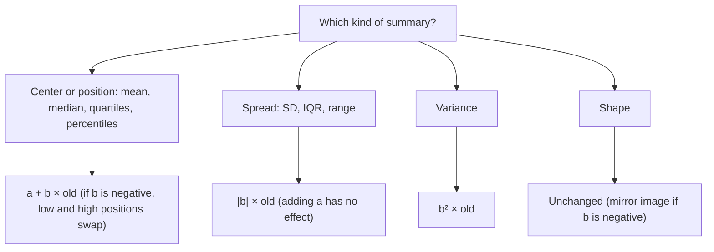

## Changing units without recomputing

Data often need converting: Celsius to Fahrenheit, feet to meters, raw scores to curved
scores, prices plus a fixed fee. Each of these is a **linear transformation**
$y = a + bx$: multiply every value by $b$, then add $a$. You don't need to recompute
summaries from scratch — they change in predictable ways. This lesson also explains
why z-scores always have mean 0 and SD 1.

## Adding a constant

If you add $a$ to every value, the whole distribution slides along the number line.

- Measures of center and position (mean, median, quartiles, percentiles, min, max) all
  increase by $a$.
- Measures of spread (range, IQR, standard deviation, variance) do *not* change: the
  distances between values are the same.
- Shape does not change.

Example: a teacher adds 5 points to every score. If the mean was 71 and the SD was 9,
the new mean is 76 and the SD is still 9.

## Multiplying by a constant

If you multiply every value by $b$ (with $b > 0$), the distribution stretches or shrinks.

- Center and position measures are multiplied by $b$.
- Range, IQR and standard deviation are multiplied by $b$; variance by $b^2$.
- Shape does not change.

Why: every deviation from the mean, $x_i - \bar{x}$, becomes $b(x_i - \bar{x})$, so each
distance scales by $b$. Squared distances scale by $b^2$.

If $b$ is negative, the distribution is also flipped: the mean is still multiplied by
$b$, but spreads are multiplied by $|b|$ (a standard deviation can't be negative), and
the order of values reverses, so a right-skewed distribution becomes left-skewed and
the old maximum becomes the new minimum.

The dotplots show both moves on the small data set 2, 3, 3, 4, 5, 7. Adding 5 slides every
dot 5 units to the right: the mean moves from 4 to 9, but the gaps between dots, and so the
SD of 1.79, stay the same. Doubling puts every dot twice as far from 0 and twice as far from
its neighbors, so the mean (8) and the SD (3.58) both double.


## Both together

For $y = a + bx$:

| Summary | New value |
|---|---|
| Mean, median, quartiles, percentiles | $a + b \times$ (old value) |
| Standard deviation, IQR, range | $\lvert b\rvert \times$ (old value) |
| Variance | $b^2 \times$ (old variance) |
| Shape | unchanged (mirror image if $b < 0$) |
| z-score of each individual | unchanged (sign flips if $b < 0$) |

The key idea: *adding affects center but not spread; multiplying affects both*.

To use the table, first sort the summary you have into one of four kinds:



The last row explains why converting units can't change how unusual a value is. A
person 1 SD above the mean height in inches is 1 SD above it in centimeters too.

### Example 1

Daily high temperatures in a city in July have mean 30 °C, standard deviation 3 °C,
median 29 °C and IQR 4 °C. Convert to Fahrenheit using $F = 32 + 1.8C$.

1. Mean: $32 + 1.8(30) = 86$ °F.
2. Median: $32 + 1.8(29) = 84.2$ °F.
3. Standard deviation: $1.8 \times 3 = 5.4$ °F (the 32 doesn't affect spread).
4. IQR: $1.8 \times 4 = 7.2$ °F.
5. Variance: $(1.8)^2(3^2) = 3.24 \times 9 = 29.16$ °F².

### Example 2

A taxi charges a $3.50 flag fee plus $2.20 per mile. Trip distances have mean 6.5 miles
and SD 4 miles. Find the mean and SD of fares.

Fare $= 3.50 + 2.20 \times \text{miles}$, so mean fare $= 3.50 + 2.20(6.5) = \$17.80$ and
SD of fares $= 2.20 \times 4 = \$8.80$.

### Example 3: standardizing

Standardizing is the transformation $z = \dfrac{x - \bar{x}}{s} = -\dfrac{\bar{x}}{s} + \dfrac{1}{s}x$,
which is linear with $a = -\bar{x}/s$ and $b = 1/s$. So:

- new mean $= -\dfrac{\bar{x}}{s} + \dfrac{1}{s}\bar{x} = 0$;
- new SD $= \dfrac{1}{s} \times s = 1$.

That proves z-scores always have mean 0 and SD 1. The shape is unchanged — standardizing
skewed data gives skewed z-scores.

### Example 4: going backward

After a curve $y = a + bx$, scores have mean 80 and SD 6. Before the curve they had mean
70 and SD 8. Find $a$ and $b$.

1. Spread: $6 = b \times 8$, so $b = 0.75$.
2. Center: $80 = a + 0.75(70) = a + 52.5$, so $a = 27.5$.

The curve is $y = 27.5 + 0.75x$ — it raises low scores more than high ones and reduces the
spread.

```plot
{"x": [0, 30], "y": [-0.03, 0.23], "grid": false, "functions": [{"f": "normpdf(x, 8, 2)"}, {"f": "normpdf(x, 18, 4)"}], "segments": [{"from": [0, 0], "to": [30, 0]}], "labels": [{"at": [8, -0.02], "text": "8"}, {"at": [18, -0.02], "text": "18"}, {"at": [10.5, 0.19], "text": "x"}, {"at": [22.5, 0.1], "text": "y"}], "caption": "y = 2 + 2x: the mean moves from 8 to 18 and the SD doubles from 2 to 4"}
```

## Nonlinear transformations are different

These rules hold only for linear transformations. For $y = x^2$ or $y = \log x$, you
cannot get the new mean by transforming the old mean: the mean of $\log x$ is not
$\log(\bar{x})$. Nonlinear transformations also change shape — that's exactly why they
are used to straighten curved relationships in Module 3.

### Example 5: what stays the same

A class's exam scores have mean 64, standard deviation 10, and Rosa scored 79. The teacher
rescales with $y = 20 + 1.0x$ for some sections and $y = 1.25x$ for others. Where does Rosa
stand afterward?

1. Original: $z = (79 - 64)/10 = 1.5$.
2. Under $y = 20 + x$: new mean 84, SD 10, Rosa's score 99. $z = (99 - 84)/10 = 1.5$.
3. Under $y = 1.25x$: new mean 80, SD 12.5, Rosa's score 98.75. $z = (98.75 - 80)/12.5 = 1.5$.

Her z-score — and therefore her percentile — is unchanged by any linear rescaling with a
positive multiplier. Curving a test changes the numbers on the page, not anyone's rank. That
is a useful check: if a transformation seems to change who is "above average," something in
the calculation is wrong.

## Common mistakes

- Adding the constant to the standard deviation or IQR.
- Multiplying the variance by $b$ instead of $b^2$.
- Giving a negative standard deviation when $b < 0$.
- Applying the rules to nonlinear changes such as squaring or taking logs.

## Key points

- For $y = a + bx$: centers and positions become $a + b(\text{old})$; SD, IQR and range
  become $|b|(\text{old})$; variance becomes $b^2(\text{old})$.
- Adding a constant shifts; multiplying rescales; shape stays the same.
- Standardizing is a linear transformation, which is why z-scores have mean 0 and SD 1.
