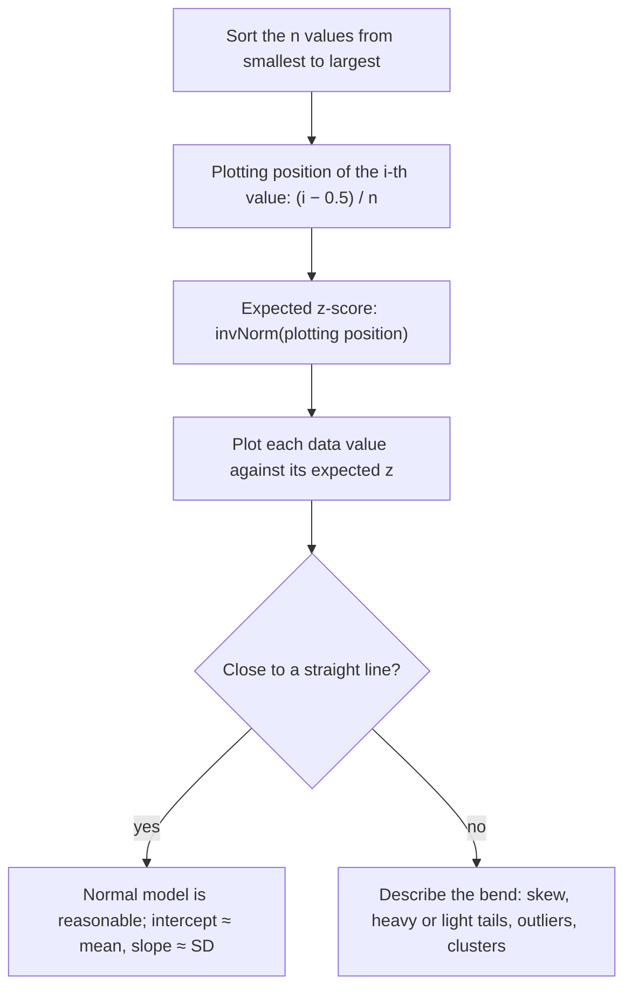

## Checking the model before trusting it

Every calculation in the lesson on normal calculations started from the words "$X$ is
approximately normal." That lesson ended with a quick check, the normal probability plot:
if the points lie close to a straight line, a normal model is reasonable. This honors
lesson looks at that plot closely. You will build one by hand, see *why* normal data line
up, learn to read each kind of bend (skewness, heavy or light tails, outliers), judge how
straight is straight enough for a small sample, and decide what to do when the plot is not
straight. Statistical software draws these plots for you, and so do graphing calculators,
but reading them well takes practice.

## Building the plot

Suppose you have $n$ values. Sort them from smallest to largest and number them
$i = 1, 2, \ldots, n$.

1. Give the $i$-th smallest value the **plotting position** $p_i = \dfrac{i - 0.5}{n}$. This
   is the proportion of the distribution you would expect at or below that value. The
   "$-0.5$" puts each value in the middle of its share of the data: with 10 values, the
   smallest stands for the lowest tenth, so it sits at 0.05, not at 0.10 or at 0.
2. Turn each plotting position into an **expected z-score**, $z_i = \Phi^{-1}(p_i)$
   (`invNorm` on a calculator). This is the z-score the $i$-th smallest value would have if
   the data came from a perfectly normal distribution.
3. Plot each data value against its expected z-score.

Why not use $i/n$? The largest value would get position $n/n = 1$, and $\Phi^{-1}(1)$ is
infinite. Other conventions exist, such as $i/(n + 1)$ or $(i - 0.375)/(n + 0.25)$, and
calculators and software differ. The plotted points move very slightly, but the shape you
read is the same. Software also differs on which axis gets the data; this course puts the
expected z-scores across and the data values up, so always check the axis labels first.



### Example 1: a plot by hand

Eight measurements of the time (in seconds) a railway signal takes to clear are 41, 44,
45, 47, 48, 50, 51 and 54. Build the normal probability plot.

| $i$ | 1 | 2 | 3 | 4 | 5 | 6 | 7 | 8 |
|---|---|---|---|---|---|---|---|---|
| $p_i = (i - 0.5)/8$ | 0.0625 | 0.1875 | 0.3125 | 0.4375 | 0.5625 | 0.6875 | 0.8125 | 0.9375 |
| $z_i = \Phi^{-1}(p_i)$ | −1.53 | −0.89 | −0.49 | −0.16 | 0.16 | 0.49 | 0.89 | 1.53 |
| value | 41 | 44 | 45 | 47 | 48 | 50 | 51 | 54 |

The expected z-scores are symmetric about 0, because the plotting positions are symmetric
about 0.5. Plotting the pairs:

```plot
{"x": [-2, 2], "y": [38, 58], "xLabel": "expected z-score", "yLabel": "clearing time (s)", "points": [{"at": [-1.53, 41], "color": "#2c5e8f"}, {"at": [-0.89, 44], "color": "#2c5e8f"}, {"at": [-0.49, 45], "color": "#2c5e8f"}, {"at": [-0.16, 47], "color": "#2c5e8f"}, {"at": [0.16, 48], "color": "#2c5e8f"}, {"at": [0.49, 50], "color": "#2c5e8f"}, {"at": [0.89, 51], "color": "#2c5e8f"}, {"at": [1.53, 54], "color": "#2c5e8f"}], "functions": [{"f": "47.5 + 4.2*x", "dashed": true}], "caption": "The eight clearing times lie close to the line 47.5 + 4.2z"}
```

The points lie close to a line, so a normal model is reasonable. The line crosses $z = 0$
at about 47.5 and rises about 4.2 seconds per unit of $z$. Compare the summary statistics:
the mean is 47.5 seconds and the standard deviation is 4.18 seconds. That match is not a
coincidence.

## Why normal data fall on a line

For a normal distribution $N(\mu, \sigma)$, inverse normal says the value with proportion
$p$ below it is $\mu + z_p\sigma$, where $z_p = \Phi^{-1}(p)$. A value with a given
proportion below it is called a **quantile**: the 0.90 quantile is the 90th percentile.
In a sample, the $i$-th smallest value estimates the quantile at its plotting position, so
for normal data

$$x_{(i)} \approx \mu + \sigma z_i.$$

That is the equation of a straight line in $z_i$, with intercept $\mu$ and slope $\sigma$.
Every normal distribution gives a straight line; only the intercept and slope change. That
is why one kind of plot checks for every normal model at once, and why the plot is also
called a *normal quantile plot*. Data from a non-normal distribution have quantiles that are
spaced differently from normal ones, so the points bend away from any line.

The labeled plot below shows the parts. Twelve values are plotted; a reference line is
fitted to the middle of the data, where it crosses $z = 0$ near the center of the data. The
largest value sits far above the line: an outlier.


## Reading the shape

The key is to compare *gaps*. Moving one step to the right on the plot, how far up do the
data move? In normal data the gaps between neighboring values are smallest in the middle and
grow toward both ends, in just the way the expected z-scores do, so the points stay on the
line. Departures show up as bends:

- *Right skew*: the low values are bunched together and the high values are spread far
  apart. The plot is flat at the left and steep at the right, a curve that bends upward
  (concave up). Both ends lie above a line fitted through the middle.
- *Left skew*: the mirror image. The plot bends downward (concave down), with both ends
  below the line.
- **Heavy tails**: the extremes on *both* sides are farther out than a normal model
  predicts. The lowest points fall below the line and the highest rise above it, an S shape
  that is steep at both ends.
- **Light tails**: the extremes on both sides are closer in than normal, as in a uniform
  distribution. The opposite S: flat at both ends.
- *Outliers*: single points far off the line at one end.
- *Gaps or clusters*: a jump in the middle of the plot can mean two groups mixed together.
- *Horizontal steps*: several points at exactly the same value, usually because the data
  were rounded. Steps alone are not evidence against normality.

The quick test that separates skew from tails: with skew, both ends bend the *same* way
(both above or both below the line); with heavy or light tails, the ends bend *opposite*
ways.

![Six small normal probability plots, each with a dashed line through the quartiles. Roughly normal: points on the line. Right-skewed: a curve bending upward, with both ends above the line. Left-skewed: a curve bending downward, with both ends below the line. Heavy tails: an S shape, lowest points below the line and highest points above it. Light tails: the opposite S, lowest points above and highest points below. One high outlier: points on the line except a single point far above it at the right.](images/stat-m2-qq-shapes.svg)

### Example 2: diagnosing skew from the gaps

Ten commute times, in minutes, are 12, 13, 13, 14, 15, 16, 18, 21, 26 and 35. Without
plotting, predict the shape of the normal probability plot.

1. Expected z-scores for $n = 10$: −1.64, −1.04, −0.67, −0.39, −0.13, 0.13, 0.39, 0.67,
   1.04, 1.64. Their gaps are symmetric: 0.61, 0.36, 0.29, 0.26, 0.25, 0.26, 0.29, 0.36,
   0.61.
2. Gaps in the data: 1, 0, 1, 1, 1, 2, 3, 5, 9. The low end is tightly bunched (gaps of 1
   and 0 where the z gaps are largest), while the high end is spread far apart (5 and 9).
3. So the plot is nearly flat at the left and climbs steeply at the right: it bends upward.
   The data are right-skewed. The value 35 is also an outlier by the $1.5 \times \text{IQR}$
   rule: $Q_1 = 13$, $Q_3 = 21$, and the upper fence is $21 + 1.5(8) = 33$.

## How straight is straight enough?

Even samples drawn from a perfectly normal distribution give wiggly plots, especially small
ones. One way to measure straightness is the correlation $r$ between the expected z-scores
and the data values, called the **probability plot correlation**. For normal data it is
close to 1. To judge "close," compare with what genuinely normal samples produce. A computer
simulation with the $(i - 0.5)/n$ plotting positions gives these approximate cutoffs: only
about 5% of truly normal samples have $r$ below

| $n$ | 10 | 20 | 50 | 100 |
|---|---|---|---|---|
| 5% cutoff for $r$ | 0.919 | 0.951 | 0.977 | 0.987 |

(Published tables, starting with J. J. Filliben's in 1975, give nearly the same values.)
The commute times in Example 2 have $r = 0.902$, below 0.919, so their bend is more than
chance wiggle: evidence against a normal model. The clearing times in Example 1 have
$r = 0.998$, no evidence against it. Formal tests of normality, such as the Shapiro–Wilk
test (1965), are built on a closely related idea; they are beyond this course.

Two cautions. With a small sample, real skewness can pass the check: absence of evidence is
not proof of normality. With a very large sample, the check flags departures too small to
matter for most purposes. Use the plot together with context, such as whether the variable
can be negative.

## When the plot is not straight

You have three main options.

- *Transform the data.* Right-skewed positive data often become close to normal after
  taking logarithms, the same tool used in Module 3 to straighten curved scatterplots.
- *Use the data directly.* If the question is about a tail ("what fraction of repairs take
  over 20 hours?"), count in the data instead of trusting a model that doesn't fit.
- *Rely on averages.* Means of many observations are close to normal even when individual
  values are not (the Central Limit Theorem, Module 7), which is why inference for means
  tolerates moderate skewness in large samples.

### Example 3: a log transformation

Ten repair times, in hours, are 3, 4, 5, 6, 7, 8, 10, 12, 15 and 22. Their mean is 9.2
hours and SD 5.83 hours. Estimate the proportion of repairs that take more than 20 hours.

1. Raw data: the plot bends upward and $r = 0.946$. That is above the cutoff of 0.919, so
   with only 10 values the plot alone does not rule out normality. But context does: a time
   cannot be negative, yet 0 is only $9.2/5.83 \approx 1.58$ SDs below the mean, so a normal
   model would put almost 6% of repairs below 0 hours.
2. Take $\log_{10}$ of each time: 0.477, 0.602, 0.699, 0.778, 0.845, 0.903, 1.000, 1.079,
   1.176, 1.342. Now $r = 0.9985$: the plot is essentially straight. The logs have mean
   0.890 and SD 0.266.
3. Log model: $\log_{10} 20 = 1.301$, so $z = (1.301 - 0.890)/0.266 \approx 1.54$ and the
   proportion above is $1 - \Phi(1.54) \approx 0.062$.
4. Raw normal model, for comparison: $z = (20 - 9.2)/5.83 \approx 1.85$, giving about
   $0.032$.

The two models disagree by a factor of 2. In the data, 1 of the 10 repairs (22 hours) took
over 20. The log model, which fits, is the one to use, and the lesson is general: models
that agree near the center can differ greatly in the tails, so tail questions are where the
plot matters most.

## Common mistakes

- Reading the axes the wrong way round. If the data are on the horizontal axis, every bend
  described above flips; check the labels first.
- Expecting a perfect line. Small normal samples wiggle; judge against the cutoffs.
- Calling horizontal steps from rounded data "non-normal."
- Confusing skew with heavy tails: skew bends both ends the same way, heavy tails bend them
  opposite ways.
- Treating a straight plot as proof that the population is normal. It only shows that a
  normal model is reasonable.
- Using a normal model for tail proportions when the plot bends at the ends.

## Key points

- Sort the data, give the $i$-th value plotting position $(i - 0.5)/n$, convert to an
  expected z-score with $\Phi^{-1}$, and plot data against expected z.
- Normal data satisfy $x_{(i)} \approx \mu + \sigma z_i$: a straight line whose intercept
  estimates the mean and whose slope estimates the SD.
- Concave up: right skew. Concave down: left skew. S shape with steep ends: heavy tails.
  S shape with flat ends: light tails. Isolated points off the line: outliers.
- The probability plot correlation measures straightness; compare it with cutoffs for the
  sample size (about 0.919 for $n = 10$, 0.987 for $n = 100$).
- When the plot is not straight, transform, use the data directly, or rely on averages. Tail
  questions are the most sensitive to the choice of model.
