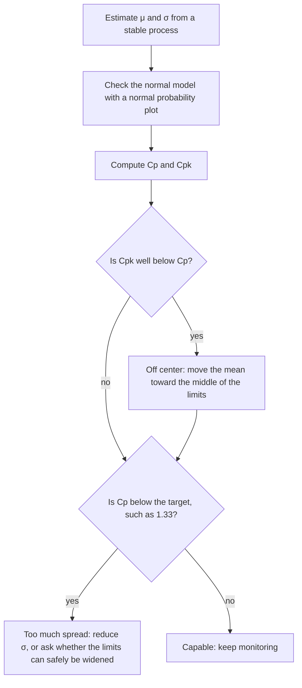

## From tail areas to quality

In the lesson on normal calculations, the question "what fraction of rail bolts are longer
than 155 mm?" was answered with a tail area. Manufacturers ask that question every day, for
every dimension of every part: bolts, brake pads, turbine blades, circuit boards. Engineering
has turned these tail areas into a small set of standard tools: *specification limits*, the
*fraction out of specification*, and the *capability indices* $C_p$ and $C_{pk}$. This honors
lesson builds those tools from the normal model you already know, shows how engineers use
them to decide what to fix, and ends with a warning about the place where the normal model
is weakest: far out in the tails.

## Specification limits and natural variation

A part's design states the range it must fall in. These are the **specification limits**:
a lower specification limit (LSL) and an upper specification limit (USL). A bolt specified
as $150 \pm 3$ mm has LSL = 147 mm and USL = 153 mm. Specification limits are set by the
designer or customer; they say what the part *must* be.

What the machine actually *does* is a different matter. If the lengths it produces are
approximately $N(\mu, \sigma)$, about 99.73% of them fall in the range $\mu \pm 3\sigma$,
often called the process's natural variation. Quality control is about how these two
ranges compare. The fraction of parts outside the limits is two tail areas:

$$P(\text{out of spec}) = \Phi\!\left(\frac{\text{LSL} - \mu}{\sigma}\right) + \left[1 - \Phi\!\left(\frac{\text{USL} - \mu}{\sigma}\right)\right].$$

Because good processes make very few bad parts, the result is usually given in
**parts per million** (ppm): the proportion times 1,000,000. A proportion of 0.0027 is 2,700 ppm.

These calculations assume the process is *stable*: its mean and SD are not drifting from
hour to hour. Engineers check that with control charts, a tool Walter Shewhart developed at
Bell Telephone Laboratories in the 1920s. A capability number for an unstable process
describes nothing in particular.

### Example 1: bolts that are slightly off center

A machine makes bolts whose lengths are approximately $N(150.3, 1.2)$ mm. The specification
is 147 to 153 mm. What fraction are out of specification?

1. Lower limit: $z = (147 - 150.3)/1.2 = -2.75$, and $\Phi(-2.75) \approx 0.0030$.
2. Upper limit: $z = (153 - 150.3)/1.2 = 2.25$, and $1 - \Phi(2.25) \approx 0.0122$.
3. Total: $0.0030 + 0.0122 = 0.0152$, about 1.5% of bolts, or roughly 15,200 ppm.

Most of the bad bolts are too long, because the mean sits 0.3 mm above the middle of the
specification.

## Capability indices

Two numbers summarize how well a process fits its specification.

The **Cp index**, written $C_p$, compares the width of the specification with the width of the
natural variation:

$$C_p = \frac{\text{USL} - \text{LSL}}{6\sigma}.$$

$C_p = 1$ means the specification is exactly as wide as $\mu \pm 3\sigma$. But $C_p$ ignores
where the mean is: it describes what the process *could* do if it were centered.

The **Cpk index**, written $C_{pk}$, accounts for centering. It measures the distance from the mean to the
*nearer* limit, in units of $3\sigma$:

$$C_{pk} = \frac{\min(\text{USL} - \mu,\ \mu - \text{LSL})}{3\sigma}.$$

Three facts follow from the formulas. $C_{pk}$ is never larger than $C_p$, and the two are
equal exactly when the mean is in the middle of the limits. $C_{pk}$ is negative if the mean
is outside the limits. And the nearer limit is $3C_{pk}$ standard deviations from the mean,
which connects $C_{pk}$ straight to z-scores and tail areas. For a centered process:

| $C_p = C_{pk}$ | Each limit is | Out of spec (both tails) |
|---|---|---|
| 1.00 | $3\sigma$ from the mean | about 2,700 ppm |
| 1.33 | $4\sigma$ from the mean | about 63 ppm |
| 1.67 | $5\sigma$ from the mean | about 0.6 ppm |
| 2.00 | $6\sigma$ from the mean | about 0.002 ppm |

Each extra standard deviation of room cuts defects by a large factor, because normal tails
thin out very fast. Many manufacturers ask suppliers for $C_{pk}$ of at least 1.33, and some
require 1.67 or more for new or safety-critical parts. These targets are industry conventions,
not results of statistics, and they vary from one industry to another.

### Example 2: indices for the bolts

For Example 1, the specification width is $153 - 147 = 6$ mm and $6\sigma = 7.2$ mm.

1. $C_p = 6/7.2 \approx 0.83$. Even perfectly centered, the natural variation is wider than
   the specification.
2. Distances to the limits: $153 - 150.3 = 2.7$ and $150.3 - 147 = 3.3$. The nearer is 2.7.
3. $C_{pk} = 2.7/(3 \times 1.2) = 2.7/3.6 = 0.75$.

Both are below 1: the process is not capable of meeting this specification.

## Two ways to improve: center or shrink

There are two levers. Moving the mean is often easy (adjust a machine setting). Reducing
$\sigma$ is usually harder (better tooling, materials or training) but often more powerful.
For the bolts:

| Change | $C_p$ | $C_{pk}$ | Out of spec |
|---|---|---|---|
| None: $\mu = 150.3$, $\sigma = 1.2$ | 0.83 | 0.75 | about 15,200 ppm |
| Center: $\mu = 150$, $\sigma = 1.2$ | 0.83 | 0.83 | about 12,400 ppm |
| Shrink: $\mu = 150.3$, $\sigma = 0.75$ | 1.33 | 1.20 | about 165 ppm |
| Both: $\mu = 150$, $\sigma = 0.75$ | 1.33 | 1.33 | about 63 ppm |

Here centering alone helps only a little, because the process is too wide. When a process is
narrow but badly off center, the reverse is true. The diagram shows the usual order of
questions.

### Example 3: how small must σ be?

The bolt specification stays 147 to 153 mm. The customer requires $C_{pk} \ge 1.33$. What is
the largest $\sigma$ that meets this (a) if the mean is held at 150, (b) if it stays at
150.3? (c) Separately, what $\sigma$ keeps the fraction of too-long bolts at 0.1% if the mean
is 150?

1. (a) The nearer limit is 3 mm away. $C_{pk} = 3/(3\sigma) \ge 1.33$ gives
   $\sigma \le 3/(3 \times 1.33) \approx 0.75$ mm. In general,
   $\sigma_{\max} = \dfrac{\text{distance to the nearer limit}}{3 \times \text{target } C_{pk}}$.
2. (b) The nearer limit is 2.7 mm away: $\sigma \le 2.7/(3 \times 1.33) \approx 0.68$ mm.
   Being off center costs about 10% of the allowed spread.
3. (c) This is the "find $\sigma$" problem from the lesson on normal calculations. 0.1% above
   153 means 99.9% below, so $z = \Phi^{-1}(0.999) \approx 3.09$. Then
   $3.09 = (153 - 150)/\sigma$, so $\sigma \approx 0.97$ mm.

## Six Sigma and the 1.5σ shift

In the 1980s the electronics company Motorola launched a quality program called **Six Sigma**,
with the goal of processes whose specification limits are 6 standard deviations
from the mean ($C_p = 2$). A centered six-sigma process would produce about 0.002 ppm out of
specification, roughly 2 parts per billion.

The figure usually quoted for Six Sigma, though, is 3.4 defects per million. That number
assumes that over the long run the mean drifts as much as $1.5\sigma$ toward one limit, which
leaves the nearer limit $6 - 1.5 = 4.5$ standard deviations away: $1 - \Phi(4.5) \approx
3.4 \times 10^{-6}$. The $1.5\sigma$ shift is a convention adopted from industrial experience,
not a law of statistics, and statisticians have long debated it. Treat "3.4 per million" as a
target that rests on that assumption.

## The tails are where the model is weakest

A capability calculation for a good process is a statement about the normal curve 4, 5 or
6 standard deviations from the mean. A study of 100 or even 1,000 parts has almost no data
that far out, so those ppm figures come from the model's shape, not from observed parts. If
the real distribution has heavier tails than normal (for example, an occasional bad batch of
material, or two machines with slightly different settings mixed together), the true defect
rate can be many times the predicted one.

### Example 4: checking the prediction

A process is centered with $C_{pk} = 1.33$, so the normal model predicts about 63 ppm out of
specification. In a run of 20,000 parts, how many out-of-spec parts should you expect, and
what would 9 mean?

1. Expected count: $20{,}000 \times 0.000063 \approx 1.3$ parts.
2. Finding 9 is about seven times the prediction. Either the process changed during the run
   or its tails are heavier than normal. (This example is illustrative.)
3. The response: look at the ends of a normal probability plot of the data, check the
   process for instability, and trust direct counts of defects over model predictions when
   they disagree.

## Common mistakes

- Confusing specification limits (what the design requires) with natural variation (what the
  process produces, about $\mu \pm 3\sigma$).
- Reporting only $C_p$ for an off-center process. $C_p$ assumes centering; $C_{pk}$ does not.
- Dividing by $6\sigma$ in $C_{pk}$. Each side of the process gets only $3\sigma$.
- Adding only one tail when both limits matter.
- Computing capability for an unstable process, or from a non-normal distribution without
  checking.
- Quoting tiny ppm predictions as if they were measured, or taking 3.4 per million as a law.

## Key points

- Fraction out of spec $= \Phi\!\left(\frac{\text{LSL} - \mu}{\sigma}\right) + 1 - \Phi\!\left(\frac{\text{USL} - \mu}{\sigma}\right)$;
  multiply by 1,000,000 for ppm.
- $C_p = (\text{USL} - \text{LSL})/(6\sigma)$ ignores centering;
  $C_{pk} = \min(\text{USL} - \mu, \mu - \text{LSL})/(3\sigma)$ includes it, and $C_{pk} \le C_p$.
- The nearer limit is $3C_{pk}$ standard deviations away: $C_{pk} = 1$ puts it at $3\sigma$,
  1.33 at $4\sigma$, 2 at $6\sigma$.
- Improve capability by centering the mean and by reducing $\sigma$.
- Six Sigma's 3.4 per million assumes a conventional $1.5\sigma$ drift.
- Defect predictions depend on the far tails of the model; check them against real counts.
