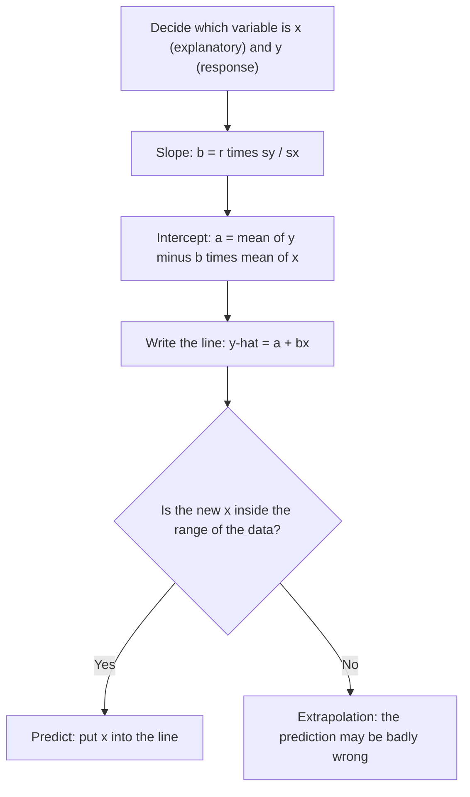

## From describing to predicting

Correlation says how tightly points cluster around a line. Regression finds *the* line,
so we can predict $y$ from $x$. This lesson derives the least-squares regression line
from the summary statistics you already know and explains how to interpret its slope
and intercept — and when not to trust a prediction.

## The regression line

A **regression line** is a straight line that describes how a response variable $y$
changes as an explanatory variable $x$ changes. We write it as

$$\hat{y} = a + bx,$$

where $\hat{y}$ ("y-hat") is the *predicted* value of $y$, $b$ is the slope and $a$ is
the $y$-intercept. The hat is a reminder that $\hat{y}$ is a prediction, not an observed
value. (Some books write $\hat{y} = b_0 + b_1x$; calculators often use $y = a + bx$ or
$y = ax + b$ — check which letter is the slope.)

## Least squares

Many lines could be drawn through a cloud of points. For each point, the vertical miss
is the **residual**:

$$\text{residual} = y - \hat{y} = \text{observed} - \text{predicted}.$$

The **least-squares regression line** (LSRL) is the line that makes the sum of squared
residuals, $\sum (y_i - \hat{y}_i)^2$, as small as possible. Squaring treats points above
and below the line alike and penalizes big misses heavily, and it leads to simple
formulas:

$$b = r\,\frac{s_y}{s_x}, \qquad a = \bar{y} - b\bar{x}.$$

### Why these formulas

- The intercept formula says $\bar{y} = a + b\bar{x}$: *the LSRL always passes through
  the point $(\bar{x}, \bar{y})$*. That's what minimizing the squared residuals forces —
  any line not through the point of means can be shifted up or down to reduce the sum.
- The slope formula says: in standardized units, the line rises $r$ standard deviations of
  $y$ for every one standard deviation of $x$. When $r = 1$ the line rises one $s_y$ per
  $s_x$; when $r = 0$ it is flat at $\bar{y}$. (Minimizing the squared-error sum directly gives the equivalent
  $b = S_{xy}/S_{xx}$, where $S_{xy} = \sum (x_i - \bar{x})(y_i - \bar{y})$ and
  $S_{xx} = \sum (x_i - \bar{x})^2$.)

### Example 1: from raw data

Use the training data from the last lesson: $(1, 3), (2, 5), (3, 4), (4, 7), (5, 6)$, where
we found $\bar{x} = 3$, $\bar{y} = 5$, $S_{xy} = 8$, $S_{xx} = 10$.

1. Slope: $b = S_{xy}/S_{xx} = 8/10 = 0.8$.
2. Intercept: $a = \bar{y} - b\bar{x} = 5 - 0.8(3) = 2.6$.
3. Equation: $\hat{y} = 2.6 + 0.8x$.

Check with the other formula: $s_x = s_y = \sqrt{10/4} \approx 1.581$ and $r = 0.8$, so
$b = 0.8 \times 1.581/1.581 = 0.8$. ✓

```plot
{"x": [0, 6], "y": [0, 8], "xLabel": "weeks", "yLabel": "score", "points": [{"at": [1, 3], "color": "#2c5e8f"}, {"at": [2, 5], "color": "#2c5e8f"}, {"at": [3, 4], "color": "#2c5e8f"}, {"at": [4, 7], "color": "#2c5e8f"}, {"at": [5, 6], "color": "#2c5e8f"}, {"at": [3, 5], "label": "(x̄, ȳ)", "open": true, "color": "#c2570c"}], "functions": [{"f": "2.6 + 0.8*x", "color": "#c2570c"}], "caption": "ŷ = 2.6 + 0.8x passes through (x̄, ȳ) = (3, 5)"}
```

The same line with every part named: the point $(4, 7)$ is observed, the line predicts
$\hat{y} = 5.8$ at $x = 4$, and the gap between them is that point's residual.


### Example 2: from summary statistics

For homes in a town, square footage $x$ (in hundreds) has $\bar{x} = 18$, $s_x = 4$; price
$y$ (thousands of dollars) has $\bar{y} = 310$, $s_y = 60$; and $r = 0.75$.

1. $b = 0.75 \times 60/4 = 11.25$.
2. $a = 310 - 11.25(18) = 310 - 202.5 = 107.5$.
3. $\hat{y} = 107.5 + 11.25x$.
4. Predicted price for a 2,200 sq ft home ($x = 22$): $107.5 + 11.25(22) = 355$, about
   \$355,000.

## Interpreting slope and intercept

- **Slope**: "For each additional unit of $x$, the predicted $y$ increases (or
  decreases) by $b$ units, on average." For homes: each extra 100 sq ft is associated
  with about \$11,250 more in predicted price. Note *predicted* — the slope describes the
  line, not a guaranteed change for any one home.
- **Intercept**: the predicted $y$ when $x = 0$. It is meaningful only if $x = 0$ is
  sensible and within the data. A home with 0 square feet predicted at \$107,500 is
  meaningless — the intercept is just an anchor for the line.

## Extrapolation

**Extrapolation** is using the line to predict far outside the range of $x$ values in
the data. The linear pattern may not continue. A child's height grows roughly linearly
from ages 3 to 10; extrapolating to age 40 predicts a 2.7-meter adult. Predict only within
(or very near) the observed range.

The whole procedure, from summary statistics to a trustworthy prediction:



## Regression toward the mean

Because $|r| \le 1$, a point $k$ SDs from $\bar{x}$ is predicted to be only $r \cdot k$ SDs
from $\bar{y}$ — closer to the mean. Tall parents tend to have children who are tall, but
less extremely so; a team with a record season tends to do less spectacularly the next
year. This **regression toward the mean** is a mathematical consequence of imperfect
correlation, not a force of nature, and it explains many "sophomore slumps."

## x and y are not interchangeable

Unlike correlation, the regression line depends on which variable is explanatory. The
line for predicting $y$ from $x$ minimizes vertical distances; predicting $x$ from $y$
minimizes horizontal ones and gives a different line (slope $r\,s_x/s_y$ in that
direction). Decide which variable is the response before computing.

## Common mistakes

- Writing $y$ instead of $\hat{y}$ in the equation (the line gives predictions).
- Using $b = r\,s_x/s_y$ (upside down).
- Interpreting the slope as a definite causal effect, or interpreting a meaningless
  intercept.
- Extrapolating beyond the data.
- Forgetting that the residual is observed minus predicted, not the reverse.

## Key points

- LSRL $\hat{y} = a + bx$ minimizes $\sum (y - \hat{y})^2$.
- $b = r\,s_y/s_x = S_{xy}/S_{xx}$; $a = \bar{y} - b\bar{x}$; the line passes through $(\bar{x}, \bar{y})$.
- Slope: predicted change in $y$ per unit of $x$. Intercept: predicted $y$ at $x = 0$ (often meaningless).
- Don't extrapolate. Predictions regress toward the mean.
