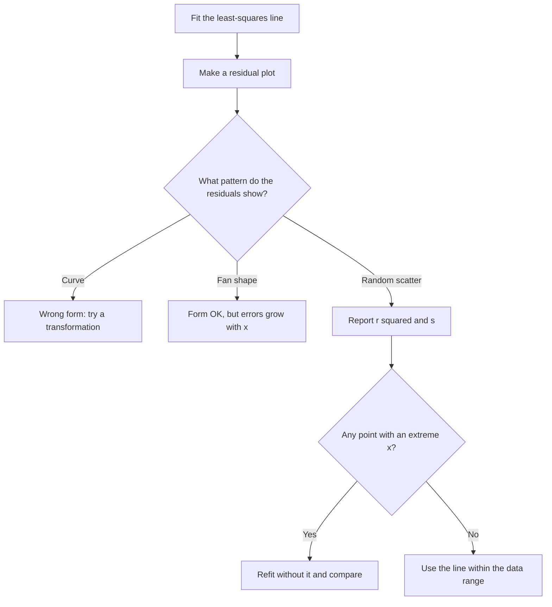

## How good is the line?

Every data set has a least-squares line, even when a line is a poor description. This
lesson gives three ways to judge the fit — residual plots, $r^2$ and the standard
deviation of the residuals — and shows how individual points can distort a regression.

## Residuals

Recall that a residual is $e = y - \hat{y}$. A positive residual means the point is
*above* the line (the line under-predicted); negative means below (over-predicted). For
any least-squares line, the residuals add to zero (and so have mean zero).

For the training data with $\hat{y} = 2.6 + 0.8x$:

| $x$ | $y$ | $\hat{y}$ | residual $y - \hat{y}$ |
|---|---|---|---|
| 1 | 3 | 3.4 | −0.4 |
| 2 | 5 | 4.2 | 0.8 |
| 3 | 4 | 5.0 | −1.0 |
| 4 | 7 | 5.8 | 1.2 |
| 5 | 6 | 6.6 | −0.6 |

The residuals sum to $0$, as promised.

## Residual plots

A **residual plot** graphs the residuals (vertical) against $x$ (or against $\hat{y}$).
It magnifies departures from the line that are hard to see on the scatterplot.

- *Random scatter* around the zero line, with no pattern: a line is an appropriate
  model.
- *A curved pattern* (for instance residuals positive at both ends, negative in the
  middle): the relationship is curved; a line is the wrong form.
- *A fan shape* (spread growing with $x$): predictions are less precise for large $x$.

```plot
{"x": [0, 10], "y": [-3, 3], "xLabel": "x", "yLabel": "residual", "points": [{"at": [1, 2.1], "color": "#2c5e8f"}, {"at": [2, 0.8], "color": "#2c5e8f"}, {"at": [3, -0.4], "color": "#2c5e8f"}, {"at": [4, -1.2], "color": "#2c5e8f"}, {"at": [5, -1.6], "color": "#2c5e8f"}, {"at": [6, -1.5], "color": "#2c5e8f"}, {"at": [7, -0.9], "color": "#2c5e8f"}, {"at": [8, 0.1], "color": "#2c5e8f"}, {"at": [9, 1.5], "color": "#2c5e8f"}], "caption": "A curved residual pattern: a straight line is not the right model"}
```

A fan shape looks different: no curve, but the residuals spread out as $x$ grows.

```plot
{"x": [0, 10], "y": [-3, 3], "xLabel": "x", "yLabel": "residual", "functions": [{"f": "0", "dashed": true}], "points": [{"at": [1, 0.3], "color": "#2c5e8f"}, {"at": [1.5, -0.4], "color": "#2c5e8f"}, {"at": [2, 0.2], "color": "#2c5e8f"}, {"at": [3, -0.6], "color": "#2c5e8f"}, {"at": [3.5, 0.8], "color": "#2c5e8f"}, {"at": [4, -0.3], "color": "#2c5e8f"}, {"at": [5, 1.1], "color": "#2c5e8f"}, {"at": [5.5, -1.2], "color": "#2c5e8f"}, {"at": [6, 0.5], "color": "#2c5e8f"}, {"at": [7, -1.7], "color": "#2c5e8f"}, {"at": [7.5, 1.9], "color": "#2c5e8f"}, {"at": [8, -0.8], "color": "#2c5e8f"}, {"at": [9, 2.4], "color": "#2c5e8f"}, {"at": [9.5, -2.2], "color": "#2c5e8f"}], "caption": "A fan-shaped residual plot: the line's form is fine, but predictions are less precise for large x"}
```

## The coefficient of determination r²

The square of the correlation, $r^2$, is called the **coefficient of determination**. It
has a clean meaning: the fraction of the variation in $y$ that is accounted for by the
linear relationship with $x$.

$$r^2 = 1 - \frac{\sum (y - \hat{y})^2}{\sum (y - \bar{y})^2} = 1 - \frac{\text{SSE}}{\text{SST}}.$$

Why: $\text{SST} = \sum (y - \bar{y})^2$ is the total variation in $y$ — the squared
error you'd make predicting every $y$ by $\bar{y}$, ignoring $x$. $\text{SSE}$ is the
squared error left after using the line. So $1 - \text{SSE}/\text{SST}$ is the fraction
of the original squared error that the line removes.

For the training data: $\text{SST} = S_{yy} = 10$ (from the correlation lesson), and
$\text{SSE} = 0.16 + 0.64 + 1 + 1.44 + 0.36 = 3.6$. So $r^2 = 1 - 3.6/10 = 0.64$, which is
$0.8^2$. ✓

Interpretation template: "About 64% of the variation in skill score is accounted for by
the linear relationship with weeks of training."

Going back from $r^2$ to $r$: $r = \pm\sqrt{r^2}$, with the sign of the slope. If
$r^2 = 0.81$ and the slope is negative, $r = -0.9$.

## The standard deviation of the residuals

The typical size of a prediction error is measured by

$$s = \sqrt{\frac{\sum (y - \hat{y})^2}{n - 2}} = \sqrt{\frac{\text{SSE}}{n-2}}.$$

We divide by $n - 2$ because two quantities (slope and intercept) were estimated from the
data. For the training data, $s = \sqrt{3.6/3} \approx 1.10$: predictions of skill
score are typically off by about 1.1 points. $r^2$ is a percentage with no units; $s$ is
in the units of $y$. Report both.

Putting the checks in order:



## Outliers, leverage and influential points

*AP exam scope:* the AP Statistics framework that took effect in the 2026–27 school year
removed the topic "analyzing departures from linearity," which covered this section's
outliers, high-leverage points and influential points (and the transformations of the next
lesson). The ideas are still standard in introductory college statistics and worth knowing
when you read any regression, but they are no longer tested on their own.

- An **outlier** in regression is a point with a large residual — far from the line in
  the $y$ direction.
- A point has high **leverage** if its $x$ value is far from $\bar{x}$. Such points pull on
  the line like a long lever.
- A point is **influential** if removing it would markedly change the slope, intercept
  or correlation. High-leverage points are often influential, especially when they don't
  follow the pattern of the rest.

An influential point may have a *small* residual — because it has pulled the line
toward itself. So don't hunt for influential points by looking at residuals; refit
without the point and compare.

```plot
{"x": [0, 16], "y": [0, 12], "xLabel": "x", "yLabel": "y", "points": [{"at": [1, 4], "color": "#2c5e8f"}, {"at": [2, 5], "color": "#2c5e8f"}, {"at": [3, 4.5], "color": "#2c5e8f"}, {"at": [4, 6], "color": "#2c5e8f"}, {"at": [5, 6.5], "color": "#2c5e8f"}, {"at": [6, 7.5], "color": "#2c5e8f"}, {"at": [15, 2], "label": "P", "color": "#c53030"}], "functions": [{"f": "3.233 + 0.671*x", "dashed": true}, {"f": "5.998 - 0.180*x", "color": "#c53030"}], "caption": "One high-leverage point P flips the slope (dashed: fit without P; solid: fit with P)"}
```

The three kinds of unusual point side by side. Each panel has the same eight points plus one
circled point, with the line fitted with it (solid) and without it (dashed).

![Three scatterplots of the same eight points rising along a line, each with one extra circled point. Point A, at x = 4.5 and well above the others, is an outlier with a large residual; the line with it is only slightly higher than the line without it. Point B, at x = 16 and lying on the trend of the other points, has high leverage but follows the pattern, so the two lines coincide. Point C, at x = 16 and far below the trend, is influential: it drags the fitted line almost flat, while the line without it rises steeply.](images/stat-m3-unusual-points.svg)

The numbers behind the panels: without the circled point the line is $\hat{y} = 2.125 + 0.475x$
with $r \approx 0.97$. A sits at $x = 4.5$, the mean of the other $x$ values, so it has the least
possible leverage: adding it only raises the intercept a little (to about 2.48), keeps the slope at 0.475, and lowers $r$ to about 0.70, and A's
residual (about 2.9) is the largest in any panel. Adding B leaves the line almost unchanged
and raises $r$ to about 0.99. Adding C drops the slope to about 0.01 and $r$ to about 0.04, yet
C's residual (about −1.7) is *smaller* than A's: C has pulled the line toward itself.

### Example 1

A regression of salary on years of experience for 30 employees gives $r = 0.52$. One
employee, the founder, has 40 years of experience while everyone else has under 15.
Removing the founder changes $r$ to 0.31 and the slope from 2.1 to 1.2 (thousands per
year). The founder is influential: one point accounts for a large share of the apparent
relationship. Report both analyses and explain.

### Example 2

For a regression of fuel used (gallons) on distance (miles) with $\hat{y} = 0.4 + 0.035x$,
a trip of 300 miles used 11.9 gallons. Find and interpret the residual.

1. $\hat{y} = 0.4 + 0.035(300) = 0.4 + 10.5 = 10.9$ gallons.
2. Residual $= 11.9 - 10.9 = 1.0$ gallon.
3. This trip used 1 gallon *more* than the line predicts — the point is above the line.

### Example 3

A study reports $r^2 = 0.36$ and a negative slope. What is $r$? $r = -\sqrt{0.36} = -0.6$.
Only 36% of the variation in the response is explained by the linear relationship.

## Common mistakes

- Computing a residual as predicted minus observed.
- Saying "$r^2 = 0.64$ means the line is correct 64% of the time" or "64% of the points
  are on the line." It is a fraction of *variation* explained.
- Forgetting the sign when taking $\sqrt{r^2}$.
- Judging fit by $r^2$ alone; a curved pattern can have a high $r^2$. Check the residual plot.
- Assuming an influential point must have a big residual.

## Key points

- Residual $= y - \hat{y}$; residuals of an LSRL sum to 0.
- Residual plot: random scatter means a line fits; curves or fans signal problems.
- $r^2 = 1 - \text{SSE}/\text{SST}$: fraction of variation in $y$ explained by the line.
- $s = \sqrt{\text{SSE}/(n-2)}$: typical prediction error, in $y$'s units.
- Outliers have big residuals; high-leverage points have extreme $x$; influential points
  change the fit when removed.
