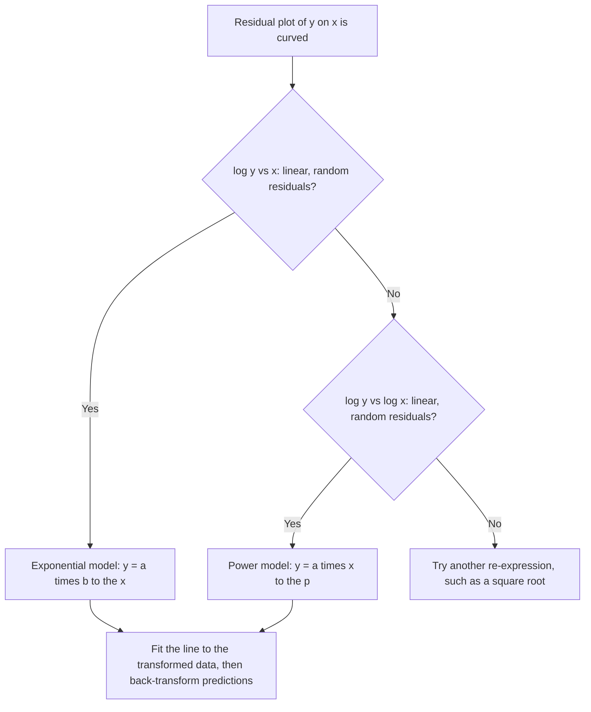

## When the residual plot curves

The last lesson showed how a curved residual plot signals that a straight line is the
wrong model. Many real relationships are curved: populations grow exponentially, the
weight of an animal grows like a power of its length, the brightness of a light falls
off with the square of distance. Rather than learn a new fitting method for each curve,
statisticians *transform* one or both variables so that the relationship becomes
linear, fit a least-squares line to the transformed data, and then transform back to
make predictions.

*AP exam scope:* transformations to achieve linearity were part of the "analyzing
departures from linearity" topic, which the AP Statistics framework removed starting in the
2026–27 school year. Treat this lesson as enrichment if you are preparing for a current AP
exam; it remains part of many college statistics courses and of older AP exams.

## The idea in one line

If $y$ depends on $x$ in a known curved way, find a function that "undoes" the
curvature. Logarithms are the workhorse because they turn multiplication into addition
and powers into multiplication:

$$\log(ab) = \log a + \log b, \qquad \log(a^k) = k \log a.$$

Either common logs ($\log_{10}$) or natural logs ($\ln$) work, as long as you undo with
the matching inverse ($10^{(\cdot)}$ or $e^{(\cdot)}$).

## Exponential models: transform y

An **exponential model** has the form $y = ab^x$: each unit increase in $x$ multiplies
$y$ by the constant factor $b$ (growth if $b > 1$, decay if $0 < b < 1$). Taking logs:

$$\log y = \log a + x \log b.$$

That is a straight line in $x$ and $\log y$, with intercept $\log a$ and slope $\log b$.
So: *if a plot of $\log y$ against $x$ is linear, an exponential model fits*.

## Power models: transform both

A **power model** has the form $y = ax^p$. Taking logs:

$$\log y = \log a + p \log x.$$

This is linear in $\log x$ and $\log y$ with slope $p$. So: *if a plot of $\log y$
against $\log x$ is linear, a power model fits*. Power models describe geometric scaling
(area grows like length², volume like length³) and many physical laws.

| Model | Linearizing plot | Fitted line | Back-transform |
|---|---|---|---|
| Exponential $y = ab^x$ | $\log y$ vs. $x$ | $\widehat{\log y} = c + dx$ | $\hat{y} = 10^{c + dx}$ |
| Power $y = ax^p$ | $\log y$ vs. $\log x$ | $\widehat{\log y} = c + d\log x$ | $\hat{y} = 10^{c}x^{d}$ |
| Square-root-type | $\sqrt{y}$ vs. $x$ (or $y$ vs. $\sqrt{x}$) | $\widehat{\sqrt{y}} = c + dx$ | $\hat{y} = (c + dx)^2$ |

## Choosing a transformation

1. Plot $y$ against $x$ and look at the residual plot from a straight-line fit. A
   systematic curve says "transform."
2. Try the candidate transformations and plot each one.
3. Choose the one whose scatterplot is most linear *and* whose residual plot shows
   random scatter. A higher $r^2$ alone is not enough — check residuals.



### Example 1: exponential growth

A colony of bacteria is counted each hour:

| Hour $x$ | 0 | 1 | 2 | 3 | 4 | 5 |
|---|---|---|---|---|---|---|
| Count $y$ | 20 | 31 | 44 | 70 | 105 | 160 |

A straight line fitted to $y$ gives $r = 0.957$, but its residual plot is clearly curved
(positive at the ends, negative in the middle). Plotting $\log_{10} y$ against $x$ gives
an almost perfect line ($r = 0.9996$), with least-squares fit

$$\widehat{\log y} = 1.3006 + 0.1802x.$$

Predict the count at hour 6:

1. $\widehat{\log y} = 1.3006 + 0.1802(6) = 2.3818$.
2. Undo the log: $\hat{y} = 10^{2.3818} \approx 241$.

Interpretation of the slope: $10^{0.1802} \approx 1.51$, so the model says the count is
multiplied by about 1.51 each hour (51% growth per hour).

```plot
{"x": [-0.5, 6], "y": [1.1, 2.6], "xLabel": "hour", "yLabel": "log count", "points": [{"at": [0, 1.301], "color": "#2c5e8f"}, {"at": [1, 1.491], "color": "#2c5e8f"}, {"at": [2, 1.643], "color": "#2c5e8f"}, {"at": [3, 1.845], "color": "#2c5e8f"}, {"at": [4, 2.021], "color": "#2c5e8f"}, {"at": [5, 2.204], "color": "#2c5e8f"}], "functions": [{"f": "1.3006 + 0.1802*x", "color": "#c2570c"}], "caption": "After taking log of the counts, the points lie on a line"}
```

Back on the original scale, the back-transformed model follows the counts closely, while the
straight line fitted to the raw counts ($\hat{y} \approx 3.95 + 27.09x$) runs below the points at
both ends and above them in the middle: exactly the curved residual pattern (positive, then
negative, then positive) described above.

```plot
{"x": [-0.5, 6], "y": [0, 250], "xLabel": "hour", "yLabel": "count", "points": [{"at": [0, 20], "color": "#2c5e8f"}, {"at": [1, 31], "color": "#2c5e8f"}, {"at": [2, 44], "color": "#2c5e8f"}, {"at": [3, 70], "color": "#2c5e8f"}, {"at": [4, 105], "color": "#2c5e8f"}, {"at": [5, 160], "color": "#2c5e8f"}], "functions": [{"f": "10^(1.3006 + 0.1802*x)", "color": "#c2570c", "label": "ŷ = 10^(1.3006 + 0.1802x)"}, {"f": "3.952 + 27.086*x", "dashed": true}], "labels": [{"at": [5.3, 112], "text": "straight line"}], "caption": "Bacteria counts with the back-transformed exponential model (solid) and the straight-line fit (dashed)"}
```

### Example 2: a power model

For a set of animals, $x$ = body length (m) and $y$ = mass (kg). A plot of $\ln y$ against
$\ln x$ is linear with fitted line $\widehat{\ln y} = 0.5 + 1.5\ln x$. Predict the mass
of an animal 4 m long.

1. $\ln 4 \approx 1.3863$, so $\widehat{\ln y} = 0.5 + 1.5(1.3863) = 2.5794$.
2. $\hat{y} = e^{2.5794} \approx 13.19$ kg.

Equivalently the model is $\hat{y} = e^{0.5}x^{1.5}$, and $e^{0.5} \cdot 4^{1.5} = 1.6487 \times 8 \approx 13.19$.

### Example 3: reading a fitted model

A model for a car's value is $\widehat{\log_{10}(\text{value})} = 4.5 - 0.06(\text{age})$. What
does the slope say? Each additional year multiplies the predicted value by
$10^{-0.06} \approx 0.871$ — about a 12.9% loss per year. A new car ($\text{age} = 0$) is
predicted to be worth $10^{4.5} \approx \$31{,}623$.

## Cautions

- Predictions must be **back-transformed**: if you fit $\log y$, the line predicts
  $\log y$, not $y$.
- Residuals and $r^2$ of the transformed fit are on the transformed scale.
- Extrapolation is even riskier with exponential models, which grow without bound.
- Logs require positive values.

## Common mistakes

- Reporting $\widehat{\log y}$ as the prediction of $y$.
- Using $10^{(\cdot)}$ to undo a natural log (or $e^{(\cdot)}$ to undo $\log_{10}$).
- Choosing a model by $r^2$ without checking the residual plot.
- Confusing the models: $\log y$ vs. $x$ linear means exponential; $\log y$ vs. $\log x$
  linear means power.

## Key points

- Transform to make a curved relationship linear, fit the LSRL, then back-transform.
- Exponential $y = ab^x$ ↔ $\log y$ linear in $x$; slope $\log b$, so $b = 10^{\text{slope}}$.
- Power $y = ax^p$ ↔ $\log y$ linear in $\log x$; slope $p$.
- Judge a transformation by a straight scatterplot and a patternless residual plot.
