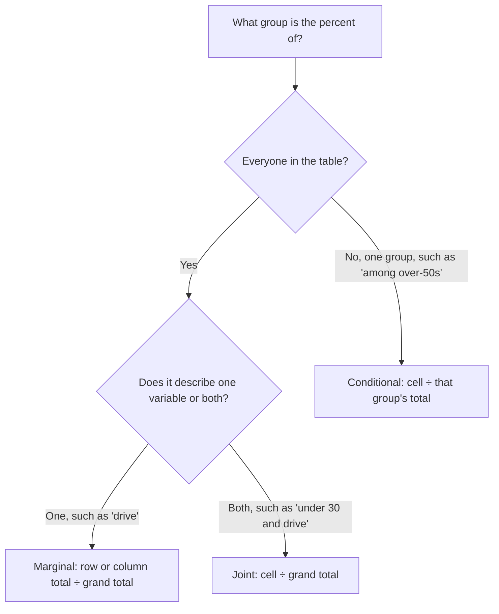

## Relationships between categorical variables

Scatterplots and correlation need two *quantitative* variables. When both variables are
categorical — age group and preferred transit mode, treatment and outcome, gender and
voting choice — the data go into a two-way table, and relationships show up as
differences between conditional distributions. These ideas lead directly to conditional
probability (Module 5) and the chi-square test (Module 9).

## Two-way tables

A **two-way table** (contingency table) counts individuals by two categorical variables
at once: one variable's categories label the rows, the other's label the columns.

A transit survey of 200 commuters:

| Age group | Train | Bus | Car | Total |
|---|---|---|---|---|
| Under 30 | 30 | 20 | 10 | 60 |
| 30–50 | 25 | 15 | 40 | 80 |
| Over 50 | 15 | 10 | 35 | 60 |
| Total | 70 | 45 | 85 | 200 |

Each inner cell is a *joint* count: 30 commuters are *both* under 30 *and* take the
train. The totals in the margins are the *marginal* counts.


## Three kinds of distribution

- The **marginal distribution** of one variable uses the row or column totals, divided by
  the grand total. Mode of transit: train $70/200 = 35\%$, bus $22.5\%$, car $42.5\%$. It
  ignores the other variable completely.
- The **joint distribution** divides each cell by the grand total: $30/200 = 15\%$ of all
  commuters are under-30 train riders.
- A **conditional distribution** describes one variable *among individuals with a given
  value of the other*: divide by that row's (or column's) total, not the grand total.

Conditional distribution of mode for each age group:

| Age group | Train | Bus | Car |
|---|---|---|---|
| Under 30 | $30/60 = 50\%$ | $33.3\%$ | $16.7\%$ |
| 30–50 | $31.25\%$ | $18.75\%$ | $50\%$ |
| Over 50 | $25\%$ | $16.7\%$ | $58.3\%$ |

Each row adds to 100%.

## Association

Two categorical variables are **associated** if the conditional distributions of one
variable differ across the categories of the other. Here the share of car commuters
rises from 16.7% (under 30) to 58.3% (over 50), so age group and transit mode are
associated. If every age group had the same distribution as the overall 35/22.5/42.5 split,
there would be no association.

A **segmented bar chart** (one bar per age group, each scaled to 100% and divided by
mode) or a **side-by-side bar chart** shows the comparison at a glance.

A **mosaic plot** is a segmented bar chart with one extra feature: each bar's *width* is
proportional to the size of its group. Here the under-30 bar would be 60 units wide, the 30–50
bar 80 units wide and the over-50 bar 60 units wide. The heights of the segments still show
each group's conditional distribution, the widths show the marginal distribution of age
group, and the area of each rectangle is proportional to its cell count.

```plot
{"x": [0.4, 3.9], "y": [-0.12, 1.05], "grid": false, "polygons": [{"points": [[0.7, 0], [1.3, 0], [1.3, 0.5], [0.7, 0.5]], "fill": true, "color": "#2c5e8f"}, {"points": [[0.7, 0.5], [1.3, 0.5], [1.3, 0.8333], [0.7, 0.8333]], "fill": true, "color": "#c2570c"}, {"points": [[0.7, 0.8333], [1.3, 0.8333], [1.3, 1], [0.7, 1]], "fill": true, "color": "#2f855a"}, {"points": [[1.7, 0], [2.3, 0], [2.3, 0.3125], [1.7, 0.3125]], "fill": true, "color": "#2c5e8f"}, {"points": [[1.7, 0.3125], [2.3, 0.3125], [2.3, 0.5], [1.7, 0.5]], "fill": true, "color": "#c2570c"}, {"points": [[1.7, 0.5], [2.3, 0.5], [2.3, 1], [1.7, 1]], "fill": true, "color": "#2f855a"}, {"points": [[2.7, 0], [3.3, 0], [3.3, 0.25], [2.7, 0.25]], "fill": true, "color": "#2c5e8f"}, {"points": [[2.7, 0.25], [3.3, 0.25], [3.3, 0.4167], [2.7, 0.4167]], "fill": true, "color": "#c2570c"}, {"points": [[2.7, 0.4167], [3.3, 0.4167], [3.3, 1], [2.7, 1]], "fill": true, "color": "#2f855a"}], "segments": [{"from": [0.5, 0], "to": [3.5, 0]}], "labels": [{"at": [1, -0.06], "text": "Under 30"}, {"at": [2, -0.06], "text": "30–50"}, {"at": [3, -0.06], "text": "Over 50"}, {"at": [3.62, 0.12], "text": "train"}, {"at": [3.6, 0.33], "text": "bus"}, {"at": [3.6, 0.7], "text": "car"}], "caption": "Segmented bar chart: the car share (top segment) grows with age"}
```

```plot
{"x": [-0.1, 2.4], "y": [-0.12, 1.05], "grid": false, "polygons": [{"points": [[0.0, 0], [0.6, 0], [0.6, 0.5], [0.0, 0.5]], "fill": true, "color": "#2c5e8f"}, {"points": [[0.0, 0.5], [0.6, 0.5], [0.6, 0.8333], [0.0, 0.8333]], "fill": true, "color": "#c2570c"}, {"points": [[0.0, 0.8333], [0.6, 0.8333], [0.6, 1.0], [0.0, 1.0]], "fill": true, "color": "#2f855a"}, {"points": [[0.64, 0], [1.44, 0], [1.44, 0.3125], [0.64, 0.3125]], "fill": true, "color": "#2c5e8f"}, {"points": [[0.64, 0.3125], [1.44, 0.3125], [1.44, 0.5], [0.64, 0.5]], "fill": true, "color": "#c2570c"}, {"points": [[0.64, 0.5], [1.44, 0.5], [1.44, 1.0], [0.64, 1.0]], "fill": true, "color": "#2f855a"}, {"points": [[1.48, 0], [2.08, 0], [2.08, 0.25], [1.48, 0.25]], "fill": true, "color": "#2c5e8f"}, {"points": [[1.48, 0.25], [2.08, 0.25], [2.08, 0.4167], [1.48, 0.4167]], "fill": true, "color": "#c2570c"}, {"points": [[1.48, 0.4167], [2.08, 0.4167], [2.08, 1.0], [1.48, 1.0]], "fill": true, "color": "#2f855a"}], "segments": [{"from": [-0.02, 0], "to": [2.1, 0]}], "labels": [{"at": [0.3, -0.06], "text": "Under 30"}, {"at": [1.04, -0.06], "text": "30–50"}, {"at": [1.78, -0.06], "text": "Over 50"}, {"at": [2.25, 0.12], "text": "train"}, {"at": [2.25, 0.33], "text": "bus"}, {"at": [2.25, 0.7], "text": "car"}], "caption": "Mosaic plot: bar widths 60 : 80 : 60 show the age-group sizes; segment heights show each group's mode split"}
```

### Example 1

Using the table, find (a) the percent of all commuters who drive, (b) the percent of
train riders who are over 50, and (c) the percent of over-50 commuters who take the train.

1. (a) Marginal: $85/200 = 42.5\%$.
2. (b) Condition on train riders (column total 70): $15/70 \approx 21.4\%$.
3. (c) Condition on over-50s (row total 60): $15/60 = 25\%$.

Parts (b) and (c) use the same cell, 15, but different denominators — the "given" group
determines the denominator. Mixing them up is the most common error with two-way tables.

To pick the denominator, ask what group the percent is *of*:



## Simpson's paradox

Combining groups can reverse an association. Two hospitals treat patients in mild or
severe condition:

| | Hospital A survived | A total | Hospital B survived | B total |
|---|---|---|---|---|
| Mild | 590 | 600 | 870 | 900 |
| Severe | 210 | 400 | 30 | 100 |
| All | 800 | 1000 | 900 | 1000 |

### Example 2

Which hospital has the better survival rate?

1. Overall: A $800/1000 = 80\%$, B $900/1000 = 90\%$ — B looks better.
2. Mild patients: A $590/600 \approx 98.3\%$, B $870/900 \approx 96.7\%$ — A is better.
3. Severe patients: A $210/400 = 52.5\%$, B $30/100 = 30\%$ — A is better.

A is better for *both* kinds of patients but worse overall, because A treats far more
severe cases (40% of its patients versus 10% for B), and severe cases have lower survival
anywhere. Condition severity is a lurking variable. This reversal is **Simpson's
paradox**: always ask whether a third variable could be hiding inside aggregated data.

### Example 3: reading the conditional distribution the other way

Among the 85 car commuters in the transit survey, what is the distribution of age group?

Divide each car count by the car column total: under 30, $10/85 \approx 11.8\%$; 30–50,
$40/85 \approx 47.1\%$; over 50, $35/85 \approx 41.2\%$. These add to 100%. Compare with the
marginal age distribution for everyone: $60/200 = 30\%$, $40\%$, $30\%$. Drivers are older
than commuters overall — the same association seen from the other direction. Whether you
condition on rows or on columns, an association shows up as conditional distributions that
differ from the marginal one; choose the direction that matches the question being asked
(here, "who drives?" rather than "how do young people travel?").

## Common mistakes

- Using the grand total as the denominator for a conditional percentage.
- Confusing "percent of train riders who are over 50" with "percent of over-50s who take
  the train."
- Concluding there's no association because the counts in a column are similar — compare
  percentages within groups, not raw counts.
- Ignoring possible lurking variables when combining groups.

## Key points

- Two-way tables count individuals by two categorical variables; inner cells are joint
  counts, margins are marginal counts.
- Marginal: total ÷ grand total. Joint: cell ÷ grand total. Conditional: cell ÷ the
  total of the given row or column.
- Variables are associated when conditional distributions differ across groups.
- Simpson's paradox: an association can reverse when a lurking variable is ignored.
