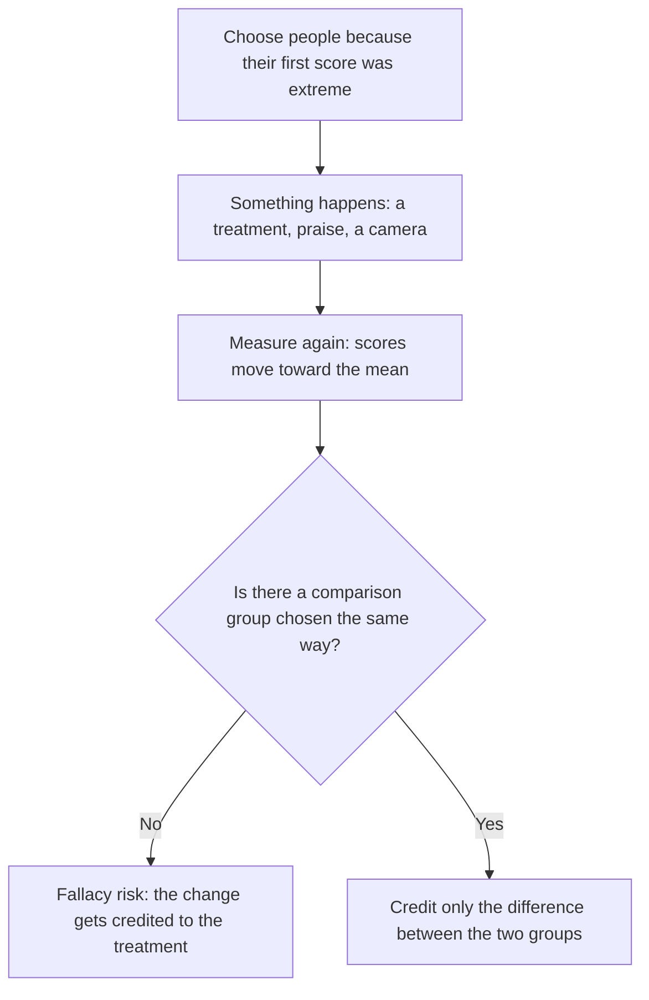

## The idea that named regression

The least-squares regression lesson ended with a short section on regression toward the mean:
because $|r| \le 1$, a prediction is always closer to the mean, in standard deviations, than
the value it was predicted from. That small fact gave regression its name, and it is behind
one of the most common reasoning errors in science, sports and everyday life. This honors
lesson tells where the idea came from, explains why it happens with a simple model of
"skill plus luck," shows how it fools people and how good study design guards against it,
and finishes with a surprise: every scatterplot has *two* regression lines.

## Galton's discovery

In the 1880s the English scientist Francis Galton collected the heights of 205 pairs of
parents and their adult children (930 children, by his count). To put men and women on one
scale he multiplied each woman's height by 1.08, and he summarized each pair of parents by
the **mid-parent height**, the average of the two parents' (adjusted) heights.

He found that children of unusually tall parents were tall, but on average less unusual than
their parents, and children of short parents were short, but less so. In his 1886 paper,
"Regression towards mediocrity in hereditary stature," he summarized it this way: a child's
deviation from the average was, on average, about two-thirds of the mid-parent's deviation.
So mid-parents 3 inches above average had children averaging about 2 inches above average.

Galton first suspected a biological pull toward the average. He then noticed the pattern runs
both ways: tall children had parents who were, on average, *less* tall than they were.
Biology can't push a generation toward the mean backward in time, so the effect had to be a
property of imperfectly related measurements. Working out how to measure "imperfectly
related" led Galton to the idea of correlation in 1888, and Karl Pearson turned it into the
formula for $r$ used today.

```plot
{"x": [-2.5, 2.5], "y": [-2.5, 2.5], "equal": true, "xLabel": "z-score of x", "yLabel": "z-score of y", "functions": [{"f": "x", "dashed": true, "label": "SD line"}, {"f": "0.6*x", "color": "#2c5e8f", "label": "y on x"}, {"f": "x/0.6", "color": "#c2570c", "label": "x on y"}], "caption": "In standard units with r = 0.6: the SD line (slope 1), the regression of y on x (slope 0.6) and the regression of x on y (slope 1/0.6 on these axes)"}
```

## The z-score form

In standard units the least-squares line is simply

$$\hat{z}_y = r\,z_x.$$

If $r = 0.6$ and an individual is 2 SDs above the mean in $x$, the predicted $y$ is only 1.2 SDs
above the mean. With $r = 1$ there is no regression; with $r = 0$ every prediction is the mean.
The weaker the relationship, the stronger the pull toward the mean.

Two misreadings are worth heading off.

- Regression to the mean does *not* make a population more uniform over time. In a stable
  population, children's heights are about as spread out as their parents'. The *predictions* are pulled in, but the
  actual values are prediction plus scatter, and the scatter refills the tails. New extreme
  individuals keep appearing; they just aren't the same individuals as before.
- It works in both directions. Predicting parents from children pulls toward the mean too.

## Why it happens: skill plus luck

A simple model makes the effect obvious. Suppose every score is a stable part plus a chance
part:

$$\text{score} = \text{true ability} + \text{luck},$$

with the luck independent from one occasion to the next. Pick the people who did best on the
first test. As a group they have high ability, but they were also, on average, lucky: being in
the top group is easier if luck helped. On a second test the ability carries over and the luck
doesn't, so the group's average falls back toward the mean. The bottom group, on average
unlucky the first time, rises.

In this model, when both tests have the same mean and SD, the correlation between them equals
the share of score variance that comes from ability rather than luck. That share is called the
test's **reliability**: the correlation between two measurements of the same thing. A very
reliable test (little luck, $r$ near 1) shows little regression; a noisy one shows a lot. (This
is a simplified model: real abilities change, practice helps, and luck isn't always
independent, but it captures why regression happens.)

### Example 1: predicting a retest

A test has mean 100 and SD 15, and a retest has the same mean and SD. Scores on the two
correlate with $r = 0.8$. Predict the retest score of a student who scored 130, and of one who
scored 82.

1. With equal SDs, the line is $\hat{y} = 100 + 0.8(x - 100)$: the predicted distance from the
   mean is 80% of the original distance.
2. Score 130 is 30 above: predicted retest $100 + 0.8(30) = 124$.
3. Score 82 is 18 below: predicted retest $100 + 0.8(-18) = 85.6$.

Both predictions move toward 100 even though nothing happened between the tests. Neither
student "got worse" or "improved"; the line is just accounting for luck.

## The regression fallacy

The **regression fallacy** is explaining a change that is just regression to the mean by some
cause: a treatment, a punishment, a jinx. It is easy to fall into because extreme cases are
exactly the ones that get attention, and so they are the ones selected for action.

- *Praise and punishment.* The psychologist Daniel Kahneman describes flight instructors in
  the Israeli Air Force who believed that praising a very good landing made the next one worse
  and shouting at a bad landing made the next one better. Both patterns are what regression
  predicts when landings vary partly by chance, with no effect from praise or shouting at all.
- *Sports.* A player with an outstanding first season usually has a less outstanding second
  one (the "sophomore slump"). Magazine-cover "jinxes" are popular stories with the same
  explanation: athletes make the cover after unusually good stretches.
- *Medicine and policy.* Patients often join a study or see a doctor when their symptoms
  are at their worst, so many improve whatever is done. Road-safety cameras are often placed at
  sites that just had an unusually bad year, so crash counts there tend to fall even without the
  camera.



The defense is a **control group** chosen the same way (Module 4): if equally extreme people
who got no treatment improve just as much, the treatment did nothing. Random assignment among
the selected people makes the two groups regress by the same amount on average.

### Example 2: did the tutoring work?

A school gives a reading test (mean 100, SD 15) and enrolls the lowest-scoring students in a
tutoring program. Their first-test average was 75. On a retest with the same mean and SD their
average is 85, a 10-point gain. Past data show $r = 0.7$ between test and retest. How much of
the gain could be regression?

1. The line predicts $100 + 0.7(75 - 100) = 100 - 17.5 = 82.5$ with no tutoring at all.
2. Regression alone accounts for $82.5 - 75 = 7.5$ of the 10 points.
3. Only about $85 - 82.5 = 2.5$ points are left that tutoring might explain, and even that
   needs a control group of similar students to confirm, since other things (practice with the
   test, for example) can raise retest scores. (Using the line to predict a group's average
   assumes the relationship is linear across the range; it is an approximation.)

## Two regression lines and the SD line

The line for predicting $y$ from $x$ minimizes vertical misses. The line for predicting $x$
from $y$ minimizes horizontal ones, and it is a different line:

$$b_{y \cdot x} = r\,\frac{s_y}{s_x}, \qquad b_{x \cdot y} = r\,\frac{s_x}{s_y}, \qquad b_{y \cdot x}\, b_{x \cdot y} = r^2.$$

Both lines pass through $(\bar{x}, \bar{y})$. Between them lies the **SD line**, which also passes
through the point of means but has slope $\pm s_y/s_x$ (the sign of $r$): it rises one SD of $y$
for each SD of $x$ and runs along the long axis of the cloud of points. Drawn on the same
$y$-versus-$x$ axes, the line for $x$ on $y$ has slope $1/b_{x \cdot y}$, so for $r > 0$:

$$r\,\frac{s_y}{s_x} \;<\; \frac{s_y}{s_x} \;<\; \frac{1}{r}\,\frac{s_y}{s_x}.$$

The regression line of $y$ on $x$ is flatter than the SD line. Your eye tends to pick the SD
line as "the line through the cloud," but the SD line over-predicts at the extremes: it ignores
the scatter, which is exactly what makes regression to the mean happen. The three lines coincide
only when $|r| = 1$.

### Example 3: both lines from summary statistics

Suppose $r = 0.6$, $s_x = 4$ and $s_y = 10$.

1. Predicting $y$ from $x$: $b_{y \cdot x} = 0.6 \times 10/4 = 1.5$.
2. Predicting $x$ from $y$: $b_{x \cdot y} = 0.6 \times 4/10 = 0.24$.
3. Check: $1.5 \times 0.24 = 0.36 = 0.6^2$. ✓
4. On $y$-versus-$x$ axes, the SD line has slope $10/4 = 2.5$ and the $x$-on-$y$ line has slope
   $1/0.24 \approx 4.17$. So $1.5 < 2.5 < 4.17$: the $y$-on-$x$ line is the flattest.

Inverting $\hat{y} = a + 1.5x$ to "solve for $x$" would give slope $1/1.5 \approx 0.67$ for
predicting $x$, not the correct 0.24. That inverted line is not a regression line.

## Common mistakes

- Treating regression to the mean as a real force that makes people or things more average.
  It is a statement about predictions from imperfectly correlated measurements.
- Crediting a treatment for improvement in a group chosen because it was extreme, with no
  comparison group.
- Expecting the spread of a population to shrink each generation or each season.
- Getting a prediction of $x$ from $y$ by solving the $y$-on-$x$ equation for $x$.
- Thinking the "best-looking" line through a cloud (the SD line) is the least-squares line.

## Key points

- $\hat{z}_y = r\,z_x$: predictions are $|r|$ times as far from the mean, in SDs, as the
  predictor. The weaker the correlation, the stronger the regression.
- Galton (1886): children's height deviations averaged about two-thirds of the mid-parent's.
  The effect runs in both directions, so it is not biological.
- Score = ability + luck explains it: extreme groups were partly lucky, and luck doesn't repeat.
- The regression fallacy credits regression to a cause; control groups chosen the same way
  prevent it.
- The two regression slopes multiply to $r^2$; the SD line lies between the two regression
  lines.
