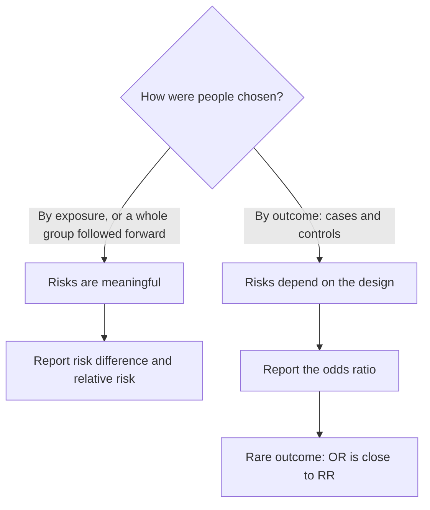

## One number for a two-way table

The two-way tables lesson compared conditional percents: 50% of under-30 commuters take the
train, 25% of over-50s do. Medicine, public health, insurance and safety engineering compare
groups this way constantly, and they boil each comparison down to one number: "smokers have
about 15 times the risk," "the drug cuts the risk in half," "the odds ratio was 3.5." This
honors lesson defines those numbers, shows why one of them (the odds ratio) is the only
choice for some study designs, and then returns to Simpson's paradox with a tool for fixing
it: standardization.

## The 2×2 table

Most of these measures start from a table with an *exposure* (a treatment, a habit, a risk
factor) in the rows and a yes/no *outcome* in the columns:

| | Outcome | No outcome | Total |
|---|---|---|---|
| Exposed | $a$ | $b$ | $a + b$ |
| Not exposed | $c$ | $d$ | $c + d$ |

The **risk** of the outcome in a group is the proportion of the group that has it: a
conditional proportion, $p_1 = a/(a + b)$ for the exposed and $p_2 = c/(c + d)$ for the
unexposed. From two risks you can build two comparisons:

- the **risk difference**, $p_1 - p_2$ (an absolute comparison, often given in percentage
  points);
- the **relative risk**, $\text{RR} = p_1/p_2$ (a ratio: how many times as likely).

$\text{RR} = 1$ and a risk difference of 0 both mean no association.

## Odds

Gamblers have long described chances as odds. The **odds** of an event are its probability
divided by the probability that it doesn't happen:

$$\text{odds} = \frac{p}{1 - p}, \qquad p = \frac{\text{odds}}{1 + \text{odds}}.$$

A probability of 0.75 is odds of $0.75/0.25 = 3$ ("3 to 1"); a probability of 0.2 is odds of
$0.25$ ("1 to 4"). In the 2×2 table the odds of the outcome among the exposed are simply $a/b$,
and among the unexposed $c/d$. The **odds ratio** compares them:

$$\text{OR} = \frac{a/b}{c/d} = \frac{ad}{bc}.$$

For a rare outcome, $1 - p$ is close to 1, so odds are close to probabilities and the odds
ratio is close to the relative risk. For a common outcome they can differ a lot, and the odds
ratio is always farther from 1 than the relative risk (unless both equal 1).

### Example 1: all four measures

A study follows 1,200 adults for ten years. Of 400 who exercised regularly, 20 developed heart
disease; of 800 who didn't, 80 did.

1. Risks: $p_1 = 20/400 = 0.05$ (exercisers) and $p_2 = 80/800 = 0.10$.
2. Risk difference: $0.05 - 0.10 = -0.05$, five percentage points lower.
3. Relative risk: $0.05/0.10 = 0.5$. Exercisers had half the risk.
4. Odds: $20/380 \approx 0.0526$ and $80/720 \approx 0.1111$, so
   $\text{OR} = (20 \times 720)/(380 \times 80) = 14{,}400/30{,}400 \approx 0.474$.

The OR (0.474) is close to the RR (0.5) because heart disease was fairly uncommon in both
groups. This is an observational study, so neither number shows that exercise *caused* the
lower risk; people who exercise differ in other ways too.

## Absolute versus relative

Relative risks make striking headlines. "Doubles the risk" sounds alarming, but if the risk
goes from 1 in 10,000 to 2 in 10,000 the risk difference is one extra case per 10,000 people.
A relative risk of 1.2 for a common condition can matter far more. Always ask for the baseline
risk, or report the risk difference alongside the ratio.

## Why odds ratios: case-control studies

In a **case-control** study (see the lesson on study conclusions), investigators start with
people who *have* the outcome (cases) and pick a comparison group who don't (controls), then
look back at exposures. The researchers choose how many cases and controls to include, so the
share of the study with the outcome is set by design. Risks computed from the table are
meaningless: double the number of controls and every "risk" changes.

The odds ratio survives. Its formula $ad/bc$ is unchanged if you multiply a whole column (all
the controls, say) by any constant, because the constant appears once on top and once on the
bottom. And the odds ratio of the outcome given exposure equals the odds ratio of exposure given
the outcome, both being $ad/bc$. So the odds of exposure among cases versus controls, which a
case-control study *can* measure, give the same number as the odds ratio for the outcome. When
the outcome is rare in the population, that odds ratio also approximates the relative risk, a
point made by the statistician Jerome Cornfield in 1951 in his work on smoking and lung
cancer.

### Example 2: a case-control study

Researchers find 200 people with a rare illness and 400 similar people without it. Among the
cases, 120 had a certain exposure; among the controls, 120 did.

| | Cases | Controls |
|---|---|---|
| Exposed | 120 | 120 |
| Not exposed | 80 | 280 |

1. Odds of exposure: cases $120/80 = 1.5$, controls $120/280 \approx 0.429$.
2. $\text{OR} = (120 \times 280)/(80 \times 120) = 33{,}600/9{,}600 = 3.5$.
3. Had they chosen 800 controls with the same exposure rate (240 exposed, 560 not):
   $\text{OR} = (120 \times 560)/(80 \times 240) = 67{,}200/19{,}200 = 3.5$, unchanged. The
   "risk of illness among the exposed" would have changed from $120/240 = 50\%$ to
   $120/360 \approx 33\%$, which shows it was never a real risk.
4. Because the illness is rare, exposed people have roughly 3.5 times the risk of the
   unexposed. (Whether the exposure *causes* it is a separate question; case-control studies
   are observational.)



## Simpson's paradox as a weighted average

The two-way tables lesson showed Hospital A beating Hospital B for mild patients (98.3% vs.
96.7% survival) and for severe patients (52.5% vs. 30%), yet losing overall (80% vs. 90%). The
reason is arithmetic. A hospital's overall survival rate is a *weighted average* of its two
stratum rates, weighted by its own case mix:

$$\text{overall} = (\text{share mild})(\text{mild rate}) + (\text{share severe})(\text{severe rate}).$$

Hospital A's patients are 40% severe, B's only 10%. Plot each hospital's overall rate against
the share of severe patients and each hospital moves along its own straight line. A's line is
above B's everywhere, but A sits far to the right, where every hospital does worse.

```plot
{"x": [0, 1], "y": [0, 1.1], "xLabel": "share of patients who are severe", "yLabel": "overall survival rate", "functions": [{"f": "0.98333*(1 - x) + 0.525*x", "color": "#2c5e8f"}, {"f": "0.96667*(1 - x) + 0.30*x", "color": "#c2570c"}], "points": [{"at": [0.4, 0.8], "color": "#2c5e8f"}, {"at": [0.1, 0.9], "color": "#c2570c"}, {"at": [0.25, 0.86875], "open": true, "color": "#2c5e8f"}, {"at": [0.25, 0.8], "open": true, "color": "#c2570c"}], "segments": [{"from": [0.25, 0], "to": [0.25, 0.97], "dashed": true}], "labels": [{"at": [0.82, 0.72], "text": "Hospital A"}, {"at": [0.75, 0.3], "text": "Hospital B"}], "caption": "Filled dots: each hospital's actual mix (A: 40% severe, 80% survive; B: 10% severe, 90% survive). A's line is above B's for every case mix. At a common mix of 25% severe (dashed), A survives 86.9% and B 80.0%."}
```

## Standardization

The fix is to compare the hospitals *as if they had the same case mix*. **Standardization**
(direct standardization) picks one standard mix, applies each group's own stratum rates to it,
and adds. The results are called adjusted (or standardized) rates. Demographers and public
health agencies routinely use it, for example to compare death rates of regions whose
populations have different age structures. (The honors lesson on causal inference in Module 4
uses the same tool to adjust an observational comparison for a measured confounder.)

### Example 3: adjusting the hospital comparison

Use the two hospitals combined as the standard: 1,500 mild and 500 severe patients, so the
standard mix is 75% mild, 25% severe.

1. Hospital A's rates: mild $590/600 \approx 0.9833$, severe $210/400 = 0.525$.
   Adjusted: $0.75(0.9833) + 0.25(0.525) = 0.7375 + 0.1313 \approx 0.869$, or 86.9%.
2. Hospital B's rates: mild $870/900 \approx 0.9667$, severe $30/100 = 0.30$.
   Adjusted: $0.75(0.9667) + 0.25(0.30) = 0.725 + 0.075 = 0.800$, or 80.0%.
3. On equal footing A is better, 86.9% to 80.0%, which agrees with the comparison inside each
   stratum. A different standard mix changes the adjusted numbers but here can't reverse the
   order, because A is better in both strata.

## A real example: kidney stones

A frequently cited example comes from a 1986 British study (Charig and colleagues) of two
treatments for kidney stones, open surgery and a less invasive keyhole procedure. Overall, the
keyhole procedure succeeded more often: 289 of 350 (83%) versus 273 of 350 (78%). But open
surgery did better for small stones (81 of 87, 93%, versus 234 of 270, 87%) and for large stones
(192 of 263, 73%, versus 55 of 80, 69%). Large stones are harder to treat, and about 75% of the
open-surgery patients had large stones versus about 23% of the keyhole patients. Stone size was
the lurking variable. (Patients weren't randomly assigned, so even the stratum comparisons can
be confounded by things that weren't recorded.)

That caveat is the limit of every adjustment: standardization removes the effect of the
variables you stratify on, and nothing else. Only random assignment balances the lurking
variables nobody measured.

## Common mistakes

- Reporting a relative risk without the baseline risk, so a tiny absolute change sounds huge.
- Calling an odds ratio a relative risk when the outcome is common; then they can be far apart.
- Computing "risks" from a case-control table, where the number of cases was chosen by the
  researchers.
- Flipping the ratio ($p_2/p_1$ instead of $p_1/p_2$). Say which group is on top.
- Treating an adjusted rate as proof of cause. Adjustment handles only the variables you
  adjusted for.

## Key points

- Risk = proportion with the outcome in a group. Risk difference $p_1 - p_2$; relative risk
  $p_1/p_2$.
- Odds $= p/(1 - p)$; odds ratio $= ad/bc$. For rare outcomes, OR ≈ RR.
- Case-control studies can estimate only the odds ratio, because it is unchanged by how many
  cases and controls are sampled.
- An overall rate is a weighted average of stratum rates; different weights cause Simpson's
  paradox.
- Direct standardization applies each group's stratum rates to one standard mix, so groups are
  compared on equal footing (for the measured variables only).
