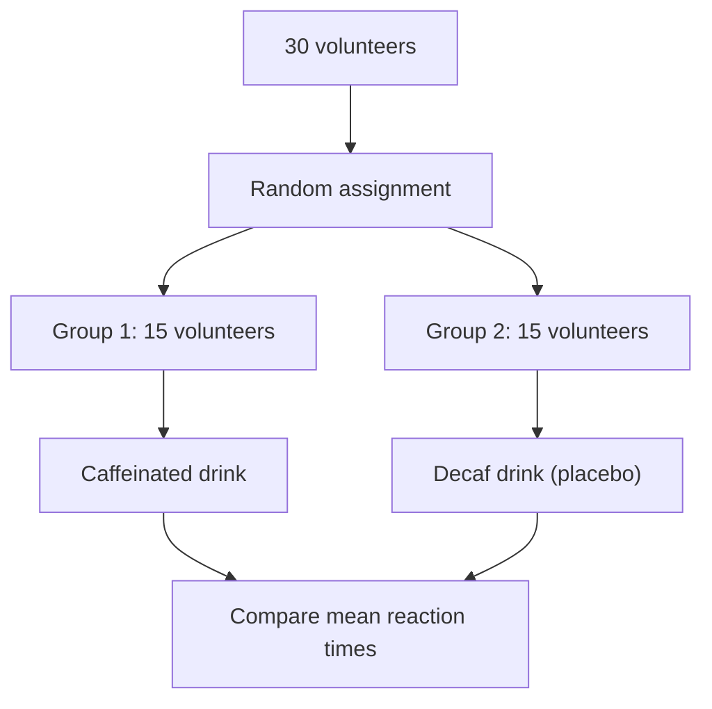
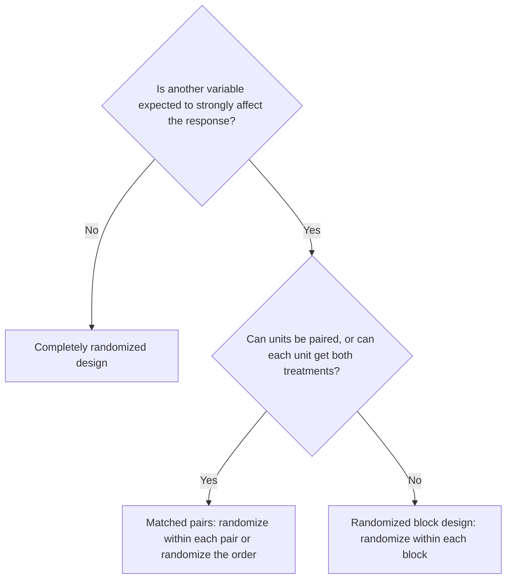

## Why experiments

A sample survey observes; an experiment *acts*. If you want to know whether a new
fastener design reduces track defects, whether a tutoring program raises scores, or
whether a drug lowers blood pressure, the most convincing evidence comes from deliberately
imposing the treatment on some units and not others, then comparing. This lesson covers
the vocabulary and the principles that make experiments trustworthy.

## Vocabulary

- **Experimental units** are the objects to which treatments are assigned; when they are
  people they are called **subjects**.
- A **factor** is an explanatory variable the experimenter manipulates; each factor has
  **levels** (specific values).
- A **treatment** is a specific condition applied to units — one level of one factor, or
  a combination of levels of several factors.
- The **response variable** is the outcome measured.

### Example 1

A study tests three fertilizer amounts (none, low, high) and two watering schedules (daily,
every other day) on 60 tomato plants, measuring fruit weight after 10 weeks.

1. Experimental units: the 60 plants.
2. Factors: fertilizer (3 levels) and watering (2 levels).
3. Treatments: every combination, $3 \times 2 = 6$ treatments.
4. Response: fruit weight.
5. With 60 plants and equal group sizes, 10 plants per treatment.

## Four principles of experimental design

1. *Comparison*. Use two or more treatments so outcomes can be compared. Often one
   group gets a **control** — no treatment, an existing standard treatment, or a placebo.
   Without a comparison group, improvement could be due to time, attention or chance.
2. **Random assignment**. Use chance to assign units to treatments. Randomization
   creates groups that are roughly equivalent in every respect — measured or not — before
   treatment begins, so differences in response can be attributed to the treatments.
3. **Replication**. Use enough experimental units in each group that chance differences
   between groups average out. (Replication can also mean repeating the whole experiment.)
4. *Control of other variables*. Keep everything except the treatment the same for all
   groups (same soil, same timing, same measurement procedure) to reduce variability and
   remove alternative explanations.

## Placebos and blinding

People often improve simply because they believe they are being treated — the **placebo
effect**. A **placebo** is a fake treatment (a sugar pill, a sham procedure) given to the
control group so that both groups have the same expectations.

In a **blind** experiment, subjects don't know which treatment they get. In a
**double-blind** experiment, neither the subjects nor the people who interact with them
and measure the response know. Double-blinding keeps expectations (and so any placebo
effect) the same in every group and prevents unconscious bias in how outcomes are measured.

## Completely randomized design

In a **completely randomized design**, all experimental units are assigned to treatments
completely at random. To assign 40 volunteers to two groups of 20: write each name on an
identical slip, shuffle, draw 20 for treatment A; the rest get treatment B. Or number the
subjects 1–40 and use a random number generator to pick 20 distinct numbers.

An outline like the one below is the standard way to describe a design: the units, the random
assignment, the groups and their treatments, and what is compared. This one is the completely
randomized version of Example 3 later in the lesson.

## Blocking

A **block** is a group of experimental units that are similar in a way expected to affect
the response. In a **randomized block design**, units are first sorted into blocks, then
randomly assigned to treatments *separately within each block*. Results are compared
within blocks.

Blocking is to experiments what stratifying is to sampling. Its purpose is to *reduce
variability*: by comparing treatments among similar units, differences between blocks
don't blur the comparison. Blocking doesn't replace randomization — randomization still
happens inside each block.

### Example 2

A railway tests two rail lubricants on 40 curves; 20 curves are sharp and 20 are gentle.
Curve sharpness strongly affects wear.

- Completely randomized: assign 20 curves at random to each lubricant. By chance, one
  lubricant might get more sharp curves, inflating its wear.
- Randomized block: block by sharpness. Within the 20 sharp curves, randomly assign 10 to
  each lubricant; do the same within the 20 gentle curves. Compare lubricants within each
  block. The large sharp/gentle difference no longer adds noise.

The outline of the randomized block design shows the random assignment happening twice, once
inside each block:

## Matched pairs

A **matched pairs design** is blocking with blocks of size 2. Either two similar units are
paired and the treatments randomly assigned within each pair (twins, two adjacent plots),
or each unit receives *both* treatments in random order (each driver tests both seat
designs, the order decided by a coin flip). The analysis looks at the *differences* within
pairs, which removes unit-to-unit variation. Randomizing the order guards against
learning or fatigue effects.

Which design to use depends on what you know about the units before the experiment starts:

## Statistical significance (a preview)

If the treatment groups' responses differ, could chance alone — the luck of the random
assignment — explain it? When an observed difference is too large to plausibly be due to
chance, it is called **statistically significant**. Module 8 makes this precise. For now:
randomization is what makes "chance" calculable, and replication is what lets real effects
stand out from chance.

### Example 3

Design an experiment to test whether a caffeinated drink improves reaction time, using 30
volunteers.

1. Treatments: caffeinated drink vs. an identical-tasting decaffeinated drink (placebo).
2. Randomly assign 15 volunteers to each (completely randomized), or better, use matched
   pairs: each volunteer is tested on two days, once with each drink, in random order.
3. Double-blind: drinks are coded by someone not involved in testing.
4. Control: same time of day, same test, no other caffeine that day.
5. Response: reaction time; compare means (or the mean of the within-person differences).

## Common mistakes

- Confusing random *sampling* (choosing who is in the study) with random *assignment*
  (choosing who gets which treatment).
- Thinking blocking replaces randomization.
- Forgetting that treatments are *combinations* of factor levels in multifactor
  experiments.
- Saying "control" when meaning "control group" — controlling variables and having a
  control group are different ideas.

## Key points

- Units, factors, levels, treatments, response.
- Principles: comparison, random assignment, replication, control.
- Placebos and double-blinding prevent expectation and measurement bias.
- Completely randomized design: assign all units at random. Randomized block: randomize
  within groups of similar units. Matched pairs: blocks of two, analyze differences.
- Statistically significant: too large a difference to attribute to chance.
