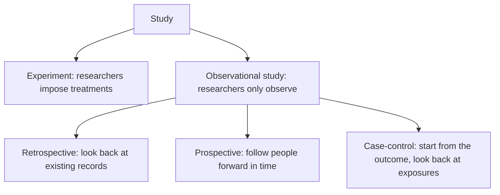
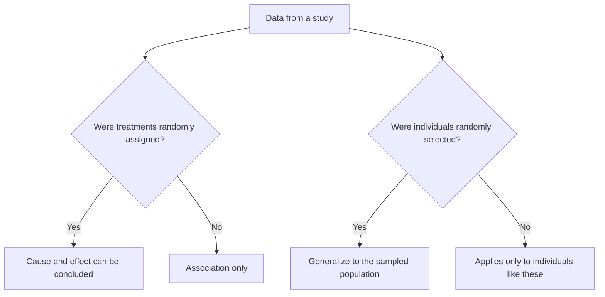

## What can this study conclude?

The last two lessons covered two tools: random sampling and random assignment. They solve
different problems. This lesson ties them together into the single most practical
question in statistics: *given how these data were collected, what conclusions are
justified — and about whom?*

## Observational studies versus experiments

In an **observational study**, researchers observe individuals and measure variables but
do not influence the responses. Surveys, records reviews and most medical studies of
lifestyle (diet, smoking, exercise) are observational. In an **experiment**, researchers
deliberately impose treatments.

Observational studies come in flavors:

- **Retrospective** studies look backward, examining existing data (medical records, past
  maintenance logs).
- **Prospective** studies follow individuals forward in time, recording outcomes as they
  happen.
- **Case-control** studies start with people who have an outcome (cases) and similar
  people without it (controls), then compare past exposures. They are efficient for rare
  outcomes.

Observational studies are often the only ethical or practical option — you can't assign
people to smoke — but they have a serious weakness.

## Confounding

Two variables are **confounded** when their effects on the response can't be separated.
A **confounding variable** is related to the explanatory variable *and* affects the
response, so it offers an alternative explanation for an observed association.

### Example 1

An observational study finds that people who drink moderate amounts of red wine have
lower rates of heart disease than people who drink none. Does wine protect the heart?

Possibly — but moderate wine drinkers also tend to have higher incomes, better diets and
better access to health care, all of which lower heart-disease risk. Income is a likely
confounding variable: it is associated with wine drinking and affects heart health. The
study cannot tell whether wine, income or both are responsible.

Even careful statistical adjustment can only account for confounders that were measured.
Random assignment is the only method that balances *all* potential confounders —
measured and unmeasured — on average. That is why well-designed experiments can show
cause and effect and observational studies, by themselves, generally cannot.

(The terms *lurking variable* and *confounding variable* are close cousins; "lurking"
emphasizes that the variable wasn't measured in the study, "confounding" that its effect
is mixed up with the explanatory variable's.)

## Scope of inference

Two separate questions:

1. *To whom can we generalize?* Only to the population from which the individuals were
   *randomly sampled*. Volunteers represent only themselves (or people like them).
2. *Can we conclude cause and effect?* Only if treatments were *randomly assigned*.

| | Random assignment | No random assignment |
|---|---|---|
| *Random sample* | Cause and effect; generalize to the population | Association only; generalize to the population |
| *No random sample* | Cause and effect, for these subjects (and similar ones) | Association only, for these individuals |

Most experiments use volunteers: the causal conclusion is solid but applies, strictly,
only to people like the volunteers. Most surveys use random samples but no assignment:
they describe the population well but can't establish causation.

The two questions are separate, so answer each one on its own:

### Example 2

A random sample of 1,000 adults in a state is surveyed. Those who report walking 30+
minutes a day report fewer sick days. What can be concluded?

There was random sampling but no random assignment. Conclusion: in the state's adult
population, walking is *associated* with fewer reported sick days. We can't say walking
*causes* fewer sick days — healthier people may be more able to walk (reverse causation)
or age may confound both.

### Example 3

Sixty volunteer employees at one company are randomly assigned to a standing desk or a
regular desk for three months; the standing-desk group reports significantly less back
pain. Conclusion: the standing desk *caused* the reduction for these volunteers (random
assignment). Generalizing to all office workers is risky, because the volunteers were not
a random sample.

## Experiments have limits too

- *Lack of realism*: lab conditions may not reflect real use, limiting generalization.
- *Ethics*: some treatments can't be assigned.
- *Hawthorne-type effects*: subjects may behave differently because they're being
  studied.

## Ethics of studies with people

Studies involving people need:

- **Informed consent**: subjects are told in advance about the nature and risks of the
  study and agree to participate, free to withdraw.
- *Review board approval*: an independent committee (an institutional review board,
  IRB) approves the plan in advance to protect subjects.
- **Confidentiality**: individual data are kept private; only summaries are reported.

### Example 4: naming a confounder properly

A city notices that neighborhoods with more rail stations have lower rates of car
ownership. A council member proposes building stations to reduce car ownership. Identify a
possible confounding variable and explain both links.

*Population density* is a good candidate. Dense neighborhoods get more stations (it is where
ridership is), *and* density itself reduces car ownership (parking is scarce and destinations
are close). So the association could be partly or entirely due to density. A complete answer
names the variable and describes both connections — to the explanatory variable (stations)
and to the response (car ownership). To learn whether stations themselves reduce car
ownership, the city would need a design that breaks the link with density — for example,
comparing similar neighborhoods before and after new stations open, ideally with the order of
openings decided at random.

## Common mistakes

- Concluding causation from an observational study, however large.
- Generalizing an experiment's results on volunteers to a whole population without a random sample.
- Treating "random sample" and "random assignment" as the same thing.
- Naming a confounding variable without explaining *both* links (to the explanatory
  variable and to the response).

## Key points

- Observational studies observe; experiments impose treatments.
- A confounding variable is associated with the explanatory variable and affects the
  response; random assignment balances confounders, measured or not.
- Random sampling → generalize to the population; random assignment → cause and effect.
- Ethical studies require informed consent, independent review and confidentiality.
