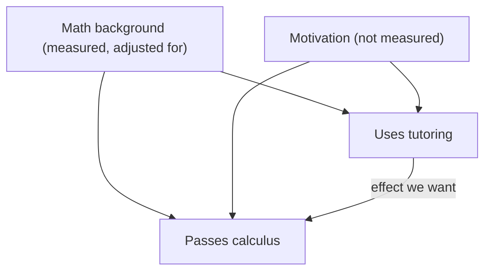

## A puzzle from lesson 18

Lesson 18 said that observational studies, by themselves, generally can't show cause and effect,
because a confounding variable might explain the association. Yet nobody ever randomly assigned
people to smoke for 30 years, and the case that smoking causes lung cancer is about as solid as
any in medicine. How did researchers get there? This lesson gives a precise language for "cause"
(potential outcomes), shows exactly where confounding enters, and then looks at the tools that
make careful causal claims possible without an experiment: adjustment, natural experiments and
a convergence of different kinds of evidence. All of them are weaker than randomization, and
part of the skill is saying how much weaker.

## Potential outcomes

Think about one student and a tutoring program. The student has two **potential outcomes**: the
score they would get with tutoring, $Y(1)$, and the score they would get without it, $Y(0)$. The
causal effect of tutoring *for that student* is $Y(1) - Y(0)$. The trouble is that we only ever see
one of the two. A tutored student's $Y(0)$ is a "what if" that never happened. This is sometimes
called the fundamental problem of causal inference.

Since individual effects can't be observed, we aim for an average. The
**average treatment effect** (ATE) is the mean of $Y(1) - Y(0)$ over everyone in the group, which equals the mean of
all the $Y(1)$ values minus the mean of all the $Y(0)$ values. The idea goes back to Jerzy Neyman's
1923 work on field experiments and was developed for observational studies by Donald Rubin in the
1970s.

### Example 1: where confounding comes from

Imagine (made-up numbers) we could see both potential outcomes for eight students:

| Student | A | B | C | D | E | F | G | H |
|---|---|---|---|---|---|---|---|---|
| $Y(0)$, no tutoring | 60 | 65 | 70 | 75 | 80 | 85 | 90 | 95 |
| $Y(1)$, tutoring | 68 | 72 | 76 | 80 | 85 | 89 | 93 | 97 |
| Effect | 8 | 7 | 6 | 5 | 5 | 4 | 3 | 2 |

The ATE is $(8 + 7 + 6 + 5 + 5 + 4 + 3 + 2)/8 = 5$ points.

1. *Self-selection.* Suppose the four strongest students (E–H) sign up. We observe $Y(1)$ for them,
   mean $(85 + 89 + 93 + 97)/4 = 91$, and $Y(0)$ for A–D, mean $(60 + 65 + 70 + 75)/4 = 67.5$.
   The naive difference is $91 - 67.5 = 23.5$ points, almost five times the true effect.
2. *Where the extra came from.* Split the naive difference:
   $$23.5 = \underbrace{(91 - 87.5)}_{\text{effect on E–H}} + \underbrace{(87.5 - 67.5)}_{\text{selection bias}}.$$
   Here 87.5 is the mean of E–H's *untutored* scores. The tutored students would have scored
   20 points higher even without tutoring. That gap is **selection bias**: the groups differed
   before treatment. It is what a confounding variable (here, prior strength) does.
3. *Random assignment.* Suppose instead a random draw sends A, E, F and G to tutoring. Then the
   tutored mean is $(68 + 85 + 89 + 93)/4 = 83.75$ and the untutored mean is
   $(65 + 70 + 75 + 95)/4 = 76.25$, a difference of 7.5. That's not exactly 5, but it isn't
   systematically off. Over all 70 equally likely ways to choose 4 of the 8, the differences average
   *exactly* 5.

That is the precise meaning of "randomization balances confounders": it makes the selection-bias
term zero on average, so the difference in means is an unbiased estimate of the ATE. Chance
error remains, and it shrinks as groups get larger.

## Adjusting for a measured confounder

Without randomization, the next best thing is to compare like with like. If a confounder has been
measured, split the data into strata of that variable, compare within each stratum, and combine
the stratum results using one common set of weights. This is the **standardization** (direct
standardization) from the honors lesson on relative risk and odds ratios, where it adjusted a
comparison of two hospitals for case mix: apply each group's stratum rates to the same standard
population. It turns the lesson of Simpson's paradox (lesson 15) into a method; here it is used
for a causal question.

### Example 2: does the tutoring center help?

A college compares calculus pass rates for students who did and didn't use its tutoring center.
Students are grouped by their high school math grade.

| | Strong background | Weak background | Overall |
|---|---|---|---|
| Used tutoring | 45 of 50 (90%) | 105 of 150 (70%) | 150 of 200 (75%) |
| Did not | 255 of 300 (85%) | 55 of 100 (55%) | 310 of 400 (77.5%) |

1. Overall, non-users pass more often (77.5% vs 75%).
2. Within each stratum, users pass more often: by 5 points (strong) and 15 points (weak). Weaker
   students are more likely to seek tutoring, which drags down the users' overall rate.
3. Standard population: all 600 students, of whom 350 are strong and 250 weak.
4. Users, standardized: $(350 \times 0.90 + 250 \times 0.70)/600 = 490/600 \approx 81.7\%$.
5. Non-users, standardized: $(350 \times 0.85 + 250 \times 0.55)/600 = 435/600 = 72.5\%$.

After adjustment, users pass about 9 points more often. But the adjustment handles only
background. If students who choose tutoring are also more motivated, motivation still
confounds the comparison, and no table can adjust for a variable that wasn't measured.



## Natural experiments

Sometimes the world assigns treatments in a way that has nothing to do with the outcome. A
**natural experiment** is an observational study in which something close to random
assignment happened by itself. Lotteries are the cleanest case: in 2008 Oregon used a lottery
to choose which low-income adults could apply for Medicaid, and researchers compared the lottery's
winners with its losers.

### Example 3: John Snow's "grand experiment"

In the London cholera epidemic of 1854, two water companies supplied the same districts, with
their pipes running down the same streets, so neighbors often got different water. In 1852 the
Lambeth company had moved its intake upstream, above the city's sewage outflows; the Southwark
and Vauxhall company still drew water from the sewage-polluted Thames in London. Households
generally hadn't chosen their company in any way linked to cholera risk. The physician John Snow
counted deaths in the first weeks of the epidemic:

| Company | Houses | Cholera deaths | Deaths per 10,000 houses |
|---|---|---|---|
| Southwark and Vauxhall | 40,046 | 1,263 | 315 |
| Lambeth | 26,107 | 98 | 37 |

1. Rates: $1263/40046 \times 10{,}000 \approx 315$ and $98/26107 \times 10{,}000 \approx 38$ (Snow printed 37).
2. Ratio: $315.4/37.5 \approx 8.4$. Houses supplied with polluted water had over eight times the
   cholera death rate.

Because the two groups were so alike in everything except their water, confounders such as
poverty or neighborhood couldn't explain a difference that size. Snow's conclusion that cholera
spread through water came nearly thirty years before Robert Koch isolated the cholera bacterium
in 1883–84.

```shape
{"bars": [{"x": 1.5, "height": 6.3, "width": 1.6, "label": "Southwark and Vauxhall"}, {"x": 5, "height": 0.74, "width": 1.6, "label": "Lambeth"}], "segments": [{"from": [0, 0], "to": [6.5, 0]}], "labels": [{"at": [1.5, 6.8], "text": "315"}, {"at": [5, 1.25], "text": "37"}], "caption": "Cholera deaths per 10,000 houses in Snow's 1854 comparison (bar heights to scale)"}
```

## Weighing the evidence: smoking and lung cancer

In 1950 Richard Doll and Austin Bradford Hill published a case-control study comparing lung cancer
patients with other hospital patients: the cancer patients were far more likely to be heavy
smokers. In 1951 they began following tens of thousands of British doctors forward in time, a
prospective study whose results pointed the same way. Similar studies in the United States agreed,
and in 1964 the U.S. Surgeon General's report concluded that cigarette smoking causes lung cancer
in men.

In 1965 Hill summarized the questions worth asking before calling an association causal. They are
often called the **Bradford Hill criteria**, though Hill called them viewpoints and insisted they
were not a checklist:

| Viewpoint | Question | Smoking and lung cancer |
|---|---|---|
| Strength | Is the association large? | Heavy smokers had many times the risk of nonsmokers |
| Consistency | Is it seen repeatedly, by different people, in different places? | Yes, in many countries and designs |
| Specificity | Is the exposure linked to one particular outcome? | Weak here; smoking harms many organs |
| Temporality | Does the cause come before the effect? | Smoking began years before diagnosis |
| Biological gradient | More exposure, more effect? | Risk rose with cigarettes per day |
| Plausibility, coherence | Does it fit what biology knows? | Tobacco smoke contains carcinogens |
| Experiment | Does removing the cause change the outcome? | People who quit had lower risk later |
| Analogy | Are similar causes known? | Other inhaled carcinogens cause cancer |

Of these, only temporality is generally treated as essential today (Hill himself wrote that none of
his viewpoints could be required as a sine qua non, but a cause that comes after its effect makes no sense). A strong, consistent **dose-response relationship** (Hill's
biological gradient) that appears in different study designs is hard to explain away: a confounder
would have to be strongly linked to smoking, in a dose-dependent way, in every population studied.
Notice that the case was built from many studies of different kinds, not from one big one.

## Other modern tools

Researchers have developed more designs that imitate an experiment, such as comparing changes over
time in a treated and an untreated group (difference in differences, the before-and-after design
suggested for the rail stations in lesson 18), or comparing people just above and just below an
eligibility cutoff. Each rests on an assumption that can't be fully checked, so a careful report
names the assumption and asks what would happen if it failed.

## Common mistakes

- Treating an adjusted comparison as if it were randomized. Adjustment only removes the confounders you measured.
- Calling any before-and-after comparison a natural experiment. The "assignment" must be unrelated to the outcome.
- Using Hill's viewpoints as a scorecard to be added up. They are questions that guide judgment.
- Forgetting reverse causation: the outcome may influence the "exposure" (sick people may stop exercising).
- Thinking a large sample removes selection bias. It removes chance error, not bias.

## Key points

- Each unit has potential outcomes $Y(1)$ and $Y(0)$; only one is ever observed.
- Average treatment effect: mean of $Y(1) - Y(0)$. Naive difference = effect on the treated + selection bias.
- Randomization makes the selection-bias term zero on average.
- Standardization compares groups at the same mix of a measured confounder; unmeasured confounders remain.
- Natural experiments use assignment that happened by chance or close to it (lotteries, Snow's water companies).
- Causal conclusions from observational data rest on a body of consistent evidence: strength,
  temporality, dose-response, consistency and plausibility together.
