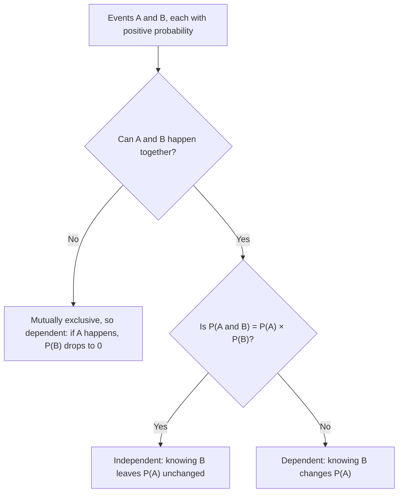

## Probability given information

The chance of rain tomorrow changes if you learn there are dark clouds tonight. The chance
a rail segment has a defect changes if you learn it's 40 years old. **Conditional
probability** is the probability of an event *given* that another event has occurred. It
is the probability version of the conditional distributions from the two-way tables
lesson — and it leads to independence, the multiplication rule and Bayes' theorem.

## Definition

The conditional probability of $A$ given $B$ is

$$P(A \mid B) = \frac{P(A \cap B)}{P(B)}, \qquad P(B) > 0.$$

Read the bar "$\mid$" as "given." Knowing $B$ occurred shrinks the sample space to $B$;
within it, the outcomes where $A$ also happens are $A \cap B$. Dividing by $P(B)$
rescales so the new sample space has total probability 1.

### Example 1: from a two-way table

An inspection program checked 500 track segments:

| | Defect | No defect | Total |
|---|---|---|---|
| Old track | 60 | 140 | 200 |
| New track | 30 | 270 | 300 |
| Total | 90 | 410 | 500 |

A segment is chosen at random.

1. $P(\text{defect}) = 90/500 = 0.18$.
2. $P(\text{defect} \mid \text{old}) = 60/200 = 0.30$. (Restrict to the old-track row.)
3. $P(\text{defect} \mid \text{new}) = 30/300 = 0.10$.
4. $P(\text{old} \mid \text{defect}) = 60/90 \approx 0.667$. (Restrict to the defect column.)

Note $P(\text{defect} \mid \text{old}) = 0.30$ but $P(\text{old} \mid \text{defect}) \approx 0.667$.
In general $P(A \mid B) \ne P(B \mid A)$; confusing the two is one of the most common and
consequential errors in reasoning about evidence.

Using the formula instead of the table: $P(\text{defect} \cap \text{old}) = 60/500 = 0.12$ and
$P(\text{old}) = 200/500 = 0.4$, so $P(\text{defect} \mid \text{old}) = 0.12/0.4 = 0.30$. ✓

An **area model** draws the same facts as a unit square. The widths are $P(\text{old}) = 0.4$ and
$P(\text{new}) = 0.6$; the shaded heights are the conditional probabilities of a defect. Each
rectangle's area is a width times a height, which is exactly the multiplication rule below, and
"given old" means looking only at the left strip.

## The general multiplication rule

Rearranging the definition gives the probability that two events both happen:

$$P(A \cap B) = P(A) \cdot P(B \mid A).$$

In words: the chance of $A$ and then $B$ is the chance of $A$ times the chance of $B$
given $A$ happened.

### Example 2: drawing without replacement

Two cards are dealt from a well-shuffled deck. Find $P(\text{both aces})$.

1. $P(\text{first ace}) = 4/52$.
2. Given the first was an ace, 3 aces remain among 51 cards: $P(\text{second ace} \mid \text{first ace}) = 3/51$.
3. $P(\text{both}) = \tfrac{4}{52} \cdot \tfrac{3}{51} = \tfrac{12}{2652} \approx 0.00452$.

## Independence

Events $A$ and $B$ are **independent** if knowing that one occurs doesn't change the
probability of the other:

$$P(A \mid B) = P(A).$$

Then the multiplication rule simplifies to

$$P(A \cap B) = P(A) \cdot P(B) \qquad \text{(independent events only)}.$$

Either equation can be used as a test. In Example 1, $P(\text{defect} \mid \text{old}) = 0.30 \ne 0.18 = P(\text{defect})$,
so defects and track age are *not* independent — old track is more defect-prone.

Separate coin tosses, separate dice, and draws *with replacement* are independent. Draws
*without* replacement are not (the second draw depends on the first), though when the
population is large compared with the sample — the common rule of thumb is the sample is
less than 10% of the population — they are close enough to independent for practical
purposes.

### Independent vs. mutually exclusive

These sound similar but are nearly opposites. If $A$ and $B$ are mutually exclusive and
$A$ happens, then $B$ *cannot* happen — knowing $A$ changes $P(B)$ to 0. So mutually
exclusive events (with positive probabilities) are always *dependent*. The chart gives the order
in which to ask the questions.

### Example 3: checking independence

$P(A) = 0.4$, $P(B) = 0.5$, $P(A \cap B) = 0.2$. Since $0.4 \times 0.5 = 0.2$, $A$ and $B$ are
independent. If instead $P(A \cap B) = 0.15$, then $P(A \mid B) = 0.15/0.5 = 0.3 \ne 0.4$ and
they are dependent.

## "At least one" with independent trials

For $n$ independent trials, each with success probability $p$,

$$P(\text{at least one success}) = 1 - (1 - p)^n,$$

because "none" means every trial fails, with probability $(1 - p)^n$.

### Example 4

A signaling system has 10 independent relays, each of which fails on a given day with
probability 0.02. What is the probability that at least one fails?

$1 - 0.98^{10} \approx 1 - 0.8171 = 0.1829$. Even with very reliable parts, a system of many
parts often has some failure — which is why critical systems use redundancy.

### Example 5: redundancy

A backup pump works with probability 0.95, independently of the main pump, which also
works with probability 0.95. The system works if *at least one* pump works:
$1 - 0.05^2 = 0.9975$. With both required, it would be only $0.95^2 = 0.9025$.

### Example 6: independence in a two-way table

In a survey of 400 riders, 120 ride at peak hours and 100 hold monthly passes; 30 do both. Are
"peak rider" and "pass holder" independent?

$P(\text{pass}) = 100/400 = 0.25$, and $P(\text{pass} \mid \text{peak}) = 30/120 = 0.25$. Knowing that
a rider travels at peak hours doesn't change the chance they hold a pass, so the events are
independent. Check with the product rule: $P(\text{peak}) P(\text{pass}) = 0.3 \times 0.25 = 0.075$
and $P(\text{both}) = 30/400 = 0.075$. ✓

## Common mistakes

- Confusing $P(A \mid B)$ with $P(B \mid A)$, or with $P(A \cap B)$.
- Multiplying probabilities of events that aren't independent.
- Assuming mutually exclusive events are independent.
- Dividing by the grand total instead of the total of the "given" group.
- Computing "at least one" as $n \times p$ — that can exceed 1.

## Key points

- $P(A \mid B) = P(A \cap B)/P(B)$: restrict to $B$.
- Multiplication rule: $P(A \cap B) = P(A)P(B \mid A)$.
- Independent: $P(A \mid B) = P(A)$, equivalently $P(A \cap B) = P(A)P(B)$.
- Mutually exclusive events with positive probabilities are dependent.
- $P(\text{at least one}) = 1 - P(\text{none}) = 1 - (1-p)^n$ for independent trials.
