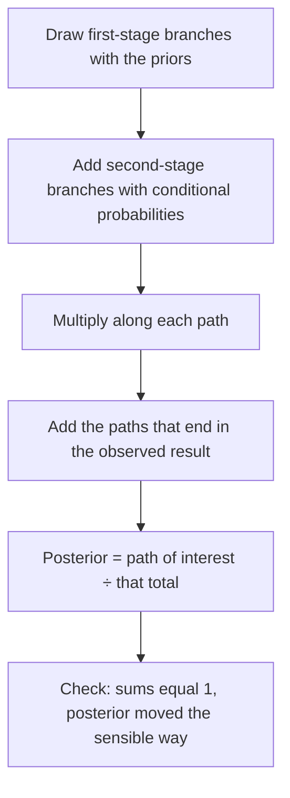

## Chance processes in stages

Many random processes happen in stages: a part comes from one of several suppliers, then
is defective or not; a person has a condition or not, then tests positive or not. A
**tree diagram** organizes such problems and makes the multiplication rule from the last
lesson almost automatic. Trees also lead to Bayes' theorem, which reverses a conditional
probability — from "the chance of a positive test given disease" to "the chance of
disease given a positive test."

## Building a tree

1. Draw a branch for each outcome of the first stage, labeled with its probability.
2. From the end of each branch, draw branches for the second stage, labeled with
   *conditional* probabilities given the first-stage outcome.
3. The probability of a complete path is the product of the probabilities along it
   (the general multiplication rule).
4. Branches leaving any point add to 1; all path probabilities together add to 1.

### Example 1: a medical screening test

A condition affects 2% of a population. A screening test detects it 95% of the time when
it is present (the **sensitivity**), and correctly gives a negative result 90% of the time
when it is absent (the **specificity**), so 10% of healthy people test positive.

```shape
{"x": [-0.3, 10.5], "y": [-0.5, 8.5], "segments": [{"from": [0, 4], "to": [3, 6.5], "label": "0.02"}, {"from": [0, 4], "to": [3, 1.5], "label": "0.98"}, {"from": [3.8, 6.5], "to": [6.6, 7.8], "label": "0.95"}, {"from": [3.8, 6.5], "to": [6.6, 5.2], "label": "0.05"}, {"from": [3.8, 1.5], "to": [6.6, 2.8], "label": "0.10"}, {"from": [3.8, 1.5], "to": [6.6, 0.2], "label": "0.90"}], "labels": [{"at": [3.4, 6.4], "text": "D"}, {"at": [3.4, 1.4], "text": "no D"}, {"at": [7, 7.7], "text": "+"}, {"at": [7, 5.1], "text": "−"}, {"at": [7, 2.7], "text": "+"}, {"at": [7, 0.1], "text": "−"}, {"at": [9.1, 7.7], "text": "0.019"}, {"at": [9.1, 5.1], "text": "0.001"}, {"at": [9.1, 2.7], "text": "0.098"}, {"at": [9.1, 0.1], "text": "0.882"}], "caption": "Tree for the screening test; path probabilities at the right"}
```

Path probabilities:

- Condition and positive: $0.02 \times 0.95 = 0.019$.
- Condition and negative: $0.02 \times 0.05 = 0.001$.
- No condition and positive: $0.98 \times 0.10 = 0.098$.
- No condition and negative: $0.98 \times 0.90 = 0.882$.

They sum to 1. ✓

## The law of total probability

To find the overall probability of a second-stage outcome, add the paths that end in it:

$$P(+) = P(D)P(+ \mid D) + P(D^c)P(+ \mid D^c) = 0.019 + 0.098 = 0.117.$$

In general, if the first stage splits the sample space into pieces $B_1, B_2, \ldots, B_k$
(mutually exclusive, covering everything), the **law of total probability** says

$$P(A) = \sum_i P(B_i)\,P(A \mid B_i).$$

## Bayes' theorem

Now reverse the question: a person tests positive. What is the probability they actually
have the condition? By the definition of conditional probability,

$$P(D \mid +) = \frac{P(D \cap +)}{P(+)} = \frac{0.019}{0.117} \approx 0.162.$$

Only about 16% of positives actually have the condition! The reason is the low
**base rate** (2%): the 10% false-positive rate applied to the huge healthy group (98%)
produces many more false positives (0.098) than true positives (0.019).

This calculation, written in general, is **Bayes' theorem**:

$$P(B_j \mid A) = \frac{P(B_j)\,P(A \mid B_j)}{\sum_i P(B_i)\,P(A \mid B_i)}.$$

You don't need to memorize it: the numerator is one path, the denominator is the total of
all paths that end in $A$. "The path you care about, divided by all paths that give what
you observed." The steps, in order:



In this context, $P(D)$ is the **prior** probability (before the test) and $P(D \mid +)$ is
the **posterior** probability (after). A positive test raised the probability from 2% to
16% — informative, but not conclusive. A second independent positive test would raise it
much further (try it: use 0.162 as the new prior).

### Example 2: which supplier?

A railway buys rail clips from three suppliers: A supplies 50% (1% defective), B supplies
30% (2% defective), C supplies 20% (5% defective). A randomly chosen clip is defective.
What's the probability it came from C?

1. Paths ending in "defective":
   A: $0.50 \times 0.01 = 0.005$; B: $0.30 \times 0.02 = 0.006$; C: $0.20 \times 0.05 = 0.010$.
2. Total: $P(\text{defective}) = 0.005 + 0.006 + 0.010 = 0.021$.
3. Bayes: $P(C \mid \text{defective}) = 0.010/0.021 \approx 0.476$.

Although C supplies only 20% of clips, it accounts for almost half of the defectives.

### Example 3: a two-way table instead of a tree

Imagine 10,000 people in Example 1. Then 200 have the condition, of whom $0.95 \times 200 = 190$
test positive; 9,800 don't, of whom $0.10 \times 9800 = 980$ test positive. Of the
$190 + 980 = 1170$ positives, $190/1170 \approx 0.162$ have the condition — the same answer.


Turning probabilities into counts of an imaginary population ("natural frequencies") is a
reliable way to check a Bayes calculation.

### Example 4: a second test

A person from Example 1 who tested positive (posterior 0.162) takes a second, independent test
of the same kind, which is also positive. Now use 0.162 as the prior:

$$P(D \mid ++) = \frac{0.162 \times 0.95}{0.162 \times 0.95 + 0.838 \times 0.10} = \frac{0.1539}{0.1539 + 0.0838} \approx 0.648.$$

Two positives raise the probability from 2% to about 65%. This is Bayesian updating: each
posterior becomes the prior for the next piece of evidence. It also shows why screening
programs confirm positive results with a second test before acting on them.

## Checking a Bayes calculation

Three quick checks catch most errors. First, the branches leaving each point must add to 1
($0.95 + 0.05$, $0.10 + 0.90$). Second, all path probabilities together must add to 1. Third,
the posterior should move in a sensible direction: a positive result should *raise* the
probability of the condition above the prior, and a negative result should lower it. In
Example 1, the prior 0.02 rose to 0.162 — more likely than before, but still far from certain.

## Common mistakes

- Putting unconditional probabilities on second-stage branches; they must be conditional
  on the branch they grow from.
- Confusing $P(+ \mid D)$ (sensitivity, 0.95) with $P(D \mid +)$ (0.162).
- Ignoring the base rate.
- Adding along a path instead of multiplying (multiply along, add across).

## Key points

- Trees: multiply along paths; add the paths that lead to the same outcome.
- Law of total probability: $P(A) = \sum P(B_i)P(A \mid B_i)$.
- Bayes: $P(B_j \mid A) = \dfrac{P(B_j)P(A \mid B_j)}{P(A)}$ — one path over all paths
  giving $A$.
- With a rare condition, even an accurate test produces mostly false positives.
