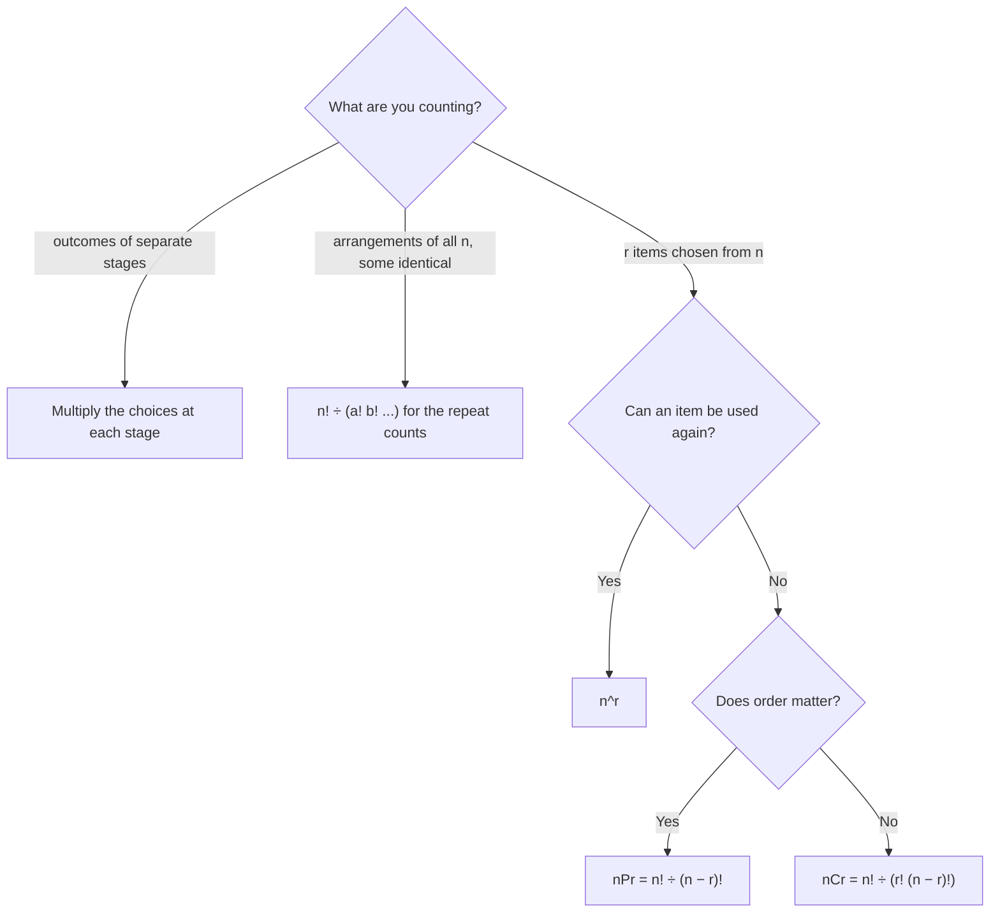

## Counting to compute probabilities

When outcomes are equally likely, $P(A)$ = (outcomes in $A$)/(total outcomes). That turns
probability into counting — but the counts are often too large to list: the number of
possible 5-card poker hands is 2,598,960. This lesson gives the systematic counting tools,
which also power the binomial distribution in the next module.

## The multiplication principle

If a task is done in stages, with $n_1$ ways for the first stage, $n_2$ for the second
(whatever happened in the first), and so on, then the total number of ways is

$$n_1 \times n_2 \times \cdots \times n_k.$$

A tree diagram shows why: each first-stage branch splits into $n_2$ branches, and so on.
For 2 shirts and 3 pairs of pants, each shirt branch splits into 3, giving $2 \times 3 = 6$ outfits:

```shape
{"x": [-0.3, 10.5], "y": [0, 6], "segments": [{"from": [0, 3], "to": [3, 4.5]}, {"from": [0, 3], "to": [3, 1.5]}, {"from": [4.1, 4.5], "to": [6.4, 5.4]}, {"from": [4.1, 4.5], "to": [6.4, 4.5]}, {"from": [4.1, 4.5], "to": [6.4, 3.6]}, {"from": [4.1, 1.5], "to": [6.4, 2.4]}, {"from": [4.1, 1.5], "to": [6.4, 1.5]}, {"from": [4.1, 1.5], "to": [6.4, 0.6]}], "labels": [{"at": [3.55, 4.5], "text": "blue"}, {"at": [3.55, 1.5], "text": "white"}, {"at": [8.3, 5.4], "text": "blue, black"}, {"at": [8.3, 4.5], "text": "blue, gray"}, {"at": [8.3, 3.6], "text": "blue, tan"}, {"at": [8.3, 2.4], "text": "white, black"}, {"at": [8.3, 1.5], "text": "white, gray"}, {"at": [8.3, 0.6], "text": "white, tan"}], "caption": "2 shirts × 3 pants: each shirt branch splits into 3, so 6 outfits"}
```

### Example 1

A license plate has 3 letters followed by 4 digits, with repeats allowed. How many plates
are possible? $26 \times 26 \times 26 \times 10 \times 10 \times 10 \times 10 = 26^3 \cdot 10^4 = 175{,}760{,}000$.

## Factorials and permutations

Arranging $n$ distinct objects in a row: $n$ choices for the first position, $n - 1$ for the
second, …, 1 for the last. That's $n$ **factorial**:

$$n! = n(n-1)(n-2)\cdots 2 \cdot 1, \qquad 0! = 1.$$

A **permutation** is an ordered arrangement. The number of ways to arrange $r$ objects
chosen from $n$ distinct objects, where order matters, is

$$_nP_r = n(n-1)\cdots(n - r + 1) = \frac{n!}{(n - r)!}.$$

### Example 2

Eight runners compete; gold, silver and bronze are awarded. How many podium outcomes?
Order matters (gold ≠ silver), so $_8P_3 = 8 \times 7 \times 6 = 336$.

(Why $0! = 1$: it makes $_nP_n = n!/0! = n!$ work, and there is exactly one way to arrange
nothing.)

## Combinations

A **combination** is a selection where order does *not* matter: choosing a committee, a
hand of cards, a sample. Each group of $r$ objects can be ordered in $r!$ ways, so the
number of permutations counts each combination $r!$ times. Divide:

$$_nC_r = \binom{n}{r} = \frac{_nP_r}{r!} = \frac{n!}{r!\,(n-r)!}.$$

Read $\binom{n}{r}$ as "$n$ choose $r$."

### Example 3

A committee of 4 is chosen from 12 employees. How many committees?

$\binom{12}{4} = \dfrac{12 \cdot 11 \cdot 10 \cdot 9}{4 \cdot 3 \cdot 2 \cdot 1} = \dfrac{11880}{24} = 495$.

If instead the 4 had distinct roles (chair, secretary, treasurer, member), order would
matter: $_{12}P_4 = 11{,}880$.

Useful facts: $\binom{n}{0} = \binom{n}{n} = 1$, $\binom{n}{1} = n$, and
$\binom{n}{r} = \binom{n}{n-r}$ (choosing who's in is the same as choosing who's out).

## Permutation or combination?

Ask: *if I rearrange the chosen objects, do I get a different outcome?*

| Situation | Order matters? | Count |
|---|---|---|
| Podium finishes, passwords, seating in a row | yes | $_nP_r$ |
| Committees, card hands, lottery picks, samples | no | $_nC_r$ |

The chart adds the other two cases from this lesson: repeats allowed, and arrangements of
letters that include identical copies.



## Arrangements with repeated objects

The letters of MISSISSIPPI (11 letters: 4 S, 4 I, 2 P, 1 M) can be arranged in
$\dfrac{11!}{4!\,4!\,2!\,1!} = 34{,}650$ distinct ways. Divide by the factorial of each
repeat count because swapping identical letters doesn't create a new arrangement.

## Probability by counting

### Example 4: sampling defective parts

A box holds 15 bearings, 5 of which are defective. An inspector randomly selects 4
(without replacement). What is the probability exactly 2 are defective?

1. Total equally likely samples: $\binom{15}{4} = 1365$.
2. Favorable samples: choose 2 of the 5 defective *and* 2 of the 10 good:
   $\binom{5}{2}\binom{10}{2} = 10 \times 45 = 450$.
3. $P = 450/1365 \approx 0.330$.

This "choose from each group, multiply, divide by the total" pattern is called the
**hypergeometric** probability.

### Example 5: a lottery

A lottery draws 6 numbers from 49. The chance that your 6 numbers match exactly is
$1/\binom{49}{6} = 1/13{,}983{,}816 \approx 7.2 \times 10^{-8}$.

### Example 6: a committee with conditions

From 7 engineers and 5 technicians, form a team of 5 with exactly 3 engineers. Count:
$\binom{7}{3}\binom{5}{2} = 35 \times 10 = 350$. As a probability for a random team of 5:
$350/\binom{12}{5} = 350/792 \approx 0.442$.

### Example 7: "at least one" with combinations

A crew of 4 is chosen at random from 5 women and 7 men. What is the probability the crew
includes at least one woman?

Counting crews with 1, 2, 3 or 4 women and adding works, but the complement is faster:
"no women" means all 4 from the 7 men, $\binom{7}{4} = 35$ crews, out of $\binom{12}{4} = 495$.

$$P(\text{at least one woman}) = 1 - \frac{35}{495} \approx 0.929.$$

The complement rule from lesson 19 combines naturally with counting.

### Example 8: no repeated digits

A 4-digit PIN is chosen at random from all $10^4 = 10{,}000$ possibilities. What is the
probability it has no repeated digit? Order matters and repeats are excluded, so the favorable
count is $_{10}P_4 = 10 \times 9 \times 8 \times 7 = 5040$, and the probability is
$5040/10000 = 0.504$ — only about half of all PINs have four different digits.

## Common mistakes

- Using permutations when order doesn't matter (overcounting by $r!$).
- Adding counts across stages instead of multiplying.
- Forgetting that $0! = 1$.
- In "exactly $k$" problems, forgetting to also choose the *other* items from the
  remaining group.

## Key points

- Multiplication principle: multiply the number of choices at each stage.
- $n!$ arranges $n$ objects; $_nP_r = n!/(n-r)!$ when order matters.
- $\binom{n}{r} = n!/(r!(n-r)!)$ when order doesn't matter.
- Probability by counting: (favorable selections)/(total selections), e.g.
  $\binom{K}{k}\binom{N-K}{n-k}\big/\binom{N}{n}$.
