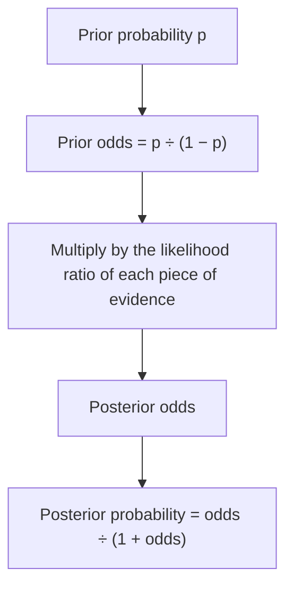

## A faster way to update

The lesson on trees and Bayes' theorem found $P(D \mid +)$ by drawing a tree, multiplying along
paths and dividing one path by the total. It works, but for a second test you had to redo the
whole calculation with a new prior. Doctors, forecasters, spam filters and forensic scientists
usually use a shortcut: write the prior as **odds**, and each piece of evidence becomes a single
number to multiply by. This honors lesson develops that odds form of Bayes' theorem, shows why it
makes repeated evidence easy, and uses it to expose a reasoning error that has helped convict
innocent people.

## Odds

The odds of an event compare its probability with the probability of its complement:

$$\text{odds}(A) = \frac{P(A)}{1 - P(A)}, \qquad P(A) = \frac{\text{odds}}{1 + \text{odds}}.$$

A probability of 0.2 is odds of $0.2/0.8 = 0.25$, said "1 to 4": for every 1 time $A$ happens, 4
times it doesn't. Odds of 3 ("3 to 1") mean $P = 3/4$.

| Probability | 0.02 | 0.2 | 0.5 | 0.75 | 0.9 |
|---|---|---|---|---|---|
| Odds | 1/49 ≈ 0.0204 | 0.25 (1 to 4) | 1 (even) | 3 (3 to 1) | 9 (9 to 1) |

Probabilities live between 0 and 1; odds run from 0 to infinity. For rare events the two are
nearly equal (0.02 versus 0.0204). Be careful with gambling language: "odds of 4 to 1 against"
means odds of $1/4$ *for* the event.

## Bayes' theorem in odds form

Let $H$ be a hypothesis (the person has the condition, the suspect left the trace) and $E$ the
evidence (a positive test, a matching sample). Write Bayes' theorem twice, once for $H$ and once
for its complement:

$$P(H \mid E) = \frac{P(H)\,P(E \mid H)}{P(E)}, \qquad P(H^c \mid E) = \frac{P(H^c)\,P(E \mid H^c)}{P(E)}.$$

Divide the first by the second. The awkward denominator $P(E)$ cancels:

$$\underbrace{\frac{P(H \mid E)}{P(H^c \mid E)}}_{\text{posterior odds}} = \underbrace{\frac{P(H)}{P(H^c)}}_{\text{prior odds}} \times \underbrace{\frac{P(E \mid H)}{P(E \mid H^c)}}_{\text{likelihood ratio}}.$$

The **likelihood ratio** (LR) measures how much more likely the evidence is if $H$ is true than if
it is false. It is the whole contribution of the evidence:

- LR greater than 1: the evidence supports $H$ (odds go up).
- LR less than 1: the evidence counts against $H$ (odds go down).
- LR equal to 1: the evidence is useless for this question, however impressive it sounds.

So: *posterior odds = prior odds × likelihood ratio.*



## Likelihood ratios of a test

For a diagnostic test with sensitivity $P(+ \mid D)$ and specificity $P(- \mid D^c)$,

$$\text{LR}_{+} = \frac{\text{sensitivity}}{1 - \text{specificity}}, \qquad \text{LR}_{-} = \frac{1 - \text{sensitivity}}{\text{specificity}}.$$

The test's likelihood ratios depend only on the test, not on who is being tested; the prior carries
the information about the population. That separation is why medical references often report
likelihood ratios.

### Example 1: the screening test again

The screening test from the lesson on Bayes' theorem had prevalence 2%, sensitivity 0.95 and
specificity 0.90.

1. Prior odds: $0.02/0.98 = 1/49 \approx 0.0204$.
2. $\text{LR}_{+} = 0.95/0.10 = 9.5$: a positive result is 9.5 times as likely for someone with the
   condition as for someone without it.
3. Posterior odds: $9.5/49 \approx 0.1939$.
4. Back to probability: $0.1939/1.1939 \approx 0.162$.

This matches the tree exactly, as it must: it is the same theorem rearranged.

### Example 2: two positive tests, or one negative

A second independent positive multiplies the odds by 9.5 again: $9.5^2/49 \approx 1.842$, so
$P(D \mid ++) \approx 1.842/2.842 \approx 0.648$, the same 65% the earlier lesson found by
using 0.162 as a new prior.

A single *negative* result instead has $\text{LR}_{-} = 0.05/0.90 \approx 0.0556$ (about 1/18).
Posterior odds: $0.0204 \times 0.0556 \approx 0.00113$, so $P(D \mid -) \approx 0.0011$. A
negative result makes the condition about 18 times less likely in odds terms.

*An assumption to state.* Multiplying likelihood ratios is valid when the pieces of evidence are
**conditionally independent**: independent among people who have the condition, and also among
people who don't. Repeating the same test on the same person often fails this, because whatever
fooled it the first time (a cross-reacting substance, say) may fool it again. Then the second
result is worth less than its LR suggests.

The plot shows the whole picture for this test: one positive result lifts every prior, and one
negative result pushes every prior down. The dashed diagonal is "no evidence" (posterior = prior).

```plot
{"x": [0, 1], "y": [0, 1], "xLabel": "prior probability", "yLabel": "posterior probability", "functions": [{"f": "9.5*x/(9.5*x + 1 - x)", "label": "after a positive (LR = 9.5)"}, {"f": "(x/18)/(x/18 + 1 - x)", "label": "after a negative (LR = 1/18)"}, {"f": "x", "dashed": true}], "points": [{"at": [0.02, 0.162], "label": "prior 0.02 → 0.162"}], "caption": "Posterior probability against prior probability for one test result"}
```

The same LR of 9.5 turns a 2% prior into 16% but a 50% prior into about 90%. Evidence is a
multiplier, not a replacement for the prior.

## Adding evidence: log odds

Taking logarithms turns multiplication into addition:

$$\log(\text{posterior odds}) = \log(\text{prior odds}) + \log(\text{LR}_1) + \log(\text{LR}_2) + \cdots$$

Each conditionally independent piece of evidence *adds* its **weight of evidence** $\log(\text{LR})$
to the running total. During World War II, Alan Turing and I. J. Good used this additive scale in
codebreaking at Bletchley Park, measuring evidence in units they called bans and decibans. Modern
spam filters and logistic regression models work on the same log-odds scale.

## The prosecutor's fallacy

The **prosecutor's fallacy** is confusing $P(E \mid \text{innocent})$, the chance of the evidence
if the defendant is innocent, with $P(\text{innocent} \mid E)$, the chance the defendant is innocent
given the evidence. It is the same confusion between $P(A \mid B)$ and $P(B \mid A)$ warned about in
the conditional probability lesson, with much higher stakes.

### Example 3: a trace evidence match

A crime-scene sample has a profile shared by 1 person in 10,000 at random. A suspect matches. An
expert says "the chance of a match if he is innocent is 1 in 10,000," and a juror hears "the
chance he is innocent is 1 in 10,000." Suppose, to isolate the statistics, that there is no other
evidence and the source could be any of 500,000 people in the region, so the prior probability
that this suspect is the source is $1/500{,}000$.

1. Prior odds: $1/499{,}999$.
2. LR: $P(\text{match} \mid \text{source}) / P(\text{match} \mid \text{not source}) = 1/(1/10{,}000) = 10{,}000$.
3. Posterior odds: $10{,}000/499{,}999 \approx 0.020$, so $P(\text{source} \mid \text{match}) \approx 0.0196$.

About 50 of the other 499,999 people would also match, so on this evidence alone the suspect is
one of roughly 51 matching people. The match is strong evidence (it multiplied the odds by
10,000), but it is not proof. In a real case other evidence changes the prior a great deal, and
laboratory error rates matter too; this example is deliberately simplified.

### A real case

In 1999 Sally Clark, an English solicitor, was convicted of murdering her two baby sons. A
pediatrician testified that the chance of two sudden infant deaths (SIDS) in a family like hers was
about 1 in 73 million, obtained by squaring an estimate of 1 in 8,543 for one death. The figure
had two flaws. Squaring assumes the two deaths are independent, but genetic and environmental
factors shared within a family make a second SIDS death more likely after a first. And even a
correct small probability of the evidence under innocence is not the probability of innocence:
two murders of infants by a parent are also extremely rare, and the court needed to compare the
two explanations, as the odds form does. The Royal Statistical Society publicly criticized the
statistics in 2001. The convictions were overturned in 2003, mainly because medical evidence
pointing to natural causes had not been disclosed, but the case is now a standard warning about
misused probability.

### Example 4: the Monty Hall problem

On a game show, a car is behind one of three doors and goats are behind the others. You pick door
1. The host, who knows where the car is, always opens a door you didn't pick that hides a goat,
choosing at random when he has two such doors. He opens door 3. Should you switch to door 2?

Compare "car behind 1" with "car behind 2". The prior odds are 1 to 1.

- If the car is behind door 1, the host chooses door 2 or 3 at random: $P(\text{opens } 3) = \tfrac12$.
- If the car is behind door 2, the host must open door 3: $P(\text{opens } 3) = 1$.

The likelihood ratio for door 1 against door 2 is $\tfrac12 \div 1 = \tfrac12$, so the posterior
odds are 1 to 2: $P(\text{car behind } 1) = \tfrac13$ and $P(\text{car behind } 2) = \tfrac23$.
Switch. Notice that the answer depends on the host's rules. If he opened a door at random and it
happened to show a goat, the likelihood ratio would be 1 and switching would not help.

## Common mistakes

- Treating odds as a probability: odds of 0.25 mean $P = 0.2$, not 0.25 (the two are close only
  for rare events).
- Reading the likelihood ratio as the posterior: an LR of 10,000 does not mean "10,000 to 1 that
  he did it"; it must multiply the prior odds.
- The prosecutor's fallacy: equating $P(E \mid \text{innocent})$ with $P(\text{innocent} \mid E)$.
- Multiplying likelihood ratios for evidence that is not conditionally independent, such as the
  same test repeated when its errors tend to repeat.
- Forgetting that the answer depends on how the evidence was produced (the host's rules).

## Key points

- $\text{odds} = p/(1-p)$ and $p = \text{odds}/(1 + \text{odds})$.
- Posterior odds = prior odds × likelihood ratio, where $\text{LR} = P(E \mid H)/P(E \mid H^c)$.
- For a test, $\text{LR}_{+} = \text{sens}/(1 - \text{spec})$ and $\text{LR}_{-} = (1 - \text{sens})/\text{spec}$.
- Conditionally independent pieces of evidence multiply their LRs (add their log LRs).
- A small $P(\text{evidence} \mid \text{innocent})$ is not a small $P(\text{innocent} \mid \text{evidence})$.
