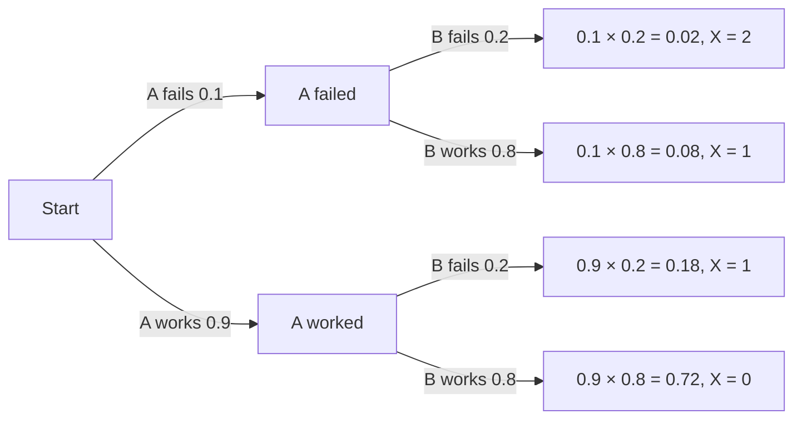

## Numbers from chance

Module 5 assigned probabilities to events. Often the outcome we care about is a *number*:
the count of defective welds in a batch, the profit from an insurance policy, the number of
trains late today. A **random variable** is a variable whose value is a numerical outcome
of a random process. Random variables let us use the tools of Modules 1–2 — center,
spread, shape — on probability models. They are written with capital letters ($X$, $Y$);
specific values with lower case ($x$).

## Discrete probability distributions

A **discrete random variable** takes a countable set of values, usually whole numbers. Its
**probability distribution** lists each value $x_i$ with its probability $p_i$, and a valid
distribution needs

$$0 \le p_i \le 1 \qquad\text{and}\qquad \sum p_i = 1.$$

Let $X$ be the number of defects found on a randomly chosen rail weld:

| $x$ | 0 | 1 | 2 | 3 |
|---|---|---|---|---|
| $P(X = x)$ | 0.50 | 0.30 | 0.15 | 0.05 |

```plot
{"x": [-1.224, 3.6], "y": [-0.09, 0.525], "grid": false, "bars": [{"x": 0, "height": 0.5, "width": 0.7}, {"x": 1, "height": 0.3, "width": 0.7}, {"x": 2, "height": 0.15, "width": 0.7}, {"x": 3, "height": 0.05, "width": 0.7}], "segments": [{"from": [-0.6000000000000001, 0], "to": [3.6, 0]}, {"from": [-0.6000000000000001, 0], "to": [-0.6000000000000001, 0.5]}, {"from": [-0.68, 0.1], "to": [-0.6000000000000001, 0.1]}, {"from": [-0.68, 0.2], "to": [-0.6000000000000001, 0.2]}, {"from": [-0.68, 0.3], "to": [-0.6000000000000001, 0.3]}, {"from": [-0.68, 0.4], "to": [-0.6000000000000001, 0.4]}, {"from": [-0.68, 0.5], "to": [-0.6000000000000001, 0.5]}], "labels": [{"at": [0, -0.03], "text": "0"}, {"at": [1, -0.03], "text": "1"}, {"at": [2, -0.03], "text": "2"}, {"at": [3, -0.03], "text": "3"}, {"at": [-0.96, 0.094], "text": "0.1"}, {"at": [-0.96, 0.194], "text": "0.2"}, {"at": [-0.96, 0.294], "text": "0.3"}, {"at": [-0.96, 0.394], "text": "0.4"}, {"at": [-0.96, 0.494], "text": "0.5"}, {"at": [1.5, -0.07], "text": "defects x"}], "caption": "Probability histogram of the number of defects (right-skewed)"}
```

Probabilities of events come from adding: $P(X \ge 2) = 0.15 + 0.05 = 0.20$, and
$P(X \ge 1) = 1 - P(X = 0) = 0.50$.

## Expected value

The **expected value** (mean) of $X$ is the probability-weighted average of its values:

$$E(X) = \mu_X = \sum x_i p_i.$$

It is the long-run average of $X$ over many repetitions — by the law of large numbers, the
average of many observed values approaches $\mu_X$. For the welds,

$$\mu_X = 0(0.50) + 1(0.30) + 2(0.15) + 3(0.05) = 0.75 \text{ defects}.$$

No weld has 0.75 defects; the expected value need not be a possible value. It says that
over many welds, the average is 0.75 defects per weld — so 1,000 welds would have about 750
defects in total.

This is exactly the weighted mean from Module 1, with probabilities as the weights.

The picture below shows why the mean is also called the *balance point*. Think of the probability
histogram as blocks on a beam: the beam balances exactly at $\mu_X = 0.75$, not at the tallest bar
(the most likely value, 0) and not at the middle of the possible values (1.5). The long right tail
pulls the balance point to the right of the tallest bar, just as a tail pulls the mean of a data set.


## Variance and standard deviation

The variance is the expected squared distance from the mean:

$$\sigma_X^2 = \sum (x_i - \mu_X)^2 p_i, \qquad \sigma_X = \sqrt{\sigma_X^2}.$$

A computing shortcut: $\sigma_X^2 = E(X^2) - \mu_X^2 = \sum x_i^2 p_i - \mu_X^2$.

### Example 1

Find the standard deviation of the number of defects.

| $x$ | $p$ | $x - \mu$ | $(x - \mu)^2 p$ |
|---|---|---|---|
| 0 | 0.50 | −0.75 | 0.28125 |
| 1 | 0.30 | 0.25 | 0.01875 |
| 2 | 0.15 | 1.25 | 0.234375 |
| 3 | 0.05 | 2.25 | 0.253125 |

Sum: $\sigma_X^2 = 0.7875$, so $\sigma_X \approx 0.887$ defects.

Shortcut check: $E(X^2) = 0(0.5) + 1(0.3) + 4(0.15) + 9(0.05) = 1.35$, and
$1.35 - 0.75^2 = 0.7875$. ✓

Unlike the sample variance, there is no $n - 1$ here: a probability distribution describes
a population (the long run), so we divide by nothing — the probabilities already sum to 1.

## Expected value in decisions

### Example 2: insurance

An insurer sells a one-year policy for \$350. With probability 0.01 it pays a \$20,000 claim;
with probability 0.02, a \$5,000 claim; otherwise nothing. Let $X$ be the insurer's profit.

| Outcome | Profit $x$ | $p$ |
|---|---|---|
| Large claim | $350 - 20{,}000 = -19{,}650$ | 0.01 |
| Small claim | $350 - 5{,}000 = -4{,}650$ | 0.02 |
| No claim | $350$ | 0.97 |

$E(X) = -19{,}650(0.01) - 4{,}650(0.02) + 350(0.97) = -196.5 - 93 + 339.5 = 50$.

The insurer expects \$50 profit per policy. On one policy it might lose \$19,650; over
thousands of policies the average profit is reliably close to \$50. The standard deviation
(about \$2,100 here) shows how risky a single policy is — insurers rely on the law of large
numbers across many policies.

### Example 3: a game

You pay \$2 to roll a die. A 6 wins \$10 (net gain \$8); anything else wins nothing (net
−\$2). Expected net gain: $8 \cdot \tfrac{1}{6} + (-2) \cdot \tfrac{5}{6} = \tfrac{8 - 10}{6} \approx -\$0.33$.
On average you lose about 33 cents per game. A **fair game** has expected net gain 0; this
one would be fair if a 6 paid \$12 total (net \$10): $10 \cdot \tfrac16 - 2 \cdot \tfrac56 = 0$.

## Discrete vs. continuous

A **continuous random variable** takes any value in an interval (a waiting time, a
weight). Its probabilities are areas under a density curve, as with the normal
distributions of Module 2, and $P(X = x) = 0$ for any single value. In this course the
continuous models you will use are the normal distribution and, later for inference, the $t$
and chi-square distributions; the rest of this module is about discrete random variables.

### Example 4: building a distribution from scratch

A signal box has two independent relays; relay A fails with probability 0.1 and relay B with
probability 0.2. Let $X$ be the number of failed relays.

A tree diagram lists every path; multiply along each path, then add the paths that give the same value of $X$.



1. $P(X = 0) = 0.9 \times 0.8 = 0.72$.
2. $P(X = 1) = 0.1 \times 0.8 + 0.9 \times 0.2 = 0.08 + 0.18 = 0.26$.
3. $P(X = 2) = 0.1 \times 0.2 = 0.02$.

Check: $0.72 + 0.26 + 0.02 = 1$. Then $\mu_X = 0.26 + 2(0.02) = 0.30$, which equals
$0.1 + 0.2$ — the expected number of failures is the sum of the individual failure
probabilities, a preview of the rules in the next lesson.

## Common mistakes

- Averaging the values without weighting by their probabilities.
- Thinking the expected value must be a possible outcome, or the most likely one.
- Forgetting to square deviations, or forgetting the final square root for $\sigma$.
- Using net and gross amounts inconsistently in games (subtract the cost from each payout).

## Key points

- A random variable assigns a number to each outcome; a discrete distribution lists values and probabilities summing to 1.
- $\mu_X = \sum x_i p_i$: the long-run average.
- $\sigma_X^2 = \sum (x_i - \mu_X)^2 p_i = E(X^2) - \mu_X^2$; $\sigma_X = \sqrt{\sigma_X^2}$.
- Expected value guides decisions over many repetitions; the SD measures the risk of one.
