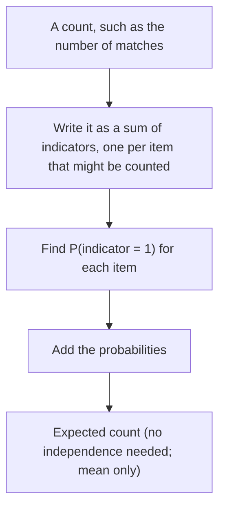

## A rule with no fine print

Lesson 25 gave two rules for a sum of random variables. Means add, $\mu_{X+Y} = \mu_X + \mu_Y$,
"for any two random variables"; variances add only when the variables are independent. You
have already used the first rule without thinking of it as special. In lesson 24, Example 4,
the expected number of failed relays came out as $0.1 + 0.2$, the sum of the two failure
probabilities. In lesson 26, the binomial mean $np$ came from adding $n$ variables that are each
0 or 1.

This honors lesson takes that unconditional rule seriously. Combined with variables that only
record whether something happened, it answers questions whose full probability distributions
would be painful or impossible to write down: How many letters land in the right envelope?
How many cereal boxes until you have every toy? How many pairs in a class share a birthday?

## Why means add, even for dependent variables

Suppose $X$ and $Y$ are discrete, and write $p(x, y) = P(X = x \text{ and } Y = y)$ for their
joint probabilities. The expected value of $X + Y$ is the probability-weighted average of
$x + y$ over all pairs:

$$E(X + Y) = \sum_x \sum_y (x + y)\,p(x, y) = \sum_x x \sum_y p(x, y) + \sum_y y \sum_x p(x, y).$$

For a fixed $x$, adding $p(x, y)$ over all $y$ gives $P(X = x)$, and likewise for $y$. So

$$E(X + Y) = \sum_x x\,P(X = x) + \sum_y y\,P(Y = y) = E(X) + E(Y).$$

Nowhere did we assume that $p(x, y) = P(X = x)P(Y = y)$. The argument works whatever the
relationship between $X$ and $Y$. Together with $E(a + bX) = a + bE(X)$, this gives
**linearity of expectation**: for any random variables $X_1, \ldots, X_n$ and constants,

$$E(c + a_1X_1 + a_2X_2 + \cdots + a_nX_n) = c + a_1E(X_1) + a_2E(X_2) + \cdots + a_nE(X_n).$$

Linearity is about *sums and constant multiples only*. Three things that look similar are
not covered:

- **Variances.** $\text{Var}(X + Y) = \text{Var}(X) + \text{Var}(Y)$ needs independence (the
  next honors lesson shows what replaces it).
- **Products.** $E(XY) = E(X)E(Y)$ holds for independent variables, but not in general. If
  $Y = X$, then $E(XY) = E(X^2)$, which is not $E(X)^2$.
- **Other functions.** For a fair die, $E(X) = 3.5$ but $E(X^2) = \tfrac{1 + 4 + 9 + 16 + 25 + 36}{6} = \tfrac{91}{6} \approx 15.17$,
  not $3.5^2 = 12.25$. The gap, $15.17 - 12.25 \approx 2.92$, is exactly the variance (lesson 24's
  shortcut formula), so $E(X^2) = E(X)^2$ only when there is no spread at all.

## Indicator variables

An **indicator variable** for an event $A$ records whether $A$ happened:

$$I_A = \begin{cases} 1 & \text{if } A \text{ occurs} \\ 0 & \text{if not.} \end{cases}$$

Its mean is $E(I_A) = 1 \cdot P(A) + 0 \cdot (1 - P(A)) = P(A)$: *the expected value of an
indicator is the probability of its event.* (Its variance is $P(A)(1 - P(A))$, as in the
binomial derivation.)

Many counts are sums of indicators: one indicator for each thing that might be counted. The
number of defectives in a sample is the sum over the items sampled of "this item is defective".
Linearity then turns a hard expected count into a sum of easy probabilities:



### Example 1: sampling without replacement

A box holds 12 parts, 3 of them defective. You draw 5 without replacement. Lesson 26 said the
count $X$ of defectives is *not* binomial, because the draws are far from independent. What is
$E(X)$?

1. Let $I_j = 1$ if the $j$th draw is defective, for $j = 1, \ldots, 5$. Then
   $X = I_1 + I_2 + I_3 + I_4 + I_5$.
2. Before anything is drawn, the $j$th draw is equally likely to be any of the 12 parts (shuffle
   the box and deal; every position is alike). So $P(I_j = 1) = 3/12 = 0.25$ for *every* $j$,
   even though the indicators are dependent: if draw 1 is defective, draw 2 is less likely to be.
3. By linearity, $E(X) = 5 \times 0.25 = 1.25$ defectives.

Check by brute force. There are $\binom{12}{5} = 792$ equally likely samples, and the number
with $k$ defectives is $\binom{3}{k}\binom{9}{5-k}$: 126, 378, 252 and 36 for $k = 0, 1, 2, 3$. So

$$E(X) = \frac{0(126) + 1(378) + 2(252) + 3(36)}{792} = \frac{990}{792} = 1.25. \checkmark$$

The mean matches the binomial formula $np$, even though the model is not binomial. The spread does
*not* match: dependence changes the variance, as the next honors lesson shows.

### Example 2: the matching problem

A clerk puts $n$ letters into $n$ addressed envelopes at random. What is the expected number of
letters that land in their own envelope? This classic is often called the **matching problem**.

1. Let $I_j = 1$ if letter $j$ is in its own envelope. Letter $j$ is equally likely to be in any
   of the $n$ envelopes, so $P(I_j = 1) = 1/n$.
2. The number of matches is $M = I_1 + \cdots + I_n$, so $E(M) = n \cdot \tfrac{1}{n} = 1$.

The answer is 1 *whatever $n$ is*: 3 letters or 3 million. Check $n = 3$ by listing all 6
arrangements (the digits say which letter is in envelopes 1, 2, 3):

| Arrangement | 123 | 132 | 213 | 321 | 231 | 312 |
|---|---|---|---|---|---|---|
| Matches | 3 | 1 | 1 | 1 | 0 | 0 |

The average is $(3 + 1 + 1 + 1 + 0 + 0)/6 = 1$. ✓ Writing down the whole distribution of $M$ for large
$n$ takes real work (the chance of no match at all approaches $1/e \approx 0.368$), but the mean took
two lines.

## Waiting times as sums: the coupon collector

Indicators are one way to split a random variable into pieces; another is to split a waiting
time into stages. In the **coupon collector problem**, each cereal box holds one of $n$ different
toys, each equally likely and independent from box to box. How many boxes do you expect to buy
to collect all $n$?

Split the wait into stages. Stage 1 ends with your first toy (exactly 1 box). Once you have $k$
different toys, each new box is new to you with probability $(n - k)/n$, so the wait for the
next new toy is a *geometric* random variable (lesson 27) with $p = (n - k)/n$ and mean $n/(n - k)$.
The total wait is the sum of the stage waits, so by linearity

$$E(\text{boxes}) = \frac{n}{n} + \frac{n}{n-1} + \cdots + \frac{n}{1} = n\left(1 + \frac12 + \frac13 + \cdots + \frac1n\right).$$

The sum in parentheses is the $n$th **harmonic number** $H_n$. It grows without bound but very
slowly, roughly like $\ln n + 0.58$ for large $n$, so the expected wait is roughly $n \ln n$.

### Example 3: six toys

For $n = 6$ the stage means are $\tfrac66, \tfrac65, \tfrac64, \tfrac63, \tfrac62, \tfrac61$, that is
1, 1.2, 1.5, 2, 3 and 6 boxes. The expected total is

$$1 + 1.2 + 1.5 + 2 + 3 + 6 = 14.7 \text{ boxes} \quad (= 6 \times H_6 = 6 \times 2.45).$$

```plot
{"x": [0, 7], "y": [0, 6.6], "bars": [{"x": 1, "height": 1, "width": 0.7}, {"x": 2, "height": 1.2, "width": 0.7}, {"x": 3, "height": 1.5, "width": 0.7}, {"x": 4, "height": 2, "width": 0.7}, {"x": 5, "height": 3, "width": 0.7}, {"x": 6, "height": 6, "width": 0.7}], "xLabel": "stage (which new toy)", "yLabel": "expected boxes", "caption": "Expected boxes for each new toy when there are 6 toys: 1, 1.2, 1.5, 2, 3 and 6, total 14.7. The last toy alone takes 6."}
```

The last toy alone accounts for 6 of the 14.7 boxes, about 41%: when only one toy is missing, each
box has just a 1-in-6 chance of being the one you need.

Because each stage uses new boxes, the stage waits are independent, so here the *variances* add
too. A geometric wait has variance $(1-p)/p^2$ (the square of lesson 27's $\sqrt{1-p}/p$), so

$$\text{Var} = 0 + \frac{1/6}{(5/6)^2} + \frac{2/6}{(4/6)^2} + \frac{3/6}{(3/6)^2} + \frac{4/6}{(2/6)^2} + \frac{5/6}{(1/6)^2} = 0 + 0.24 + 0.75 + 2 + 6 + 30 = 38.99,$$

and the SD is about $\sqrt{38.99} \approx 6.24$ boxes. The total wait is very spread out and
right-skewed: a computer simulation of 200,000 collectors (our own check) put about 58% of them at
14 boxes or fewer, but about 1 in 200 needed 40 or more.

### Example 4: shared birthdays

In a class of 30, what is the expected number of *pairs* of students who share a birthday?
Assume, as a simplification, 365 equally likely birthdays (this ignores February 29 and the real,
mild seasonal pattern in births).

1. There are $\binom{30}{2} = 435$ pairs. Give each pair an indicator that equals 1 if the two
   share a birthday.
2. For any one pair, the second person's birthday matches the first's with probability $1/365$.
3. $E(\text{shared pairs}) = 435 \times \tfrac{1}{365} \approx 1.19$.

The pair indicators are dependent (if Ana matches Ben and Ben matches Cy, then Ana matches Cy),
but linearity doesn't care. Notice what linearity does *not* give: the probability that at least
one pair shares a birthday. That needs the complement rule,
$1 - \tfrac{365 \times 364 \times \cdots \times 336}{365^{30}} \approx 0.706$. An expected count is not a
probability, even when it is near 1.

## Common mistakes

- Believing linearity needs independence. It doesn't; independence is needed for variances to
  add and for $E(XY) = E(X)E(Y)$.
- Pushing expectation through a nonlinear function: $E(X^2) \ne E(X)^2$ and
  $E(1/X) \ne 1/E(X)$ in general.
- Treating an expected count as a probability ("we expect 1.19 shared pairs, so a shared pair
  is certain").
- Choosing indicators that don't add up to the count, such as counting ordered pairs (Ana–Ben and
  Ben–Ana) and doubling the answer.
- In the coupon collector, forgetting that the first stage takes exactly one box, or using
  $p = k/n$ instead of $(n - k)/n$ for the chance of a *new* toy.

## Key points

- Linearity of expectation: $E(\sum a_iX_i + c) = \sum a_iE(X_i) + c$ for *any* random variables.
- An indicator's mean is the probability of its event: $E(I_A) = P(A)$.
- Expected count = sum of the probabilities that each item is counted.
- Matching: the expected number of matches is 1 for every $n$. Coupon collector: $n H_n$ boxes.
- Linearity gives means only; variances and probabilities usually need more (independence or the
  full distribution).
