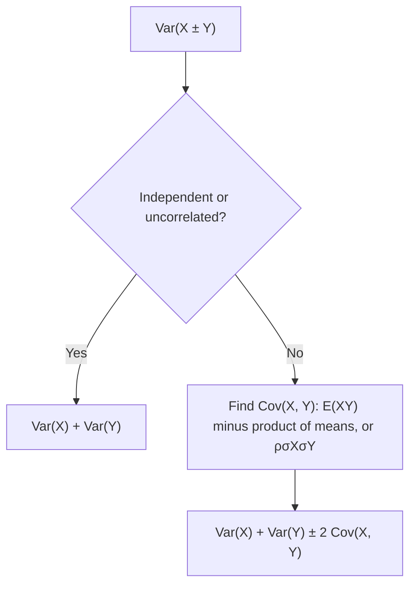

## What replaces "variances add"

Lesson 25 added variances only for independent random variables, and quoted without proof a
general formula with a correlation term, $\sigma_{X \pm Y}^2 = \sigma_X^2 + \sigma_Y^2 \pm 2\rho\,\sigma_X\sigma_Y$.
The previous honors lesson found the mean number of defectives in a sample drawn without
replacement, and promised that the spread would differ from the binomial one. This lesson
delivers on both. It defines the covariance of two random variables, proves the general variance
formula, and uses it to explain two things you have taken on trust: why spreading money over
several investments reduces risk, and why the 10% condition makes the binomial model safe.

## Two random variables at once

To describe how two discrete random variables behave *together*, list the probability of each
pair of values: their joint distribution. On a commuter railway, let $X$ be the number of late
trains on line A during the morning peak and $Y$ the number of late trains on line B (each line
runs few trains at the peak, so the counts are small). Both lines share the same weather, so they
tend to run late together. Suppose the joint probabilities are

| | $Y = 0$ | $Y = 1$ | $P(X = x)$ |
|---|---|---|---|
| $X = 0$ | 0.40 | 0.10 | 0.50 |
| $X = 1$ | 0.15 | 0.15 | 0.30 |
| $X = 2$ | 0.05 | 0.15 | 0.20 |
| $P(Y = y)$ | 0.60 | 0.40 | 1 |

The row and column totals are the distributions of $X$ and of $Y$ alone, just like the marginal
distributions of a two-way table. From them, $\mu_X = 0.3 + 0.4 = 0.7$, $E(X^2) = 0.3 + 0.8 = 1.1$, so
$\sigma_X^2 = 1.1 - 0.49 = 0.61$; and $\mu_Y = 0.4$, $\sigma_Y^2 = 0.4 - 0.16 = 0.24$.

Are $X$ and $Y$ independent? Independence would need *every* cell to equal the product of its
row and column totals. The first cell fails: $P(X = 0, Y = 0) = 0.40$, but
$P(X = 0)P(Y = 0) = 0.5 \times 0.6 = 0.30$. Good mornings on line A come with good mornings on
line B more often than independence would predict.

## Covariance

The **covariance** of $X$ and $Y$ measures how they vary together:

$$\text{Cov}(X, Y) = E\big[(X - \mu_X)(Y - \mu_Y)\big].$$

When both are above their means, or both below, the product $(X - \mu_X)(Y - \mu_Y)$ is positive;
when one is above and the other below, it is negative. So a positive covariance means the variables
tend to move together, a negative one that they tend to move in opposite directions. Expanding the
product and using linearity of expectation gives the computing shortcut

$$\text{Cov}(X, Y) = E(XY) - \mu_X\mu_Y,$$

the twin of $\sigma^2 = E(X^2) - \mu^2$. (In fact $\text{Cov}(X, X) = \text{Var}(X)$.)

### Example 1: covariance from the table

Only cells where both $X$ and $Y$ are nonzero contribute to $E(XY)$:

$$E(XY) = (1)(1)(0.15) + (2)(1)(0.15) = 0.45, \qquad \text{Cov}(X, Y) = 0.45 - (0.7)(0.4) = 0.17.$$

The covariance is positive, as expected. Its units are "trains × trains", which are hard to
interpret, so we usually rescale it to the correlation

$$\rho = \frac{\text{Cov}(X, Y)}{\sigma_X\sigma_Y} = \frac{0.17}{\sqrt{0.61}\sqrt{0.24}} \approx 0.44.$$

Like the correlation $r$ of a scatterplot in Module 3, $\rho$ has no units and always lies between
$-1$ and $1$; it measures the strength of the *linear* relationship between the random variables.

## Independent means uncorrelated, not the other way round

If $X$ and $Y$ are independent, every joint probability factors, $p(x, y) = P(X = x)P(Y = y)$, and the double sum for
$E(XY)$ splits into a product: $E(XY) = E(X)E(Y)$. So $\text{Cov}(X, Y) = 0$. Variables with zero
covariance are called **uncorrelated**.

The converse is false. Let $X$ be $-1$, $0$ or $1$ with probability $\tfrac13$ each, and $Y = X^2$.
Then $Y$ is completely determined by $X$, about as dependent as two variables can be. Yet
$E(X) = 0$ and $E(XY) = E(X^3) = \tfrac13(-1 + 0 + 1) = 0$, so $\text{Cov}(X, Y) = 0$. The relationship
is perfectly U-shaped, not linear, and covariance only detects the linear part.

## The variance of a sum, proved

Let $S = X + Y$, so $S - \mu_S = (X - \mu_X) + (Y - \mu_Y)$. Square and take expected values,
using linearity:

$$\text{Var}(X + Y) = E\big[(X - \mu_X)^2\big] + E\big[(Y - \mu_Y)^2\big] + 2E\big[(X - \mu_X)(Y - \mu_Y)\big],$$

that is,

$$\text{Var}(X \pm Y) = \text{Var}(X) + \text{Var}(Y) \pm 2\,\text{Cov}(X, Y).$$

More generally, $\text{Var}(aX + bY) = a^2\text{Var}(X) + b^2\text{Var}(Y) + 2ab\,\text{Cov}(X, Y)$.
Substituting $\text{Cov}(X, Y) = \rho\,\sigma_X\sigma_Y$ gives exactly lesson 25's general formula, and
for independent (or merely uncorrelated) variables the covariance term vanishes, leaving "variances add".



### Example 2: total late trains

For the railway, the total $T = X + Y$ has

$$\text{Var}(T) = 0.61 + 0.24 + 2(0.17) = 1.19, \qquad \sigma_T = \sqrt{1.19} \approx 1.09 \text{ trains}.$$

Check directly from the table: $T$ is 0, 1, 2, 3 with probabilities 0.40, $0.10 + 0.15 = 0.25$,
$0.15 + 0.05 = 0.20$ and 0.15, so $E(T) = 1.1$ and $E(T^2) = 0.25 + 0.8 + 1.35 = 2.4$, and
$\text{Var}(T) = 2.4 - 1.21 = 1.19$. ✓ Wrongly assuming independence would give
$\sigma_T = \sqrt{0.85} \approx 0.92$: bad mornings pile up on both lines at once, so the total is
riskier than independence suggests.

## Diversification

**Diversification** means spreading money (or risk) over several investments so that their ups and
downs partly cancel. Covariance says exactly how much it helps.

### Example 3: two investments

*A deliberately simplified model.* Two investments $A$ and $B$ each have mean annual return 6% and
SD 10 percentage points, with correlation $\rho$. Put half your money in each, so your return is
$R = 0.5A + 0.5B$. The mean is still 6%, and

$$\text{Var}(R) = 0.25(100) + 0.25(100) + 2(0.5)(0.5)\,\rho\,(10)(10) = 50(1 + \rho).$$

| $\rho$ | 1 | 0.3 | 0 | $-0.5$ | $-1$ |
|---|---|---|---|---|---|
| SD of $R$ (points) | 10 | 8.06 | 7.07 | 5 | 0 |

```plot
{"x": [-1, 1], "y": [0, 11], "functions": [{"f": "sqrt(50*(1+x))"}], "points": [{"at": [0, 7.071], "label": "independent: 7.07"}, {"at": [1, 10], "label": "ρ = 1: 10"}], "xLabel": "correlation ρ between the investments", "yLabel": "SD of the 50-50 mix", "caption": "The same average return carries less risk the lower the correlation; perfectly correlated investments give no benefit"}
```

With $\rho = 1$ the two investments are really one, and mixing them gains nothing. Every lower
correlation gives the same mean with less risk. Real returns are messier than this model: their
distributions are not fixed, and correlations between investments tend to rise in a crisis,
just when diversification is needed most. The direction of the effect is solid; the exact numbers
depend on assumptions.

## Sampling without replacement: negative covariance

Return to the box of $N = 12$ parts with $K = 3$ defective, sampling $n = 5$ without replacement.
Write $p = K/N = 0.25$ and let $I_j$ indicate that draw $j$ is defective. Each $I_j$ has mean $p$
and variance $p(1 - p)$. For two different draws,

$$P(I_i = 1 \text{ and } I_j = 1) = \frac{K}{N} \cdot \frac{K - 1}{N - 1},$$

so the covariance $\text{Cov}(I_i, I_j) = \tfrac{K(K-1)}{N(N-1)} - p^2$ simplifies to
$-\tfrac{p(1-p)}{N - 1}$. It is *negative*: one defective drawn leaves fewer for the other draws.
Adding the $n$ variances and the $n(n-1)$ covariance terms (one for each ordered pair of different
draws) gives

$$\text{Var}(X) = np(1-p) - n(n-1)\frac{p(1-p)}{N - 1} = np(1-p)\cdot\frac{N - n}{N - 1}.$$

The factor $\dfrac{N - n}{N - 1}$ is the **finite population correction**.

### Example 4: the box of 12

$\text{Var}(X) = 5(0.25)(0.75) \cdot \tfrac{7}{11} \approx 0.5966$, so $\sigma_X \approx 0.772$. The
binomial formula would give $\sqrt{5(0.25)(0.75)} \approx 0.968$, about 25% too large. A direct check
with the counts 126, 378, 252, 36 out of 792 from the previous lesson: $E(X^2) = (378 + 4 \cdot 252 + 9 \cdot 36)/792 \approx 2.159$,
and $2.159 - 1.25^2 \approx 0.5966$. ✓ Sampling without replacement makes the count *less* variable,
because each draw slightly balances the ones before it.

### Example 5: where the 10% condition comes from

If the sample is 10% of a large population, the correction factor is about $1 - n/N = 0.9$ (for
$N = 1{,}000$ and $n = 100$ it is $900/999 \approx 0.901$). The SD is multiplied by about
$\sqrt{0.9} \approx 0.95$, so the binomial SD is only about 5% too large. That is the reasoning
behind the 10% condition: below it, ignoring the dependence changes the SD by at most about 5%.
The cutoff of 10% is a convention, not a theorem. For 50 voters from a city of 400,000 the factor is
$0.99988$, and the dependence is invisible.

## Common mistakes

- Adding variances for dependent variables; with positive covariance this understates the spread
  of a sum.
- Concluding "independent" from a covariance of zero; uncorrelated variables can be strongly
  (nonlinearly) dependent.
- Using $-2\,\text{Cov}$ for a sum or $+2\,\text{Cov}$ for a difference.
- Forgetting the factor 2, or forgetting $a^2$ and $b^2$ in $\text{Var}(aX + bY)$ while still
  writing $ab$ in the covariance term.
- Declaring independence because one cell of a joint table factors; every cell must equal the
  product of its row and column totals.

## Key points

- $\text{Cov}(X, Y) = E[(X - \mu_X)(Y - \mu_Y)] = E(XY) - \mu_X\mu_Y$; $\rho = \text{Cov}/(\sigma_X\sigma_Y)$.
- Independent ⇒ uncorrelated ($\text{Cov} = 0$), but not conversely.
- $\text{Var}(aX + bY) = a^2\sigma_X^2 + b^2\sigma_Y^2 + 2ab\,\text{Cov}(X, Y)$.
- Lower correlation between investments means less risk for the same mean return.
- Sampling without replacement: $\text{Var}(X) = np(1-p)\frac{N-n}{N-1}$; the 10% condition keeps the
  correction factor near 1.
