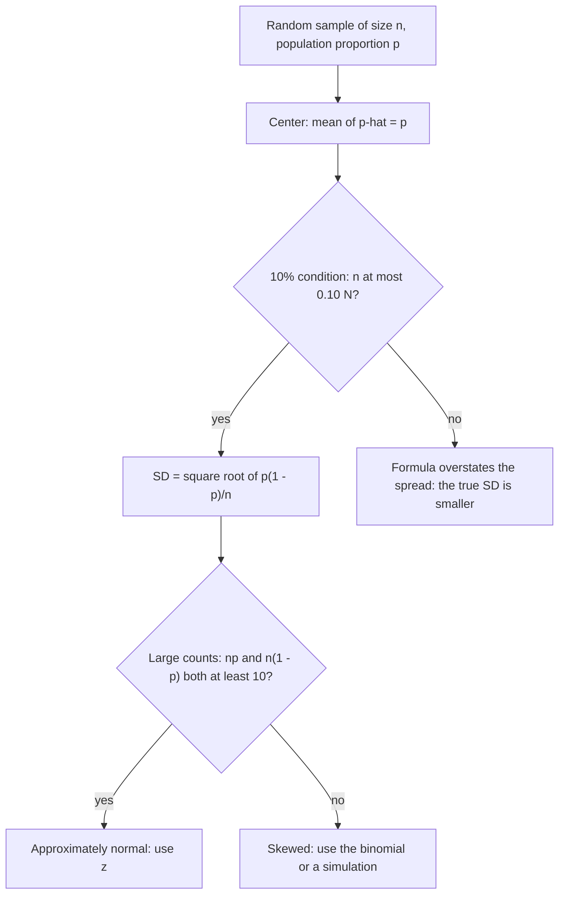

## The bridge to inference

Everything up to now has prepared for one idea. A statistic such as $\hat{p}$ or $\bar{x}$
is computed from a random sample, so it is itself a random variable: a different sample
would give a different value. If we know how a statistic varies from sample to sample, we
can say how far it is likely to be from the parameter — and that is what confidence
intervals and significance tests do. This lesson introduces sampling distributions and
works out the one for a sample proportion.

## Sampling distributions

The **sampling distribution** of a statistic is the distribution of its values over all
possible samples of the same size from the same population.

Imagine a population of 50,000 rail commuters, 60% of whom favor extending service hours.
Take an SRS of 150 and compute $\hat{p}$, the proportion in favor. Repeat thousands of
times. The histogram of all those $\hat{p}$ values approximates the sampling
distribution. It turns out to be centered at 0.60, roughly normal, with standard deviation
about 0.04.

Keep three distributions apart:

| Distribution | What it describes |
|---|---|
| Population distribution | the values of the variable for all individuals |
| Distribution of the sample data | the values in *one* sample |
| Sampling distribution | the values of a *statistic* across many samples |

The picture shows all three for the commuters. The population has 60% in favor (the parameter
$p = 0.60$). One SRS of 150 happened to contain 85 supporters, so its data show $\hat{p} \approx 0.57$.
The bottom panel is a real simulation: 1,000 SRSs of 150, one $\hat{p}$ from each. Their mean is
0.600 and their standard deviation is about 0.040, matching the formulas below.


## Bias and variability of a statistic

A statistic used to estimate a parameter is an **estimator**. It is an **unbiased
estimator** if the mean of its sampling distribution equals the parameter: it is not
systematically too high or too low. $\hat{p}$, $\bar{x}$ and $s^2$ are unbiased for $p$,
$\mu$ and $\sigma^2$.

The **variability** of a statistic is the spread of its sampling distribution, and it is
controlled mainly by the sample size: *larger samples give less variable statistics*.
Surprisingly, as long as the population is much larger than the sample, the population
size barely matters — an SRS of 1,500 is about as precise for a country of 300 million as
for a city of 300,000.

Think of a target: bias is aiming at the wrong spot; high variability is a wide scatter of
shots. Random sampling removes bias; large samples reduce variability.

## The sampling distribution of $\hat{p}$

Let $X$ be the number of successes in an SRS of size $n$ from a population with
proportion $p$, so $\hat{p} = X/n$. When the sample is less than 10% of the population,
$X$ is approximately $B(n, p)$, and dividing by $n$ (a linear transformation) gives:

$$\mu_{\hat{p}} = p, \qquad \sigma_{\hat{p}} = \sqrt{\frac{p(1-p)}{n}}.$$

- **Center**: $\hat{p}$ is unbiased.
- **Spread**: shrinks like $1/\sqrt{n}$. To halve the standard deviation, you need *four
  times* the sample size.
- *Shape*: approximately normal when the **large counts condition** holds:
  $np \ge 10$ and $n(1-p) \ge 10$.

The **10% condition** ($n \le 0.10N$) justifies the standard deviation formula when sampling
without replacement.

The checks fit together in a fixed order: the center needs nothing, the standard deviation
formula needs the 10% condition, and the normal shape needs large counts.



### Example 1

For the commuters: $p = 0.60$, $n = 150$.

1. $\mu_{\hat{p}} = 0.60$.
2. $\sigma_{\hat{p}} = \sqrt{0.6(0.4)/150} = \sqrt{0.0016} = 0.04$.
3. Conditions: $150 \le 0.10(50{,}000)$ ✓; $np = 90 \ge 10$, $n(1-p) = 60 \ge 10$ ✓, so
   approximately normal.
4. Probability a sample shows less than 55% in favor:
   $z = (0.55 - 0.60)/0.04 = -1.25$, $P(Z < -1.25) \approx 0.1056$.

About 1 in 9 samples of 150 would show under 55% support, even though 60% of the
population is in favor. That is sampling variability.

```plot
{"x": [0.44, 0.76], "y": [-1, 10.5], "grid": false, "functions": [{"f": "normpdf(x, 0.6, 0.04)"}], "shade": [{"f": "normpdf(x, 0.6, 0.04)", "from": 0.44, "to": 0.55}], "segments": [{"from": [0.44, 0], "to": [0.76, 0]}], "labels": [{"at": [0.55, -0.6], "text": "0.55"}, {"at": [0.6, -0.6], "text": "0.60"}, {"at": [0.68, -0.6], "text": "0.68"}, {"at": [0.52, -0.6], "text": "0.52"}], "caption": "Sampling distribution of p̂ for n = 150, p = 0.6; shaded: P(p̂ < 0.55)"}
```

### Example 2

A rail operator claims 30% of riders use monthly passes. In an SRS of 400 riders, how
likely is a sample proportion of 33% or more, if the claim is true?

1. $\sigma_{\hat{p}} = \sqrt{0.3(0.7)/400} \approx 0.0229$.
2. Large counts: $400(0.3) = 120$, $400(0.7) = 280$ ✓.
3. $z = (0.33 - 0.30)/0.0229 \approx 1.31$; $P(Z \ge 1.31) \approx 0.095$.

A sample result of 33% would not be very surprising if the claim were true. This style of
reasoning — "how likely is a result this extreme if the claim is true?" — is exactly the
logic of significance tests in Module 8.

## Simulation as a check

If conditions fail, simulation still works: use software to draw many samples from a
model population and look at the distribution of the statistic. For small samples with
$p$ near 0 or 1, the sampling distribution of $\hat{p}$ is skewed, and normal calculations
can be badly off.

### Example 3: the effect of sample size

Repeat Example 1 with an SRS of 600 commuters instead of 150. Now
$\sigma_{\hat{p}} = \sqrt{0.6(0.4)/600} = 0.02$, half as large (four times the sample). The chance
of a sample proportion below 0.55 becomes $P(Z < (0.55 - 0.60)/0.02) = P(Z < -2.5) \approx 0.006$,
down from about 0.106. Larger samples make results like "55% or less" far less likely when the
truth is 60%, which is exactly why larger samples give sharper conclusions.

## Common mistakes

- Confusing the sampling distribution with the distribution of one sample's data.
- Using $\sqrt{p(1-p)}/n$ or $p(1-p)/n$ for the standard deviation (the square root covers
  the whole fraction).
- Thinking a larger *population* reduces variability; it's the sample size that matters.
- Skipping the large counts check before using a normal model.

## Key points

- A sampling distribution shows how a statistic varies across all samples of size $n$.
- Unbiased: centered on the parameter. Variability: shrinks as $n$ grows.
- $\hat{p}$: mean $p$, SD $\sqrt{p(1-p)/n}$ (10% condition), approximately normal if
  $np \ge 10$ and $n(1-p) \ge 10$.
- Quadrupling $n$ halves the standard deviation.
