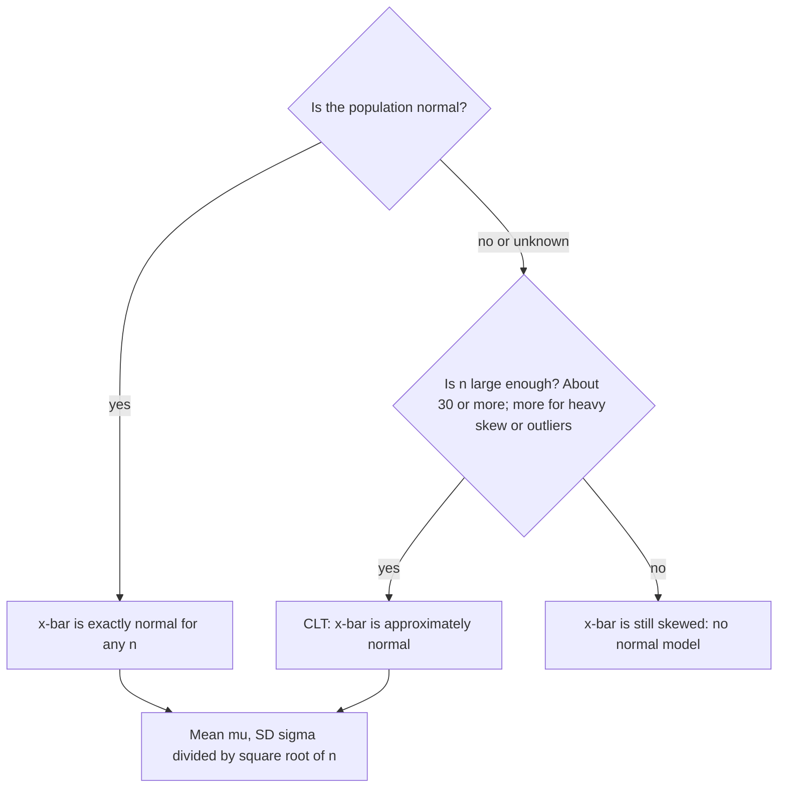

## Averages are less variable than individuals

One train's delay is hard to predict; the *average* delay of 50 trains is much more
stable. This lesson makes that precise. It gives the mean and standard deviation of the
sampling distribution of $\bar{x}$ and states the Central Limit Theorem — the reason
normal distributions appear throughout inference even when the data themselves are not
normal.

## Mean and standard deviation of $\bar{x}$

Take an SRS of size $n$ from a population with mean $\mu$ and standard deviation $\sigma$.
Then

$$\mu_{\bar{x}} = \mu, \qquad \sigma_{\bar{x}} = \frac{\sigma}{\sqrt{n}}.$$

Why: $\bar{x} = (X_1 + \cdots + X_n)/n$. The sum has mean $n\mu$ and, for independent
observations, variance $n\sigma^2$ (Module 6). Dividing by $n$ gives mean $\mu$ and
variance $n\sigma^2/n^2 = \sigma^2/n$, so standard deviation $\sigma/\sqrt{n}$.

So $\bar{x}$ is an unbiased estimator of $\mu$, and its spread shrinks with the square root
of the sample size. (As with $\hat{p}$, the formula assumes independence; when sampling
without replacement, check the 10% condition.)

The quantity $\sigma/\sqrt{n}$ is sometimes called the **standard error of the mean**,
although "standard error" is more precisely used when $\sigma$ is replaced by the sample's
$s$ (lesson 31).

## Shape: two cases

1. *Normal population*. If the population is normal, $\bar{x}$ is *exactly* normal for any $n$.
2. *Any population — the Central Limit Theorem*. Draw an SRS of size $n$ from any
   population with finite mean $\mu$ and standard deviation $\sigma$. When $n$ is large, the
   sampling distribution of $\bar{x}$ is approximately normal:
   $$\bar{x} \approx N\!\left(\mu, \frac{\sigma}{\sqrt{n}}\right).$$

That is the **Central Limit Theorem** (CLT). How large is "large"? It depends on the
population's shape: for mildly skewed populations, $n \ge 30$ is the usual guideline; for
roughly symmetric ones, much smaller $n$ suffices; for very heavily skewed populations (or
ones with extreme outliers), more is needed.

Why should averaging produce a bell shape? Each observation contributes a small random
push up or down. Extreme averages need many observations to be extreme in the *same*
direction, which is rare, while moderate averages can arise in a huge number of ways. The
CLT is the mathematical form of that intuition, and it explains why so many measured
quantities — which are themselves sums of many small effects — look normal.

```plot
{"x": [20, 80], "y": [0, 0.21], "grid": false, "functions": [{"f": "normpdf(x, 50, 12)"}, {"f": "normpdf(x, 50, 6)"}, {"f": "normpdf(x, 50, 2)"}], "labels": [{"at": [70, 0.025], "text": "n = 1"}, {"at": [61, 0.06], "text": "n = 4"}, {"at": [55.5, 0.19], "text": "n = 36"}], "caption": "Sampling distributions of x̄ from a population with μ = 50, σ = 12"}
```

Those curves are drawn as normal to show the shrinking spread. The CLT's real surprise is what
happens to a population that is *not* normal. The picture below uses wait times with mean 10
minutes and standard deviation 10 minutes, a strongly right-skewed (exponential) population. The
exact sampling distribution of $\bar{x}$ is still clearly skewed for $n = 4$, but for $n = 30$ it is
nearly symmetric and bell-shaped, centered at 10 with standard deviation $10/\sqrt{30} \approx 1.83$.


### Example 1

Delivery times have mean 50 minutes and standard deviation 12 minutes, and are right-skewed.
For a random sample of 36 deliveries, find $P(\bar{x} > 52)$.

1. $\mu_{\bar{x}} = 50$; $\sigma_{\bar{x}} = 12/\sqrt{36} = 2$.
2. Shape: the population is skewed, but $n = 36 \ge 30$, so by the CLT $\bar{x}$ is
   approximately normal.
3. $z = (52 - 50)/2 = 1$; $P(Z > 1) \approx 0.1587$.

Compare one delivery: $P(X > 52)$ can't be found from a normal table at all, since the
population is skewed — but even if it were normal, $z = (52 - 50)/12 \approx 0.17$ would put
about 43% of single deliveries above 52. An average of 36 is far more predictable.

### Example 2: totals

Bags of gravel have mean weight 7 kg and SD 2 kg. A truck carries 50 bags. What is the
probability the total exceeds 370 kg?

1. Total $> 370$ is the same as $\bar{x} > 370/50 = 7.4$.
2. $\sigma_{\bar{x}} = 2/\sqrt{50} \approx 0.2828$; the CLT applies ($n = 50$).
3. $z = (7.4 - 7)/0.2828 \approx 1.414$; $P(Z > 1.414) \approx 0.0786$.

Equivalently, the total has mean $50 \times 7 = 350$ and SD $\sqrt{50} \times 2 \approx 14.14$:
$z = (370 - 350)/14.14 \approx 1.414$.

### Example 3: how large a sample?

How large must $n$ be for $\sigma_{\bar{x}}$ to be at most 1 minute when $\sigma = 12$?
$12/\sqrt{n} \le 1$ gives $\sqrt{n} \ge 12$, so $n \ge 144$.

### Example 4: small samples

The same delivery times (mean 50, SD 12, skewed right) are sampled with $n = 4$. Can we find
$P(\bar{x} > 56)$ with a normal model? No: with only four observations from a skewed
population, the sampling distribution of $\bar{x}$ is still noticeably skewed, and the CLT does
not yet apply. If instead the delivery times were known to be *normal*, $\bar{x}$ would be exactly
normal with $\sigma_{\bar{x}} = 12/\sqrt4 = 6$, and $P(\bar{x} > 56) = P(Z > 1) \approx 0.16$. The
shape of the population matters most when $n$ is small.

The decision comes down to two questions, asked in this order:



## The CLT and proportions

A sample proportion is secretly a sample mean: code each success as 1 and each failure as 0,
and $\hat{p}$ is the average of those 0s and 1s. The population of 0s and 1s has mean $p$ and
standard deviation $\sqrt{p(1-p)}$, so the CLT says $\hat{p}$ is approximately normal with mean
$p$ and SD $\sqrt{p(1-p)}/\sqrt{n}$ — exactly the result of lesson 28. The large counts condition is
the "large enough $n$" requirement for this very skewed 0/1 population.

## Common mistakes

- Using $\sigma$ instead of $\sigma/\sqrt{n}$ when the question is about a sample *mean*.
- Thinking the CLT makes the *data* (or the population) normal. It describes the
  distribution of $\bar{x}$; a large sample from a skewed population still looks skewed.
- Applying the CLT to a small sample from a skewed population.
- Dividing by $n$ instead of $\sqrt{n}$.

## Key points

- $\mu_{\bar{x}} = \mu$ and $\sigma_{\bar{x}} = \sigma/\sqrt{n}$.
- Normal population → $\bar{x}$ exactly normal. Any population, large $n$ → $\bar{x}$ approximately
  normal (CLT; $n \ge 30$ is a common guideline).
- Questions about totals convert to $\bar{x}$ (or use mean $n\mu$, SD $\sqrt{n}\,\sigma$).
- Averages vary less than individuals by a factor of $\sqrt{n}$.
