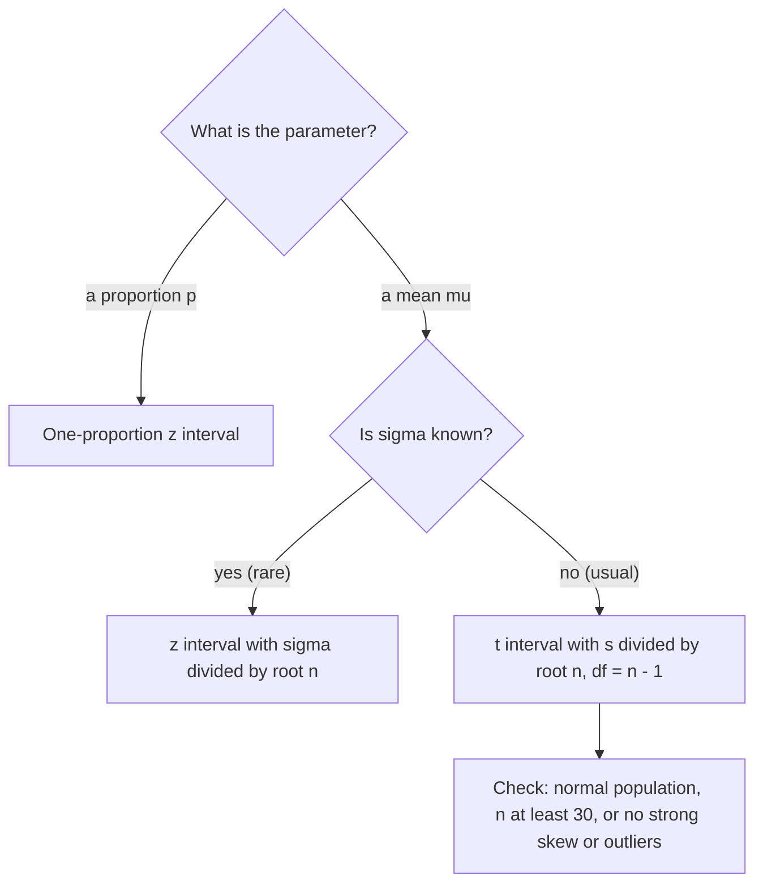

## Estimating a population mean

The interval for a proportion used $\hat{p}$ and its standard error. For a population mean
$\mu$ the natural estimate is $\bar{x}$, whose standard deviation is $\sigma/\sqrt{n}$ — but
$\sigma$, the population standard deviation, is almost never known. Replacing it with the
sample standard deviation $s$ adds extra uncertainty, and the fix is a new family of
distributions: the t distributions.

## If σ were known: the z interval

If $\sigma$ were known (rare in practice), the reasoning of the last lesson gives
$\bar{x} \pm z^*\dfrac{\sigma}{\sqrt{n}}$. This is useful mainly for planning sample sizes
(below) and for understanding the t interval.

## The t distributions

When we standardize $\bar{x}$ with $s$ instead of $\sigma$,

$$t = \frac{\bar{x} - \mu}{s/\sqrt{n}},$$

the result does not follow the standard normal distribution: $s$ varies from sample to
sample, so $t$ varies more than $z$. If the population is normal, this statistic has a
**t distribution** with $n - 1$ **degrees of freedom** (df).

Properties of t distributions:

- symmetric about 0, bell-shaped, like $N(0, 1)$;
- *heavier tails* than the normal — more probability far from 0 — reflecting the extra
  uncertainty from estimating $\sigma$;
- as df increases, $t$ approaches the standard normal (at df = ∞ they are identical).

```plot
{"x": [-4, 4], "y": [0, 0.42], "grid": false, "functions": [{"f": "normpdf(x)"}, {"f": "tpdf(x, 2)", "dashed": true}], "labels": [{"at": [0.95, 0.38], "text": "N(0, 1)"}, {"at": [2.7, 0.07], "text": "t, df = 2"}], "caption": "A t distribution has heavier tails than the standard normal"}
```

Critical values $t^*$ come from a t table or technology (`invT` on a calculator). For 95%
confidence: df = 9 gives $t^* = 2.262$; df = 29 gives 2.045; df = 99 gives 1.984 —
approaching $z^* = 1.96$.

The picture shows what $t^*$ means for df = 9 and 95% confidence: it is the value that leaves
the middle area $C = 0.95$ between $-t^*$ and $t^*$, with $(1 - C)/2 = 0.025$ in each tail.


## The one-sample t interval

$$\bar{x} \pm t^*\frac{s}{\sqrt{n}}, \qquad \text{df} = n - 1.$$

The **standard error of the mean** is $SE_{\bar{x}} = s/\sqrt{n}$.

### Conditions

1. **Random**: random sample or randomized experiment.
2. *10%*: $n \le 0.10N$ when sampling without replacement.
3. *Normal/large sample*: the population is normal, *or* $n \ge 30$ (CLT). For small samples,
   graph the data: t procedures are fine if the data show no strong skew and no outliers.

t procedures are **robust**: they work well even when the population is not exactly normal,
as long as there are no outliers and no strong skewness (relative to $n$). Outliers are the
real danger because $\bar{x}$ and $s$ are not resistant.

Which interval to use depends on the parameter and on what is known:



### Example 1

A random sample of 16 freight trains has mean loading time $\bar{x} = 31.2$ min and
$s = 4.8$ min; a dotplot shows no skew or outliers. Find a 95% confidence interval for the
mean loading time of all freight trains.

1. *State*: $\mu$ = mean loading time of all freight trains; 95% confidence.
2. *Plan*: one-sample t interval. Random ✓; 16 is under 10% of all trains ✓; small sample
   but no skew or outliers ✓.
3. *Do*: df = 15, $t^* = 2.131$. $SE = 4.8/\sqrt{16} = 1.2$. $ME = 2.131(1.2) \approx 2.557$.
   Interval: $31.2 \pm 2.557 = (28.64, 33.76)$ minutes.
4. *Conclude*: We are 95% confident that the mean loading time for all freight trains is
   between 28.6 and 33.8 minutes.

With $z^* = 1.96$ instead, the interval would be too narrow (±2.35), and its actual capture
rate would fall below 95%.

### Example 2

Ten measurements of the gap (mm) at a rail joint: 4.2, 5.1, 3.8, 4.9, 5.6, 4.4, 5.0, 4.7, 3.9, 5.3.
Find a 90% confidence interval for the mean gap.

1. $\bar{x} = 4.69$, $s \approx 0.6008$ (calculator), $n = 10$, df = 9, $t^* = 1.833$.
2. $SE = 0.6008/\sqrt{10} \approx 0.190$; $ME = 1.833(0.190) \approx 0.348$.
3. Interval: $4.69 \pm 0.348 = (4.342, 5.038)$ mm.

## Choosing a sample size for a mean

For a margin of error $M$, use a planning value $\sigma^*$ (from a pilot study or past data)
and the z critical value:

$$n \ge \left(\frac{z^*\sigma^*}{M}\right)^2, \quad\text{rounded up.}$$

### Example 3

To estimate mean commute time within 2 minutes with 95% confidence, guessing $\sigma \approx 12$:
$n \ge (1.96 \times 12/2)^2 = 138.3$, so $n = 139$.

(Using $z^*$ is standard for planning because $t^*$ depends on the unknown $n$; the actual
interval will use $t^*$, slightly wider.)

### Example 4: bracketing with a t table

Without technology, suppose a sample of $n = 16$ gives a 95% interval and you only have a t
table. Look in the row df = 15 and the column for 95% confidence (tail area 0.025): $t^* = 2.131$,
the value used in Example 1. If your df isn't in the table (say df = 43), use the next
*smaller* df listed (40), which gives a slightly larger $t^*$ and a slightly wider, safe interval.

## Why the t correction matters for small samples

With $n = 5$ (df = 4), $t^* = 2.776$ for 95% confidence. Using $z^* = 1.96$ with $s$ instead
would make the interval about 30% too narrow, and such intervals would capture $\mu$ only about
88% of the time instead of 95%. For $n = 100$ the difference is negligible ($t^* = 1.984$). The
t distribution matters most exactly when data are scarce.

## Common mistakes

- Using $z^*$ with $s$ for a small sample.
- Using df $= n$ instead of $n - 1$.
- Applying t procedures to small samples with outliers or strong skew.
- Interpreting the interval as covering 95% of individual values. It estimates the *mean*;
  individual values vary far more.
- Rounding a sample size down.

## Key points

- $t = (\bar{x} - \mu)/(s/\sqrt{n})$ has a t distribution with $n - 1$ df; heavier tails than normal.
- One-sample t interval: $\bar{x} \pm t^* s/\sqrt{n}$.
- Conditions: random, 10%, normal population or $n \ge 30$ (or no strong skew/outliers).
- t procedures are robust except to outliers and strong skew in small samples.
- Sample size: $n \ge (z^*\sigma^*/M)^2$, rounded up.
