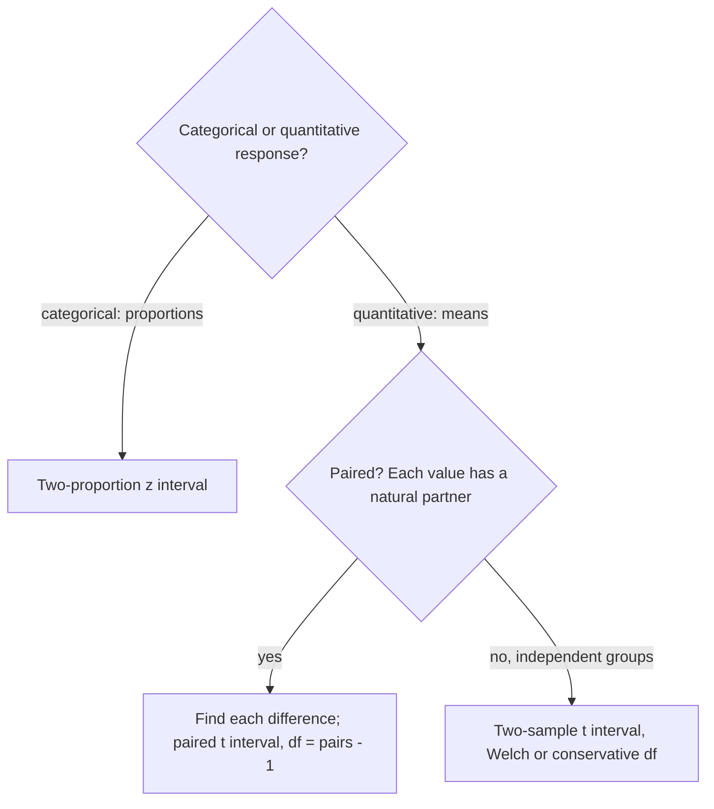

## Comparisons are the usual goal

Most real questions compare: Does the new signal system reduce delays compared with the
old one? Is support higher among younger voters than older ones? This lesson extends the
last two to estimate a *difference* between two proportions or two means, and shows how
paired data turn a two-sample problem into a one-sample problem. The key tool is the rule
from Module 6: for independent random variables, *variances add* when you subtract.

## Difference of two proportions

Take independent random samples from two populations (or randomly assign two
treatments). The difference $\hat{p}_1 - \hat{p}_2$ estimates $p_1 - p_2$ and has

$$\mu_{\hat{p}_1 - \hat{p}_2} = p_1 - p_2, \qquad \sigma_{\hat{p}_1 - \hat{p}_2} = \sqrt{\frac{p_1(1-p_1)}{n_1} + \frac{p_2(1-p_2)}{n_2}}.$$

The standard deviation comes from adding the two variances. The **two-proportion z interval**
replaces the $p$'s with $\hat{p}$'s:

$$(\hat{p}_1 - \hat{p}_2) \pm z^*\sqrt{\frac{\hat{p}_1(1-\hat{p}_1)}{n_1} + \frac{\hat{p}_2(1-\hat{p}_2)}{n_2}}.$$

*Conditions*: random samples or random assignment; independent groups; 10% condition for
each sample; large counts — at least 10 successes and 10 failures *in each group*.

### Example 1

A transit agency tests two fare-reminder messages, randomly assigning 400 riders to each.
168 of 400 riders who got message A renewed their pass, versus 132 of 400 with message B.
Construct a 95% interval for $p_A - p_B$.

1. $\hat{p}_A = 0.42$, $\hat{p}_B = 0.33$; difference 0.09.
2. Conditions: random assignment ✓; counts 168, 232, 132, 268 all ≥ 10 ✓.
3. $SE = \sqrt{\dfrac{0.42(0.58)}{400} + \dfrac{0.33(0.67)}{400}} \approx 0.0341$.
4. $ME = 1.96(0.0341) \approx 0.0668$. Interval: $0.09 \pm 0.067 = (0.023, 0.157)$.
5. We are 95% confident message A increases the renewal rate by between 2.3 and 15.7
   percentage points over message B. Because 0 is not in the interval, the data give
   convincing evidence of a real difference — and since riders were randomly assigned, we
   can say message A *caused* the higher rate.

*Reading a two-sample interval*: if it contains 0, "no difference" is plausible; if it is
entirely above (below) 0, the first parameter is plausibly larger (smaller).
In the figure, interval A (Example 1) says $p_1 > p_2$ is plausible and $p_1 = p_2$ is not; B
leaves "no difference" plausible; C says $p_1 < p_2$.

```shape
{"segments": [{"from": [-2.2, 0], "to": [2.2, 0]}, {"from": [0, -0.1], "to": [0, 3.6], "dashed": true}, {"from": [0.23, 3], "to": [1.57, 3]}, {"from": [-0.4, 2], "to": [0.7, 2]}, {"from": [-1.5, 1], "to": [-0.3, 1]}], "points": [{"at": [0.9, 3]}, {"at": [0.15, 2]}, {"at": [-0.9, 1]}], "labels": [{"at": [1.85, 3], "text": "A"}, {"at": [0.95, 2], "text": "B"}, {"at": [-1.75, 1], "text": "C"}, {"at": [-2, -0.35], "text": "−0.2"}, {"at": [-1, -0.35], "text": "−0.1"}, {"at": [0, -0.35], "text": "0"}, {"at": [1, -0.35], "text": "0.1"}, {"at": [2, -0.35], "text": "0.2"}], "caption": "Three 95% intervals for p₁ − p₂: A (Example 1) lies entirely above 0, B contains 0, C lies entirely below 0"}
```

## Difference of two means

For independent random samples, $\bar{x}_1 - \bar{x}_2$ has standard deviation
$\sqrt{\sigma_1^2/n_1 + \sigma_2^2/n_2}$. Estimating with $s_1$ and $s_2$ gives the
**two-sample t interval**:

$$(\bar{x}_1 - \bar{x}_2) \pm t^*\sqrt{\frac{s_1^2}{n_1} + \frac{s_2^2}{n_2}}.$$

The statistic doesn't have an exact t distribution, but a t distribution approximates it
well. Two choices for df:

- *Technology (Welch's formula)*: df $= \dfrac{(s_1^2/n_1 + s_2^2/n_2)^2}{\dfrac{(s_1^2/n_1)^2}{n_1 - 1} + \dfrac{(s_2^2/n_2)^2}{n_2 - 1}}$ — usually not a whole number.
- *Conservative by hand*: df $=$ the smaller of $n_1 - 1$ and $n_2 - 1$. This gives a
  slightly wider interval (a larger $t^*$), so the true confidence is at least $C$.

*Conditions*: random, independent groups, 10%, and each group normal or $n \ge 30$ (or, for
small samples, no strong skew or outliers in either group).

(Older texts also describe a "pooled" t interval that assumes $\sigma_1 = \sigma_2$. Because
that assumption is hard to check and the unpooled version works well either way, the
unpooled interval is the standard choice.)

### Example 2

Random samples of maintenance crews using two scheduling systems give weekly completed tasks:
System 1: $n_1 = 25$, $\bar{x}_1 = 78.4$, $s_1 = 6.2$; System 2: $n_2 = 30$, $\bar{x}_2 = 74.1$,
$s_2 = 7.5$. Find a 95% interval for $\mu_1 - \mu_2$.

1. Difference: $78.4 - 74.1 = 4.3$.
2. $SE = \sqrt{6.2^2/25 + 7.5^2/30} = \sqrt{1.5376 + 1.875} \approx 1.847$.
3. Conservative df $= 24$, $t^* = 2.064$; $ME = 2.064(1.847) \approx 3.81$.
   Interval: $(0.49, 8.11)$.
4. With technology (Welch df ≈ 53.0, $t^* \approx 2.006$): $(0.59, 8.01)$ — slightly narrower.
5. Both intervals are entirely above 0: plausibly System 1 crews complete more tasks per week,
   on average.

## Paired data

When the two measurements come in **pairs** — the same rail segment before and after
grinding, each driver on two seat designs, twins — the samples are *not* independent, and
the two-sample interval is wrong. Instead compute the difference $d$ for each pair and use
a one-sample t interval on the differences:

$$\bar{d} \pm t^*\frac{s_d}{\sqrt{n}}, \qquad \text{df} = n - 1,$$

where $n$ is the number of *pairs*. The conditions apply to the differences.

### Example 3

Ten workers' productivity is measured before and after a training course. The ten
after-minus-before differences have $\bar{d} = 2.1$ units and $s_d = 1.8$. 95% interval for
the mean improvement $\mu_d$:

df $= 9$, $t^* = 2.262$, $ME = 2.262(1.8/\sqrt{10}) \approx 1.29$. Interval: $(0.81, 3.39)$ units.
Entirely positive: the training is associated with improved productivity. (Without a control
group, other changes over time could also explain the improvement.)

Pairing usually helps: differences within a pair remove person-to-person variability, so
$s_d$ is often much smaller than the SDs of the separate measurements, giving a narrower
interval.

## Choosing the right interval

The type of response and the way the data were collected decide the procedure:



## Common mistakes

- Subtracting variances (or SEs) instead of adding variances.
- Using a two-sample procedure on paired data, or a paired procedure on independent groups.
  Ask: does each value in group 1 have a natural partner in group 2?
- Checking large counts only overall instead of in each group.
- Forgetting to state the direction of the difference ($\mu_1 - \mu_2$ vs. $\mu_2 - \mu_1$).

## Key points

- Two proportions: $(\hat{p}_1 - \hat{p}_2) \pm z^*\sqrt{\hat{p}_1(1-\hat{p}_1)/n_1 + \hat{p}_2(1-\hat{p}_2)/n_2}$.
- Two means: $(\bar{x}_1 - \bar{x}_2) \pm t^*\sqrt{s_1^2/n_1 + s_2^2/n_2}$, df by technology or conservative $\min(n_1, n_2) - 1$.
- Paired data: one-sample t interval on the differences.
- An interval for a difference that excludes 0 indicates a real difference.
