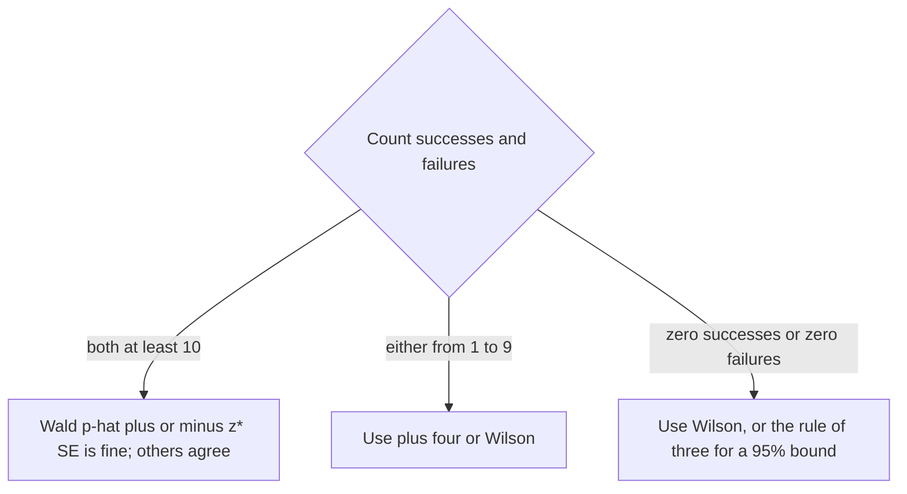

## Does "95% confidence" really mean 95%?

Lesson 30 built the one-proportion z interval $\hat{p} \pm z^*\sqrt{\hat{p}(1-\hat{p})/n}$ and
said that 95% of all such intervals capture $p$. Statisticians call this the **Wald interval**,
and the 95% is a target: the **nominal confidence level**. The long-run capture rate the method
actually achieves for a given $n$ and $p$ is its **coverage probability**. For the Wald interval
the two can be far apart, which is why the core lesson insists on the large counts condition.

This honors lesson shows how to compute coverage exactly, why the Wald interval falls short,
and two better intervals that are easy to use: the plus four interval and the Wilson score
interval. It ends with the hardest case of all, a sample with zero successes.

## Computing coverage exactly

For a proportion, coverage can be found without any simulation. With $n$ fixed, the count of
successes $X$ is binomial and can only be $0, 1, \dots, n$. Each possible count gives one
interval. So

$$\text{coverage} = \sum P(X = x), \quad \text{over the counts } x \text{ whose interval contains } p.$$

### Example 1: coverage when n = 10 and p = 0.3

Suppose the true proportion is $p = 0.3$ and we take samples of $n = 10$ (large counts fails:
$np = 3$). For each count, compute the Wald interval and check whether it contains 0.3.

| $x$ | $P(X = x)$ | 95% Wald interval | Contains 0.3? |
|---|---|---|---|
| 0 | 0.0282 | (0, 0) | no |
| 1 | 0.1211 | (−0.086, 0.286) | no |
| 2 | 0.2335 | (−0.048, 0.448) | yes |
| 3 | 0.2668 | (0.016, 0.584) | yes |
| 4 | 0.2001 | (0.096, 0.704) | yes |
| 5 | 0.1029 | (0.190, 0.810) | yes |
| 6 | 0.0368 | (0.296, 0.904) | yes |
| 7 to 10 | 0.0106 | all start above 0.4 | no |

Coverage $= 0.2335 + 0.2668 + 0.2001 + 0.1029 + 0.0368 = 0.8401$. The "95%" interval
captures $p$ only about 84% of the time. Notice the two kinds of failure: with $x = 0$ the
interval has zero width, and with $x = 1$ the estimated standard error is so small that the
interval stops short of 0.3.

## Why the Wald interval falls short

The Wald interval estimates the standard deviation of $\hat{p}$ by plugging in $\hat{p}$ itself.
When $\hat{p}$ happens to be near 0 or 1, $\hat{p}(1-\hat{p})$ is small, so the interval is too
short exactly when it most needs to be long. It can also produce impossible endpoints below 0
or above 1.

A second, stranger problem comes from the counts being whole numbers. As $p$ or $n$ changes
slightly, a count can move into or out of the "captures $p$" set, so coverage jumps up and
down in a sawtooth. The figure shows exact coverage for $n = 40$ as the true $p$ varies. Even
for $p$ between 0.2 and 0.8, where large counts holds, the Wald coverage wanders between about
0.905 and 0.956 and is usually below 0.95. At $p = 0.5$ it is 0.935 for $n = 50$ and 0.943 for
$n = 100$. Brown, Cai and DasGupta (2001) documented this erratic behavior in detail and
recommended replacing the Wald interval, with the Wilson and plus four (Agresti–Coull)
intervals among the methods they recommended.

## The plus four interval

Agresti and Coull (1998) proposed a fix that takes ten seconds by hand: *add two successes and
two failures*, then use the usual formula. With

$$\tilde{p} = \frac{x + 2}{n + 4}, \qquad \text{the interval is} \qquad \tilde{p} \pm z^*\sqrt{\frac{\tilde{p}(1 - \tilde{p})}{n + 4}}.$$

This **plus four interval** pulls the center toward 0.5 and never has zero width. Its coverage
stays close to 95% for every $p$ (the blue curve, between about 0.94 and 0.97 for $p$ from 0.2
to 0.8 when $n = 40$). A common textbook guideline is to use it for confidence levels from 90% to
99% with $n \ge 10$; it still needs a random sample and the 10% condition, but not large counts.
The point estimate you report is still $\hat{p}$; only the interval is built around $\tilde{p}$.

For a difference of two proportions, the matching recipe (Agresti and Caffo, 2000) adds one
success and one failure to *each* group before using the two-proportion z interval.

### Example 2: two cracked fasteners

An inspector checks a random sample of 40 rail fasteners and finds 2 cracked. Estimate the
proportion cracked with 95% confidence.

1. Wald: $\hat{p} = 2/40 = 0.05$, $SE = \sqrt{0.05(0.95)/40} \approx 0.0345$,
   $ME = 1.96(0.0345) \approx 0.0675$, giving $(-0.018, 0.118)$. A negative proportion is
   impossible, and only 2 successes means large counts fails badly.
2. Plus four: $\tilde{p} = 4/44 \approx 0.0909$,
   $SE = \sqrt{0.0909(0.9091)/44} \approx 0.0433$, $ME = 1.96(0.0433) \approx 0.0849$.
3. Interval: $0.0909 \pm 0.0849 = (0.006, 0.176)$.

We are 95% confident that between 0.6% and 17.6% of all fasteners are cracked. The interval is
not centered on $\hat{p} = 0.05$, and that asymmetry is correct: with a proportion this close
to 0, the plausible values stretch much farther above 0.05 than below it.

## The Wilson score interval

The Wald interval asks "how far is $p$ from $\hat{p}$?" using a standard deviation computed
from $\hat{p}$. Edwin Wilson (1927) turned the question around: which values $p_0$ would make
the observed $\hat{p}$ unsurprising, using the standard deviation that $p_0$ itself implies?
The **Wilson score interval** is the set of all $p_0$ with

$$|\hat{p} - p_0| \le z^*\sqrt{\frac{p_0(1 - p_0)}{n}}.$$

Squaring both sides gives a quadratic in $p_0$:
$(1 + z^{*2}/n)\,p_0^2 - (2\hat{p} + z^{*2}/n)\,p_0 + \hat{p}^2 = 0$, and its two roots are the
endpoints. Solving with the quadratic formula gives

$$\text{center} = \frac{\hat{p} + \dfrac{z^{*2}}{2n}}{1 + \dfrac{z^{*2}}{n}}, \qquad \text{half-width} = \frac{z^*}{1 + \dfrac{z^{*2}}{n}}\sqrt{\frac{\hat{p}(1 - \hat{p})}{n} + \frac{z^{*2}}{4n^2}}.$$

Multiplying the center's top and bottom by $n$ shows it equals $(x + z^{*2}/2)/(n + z^{*2})$.
At 95%, $z^{*2} = 3.84$, so the center is $(x + 1.92)/(n + 3.84)$: plus four is Wilson's center
rounded to "add 2 and 2". The Wilson interval always stays between 0 and 1. In Module 8 you
will meet the one-proportion z test, whose standard deviation also uses the hypothesized $p_0$;
the Wilson interval is exactly the set of $p_0$ values that a two-sided test at the matching
level would not reject.

### Example 3: Wilson for the fasteners

With $x = 2$, $n = 40$, $z^* = 1.96$: $z^{*2}/n = 3.8416/40 = 0.09604$.

1. Center: $(0.05 + 0.04802)/1.09604 \approx 0.0894$.
2. Half-width: $\dfrac{1.96}{1.09604}\sqrt{\dfrac{0.05(0.95)}{40} + \dfrac{3.8416}{6400}} = 1.7883\sqrt{0.0011875 + 0.0006003} \approx 1.7883(0.04228) \approx 0.0756$.
3. Interval: $0.0894 \pm 0.0756 = (0.014, 0.165)$.

| Method | Interval for 2 of 40 | Interval for 540 of 1,200 |
|---|---|---|
| Wald | (−0.018, 0.118) | (0.422, 0.478) |
| Plus four | (0.006, 0.176) | (0.422, 0.478) |
| Wilson | (0.014, 0.165) | (0.422, 0.478) |
| Clopper–Pearson | (0.006, 0.169) | (0.422, 0.479) |

The last row is the **Clopper–Pearson interval** (1934), often called the "exact" interval
because it is computed from binomial probabilities directly. It guarantees coverage of *at
least* 95% for every $p$, but the price is width: for $n = 40$ its coverage is usually between
about 96% and 99%.
"Exact" describes the method, not the coverage. With large counts (the right column), all four
agree to about three decimals, which is why the Wald interval is fine in the core course's
setting.

## Zero successes and the rule of three

A railway tests 50 randomly chosen signal relays and none fails. The Wald interval is (0, 0),
which would claim the failure rate is known to be exactly zero. Ask instead: how large could
$p$ be and still make "0 failures in 50" reasonably likely? The chance of no failures is
$(1 - p)^{50}$. Setting $(1 - p)^n = 0.05$ gives the one-sided 95% upper bound

$$p_{\text{upper}} = 1 - 0.05^{1/n} \approx \frac{3}{n},$$

because $(1 - p)^n \approx e^{-np}$ and $e^{-3} \approx 0.05$. This shortcut is the **rule of
three**, popularized in medicine by Hanley and Lippman-Hand (1983).

### Example 4: no failed relays

For $n = 50$: exact bound $1 - 0.05^{1/50} \approx 0.0582$; rule of three $3/50 = 0.06$. We are
95% confident the failure rate is at most about 6%. Zero failures in 50 is good news, but it is
fully consistent with a failure rate of several percent. (The two-sided 95% Wilson interval
for this sample is (0, 0.071).)

The rule of three gives a one-sided bound, so it matches the upper end of a two-sided 90%
interval, not a 95% one. It works well once $n$ is about 30 or more.

## Choosing an interval for one proportion

None of these intervals repairs a biased sample: the random condition matters just as much as
before. Software packages differ in their default (some report Wald, some Wilson, some
Clopper–Pearson), so check which one you are given. On the AP exam, use the Wald interval from
lesson 30 unless a question says otherwise.

## Common mistakes

- Thinking "95% confidence" guarantees 95% coverage for every $n$ and $p$. For the Wald
  interval it is a target that is often missed, badly so with few successes or failures.
- Using $n$ instead of $n + 4$ in the plus four standard error, or reporting $\tilde{p}$ as the
  point estimate instead of $\hat{p}$.
- Calling Clopper–Pearson coverage "exactly 95%". It is at least 95%, usually more.
- Reading the rule of three as a two-sided 95% interval, or using it when there were some
  successes.
- Trusting an interval with a negative lower endpoint instead of recognizing that the method
  has failed.

## Key points

- Coverage probability is the long-run capture rate a method really achieves; the nominal
  level is its target. For proportions it can be computed exactly by summing binomial
  probabilities.
- The Wald interval under-covers near $p = 0$ or 1 and oscillates even with large counts.
- Plus four: add 2 successes and 2 failures, $\tilde{p} \pm z^*\sqrt{\tilde{p}(1-\tilde{p})/(n+4)}$.
- Wilson: all $p_0$ with $|\hat{p} - p_0| \le z^*\sqrt{p_0(1-p_0)/n}$; plus four is its rounded center.
- Clopper–Pearson is conservative: coverage at least 95%, often more.
- Zero successes in $n$: 95% upper bound $1 - 0.05^{1/n} \approx 3/n$ (rule of three).
