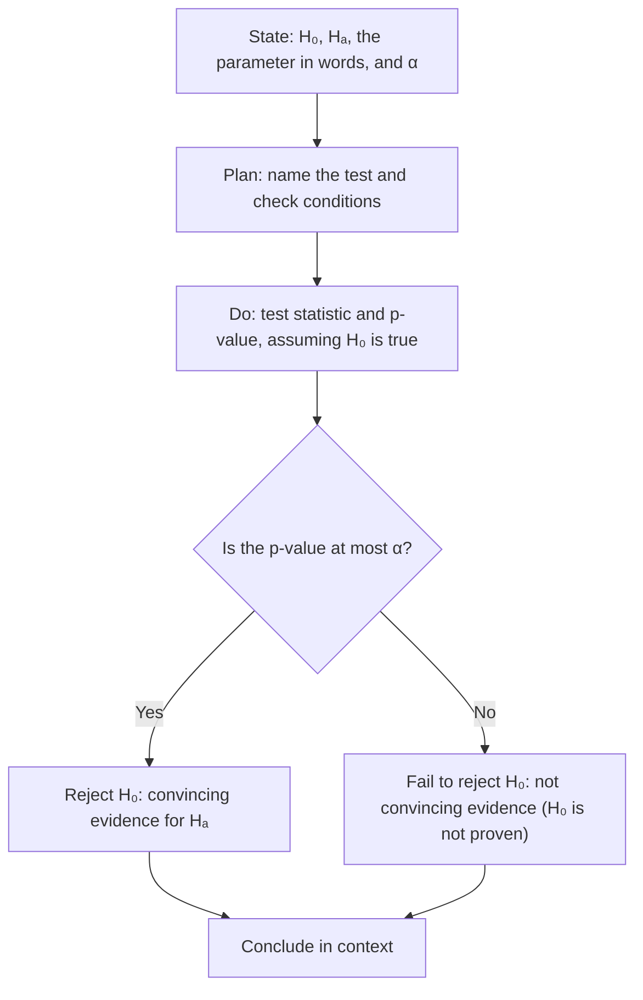

## A second kind of question

Confidence intervals answer "what is the value of the parameter?" Significance tests
answer a yes/no question: "do the data give convincing evidence against a claim?" Is a
new braking system *really* better, or could the observed improvement be chance? Did the
on-time rate *really* fall, or is this sample just unlucky? This lesson lays out the
reasoning; lesson 34 looks at the errors a test can make, and lessons 35 and 36 apply it to proportions and means.

## The reasoning in one paragraph

Start by assuming the claim of "no effect" or "no change" is true. Work out how likely it
would be, *under that assumption*, to get a sample result at least as extreme as the one
observed. If that probability is very small, the result is hard to explain by chance
alone, and we have evidence against the assumption. If it isn't small, chance is a
plausible explanation, and the data don't give convincing evidence. This is proof by
"near-contradiction": an outcome that would rarely happen if the claim were true counts
against the claim. It is the same reasoning as the simulation-based inference of lesson 20; this lesson
replaces the simulated distribution with a sampling distribution worked out from a probability model.

## Hypotheses

- The **null hypothesis** $H_0$ is the claim being tested, usually "no effect" or "no
  difference." It always states a specific parameter value: $H_0: p = 0.80$.
- The **alternative hypothesis** $H_a$ is what we hope to find evidence for. It is
  **one-sided** ($H_a: p < 0.80$ or $H_a: p > 0.80$) or **two-sided** ($H_a: p \ne 0.80$).

Hypotheses are always about *parameters* ($p$, $\mu$), never statistics ($\hat{p}$, $\bar{x}$) —
we know the statistics exactly. Choose $H_a$ from the research question *before* looking at
the data; peeking and then choosing a one-sided alternative in the observed direction is
cheating.

## Test statistics and p-values

A **test statistic** measures how far the sample result is from the null value, in standard
errors:

$$\text{test statistic} = \frac{\text{statistic} - \text{null value}}{\text{standard error of the statistic}}.$$

The **p-value** is the probability, *computed assuming $H_0$ is true*, of getting a test
statistic at least as extreme as the one observed, in the direction(s) of $H_a$.

- $H_a$ with "<": p-value = area to the left of the test statistic.
- $H_a$ with ">": area to the right.
- $H_a$ with "≠": twice the area beyond $|$test statistic$|$ (both tails).

*Small p-values are evidence against $H_0$*. A large p-value means the data are
consistent with $H_0$ — not that $H_0$ is true.

### Example 1

A freight company claims 80% of shipments arrive on time. A shipper suspects the rate is
lower. In a random sample of 200 shipments, 148 (74%) arrived on time.

1. Hypotheses: $H_0: p = 0.80$; $H_a: p < 0.80$, where $p$ is the proportion of all
   shipments that arrive on time.
2. If $H_0$ is true, $\hat{p}$ is approximately normal with mean 0.80 and SD
   $\sqrt{0.8(0.2)/200} \approx 0.0283$.
3. Test statistic: $z = \dfrac{0.74 - 0.80}{0.0283} \approx -2.12$.
4. p-value: $P(Z \le -2.12) \approx 0.017$.

Interpretation: if the true on-time rate were 80%, there would be only about a 1.7% chance
of a sample of 200 showing 74% or less. That's unusual, so the data give convincing
evidence that the on-time rate is below 80%.

```plot
{"x": [-3.5, 3.5], "y": [-0.04, 0.42], "grid": false, "functions": [{"f": "normpdf(x)"}], "shade": [{"f": "normpdf(x)", "from": -3.5, "to": -2.12}], "segments": [{"from": [-3.5, 0], "to": [3.5, 0]}], "labels": [{"at": [-2.12, -0.025], "text": "z = −2.12"}, {"at": [0, -0.025], "text": "0"}], "caption": "One-sided p-value: the area left of z = −2.12 is about 0.017"}
```

## Significance level and conclusions

Before collecting data, choose a **significance level** $\alpha$ — the threshold for
"small" — commonly 0.05 (sometimes 0.01 or 0.10).

- If p-value $\le \alpha$: *reject $H_0$*. The result is **statistically significant** at level $\alpha$;
  there is convincing evidence for $H_a$.
- If p-value $> \alpha$: *fail to reject $H_0$*. There is not convincing evidence for $H_a$.

The picture puts the pieces of Example 1 on one sampling distribution. At $\alpha = 0.05$, any
$\hat{p}$ at or below the critical value 0.7535 ($z = -1.645$) would lead to rejecting $H_0$;
that stretch of values is the **rejection region**, with total area $\alpha$. The observed 0.74
falls inside it, and the p-value (the darker tail) is smaller than $\alpha$. Comparing the p-value
with $\alpha$ and comparing the observed statistic with the critical value always give the same
decision.


We never "accept $H_0$." Failing to find evidence of a difference is not evidence of no
difference — the sample may simply have been too small. Courtrooms use the same logic: a
"not guilty" verdict means the evidence wasn't strong enough, not that innocence was proven.

Always state the conclusion *in context*, linked to the p-value and $\alpha$: "Because the
p-value of 0.017 is less than $\alpha = 0.05$, we reject $H_0$. There is convincing evidence
that fewer than 80% of the company's shipments arrive on time."

### Example 2: two-sided

A test of $H_0: \mu = 50$ versus $H_a: \mu \ne 50$ gives $z = 1.70$. The p-value counts both
tails: $2P(Z \ge 1.70) = 2(0.0446) \approx 0.089$. At $\alpha = 0.05$, fail to reject $H_0$: the
data are not convincing evidence that $\mu$ differs from 50. At $\alpha = 0.10$, we would
reject. This is why $\alpha$ must be fixed in advance.

## Tests and confidence intervals agree

A two-sided test at level $\alpha$ rejects $H_0: \mu = \mu_0$ exactly when $\mu_0$ falls
*outside* the $(1 - \alpha)$ confidence interval (for means; nearly always for proportions).
The interval adds information the test lacks: *how big* the effect plausibly is.

## Statistical vs. practical significance

With a huge sample, even a tiny, unimportant effect can be statistically significant. A
diet producing an average loss of 0.2 kg could give p < 0.001 with 50,000 subjects. Always
look at the size of the effect (a confidence interval helps). Conversely, an important
effect can fail to be significant if the sample is small.

## The four-step process

1. *State* hypotheses, parameter (in words), and $\alpha$.
2. *Plan*: name the test and check conditions (random, 10%, normal/large counts).
3. *Do*: compute the test statistic and p-value.
4. *Conclude*: compare with $\alpha$ and answer the question in context.



## Common mistakes

- Writing hypotheses about statistics ($H_0: \hat{p} = 0.8$) instead of parameters.
- Interpreting the p-value as the probability that $H_0$ is true. It is the probability of
  data this extreme *if* $H_0$ is true.
- "Accepting" $H_0$ when the p-value is large.
- Forgetting to double the tail area for a two-sided test.
- Confusing statistical significance with practical importance.

## Key points

- $H_0$: specific parameter value; $H_a$: one- or two-sided, chosen before seeing data.
- Test statistic = (statistic − null value)/(standard error).
- p-value = probability, assuming $H_0$, of a result at least as extreme as observed.
- p-value $\le \alpha$ → reject $H_0$ (significant); otherwise fail to reject. Never "accept."
- Significance ≠ importance; report effect sizes with intervals.
