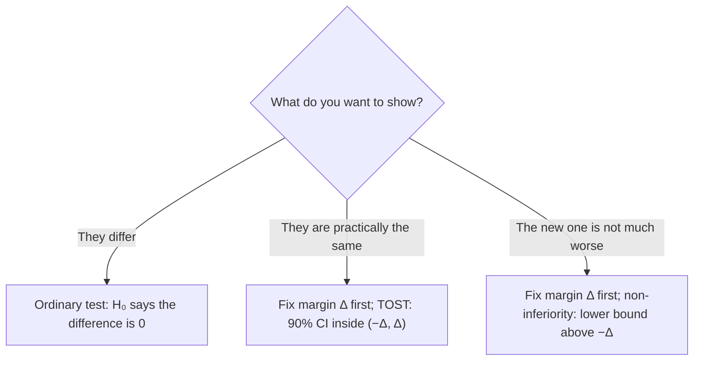

## Turning "no evidence of a difference" around

Lesson 33 warned that failing to reject $H_0$ is not evidence that $H_0$ is true: a small or noisy
study can miss a real difference. Yet many practical questions really are about sameness. Does a
generic drug act like the brand-name version? Does a new laser gauge read rail wear the same as
the trusted manual gauge? Is a cheaper treatment *not much worse* than the standard one? An
ordinary significance test can't answer these, because its null hypothesis is the very claim we
want to support. The fix is to swap the roles: make "the difference is large" the null hypothesis,
so that rejecting it gives convincing evidence that the difference is small. This lesson builds
that idea with the tools of lessons 33–36.

## The equivalence margin

"Small" has to be defined before any data are seen. The **equivalence margin** $\Delta$ is the largest
difference that would not matter in practice: for example, gauge readings within 0.30 mm of each
other are interchangeable for maintenance decisions. Choosing $\Delta$ is a subject-matter
decision, not a statistical one, and it must be justified and fixed in advance; with a generous
enough margin, anything could be declared "equivalent."

## Hypotheses for equivalence

Let $\theta$ be the true difference (a mean difference $\mu_d$, or $\mu_1 - \mu_2$, or $p_1 - p_2$).
An **equivalence test** uses

$$H_0: \theta \le -\Delta \text{ or } \theta \ge \Delta \quad (\text{not equivalent}) \qquad H_a: -\Delta < \theta < \Delta \quad (\text{equivalent}).$$

Two things are new compared with lesson 33. The null hypothesis is now a range of values, not a
single value. And the burden of proof has moved: the data must show the difference is inside the
margin, so a small, noisy study ends with "not shown equivalent," which is the safe default.

## Two one-sided tests (TOST)

The standard method, popularized by Donald Schuirmann (1987), splits $H_0$ into its two pieces and
tests each one-sided:

- Test 1: $H_{01}: \theta \le -\Delta$ against $\theta > -\Delta$, with $t_1 = \dfrac{\text{estimate} - (-\Delta)}{SE}$.
- Test 2: $H_{02}: \theta \ge \Delta$ against $\theta < \Delta$, with $t_2 = \dfrac{\text{estimate} - \Delta}{SE}$.

Conclude equivalence only if *both* tests reject at level $\alpha$. The **TOST** p-value is the
larger of the two one-sided p-values.

*Why each test can use the full $\alpha$.* Suppose $H_0$ is true; say $\theta \ge \Delta$. A false
claim of equivalence needs test 2 to reject, and test 2 is a valid level-$\alpha$ test of exactly
this situation, so the chance is at most $\alpha$. (Test 1 must also reject, which only makes a false
claim less likely.) The same argument works when $\theta \le -\Delta$. No Bonferroni-style splitting
is needed, because the conclusion requires both rejections rather than either one.

## The confidence interval view

Each one-sided test at level $\alpha$ matches one end of a $(1 - 2\alpha)$ confidence interval, so

> TOST at level $\alpha$ concludes equivalence exactly when the $(1 - 2\alpha)$ confidence interval
> lies entirely inside $(-\Delta, \Delta)$.

With $\alpha = 0.05$, that is a **90%** interval, not a 95% one, a frequent source of confusion. The
picture shows the four possible outcomes.

![Four horizontal 90% confidence intervals drawn against an axis with dashed lines at minus delta, 0 and plus delta, the region between the margins shaded as the equivalence zone. Top: an interval from about −0.12 to 0.42 that contains 0 but reaches past plus delta: inconclusive. Second: an interval from −0.10 to 0.12 inside the zone and containing 0: equivalent, the interval includes 0. Third: an interval from 0.34 to 0.60, entirely beyond plus delta: not equivalent. Bottom: an interval from 0.05 to 0.22 inside the zone but excluding 0: equivalent, the interval excludes 0.](images/stat-m8-equivalence.svg)

The bottom interval is worth a second look: a difference can be real (the interval excludes 0) and
still too small to matter (the interval is inside the margin). With a large enough sample, an
ordinary test would call that difference significant, which is lesson 33's warning about
statistical versus practical significance seen from the other side.

### Example 1: two rail-wear gauges

A railway wants to replace manual gauge readings with a laser gauge. On 25 randomly chosen rail
sections, both are used; the differences (laser − manual) have $\bar{d} = 0.12$ mm and $s_d = 0.40$ mm,
and a dotplot shows no strong skew or outliers. The margin is $\Delta = 0.30$ mm. Use $\alpha = 0.05$.

1. *Standard error*: $SE = 0.40/\sqrt{25} = 0.08$ mm; df $= 24$.
2. *Test 1* ($H_{01}: \mu_d \le -0.30$): $t_1 = \dfrac{0.12 + 0.30}{0.08} = 5.25$, p-value $= P(t_{24} \ge 5.25) < 0.0001$.
3. *Test 2* ($H_{02}: \mu_d \ge 0.30$): $t_2 = \dfrac{0.12 - 0.30}{0.08} = -2.25$, p-value $= P(t_{24} \le -2.25) \approx 0.017$.
4. *TOST p-value*: the larger, 0.017. Both tests reject at 0.05, so there is convincing evidence that
   the mean difference is within ±0.30 mm: the gauges are equivalent for this purpose.
5. *Interval check*: with $t^* = 1.711$ (90%, df 24), $0.12 \pm 1.711(0.08) = (-0.017, 0.257)$, inside
   $(-0.30, 0.30)$, as it must be.

Notice what an ordinary paired t test of $H_0: \mu_d = 0$ would say: $t = 0.12/0.08 = 1.5$, two-sided
p-value about 0.15, "no significant difference." That result alone would *not* justify the switch;
the equivalence test does.

### Example 2: a small study can't show equivalence

Suppose the railway had measured only 6 sections and got the same $\bar{d} = 0.12$ and $s_d = 0.40$.

1. $SE = 0.40/\sqrt{6} \approx 0.163$, df $= 5$.
2. Ordinary test: $t \approx 0.73$, p-value $\approx 0.50$. Not significant.
3. TOST: $t_2 = (0.12 - 0.30)/0.163 \approx -1.10$, p-value $\approx 0.16$, so test 2 fails.
4. The 90% interval $0.12 \pm 2.015(0.163) \approx (-0.21, 0.45)$ reaches past $+0.30$: inconclusive.

The ordinary test "finds nothing," but the equivalence test correctly refuses to call the gauges
interchangeable. The data are consistent with a difference as large as 0.45 mm.

## Non-inferiority

Often only one direction matters. A new treatment that is cheaper, safer or easier to take is
worth using if it is *not much worse* than the standard; being better would be a bonus. A
**non-inferiority test** with margin $\Delta$ (higher outcome = better) uses

$$H_0: \theta \le -\Delta \qquad H_a: \theta > -\Delta, \qquad \theta = \text{new} - \text{standard}.$$

This is just test 1 of the TOST pair: one one-sided test against the margin instead of against 0.
In interval terms, non-inferiority is shown when the lower confidence bound is above $-\Delta$.
Regulators often ask for a one-sided level of 0.025, which matches the lower end of a two-sided
95% interval.

### Example 3: a cheaper treatment

A trial randomly assigns 400 patients to a cheaper treatment and 400 to the standard one. The cure
rates are $\hat{p}_{\text{new}} = 0.78$ and $\hat{p}_{\text{std}} = 0.82$. The margin is $\Delta = 0.10$: a cure
rate up to 10 percentage points lower would be acceptable given the lower cost. Use a one-sided
level of 0.025.

1. *Estimate*: $\hat{p}_{\text{new}} - \hat{p}_{\text{std}} = -0.04$.
2. *Standard error*: $H_0$ does not say the two rates are equal, so don't pool:
   $SE = \sqrt{\dfrac{0.78(0.22)}{400} + \dfrac{0.82(0.18)}{400}} \approx 0.0282$.
3. *Test statistic*: $z = \dfrac{-0.04 - (-0.10)}{0.0282} \approx 2.12$; p-value $= P(Z \ge 2.12) \approx 0.017$.
4. *Conclusion*: $0.017 < 0.025$, so reject $H_0$: convincing evidence that the new treatment's cure rate
   is less than 10 points below the standard's. The 95% interval, $-0.04 \pm 1.96(0.0282) \approx (-0.095, 0.015)$,
   has its lower end above $-0.10$, which says the same thing.

Large counts hold easily (every count is at least 72). Specialized trials use slightly refined
standard errors, but the logic is the same; this unpooled version is a simplification. Note also
what the trial does *not* show: the interval includes 0, so it gives no evidence that the new
treatment is better, or worse.

## Equivalence in practice

The best-known use is **bioequivalence**: showing that a generic drug delivers the active ingredient
to the bloodstream like the original. The U.S. FDA's usual standard is a TOST on the log scale: the
90% confidence interval for the ratio of the two products' (geometric) mean blood levels must lie
within 80% to 125%. The limits look lopsided but are symmetric on the log scale, since
$1/0.80 = 1.25$. Equivalence and non-inferiority designs are also used to compare measuring
instruments, manufacturing processes and teaching methods.

## Common mistakes

- Claiming equivalence because an ordinary test was not significant.
- Choosing the margin after seeing the data, or choosing it so wide that equivalence is guaranteed.
- Using a 95% interval for a TOST at $\alpha = 0.05$; the matching interval is 90%.
- Splitting $\alpha$ between the two one-sided tests; each uses the full $\alpha$.
- Reporting the smaller of the two one-sided p-values; the TOST p-value is the larger one.
- Reading non-inferiority as superiority: "not much worse" does not mean "better."

## Key points

- Equivalence: $H_0$ is "the difference is at least $\Delta$ in size"; rejecting it shows the difference
  is small. The margin $\Delta$ is a practical judgment fixed in advance.
- TOST: two one-sided tests against $-\Delta$ and $+\Delta$, each at level $\alpha$; the TOST p-value is
  the larger p-value.
- Equivalently, the $(1 - 2\alpha)$ interval lies inside $(-\Delta, \Delta)$: a 90% interval for $\alpha = 0.05$.
- Non-inferiority is one of the two tests: show $\theta > -\Delta$.
- A difference can be statistically significant and still practically equivalent.
