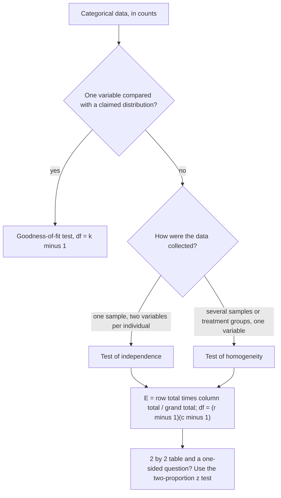

## Testing association

In Module 3 you saw that two categorical variables are associated when their conditional
distributions differ, as with age group and transit mode. But any sample shows *some*
difference between groups. Is the observed association too large to be chance? The
chi-square statistic from the last lesson extends naturally to two-way tables and answers
that question.

## Two situations, one calculation

- **Test of independence**: one random sample, two categorical variables recorded on each
  individual. $H_0$: the variables are independent (no association) in the population.
  $H_a$: they are associated.
- **Test of homogeneity**: separate random samples from several populations (or several
  randomly assigned treatments), one categorical variable. $H_0$: the distribution of the
  variable is the same in every population. $H_a$: the distributions are not all the same.

The two differ in *design* and in how hypotheses are worded, but the computation is
identical.

This chart sorts out which chi-square test (if any) fits a situation:

## Expected counts

If $H_0$ is true, each row should have the same conditional distribution as the overall
(marginal) distribution. That gives

$$\text{Expected count} = \frac{\text{row total} \times \text{column total}}{\text{grand total}}.$$

Why: under independence, $P(\text{row } i \text{ and column } j) = P(\text{row } i)P(\text{column } j)$,
estimated by $\dfrac{\text{row total}}{n} \cdot \dfrac{\text{column total}}{n}$; multiply by $n$
to get a count.

The picture uses the transit survey of Example 1 below: the expected count for under-30 train
riders comes from the row total, the column total and the grand total.

Then, as before,

$$\chi^2 = \sum_{\text{all cells}} \frac{(O - E)^2}{E}, \qquad \text{df} = (r - 1)(c - 1),$$

where $r$ and $c$ are the numbers of rows and columns (not counting totals). Once the margins
are fixed, only $(r-1)(c-1)$ cells can vary freely.

*Conditions*: random (sample or assignment); 10% condition for sampling; all expected counts
at least 5.

### Example 1: independence

The transit survey from Module 3 (a random sample of 200 commuters):

| Age group | Train | Bus | Car | Total |
|---|---|---|---|---|
| Under 30 | 30 | 20 | 10 | 60 |
| 30–50 | 25 | 15 | 40 | 80 |
| Over 50 | 15 | 10 | 35 | 60 |
| Total | 70 | 45 | 85 | 200 |

1. *State*: $H_0$: age group and transit mode are independent among commuters; $H_a$: they
   are associated. $\alpha = 0.05$.
2. *Plan*: chi-square test of independence. Expected counts, e.g. Under 30/Train:
   $60 \times 70/200 = 21$. All expected counts:

   | | Train | Bus | Car |
   |---|---|---|---|
   | Under 30 | 21 | 13.5 | 25.5 |
   | 30–50 | 28 | 18 | 34 |
   | Over 50 | 21 | 13.5 | 25.5 |

   All ≥ 5 ✓. Random sample ✓.
3. *Do*: cell contributions $(O - E)^2/E$:

   | | Train | Bus | Car |
   |---|---|---|---|
   | Under 30 | 3.857 | 3.130 | 9.422 |
   | 30–50 | 0.321 | 0.500 | 1.059 |
   | Over 50 | 1.714 | 0.907 | 3.539 |

   $\chi^2 \approx 24.45$, df $= (3-1)(3-1) = 4$, p-value $\approx 0.00006$.
4. *Conclude*: reject $H_0$. There is very strong evidence of an association between age
   group and transit mode among commuters. The biggest contribution (9.42) comes from
   under-30 car commuters: far fewer than expected (10 vs. 25.5).

   The grid shows all nine contributions at once; darker cells matter more, and the arrows show
   whether each count is above or below its expected value.

   

Since the data are observational, the association does not mean age *causes* mode choice
(income, family size and where people live may confound it).

### Example 2: homogeneity

A railway randomly assigns 300 new customers to one of three onboarding emails and records
whether each customer buys a monthly pass, a ten-ride card, or nothing. $H_0$: the distribution
of purchase choice is the same for all three emails. The same expected counts, $\chi^2$ and
df formula apply ($r = 3$ emails, $c = 3$ choices, df = 4). A small p-value would mean the
emails produce different purchase distributions — and because of random assignment, the email
*causes* the difference.

## Connection to the two-proportion z test

For a 2×2 table, the chi-square statistic equals the square of the two-proportion z statistic
(pooled), and the chi-square p-value equals the two-sided z p-value. For example, a table
with 60 of 200 old track segments defective vs. 30 of 300 new ones gives
$z \approx 5.70$ and $\chi^2 \approx 32.5 \approx 5.70^2$. The z test can also do one-sided tests;
the chi-square test extends to bigger tables.

### Example 3: setting up a larger table

A random sample of 500 passengers is classified by ticket type (single, return, pass, other:
4 columns) and travel purpose (work, leisure: 2 rows). For a test of independence,
df $= (2 - 1)(4 - 1) = 3$. If the "other" ticket column has only 20 passengers and 25% of all
passengers travel for leisure, the smallest expected count is $20 \times 125/500 = 5$ — just
meeting the condition. With fewer "other" tickets, combining it with a neighboring category
would be sensible before running the test.

## Common mistakes

- Computing expected counts from row or column totals alone, instead of
  (row total × column total)/grand total.
- Including the total row and column when counting $r$ and $c$.
- Mixing up independence (one sample, two variables) and homogeneity (several samples, one
  variable) in the hypotheses.
- Using percentages instead of counts.
- Inferring causation from a test of independence on observational data.

## Key points

- Expected $= (\text{row total})(\text{column total})/n$; $\chi^2 = \sum (O - E)^2/E$; df $= (r-1)(c-1)$.
- Independence: one sample, two variables. Homogeneity: several samples or treatments, one variable.
- Conditions: random, 10%, all expected counts ≥ 5.
- Look at the largest cell contributions to explain a significant result.
- For a 2×2 table, $\chi^2 = z^2$.
