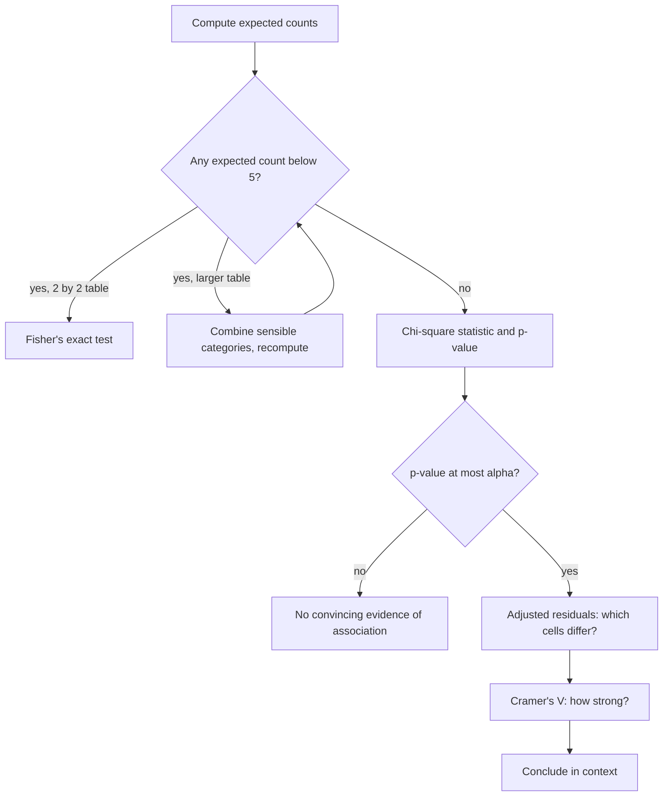

## A p-value is not the end of the analysis

Lesson 38 ended a test of independence by pointing at the largest contributions to $\chi^2$. A
careful analysis asks three more questions, and this honors lesson gives a tool for each:

1. *Which cells really differ from independence?* Contributions have no fixed scale;
   **adjusted residuals** put every cell on the standard normal scale.
2. *How strong is the association?* A tiny p-value can come from a trivial association in a huge
   sample; **Cramér's V** measures strength separately from sample size.
3. *What if the expected counts are too small?* For a 2 × 2 table, **Fisher's exact test** gives an
   exact p-value with no large-counts condition.



## Cell residuals on a standard scale

Lesson 37 mentioned standardized residuals $(O - E)/\sqrt{E}$; their squares are exactly the cell
contributions. They look like z-scores, but they aren't quite: under $H_0$ their variance is
*less* than 1, because the margins are fixed and each cell has less room to move than a free count
would. The fix, due to S. J. Haberman (1973), divides by a smaller number:

$$\text{adjusted residual} = \frac{O - E}{\sqrt{E\left(1 - \dfrac{\text{row total}}{n}\right)\left(1 - \dfrac{\text{column total}}{n}\right)}}.$$

Under $H_0$ and with large counts, each adjusted residual is approximately standard normal. So a
cell with an adjusted residual beyond about $\pm 2$ is one the independence model fits poorly; the
sign says whether the count is above (+) or below (−) expectation.

Two cautions. First, a table has many cells, and with 9 or 12 cells one of them may pass $\pm 2$
by chance alone, so many analysts use a stricter cutoff such as $\pm 3$ when hunting through a
large table (the multiple-testing problem in another form). Second, use adjusted residuals to
*describe* a significant result, not to replace the overall test.

### Example 1: the transit survey again

For under-30 car commuters: $O = 10$, $E = 25.5$, row total 60, column total 85, $n = 200$.

1. Standardized residual: $(10 - 25.5)/\sqrt{25.5} = -15.5/5.050 = -3.07$.
2. Adjusted: the denominator is $\sqrt{25.5 \times (1 - 0.30)(1 - 0.425)} = \sqrt{10.264} = 3.204$,
   so the adjusted residual is $-15.5/3.204 = -4.84$.

All nine adjusted residuals:

| | Train | Bus | Car |
|---|---|---|---|
| Under 30 | 2.91 | 2.40 | −4.84 |
| 30–50 | −0.91 | −1.04 | 1.75 |
| Over 50 | −1.94 | −1.29 | 2.97 |

The story is clear: under-30s drive far less and ride trains and buses more than independence
predicts, and over-50s drive more. The middle age group fits the independence model well. Notice
that the adjusted residuals are larger than the standardized ones (−4.84 vs. −3.07) and so give a
fairer sense of how surprising each cell is.

## Strength of association: Cramér's V

For fixed proportions, $\chi^2$ grows in direct proportion to $n$. Multiply every count in the
transit table by 10 and the conditional distributions don't change at all, yet $\chi^2$ becomes
244.5 instead of 24.45. So $\chi^2$ and its p-value measure *evidence*, not *strength*. Harald
Cramér (1946) removed the sample size:

$$V = \sqrt{\frac{\chi^2}{n \cdot \min(r - 1,\; c - 1)}}.$$

$V$ runs from 0 (the conditional distributions are identical: no association) to 1 (the strongest
possible association, where knowing one variable pins down the other as far as the table allows).
For a 2 × 2 table, $\min(r - 1, c - 1) = 1$ and $V$ is the **phi coefficient**
$\phi = \sqrt{\chi^2/n}$, which equals the absolute value of the correlation you would get by
coding both variables as 0 and 1.

How big is big? Rough conventions from Jacob Cohen (1988) call about 0.1 small, 0.3 medium and
0.5 large when $\min(r - 1, c - 1) = 1$, with smaller cutoffs for bigger tables. These are
*conventions, not laws*: many statisticians object to fixed labels, and what counts as important
depends on the field. Report $V$ with the context.

### Example 2: evidence vs. strength

1. *Transit survey*: $V = \sqrt{24.45/(200 \times 2)} = \sqrt{0.0611} = 0.247$, a moderate
   association. With every count multiplied by 10, $V = \sqrt{244.5/(2000 \times 2)} = 0.247$
   again: same strength, far more evidence.
2. *A huge survey*: 10,000 riders on each of two lines are asked whether they're satisfied: 51%
   say yes on line A and 49% on line B. The pooled z statistic is
   $z = 0.02/\sqrt{0.5(0.5)(2/10{,}000)} = 2.83$, so $\chi^2 = 8.0$ and the p-value is 0.005,
   "highly significant". But $\phi = \sqrt{8.0/20{,}000} = 0.02$: the association is almost
   nothing. With $n = 20{,}000$, a 2-point difference is real but probably unimportant.

## Fisher's exact test for small 2 × 2 tables

When an expected count is below 5, the chi-square curve can't be trusted. For a 2 × 2 table, R. A.
Fisher's idea was to *condition on the margins*: treat the row and column totals as fixed, and ask
how the counts could fall inside them. Once the margins are fixed, one cell (call it $a$, top left)
determines the whole table. Under $H_0$ (no association), $a$ has a **hypergeometric**
distribution, the "draw without replacement" model from the counting lesson:

$$P(a) = \frac{\binom{\text{row 1 total}}{a}\binom{\text{row 2 total}}{\text{col 1 total} - a}}{\binom{n}{\text{col 1 total}}}.$$

The p-value adds the probabilities of the observed table and every table at least as extreme in
the direction of $H_a$. No approximation is involved, so there is no large-counts condition;
the conditions are random sampling or random assignment.

Fisher illustrated the idea in *The Design of Experiments* (1935) with a colleague who claimed she
could taste whether milk had been poured into a cup before or after the tea. She is given 8 cups,
4 of each kind, in random order, and must pick the 4 milk-first cups. If she is only guessing,
every choice of 4 cups is equally likely: $\binom{8}{4} = 70$ choices, only 1 of them all correct.
So getting all 4 right has probability $1/70 = 0.014$, convincing evidence of a real skill.
Getting 3 of 4 right is much weaker evidence: there are $\binom{4}{3}\binom{4}{1} = 16$ ways to do
exactly that, so $P(\text{3 or more right}) = 17/70 = 0.24$.

### Example 3: brake pads

A railway fits a new brake-pad design to 10 randomly chosen cars and the old design to 10 others.
After a winter, 1 of the new pads and 6 of the old pads have failed. Is the new design better?

| | Failed | Did not fail | Total |
|---|---|---|---|
| New | 1 | 9 | 10 |
| Old | 6 | 4 | 10 |
| Total | 7 | 13 | 20 |

1. *Check*: expected failures are $10 \times 7/20 = 3.5$ in each row, below 5, so the chi-square
   test is not appropriate.
2. *Model*: with the margins fixed, the number of new-pad failures $a$ can be 0 to 7, and
   $P(a) = \binom{10}{a}\binom{10}{7 - a}\big/\binom{20}{7}$, with $\binom{20}{7} = 77{,}520$.
3. *One-sided p-value* ($H_a$: new pads fail less often): tables with $a \le 1$.
   $P(0) = \dfrac{1 \times 120}{77{,}520} = 0.0015$ and $P(1) = \dfrac{10 \times 210}{77{,}520} = 0.0271$, so
   the p-value is $0.0286$.
4. *Conclude*: at $\alpha = 0.05$ there is convincing evidence that the new design reduces failures,
   and because the designs were randomly assigned, the design itself is the likely cause.

```plot
{"x": [-0.7, 10], "y": [0, 0.36], "xLabel": "new-pad failures", "yLabel": "probability", "bars": [{"x": 0, "height": 0.0015, "width": 0.8, "label": "0"}, {"x": 1, "height": 0.0271, "width": 0.8, "label": "1"}, {"x": 2, "height": 0.1463, "width": 0.8}, {"x": 3, "height": 0.3251, "width": 0.8}, {"x": 4, "height": 0.3251, "width": 0.8}, {"x": 5, "height": 0.1463, "width": 0.8}, {"x": 6, "height": 0.0271, "width": 0.8}, {"x": 7, "height": 0.0015, "width": 0.8}], "caption": "Hypergeometric distribution of new-pad failures when 7 of the 20 pads fail and design makes no difference; the one-sided p-value is the total of the bars at 0 and 1, 0.0286"}
```

The distribution is symmetric here because both rows have 10 cars, so the two-sided p-value
(adding the matching tail at 6 and 7) is $2 \times 0.0286 = 0.057$. For comparison, the invalid
chi-square test would have given $\chi^2 = 5.49$ and $p = 0.019$, noticeably smaller. Because the
counts are discrete and the margins are held fixed, Fisher's test is often *conservative* (its
true Type I error rate is at most, and often below, $\alpha$); statisticians still debate whether
conditioning on both margins is the right choice, but the test remains the standard one for small
2 × 2 tables.

## Common mistakes

- Treating standardized residuals $(O - E)/\sqrt{E}$ as z-scores: use adjusted residuals for that.
- Reading a tiny p-value as a strong association; check $V$ (or the conditional percentages).
- Using $\min(r, c)$ instead of $\min(r - 1, c - 1)$ in Cramér's V.
- Running a chi-square test on a 2 × 2 table with an expected count below 5 instead of Fisher's test.
- In Fisher's test, adding the probabilities of the *less* extreme tables instead of the more extreme ones.
- Hunting through every cell of a big table for one residual past ±2 and reporting it as a finding.

## Key points

- Adjusted residual $= (O - E)\big/\sqrt{E(1 - \text{row}/n)(1 - \text{col}/n)}$, about $N(0, 1)$ under $H_0$;
  beyond ±2 (±3 for big tables) marks a cell that departs from independence.
- $\chi^2$ grows with $n$; Cramér's $V = \sqrt{\chi^2/(n \min(r - 1, c - 1))}$ measures strength from 0 to 1;
  for 2 × 2 tables it is $\phi = \sqrt{\chi^2/n}$.
- Significance is evidence; strength is a separate question.
- Fisher's exact test conditions on the margins: the top-left count is hypergeometric, and the
  p-value adds the probabilities of tables at least as extreme. No large-counts condition.
