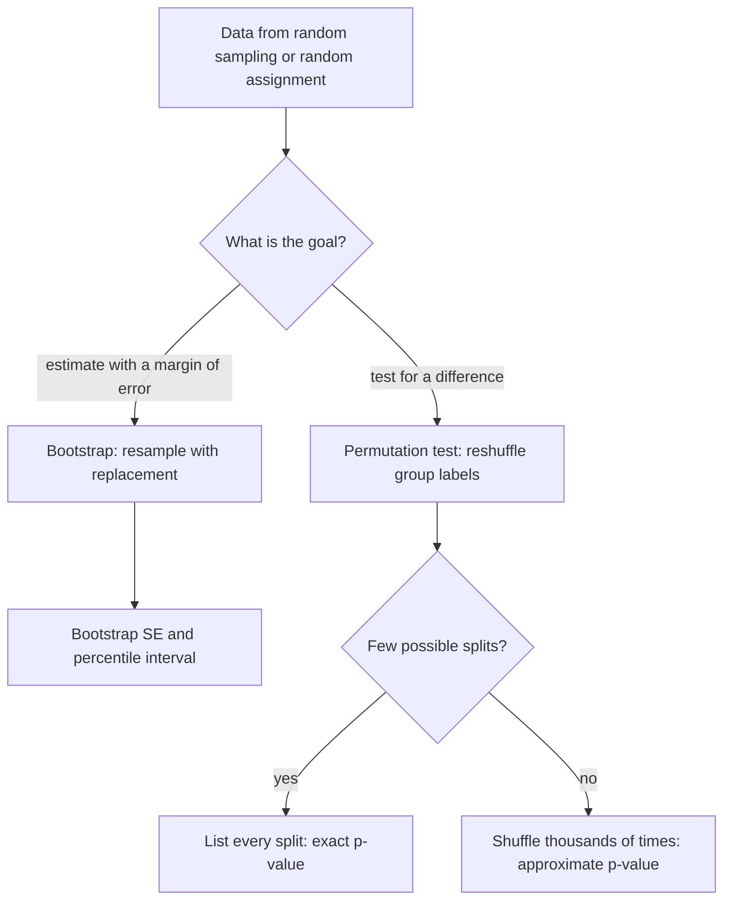

## Inference without a formula

Every interval and test in the AP course rests on a formula for a sampling distribution:
$\hat{p}$ is approximately normal with standard error $\sqrt{p(1-p)/n}$, $\bar{x}$ has standard
error $\sigma/\sqrt{n}$, and so on. Those formulas exist for means, proportions and slopes. But
what is the standard error of a sample *median*? Of a trimmed mean, a correlation or a ratio of two
medians? Either the formula is messy, or there is none you could use by hand.

The simulation lesson already showed one way around formulas: the randomization test, which
shuffles group labels to see what chance alone produces. This honors lesson builds the whole
toolkit that grew from that idea once computers became cheap. The **bootstrap** estimates
standard errors and confidence intervals for almost any statistic, and the **permutation test**
makes the randomization test exact. Together they are called **resampling** methods, because they
reuse the one sample you have instead of a formula.

## The bootstrap idea

The sampling distribution of a statistic describes how it would vary over many samples from the
population. We can't draw those samples; we have one. The bootstrap, introduced by Bradley Efron
in 1979, makes one bold substitution: *treat the sample as if it were the population*, then draw
new samples from it.

A **bootstrap sample** (or resample) is $n$ values drawn **with replacement** from the original
$n$ values. Some values appear twice or more, and some not at all. Compute the statistic for each
of many resamples, typically 1,000 to 10,000, and the collection of results is the **bootstrap
distribution**. Its standard deviation is the **bootstrap standard error**.

Why with replacement? Drawing $n$ values *without* replacement from $n$ values just reshuffles the
original sample, so every resample would have the same median and the method would show no
variability at all. Drawing with replacement mimics drawing independent values from a large
population whose distribution looks like the sample.


The logic in one sentence: the bootstrap distribution varies around the *sample's* statistic
roughly the way the sampling distribution varies around the *population's* parameter. The center
of the bootstrap distribution tells you nothing new (it sits near your own statistic); its
**spread** and shape are what you use.

### Example 1: three resamples by hand

Nine commuters reported their one-way commute in minutes:

$$12,\ 15,\ 17,\ 18,\ 21,\ 24,\ 26,\ 33,\ 52.$$

The median is 21 and the mean is $218/9 \approx 24.2$. Number the values 1 to 9 and draw nine
random positions with replacement:

| Positions drawn | Resample (sorted) | Median | Mean |
|---|---|---|---|
| 3, 9, 1, 5, 5, 7, 2, 8, 3 | 12, 15, 17, 17, 21, 21, 26, 33, 52 | 21 | 23.8 |
| 4, 4, 6, 2, 8, 6, 1, 7, 4 | 12, 15, 18, 18, 18, 24, 24, 26, 33 | 18 | 20.9 |
| 6, 9, 9, 3, 5, 8, 2, 7, 6 | 15, 17, 21, 24, 24, 26, 33, 52, 52 | 24 | 29.3 |

Each row is one bootstrap sample. In the first, value 3 (17) and value 5 (21) were drawn twice and
values 4 and 6 not at all. Three medians are far too few to say anything; a computer repeats this
10,000 times.

### Example 2: a bootstrap standard error and interval for the median

One run of 10,000 resamples of the commute data gave medians with standard deviation about 3.9
minutes: the bootstrap standard error of the median. Because $n$ is odd, every resample's median is
one of the nine data values, so the bootstrap distribution sits on just those values:

```plot
{"x": [8, 56], "y": [0, 30], "xLabel": "median of a resample (minutes)", "yLabel": "percent of resamples", "bars": [{"x": 12, "height": 0.14, "width": 1.2}, {"x": 15, "height": 2.9, "width": 1.2}, {"x": 17, "height": 11.4, "width": 1.2}, {"x": 18, "height": 22.1, "width": 1.2}, {"x": 21, "height": 26.9, "width": 1.2}, {"x": 24, "height": 22.1, "width": 1.2}, {"x": 26, "height": 11.4, "width": 1.2}, {"x": 33, "height": 2.9, "width": 1.2}, {"x": 52, "height": 0.14, "width": 1.2}], "caption": "Bootstrap distribution of the median for the nine commute times (long-run percentages)"}
```

The simplest bootstrap confidence interval is the **percentile interval**: the middle 95% of the
bootstrap distribution, from its 2.5th to its 97.5th percentile. About 3.0% of resample medians
are 15 or less and about 97.0% are 26 or less, so the 2.5th percentile is 15 and the 97.5th is 33.
A 95% percentile interval for the median commute is **15 to 33 minutes**. The lumpiness of the
histogram is a warning that with $n = 9$ this interval is rough.

### How good is the bootstrap standard error?

For the sample mean there is a formula to compare with. The bootstrap standard error of $\bar{x}$
works out to exactly

$$\text{SE}_{\text{boot}}(\bar{x}) = \sqrt{\frac{n-1}{n}}\cdot\frac{s}{\sqrt{n}},$$

slightly smaller than the usual $s/\sqrt{n}$, because resampling uses the sample's own spread,
which divides by $n$ rather than $n - 1$. For the commute data, $s \approx 12.18$, so
$s/\sqrt{9} \approx 4.06$ while the bootstrap gives $\sqrt{8/9} \times 4.06 \approx 3.83$. For
$n = 100$ the factor is 0.995 and the difference vanishes. The bootstrap reproduces the textbook
answer where one exists, which is the main reason to trust it where none does.

That small-sample shrinkage is also why the plain percentile interval tends to be **too narrow when
$n$ is small** (it covers the true value less often than 95%). Statisticians use refined versions
(the "bias-corrected and accelerated" interval, for one) and treat any bootstrap with $n$ below
about 20 cautiously. This lesson keeps to the percentile interval as a simplified first look.

## Permutation tests

A permutation test answers a different question: *could this difference be just chance?* It is the
randomization test from the simulation lesson, done exactly.

In a randomized experiment, if the treatment has no effect (the null hypothesis), each unit's
response would have been the same in either group. Then the group labels are arbitrary, and every
way of splitting the responses into groups of the original sizes was equally likely to occur. The
**permutation distribution** is the statistic computed for every such split. The p-value is the
fraction of splits giving a result at least as extreme as the one observed. When there are too
many splits to list, a computer samples a few thousand at random; that is the randomization test
you met before.

### Example 3: an exact permutation test

Eight seedlings are randomly assigned, four to a new fertilizer and four to the standard one.
Heights after three weeks (cm):

| Fertilizer | Heights | Mean |
|---|---|---|
| New | 22, 25, 27, 30 | 26.0 |
| Standard | 18, 20, 21, 23 | 20.5 |

Observed difference: $26.0 - 20.5 = 5.5$ cm. Test $H_0$: no effect against $H_a$: the new
fertilizer increases height.

1. Number of ways to choose which 4 of the 8 heights are "new": $\binom{8}{4} = 70$. Under $H_0$
   each of the 70 splits was equally likely.
2. For a difference of 5.5 or more, the "new" group must hold nearly all the large values. Only two
   splits do: the observed one (5.5) and $\{23, 25, 27, 30\}$ against $\{18, 20, 21, 22\}$, whose
   means are 26.25 and 20.25 (difference 6.0).
3. Exact p-value: $2/70 \approx 0.029$.

At $\alpha = 0.05$ this is convincing evidence that the fertilizer increases growth. (A two-sample
t test gives a one-sided p-value of about 0.019, close, but it needs the normality condition that
eight values can't check. The permutation test needs only the random assignment.)

## Bootstrap or permutation?

The two methods use the sample in opposite ways, and mixing them up is the most common error.

| | Bootstrap | Permutation test |
|---|---|---|
| Question | How precise is my estimate? | Could this effect be chance? |
| Draws | With replacement, same $n$ | Without replacement: reshuffle labels |
| World it imitates | Repeated random sampling | The null hypothesis being true |
| Main output | Standard error, confidence interval | p-value |



## What resampling can't do

Resampling replaces *formulas*, not *design*. A bootstrap from a biased sample reproduces the bias
faithfully. A permutation test after a non-random assignment tests nothing about cause. The bootstrap
also struggles with statistics that depend on a few extreme values (the sample maximum is the
classic failure: a resample's maximum can never exceed the sample's), and with dependent data such
as time series, which need special versions. And with tiny samples the sample is a poor stand-in
for the population, so bootstrap answers are rough.

## Common mistakes

- Resampling without replacement for a bootstrap: every resample is the original data reordered.
- Using the center of the bootstrap distribution as a better estimate. It sits near your statistic;
  the bootstrap measures spread, not truth.
- Resampling with replacement for a permutation test. A permutation test reshuffles the observed
  values between groups.
- Counting only the splits *equal to* the observed difference, instead of those at least as extreme.
- Trusting a bootstrap from a biased or tiny sample, or bootstrapping a maximum or minimum.

## Key points

- Bootstrap: draw $n$ values with replacement from the sample, compute the statistic, repeat
  thousands of times. The SD of the results is the bootstrap SE; the middle 95% is the percentile
  interval.
- For the mean, $\text{SE}_{\text{boot}} = \sqrt{(n-1)/n}\cdot s/\sqrt{n}$, nearly the usual SE.
- Permutation test: under $H_0$ the group labels are exchangeable; the p-value is the fraction of
  splits at least as extreme as observed. With $\binom{n}{k}$ splits small enough to list, it is
  exact.
- Bootstrap answers "how precise?", permutation answers "could it be chance?"
- Neither fixes a biased sample, a non-random assignment or a tiny $n$.
