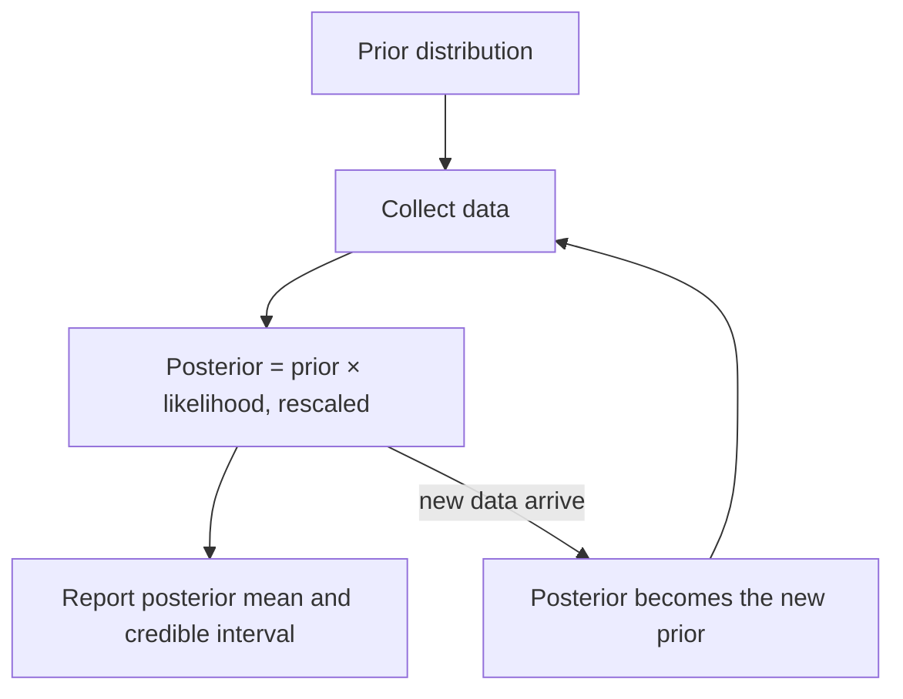

## A different meaning for probability

Every interval and test in the AP course treats a parameter such as $p$ as a fixed, unknown number.
Probability describes only the *data*: "95% confidence" is a statement about how often the method
works over many samples, not about this one interval. That is the **frequentist** view, and it
is the one the AP exam uses.

There is a second, older approach. In **Bayesian inference**, probability also describes what we
know about the parameter itself. Before the data you state a **prior distribution** for $p$; after
the data, Bayes' theorem turns it into a **posterior distribution**. You have already done this for
a single event: in the lesson on trees and Bayes' theorem, a 2% prior probability of disease became
a 16% posterior after a positive test. This honors lesson does the same thing for a whole range of
possible values of $p$, and shows where the answers agree with, and differ from, the confidence
intervals you know.

## Bayes' theorem for a parameter

Suppose the possible values of $p$ are a short list $p_1, p_2, \ldots$. For each one, Bayes'
theorem says

$$P(p_i \mid \text{data}) = \frac{P(p_i)\,P(\text{data} \mid p_i)}{\sum_j P(p_j)\,P(\text{data} \mid p_j)}.$$

The term $P(\text{data} \mid p_i)$, read as a function of the parameter, is called the
**likelihood**. For $x$ successes in $n$ independent trials it is the binomial probability
$\binom{n}{x} p_i^{\,x}(1 - p_i)^{n - x}$. The denominator just makes the posterior add to 1. So
the whole method fits in one line:

$$\text{posterior} \;\propto\; \text{prior} \times \text{likelihood}.$$

($\propto$ means "is proportional to": multiply, then rescale so the total is 1.)

### Example 1: a three-value prior

A new physical therapy treatment either works for 30%, 50% or 70% of patients; before any data a
researcher thinks each is equally likely. In a pilot study 7 of 10 patients improve.

| $p$ | Prior | Likelihood $\binom{10}{7}p^7(1-p)^3$ | Prior × likelihood | Posterior |
|---|---|---|---|---|
| 0.3 | 1/3 | 0.0090 | 0.0030 | 0.023 |
| 0.5 | 1/3 | 0.1172 | 0.0391 | 0.298 |
| 0.7 | 1/3 | 0.2668 | 0.0889 | 0.679 |
| Total | 1 | | 0.1310 | 1 |

Each posterior is its product divided by 0.1310. The data moved belief strongly toward $p = 0.7$
(from 33% to 68%) and almost ruled out $p = 0.3$. Note that this is a statement the frequentist
approach never makes: "the probability that $p = 0.7$ is 0.68".

## Continuous priors: the beta distribution

Real proportions can be any number from 0 to 1, so the prior should be a density curve on $[0, 1]$.
The usual choice is the **beta distribution** $\text{Beta}(a, b)$, with density proportional to

$$p^{\,a-1}(1-p)^{\,b-1}, \qquad 0 \le p \le 1,$$

and mean $\dfrac{a}{a+b}$. $\text{Beta}(1, 1)$ is flat (the uniform prior, "every value equally
plausible"). Larger $a$ and $b$ give a narrower curve. A helpful way to read it: $\text{Beta}(a, b)$
is exactly what a flat prior becomes after $a - 1$ successes and $b - 1$ failures, so for large $a$
and $b$ it carries roughly the information of $a$ earlier successes and $b$ earlier failures.

Now multiply by the binomial likelihood $p^{\,x}(1-p)^{\,n-x}$. The exponents simply add:

$$p^{\,a-1}(1-p)^{\,b-1}\cdot p^{\,x}(1-p)^{\,n-x} = p^{\,a+x-1}(1-p)^{\,b+n-x-1}.$$

That is another beta shape. So

$$\text{Beta}(a, b) \text{ prior} + x \text{ successes in } n \text{ trials} \;\longrightarrow\; \text{Beta}(a + x,\ b + n - x) \text{ posterior}.$$

Add the successes to $a$, the failures to $b$. A prior that comes back as the same family after
updating is called a **conjugate prior**; the beta is conjugate to the binomial.

The **posterior mean** is

$$\frac{a + x}{a + b + n} = \underbrace{\frac{n}{a+b+n}}_{\text{weight on data}}\cdot\hat{p} \;+\; \underbrace{\frac{a+b}{a+b+n}}_{\text{weight on prior}}\cdot\frac{a}{a+b},$$

a weighted average of the sample proportion $\hat{p} = x/n$ and the prior mean. The data's weight
grows with $n$: a large sample swamps any reasonable prior. Pulling an estimate from $\hat{p}$
toward the prior mean is called **shrinkage**.

A **credible interval** is an interval that contains the parameter with a stated posterior
probability. The equal-tailed 95% credible interval runs from the 2.5th to the 97.5th percentile of
the posterior, found with software.

### Example 2: a flat prior

Start the therapy study again with a flat $\text{Beta}(1, 1)$ prior. With 7 successes and 3
failures the posterior is $\text{Beta}(1 + 7,\ 1 + 3) = \text{Beta}(8, 4)$, whose density is
$1320\,p^7(1-p)^3$.

```plot
{"x": [0, 1], "y": [0, 3.4], "xLabel": "p", "yLabel": "density", "functions": [{"f": "1", "label": "prior Beta(1, 1)", "dashed": true}, {"f": "1320*x^7*(1-x)^3", "label": "posterior Beta(8, 4)"}], "shade": [{"f": "1320*x^7*(1-x)^3", "from": 0.390, "to": 0.891}], "caption": "Flat prior and the Beta(8, 4) posterior after 7 successes in 10; shaded: 95% credible interval 0.39 to 0.89"}
```

- Posterior mean: $8/12 \approx 0.667$, between $\hat{p} = 0.7$ and the prior mean 0.5.
- 95% credible interval (software): $0.390$ to $0.891$.
- $P(p > 0.5 \mid \text{data}) \approx 0.887$.

For comparison, the AP one-proportion z interval is $0.7 \pm 1.96\sqrt{0.7(0.3)/10}$, or $0.416$ to
$0.984$, though with only 3 failures its large-counts condition fails. The two intervals are similar
in width but not identical, and they mean different things (see below).

This posterior mean, $(x+1)/(n+2)$ for a flat prior, is Laplace's **rule of succession**. Pierre-Simon
Laplace derived it in 1774, a decade after Thomas Bayes's essay was published in 1763 by his friend
Richard Price, two years after Bayes died.

### Example 3: an informative prior

A basketball coach knows a player has made about 70% of free throws over her career. Players change,
so the coach counts that knowledge as worth only 50 shots: prior $\text{Beta}(35, 15)$, mean 0.7,
with 95% of its probability between about 0.57 and 0.82. Early this season she makes 9 of 20.

1. Posterior: $\text{Beta}(35 + 9,\ 15 + 11) = \text{Beta}(44, 26)$.
2. Posterior mean: $44/70 \approx 0.629$. Check with the weights: data weight $20/70 \approx 0.286$,
   so $0.286(0.45) + 0.714(0.70) \approx 0.629$.
3. 95% credible interval: about $0.513$ to $0.737$.

The 20 new shots alone suggest 45%, but 20 shots is a small sample, and the posterior moves only
part of the way from 70%. A coach who benched her after a cold streak would be overreacting to noise;
the Bayesian estimate formalizes "don't overreact". If the cold streak continues, the posterior keeps
moving: after 200 shots at 45%, the data weight would be $200/250 = 0.8$.


The picture shows the general pattern: the posterior lies between the prior and the likelihood,
closer to whichever carries more information, and it is usually narrower than either (not always: data that
sharply contradict a very confident prior can leave the posterior wider than the prior).

## Updating one batch at a time

Because the update just adds counts, the order of the data doesn't matter. Updating after 10 shots
and then after 10 more gives the same posterior as updating once after all 20. Yesterday's posterior
is today's prior:



## Credible interval or confidence interval?

The two answer different questions.

- A 95% *confidence* interval comes from a method that captures the true $p$ in 95% of repeated
  samples. For one computed interval, $p$ is either in it or not; you may not say "95% probability".
- A 95% *credible* interval says: given the prior and the data, there is a 0.95 probability that $p$
  lies in it. That is the sentence many students wrongly say about confidence intervals; in the
  Bayesian framework it is correct, *conditional on the prior*.

With a flat or weak prior and a large sample the two intervals nearly coincide numerically, which is
why the frequentist interval often works as a quick Bayesian answer too.

## Where the debate is

The objection to Bayesian inference is the prior: two analysts with different priors reach different
posteriors from the same data. Bayesians reply that priors are stated openly and can be checked by a
**sensitivity analysis** (rerun with several reasonable priors; if the conclusion holds, the prior
didn't drive it), and that with enough data the priors stop mattering. Both camps are active in
modern statistics; many practitioners use whichever fits the problem. Bayesian methods are standard
in some fields (spam filtering, some clinical-trial designs, sports and election forecasting), but
the AP exam tests only frequentist inference.

## Common mistakes

- Forgetting to rescale: prior × likelihood values must be divided by their total.
- Adding the number of *trials* to $b$; add the number of *failures*, $n - x$.
- Reading $\text{Beta}(a, b)$'s mean as $a/b$ instead of $a/(a+b)$.
- Interpreting a confidence interval as a credible interval (or the reverse).
- Choosing a prior after seeing the data to get the answer you want. The prior must reflect what
  was known before.

## Key points

- Posterior ∝ prior × likelihood; the likelihood is $P(\text{data} \mid \text{parameter})$.
- Beta prior + binomial data: $\text{Beta}(a, b) \to \text{Beta}(a + x,\ b + n - x)$.
- Posterior mean $(a + x)/(a + b + n)$ is a weighted average of $\hat{p}$ and the prior mean; the
  data's weight $n/(a+b+n)$ grows with $n$ (shrinkage toward the prior shrinks as data accumulate).
- A credible interval carries a direct probability statement about the parameter, given the prior.
- Check sensitivity to the prior; with lots of data, reasonable priors agree.
