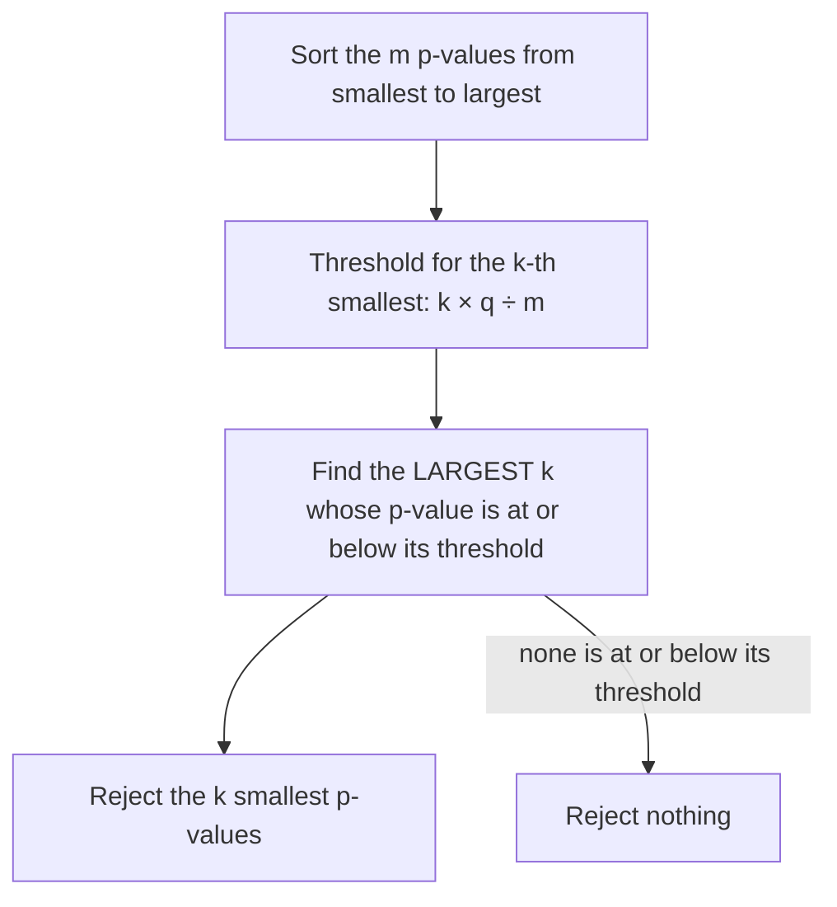

## One test is honest; twenty tests are a fishing trip

The lesson on errors and power set the rules for *one* significance test: if the null hypothesis
is true, a test at $\alpha = 0.05$ wrongly rejects it 5% of the time. Real studies rarely run one
test. A medical trial records a dozen outcomes, a survey compares every pair of groups, a genetics
study tests 20,000 genes. Each test keeps its own 5% risk, but the chance that *some* test gives a
false alarm grows fast. This honors lesson measures that problem, shows two standard corrections,
and explains how ignoring it contributed to the "replication crisis" in science.

## The familywise error rate

Run $m$ tests, all of whose null hypotheses are true, each at level $\alpha$. The
**familywise error rate** (FWER) is the probability of at least one Type I error among them. If the
tests are independent, the complement rule gives

$$\text{FWER} = 1 - (1 - \alpha)^m.$$

The expected number of false positives is $m\alpha$, whether or not the tests are independent.

### Example 1: twenty flavors

A company tests whether each of 20 flavors of a snack is linked to headaches, using 20 independent
tests at $\alpha = 0.05$. Suppose no flavor has any effect.

1. Expected false positives: $20 \times 0.05 = 1$.
2. $P(\text{at least one significant result}) = 1 - 0.95^{20} \approx 1 - 0.358 = 0.642$.

Nearly two times in three, at least one flavor will look "significantly linked to headaches" by
chance alone. If only that flavor makes the news, the public sees a p-value below 0.05 and none of
the 19 failures.

```plot
{"x": [0, 60], "y": [-0.09, 1], "xAxisAt": "bottom", "xLabel": "number of independent tests, m", "yLabel": "P(at least one false positive)", "functions": [{"f": "1 - 0.95^x", "label": "each at α = 0.05"}, {"f": "1 - (1 - 0.05/x)^x", "from": 1, "dashed": true}], "points": [{"at": [20, 0.642], "label": "m = 20: 0.64"}], "labels": [{"at": [44, 0.14], "text": "Bonferroni, each at 0.05/m"}], "caption": "Familywise error rate when every null hypothesis is true"}
```

## The Bonferroni correction

The simplest fix is the **Bonferroni correction**: to keep the FWER at most $\alpha$ over $m$ tests,
run each test at level $\alpha/m$ (equivalently, multiply each p-value by $m$ and compare with
$\alpha$).

*Why it works.* Let $A_i$ be the event that test $i$ gives a false positive. The probability of a
union is never more than the sum of the probabilities (the union bound, or Boole's inequality, from
the honors lesson on inclusion-exclusion):

$$\text{FWER} = P(A_1 \cup \cdots \cup A_m) \le P(A_1) + \cdots + P(A_m) = m \cdot \frac{\alpha}{m} = \alpha.$$

No independence is needed, which is the method's strength. Its weakness is power: with 20 tests each
must reach $p \le 0.0025$, so real but modest effects get missed. A refinement by Sture Holm (1979)
is never less powerful: sort the p-values, compare the smallest with $\alpha/m$, the next with
$\alpha/(m-1)$, and so on, stopping at the first failure.

## The false discovery rate

When thousands of tests are run to find leads worth following up (genes, drug candidates), insisting
on *no* false positive at all is too strict. A different target is the **false discovery rate**
(FDR): the expected fraction of rejected null hypotheses that are actually true. An FDR of 5% means
roughly 1 in 20 "discoveries" is a dud, which a follow-up study can weed out.

Yoav Benjamini and Yosef Hochberg (1995) gave a simple procedure that controls the FDR at level $q$
for independent tests. This is the **Benjamini–Hochberg procedure**:



### Example 2: ten p-values three ways

A study tests 10 hypotheses and gets these p-values, already sorted:

| Rank $k$ | 1 | 2 | 3 | 4 | 5 | 6 | 7 | 8 | 9 | 10 |
|---|---|---|---|---|---|---|---|---|---|---|
| p-value | 0.001 | 0.004 | 0.012 | 0.019 | 0.031 | 0.044 | 0.120 | 0.300 | 0.550 | 0.810 |
| BH threshold $0.05k/10$ | 0.005 | 0.010 | 0.015 | 0.020 | 0.025 | 0.030 | 0.035 | 0.040 | 0.045 | 0.050 |

- *No correction* ($p \le 0.05$): 6 rejections.
- *Bonferroni* ($p \le 0.05/10 = 0.005$): 2 rejections (ranks 1 and 2).
- *Benjamini–Hochberg* with $q = 0.05$: ranks 1 to 4 are at or below their thresholds
  ($0.019 \le 0.020$), and no larger rank is (rank 5: $0.031 > 0.025$; rank 6: $0.044 > 0.030$;
  ranks 7 to 10 are far above). The largest qualifying $k$ is 4, so reject 4.

BH sits between the two: more discoveries than Bonferroni, with a guarantee about the share of them
that are false rather than about having none.

## How many "discoveries" are false?

Even a single test per study can mislead when a field tests many long-shot ideas. Picture 1,000
hypotheses tested at $\alpha = 0.05$, of which only 10% are really true, by studies with power 0.8.


### Example 3: the share of false discoveries

1. Real effects: 100. With power 0.8, $0.8 \times 100 = 80$ are detected (true positives) and 20 are
   missed (false negatives).
2. No effect: 900. With $\alpha = 0.05$, $0.05 \times 900 = 45$ are significant anyway (false
   positives) and 855 are not (true negatives).
3. Significant results: $80 + 45 = 125$, of which $45/125 = 0.36$ are false.

More than a third of the "significant findings" are false, even though every test kept its 5% error
rate. With power 0.35, more typical of small studies, the true positives drop to 35 and the false
share rises to $45/80 \approx 0.56$. This is Bayes' theorem again: $\alpha$ is
$P(\text{significant} \mid \text{no effect})$, but a reader wants
$P(\text{no effect} \mid \text{significant})$, which also depends on the prior share of true
hypotheses and on power. John Ioannidis made this argument in a widely read 2005 paper, "Why most
published research findings are false". His model is simplified (real fields differ a great deal),
but the direction of the effect is not in dispute.

## Hidden multiplicity: p-hacking

Multiplicity also hides inside a single study. A researcher can choose which outcome to report, which
participants to exclude as outliers, whether to adjust for age, when to stop collecting data. Each
choice is defensible alone; trying several and reporting the one that "worked" is **p-hacking**. Five
independent tries at $\alpha = 0.05$ give a false-positive chance of $1 - 0.95^5 \approx 0.23$ (less if
the tries are strongly related, which they often are). In 2011 Joseph Simmons, Leif Nelson and Uri
Simonsohn showed by simulation that combining just four such flexible choices pushed the false-positive
rate above 60%. Andrew Gelman and Eric Loken called the subtler version, where an analyst never
consciously tries several analyses but would have chosen differently had the data looked different,
the "garden of forking paths".

## The replication crisis and the response

In 2015 the Open Science Collaboration repeated 100 published psychology experiments. About 97% of the
originals had reported significant results; only about 36% of the repeats did, and the effects found
were on average about half as large. Similar projects in other fields found replication rates that
varied widely but were often disappointing. This is the **replication crisis**, and multiple testing,
p-hacking, low power and publishing only significant results are among its main causes.

The responses all follow from this lesson:

- **Preregistration**: publish the hypotheses, outcomes and analysis plan before collecting data, so
  readers can tell planned tests from exploration.
- Correct for the number of tests (Bonferroni, Holm, BH) and report how many were run.
- Run larger studies (higher power lowers the false share of discoveries) and replicate surprising
  results before trusting them.
- Report effect sizes and intervals rather than only "significant or not". In 2016 the American
  Statistical Association issued a statement on p-values stressing that a p-value does not measure
  the probability that a hypothesis is true, and that conclusions should not rest on whether
  $p$ crosses 0.05 alone.

## Common mistakes

- Treating each test's 5% as the study's error rate when many tests were run.
- Dividing $\alpha$ by the number of tests *reported* rather than the number *run*.
- In Benjamini–Hochberg, stopping at the first p-value that misses its threshold. Take the *largest*
  $k$ that passes.
- Confusing $P(\text{significant} \mid \text{no effect}) = \alpha$ with
  $P(\text{no effect} \mid \text{significant})$.
- Calling exploration confirmation: a pattern found by searching needs a new data set to test it.

## Key points

- $m$ independent tests of true nulls: FWER $= 1 - (1-\alpha)^m$; expected false positives $m\alpha$.
- Bonferroni: test each at $\alpha/m$; FWER $\le \alpha$ by Boole's inequality, no independence needed.
- FDR = expected share of discoveries that are false; Benjamini–Hochberg: largest $k$ with
  $p_{(k)} \le kq/m$, reject the $k$ smallest.
- Share of significant results that are false $= \dfrac{\alpha(1-\pi)}{\alpha(1-\pi) + \text{power}\cdot\pi}$,
  where $\pi$ is the share of true hypotheses.
- Preregistration, corrections, power and replication are the defenses.
