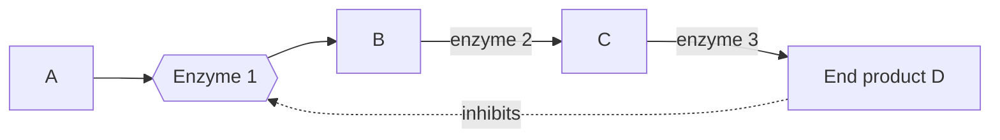

## Proteins that make chemistry fast

The last lesson ended with proteins and the idea that a protein's shape determines its job. The most important proteins of all are enzymes. A cell carries out thousands of chemical reactions every second: digesting food, copying DNA, building membranes. At body temperature, most of these reactions would happen far too slowly to keep a cell alive, taking years or even centuries on their own. Enzymes make them happen in fractions of a second. This lesson explains how, and how temperature, pH, substrate supply and inhibitors change their speed.

## What an enzyme is

An **enzyme** is a biological catalyst, almost always a protein, that speeds up a specific chemical reaction. A catalyst is any substance that speeds up a reaction without being used up or permanently changed by it. Because the enzyme comes out unchanged, one enzyme molecule can catalyze the same reaction over and over, thousands of times per second for fast enzymes.

The molecule an enzyme acts on is its **substrate**; what the reaction produces are the products. Enzyme names usually end in *-ase* and often name the substrate: lactase breaks down lactose, protease breaks down proteins, DNA polymerase builds DNA polymers.

The discovery that enzymes are chemicals, not a mysterious "vital force," came in 1897. Eduard Buchner ground yeast cells with sand, filtered the juice so that no living cells remained, and added sugar. The cell-free juice still fermented the sugar into alcohol and carbon dioxide. Something in the juice, not life itself, was doing the chemistry. In 1926 James Sumner purified the enzyme urease into crystals and showed it was a protein. (A few catalysts in cells, called ribozymes, are made of RNA instead; the ribosome's catalytic core is one. But the vast majority of enzymes are proteins.)

## Activation energy

Even a reaction that releases energy needs a push to get started. Old bonds must be strained or broken before new ones form. The energy needed to start a reaction is its **activation energy**. A match will not light until you strike it; sugar will not burn in air until you heat it.

Enzymes speed up reactions by *lowering the activation energy*. They do not supply energy, and they do not change how much energy the reaction releases or absorbs overall; the starting and ending energies are the same with or without the enzyme. They provide an easier pathway.

```plot
{"x": [0, 10], "y": [0, 11], "xLabel": "progress of reaction", "yLabel": "energy", "functions": [{"f": "3.5 - 1.5*tanh(2*(x-5)) + 5*exp(-(x-5)^2)", "label": "without enzyme"}, {"f": "3.5 - 1.5*tanh(2*(x-5)) + 2.5*exp(-(x-5)^2)", "label": "with enzyme", "dashed": true}], "labels": [{"at": [1, 5.6], "text": "reactants"}, {"at": [9, 1.4], "text": "products"}], "caption": "An enzyme lowers the activation energy (the hump) but not the energy of the reactants or products"}
```

## How enzymes work: the active site

An enzyme folds into a shape with a small pocket or groove called the **active site**, where the substrate binds. The active site's shape and the chemical properties of its amino acid side chains match the substrate, which is why each enzyme is so specific: sucrase acts on sucrose, not on lactose.

The steps are:

1. The substrate binds to the active site, forming an enzyme–substrate complex.
2. The enzyme changes shape slightly to grip the substrate more tightly. This is the *induced fit* model; the older "lock and key" picture of a rigid active site is a useful start but leaves this out. The fit strains the substrate's bonds, holds two substrates in the right orientation, or provides a favorable chemical environment, lowering the activation energy.
3. The reaction occurs and the products are released.
4. The enzyme is free to bind another substrate.


The picture follows one trip around this cycle. Notice that the enzyme in panel 3 is identical to the one in panel 1: that is what it means for a catalyst not to be used up.

Many enzymes need a helper to work: a *cofactor* such as a metal ion (zinc, magnesium, iron) or an organic *coenzyme*, many of which come from vitamins. That is one reason vitamins are needed in the diet.

## Measuring enzyme activity

Enzyme activity is measured as a reaction rate: how much product forms, or how much substrate disappears, per unit time.

$$\text{rate} = \frac{\text{change in amount}}{\text{change in time}}$$

On a graph of product versus time, the rate is the slope. Biologists usually report the *initial rate*, the slope at the very start, because later the substrate is being used up and the reaction slows.

### Example 1: Catalase and oxygen

Catalase, found in nearly all cells that use oxygen, breaks down hydrogen peroxide (a harmful by-product of metabolism) into water and oxygen gas: 2 H₂O₂ → 2 H₂O + O₂. A student adds a slice of potato (a source of catalase) to hydrogen peroxide and collects the oxygen.

| Time (s) | 0 | 10 | 20 | 30 | 40 | 50 | 60 |
|---|---|---|---|---|---|---|---|
| O₂ collected (mL) | 0 | 8 | 15 | 21 | 25 | 27 | 28 |

*Initial rate (first 10 s):* $\dfrac{8 - 0}{10 - 0} = 0.8$ mL/s.

*Rate from 40 to 60 s:* $\dfrac{28 - 25}{60 - 40} = \dfrac{3}{20} = 0.15$ mL/s.

*Interpretation:* the rate falls over time not because the enzyme wears out (it is not used up) but because the hydrogen peroxide, the substrate, is being consumed. Fewer substrate molecules means fewer collisions with active sites. If the curve flattens completely, the substrate is gone; adding more peroxide would start the reaction again.

## Factors that affect enzyme activity

### Temperature

Raising the temperature makes molecules move faster, so enzymes and substrates collide more often and the rate rises. But above a certain temperature, the vibrations break the hydrogen bonds and other weak interactions holding the enzyme's shape. The active site loses its shape and can no longer bind substrate. This loss of shape is **denaturation**, and it is usually permanent (an egg white does not unboil). The temperature of fastest activity is the *optimum temperature*. For most human enzymes it is near body temperature, about 37 °C. Enzymes from bacteria living in hot springs have optima above 70 °C; their stable proteins are used in the PCR technique of Module 6.

```plot
{"x": [0, 65], "y": [0, 110], "xLabel": "temperature (°C)", "yLabel": "relative activity (%)", "functions": [{"f": "113*exp(0.07*(x-37))/(1+exp(0.5*(x-41)))", "label": "human enzyme"}], "points": [{"at": [37, 100], "label": "optimum ≈ 37 °C"}], "caption": "Activity rises with temperature until the enzyme denatures, then falls steeply"}
```

Notice the shape: a gradual rise, then a steep fall. Cooling an enzyme slows it but does not denature it; warm it back up and activity returns. Overheating destroys it.

### pH

Each enzyme also has an *optimum pH*. Changing the pH changes the charges on R groups, disrupting the bonds that hold the enzyme's shape and the charges in the active site. Far from the optimum, the enzyme denatures. Optima match where enzymes work: pepsin, which digests protein in the acidic stomach, works best near pH 2; trypsin, which continues protein digestion in the small intestine, works best near pH 8.

```plot
{"x": [0, 12], "y": [0, 110], "xLabel": "pH", "yLabel": "relative activity (%)", "functions": [{"f": "100*exp(-(x-2)^2/1.5)", "label": "pepsin"}, {"f": "100*exp(-(x-8)^2/1.5)", "label": "trypsin", "dashed": true}], "caption": "Pepsin works best near pH 2, trypsin near pH 8"}
```

### Substrate concentration

With a fixed amount of enzyme, adding substrate speeds the reaction at first, because active sites find substrates more often. Eventually every active site is busy all the time; the enzyme is *saturated*, and the rate levels off at a maximum. At that point, only adding more enzyme can raise the rate.

### Inhibitors

An **inhibitor** is a molecule that reduces an enzyme's activity.

- A *competitive inhibitor* resembles the substrate and binds the active site, blocking it. Because inhibitor and substrate compete for the same spot, flooding the reaction with substrate can outcompete the inhibitor and restore nearly the full maximum rate.
- A *noncompetitive inhibitor* binds elsewhere on the enzyme and changes its shape so the active site works poorly. Adding more substrate does not help, because the problem is not competition for the site.

Cells use inhibition to regulate themselves. In *feedback inhibition*, the end product of a chain of reactions inhibits an enzyme early in the chain, so the cell stops making a product when it has enough. The diagram shows the pattern: product D, three steps away, shuts down enzyme 1.



Many drugs and poisons are inhibitors: ibuprofen blocks an enzyme that makes inflammation signals, and some nerve agents and insecticides block an enzyme needed by nerves.

```plot
{"x": [0, 30], "y": [0, 110], "xLabel": "substrate concentration", "yLabel": "reaction rate", "functions": [{"f": "100*x/(2+x)", "label": "no inhibitor"}, {"f": "100*x/(8+x)", "label": "competitive inhibitor", "dashed": true}, {"f": "50*x/(2+x)", "label": "noncompetitive inhibitor", "dashed": true}], "caption": "Extra substrate overcomes a competitive inhibitor but not a noncompetitive one"}
```

### Example 2: Which kind of inhibitor?

A researcher measures the rate of an enzyme with and without a drug, at low and high substrate concentrations (rates in µmol/min).

| Substrate | No drug | With drug |
|---|---|---|
| Low | 40 | 15 |
| Very high | 95 | 93 |

At low substrate the drug cuts the rate sharply (from 40 to 15), but at very high substrate the rate with the drug almost reaches the uninhibited maximum (93 versus 95). Extra substrate overcomes the drug, so it competes for the active site: it is a *competitive inhibitor*. A noncompetitive inhibitor would lower the rate at high substrate too.

### Example 3: Predicting an experiment

A student boils a potato slice for 5 minutes, cools it to room temperature, then adds it to hydrogen peroxide. Predict the result, and name the control.

Prediction: little or no oxygen is produced. Boiling denatured the catalase, and cooling does not restore its shape. The control is an unboiled potato slice of the same size in the same volume and concentration of peroxide at the same temperature; it should bubble vigorously, showing that the peroxide and procedure work and that any difference comes from boiling.

## Common mistakes

- *Saying enzymes are used up.* They are released unchanged and reused; the substrate is used up.
- *Saying enzymes add energy or change the overall energy released.* They only lower the activation energy.
- *Saying high temperature "kills" enzymes.* Enzymes are molecules, not living things; they denature.
- *Thinking cold denatures enzymes.* Cold slows them reversibly; heat and extreme pH denature them.
- *Assuming all enzymes have the same optimum.* Optima match each enzyme's normal environment.
- *Confusing the two inhibitors.* Only competitive inhibition is overcome by adding substrate.

## Key points

- An **enzyme** is a reusable biological catalyst, usually a protein, that speeds a specific reaction by lowering its **activation energy**.
- The **substrate** binds the **active site**; induced fit strains bonds and brings substrates together.
- Rate = change in amount ÷ time; the initial rate is the slope at the start.
- Activity rises with temperature to an optimum, then falls as the enzyme undergoes **denaturation**; each enzyme has an optimum pH too.
- More substrate raises the rate until the enzyme is saturated.
- A competitive **inhibitor** blocks the active site (overcome by extra substrate); a noncompetitive inhibitor changes the enzyme's shape from elsewhere.
