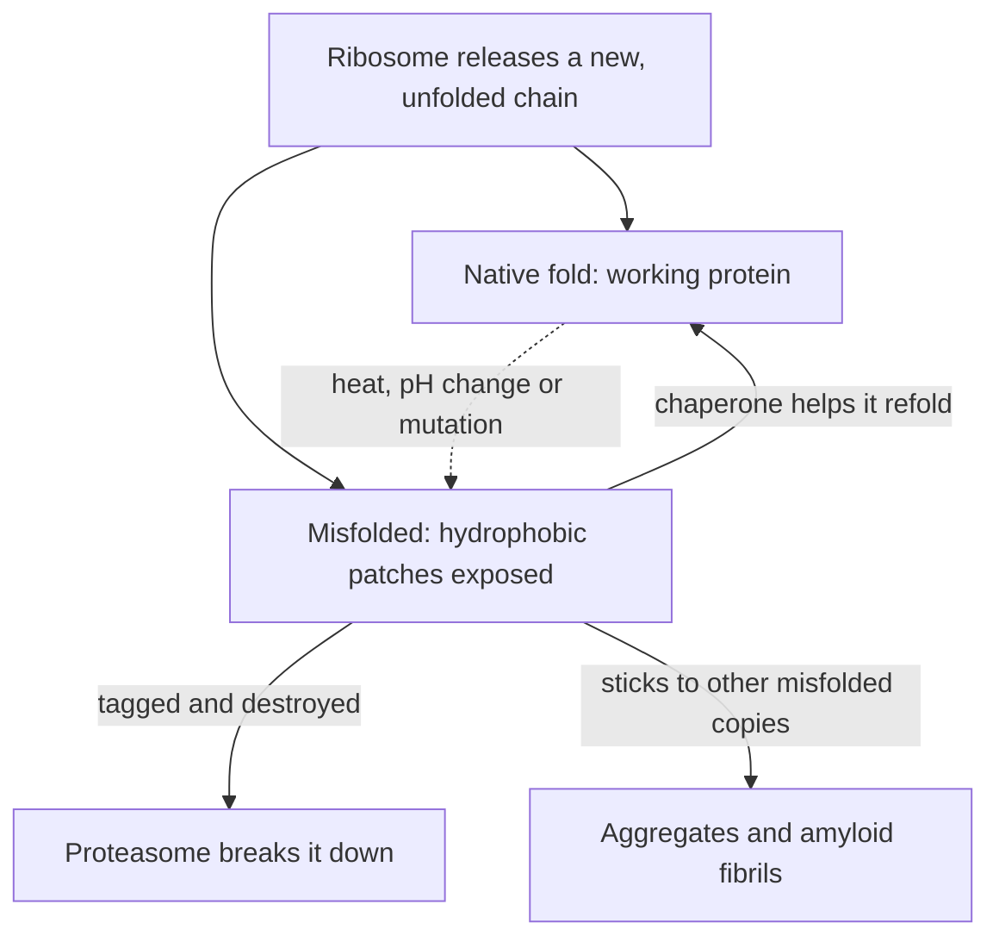

## From four levels to a mechanism

Lesson 4 described protein shape at four levels and told the story of Anfinsen's ribonuclease, which refolded on its own. This honors lesson asks the harder questions. Why does one stretch of chain become a helix and another a sheet? What holds a folded protein together? How does a chain find its one correct shape among an astronomical number of wrong ones, and what happens in the cell, and in disease, when it doesn't? The picture below recaps the four levels from Lesson 4.

## The backbone: flat plates joined by swivels

When two amino acids join by dehydration synthesis, the carboxyl carbon of one bonds to the amino nitrogen of the next. This C–N bond is the **peptide bond**. A polypeptide therefore has a repeating backbone, N–C–C, N–C–C, with an R group on each central (alpha) carbon. One end has a free amino group (the N-terminus), the other a free carboxyl group (the C-terminus); sequences are written from N to C, the direction the ribosome builds them.

The peptide bond is not an ordinary single bond. Electrons are shared partly across the C=O and C–N bonds, giving the C–N link partial double-bond character. Double bonds don't rotate, so the six atoms around each peptide bond lie flat in one plane. The chain can only twist at the single bonds on either side of each alpha carbon: picture flat playing cards joined at the corners by swivels. In 1963 G. N. Ramachandran showed that most combinations of swivel angles make atoms bump into each other; the allowed regions are small, and they include the angles found in the helix and the sheet.

## R groups decide where each part goes

The backbone is the same along the whole chain, so the R groups make each protein different. They fall into four broad groups at the pH of a cell:

| Class | Examples | Behavior in water |
|---|---|---|
| Nonpolar (hydrophobic) | glycine, alanine, valine, leucine, isoleucine, methionine, phenylalanine, tryptophan, proline | avoid water; tend to be buried inside |
| Polar, uncharged | serine, threonine, asparagine, glutamine, tyrosine, cysteine | hydrogen bond with water or each other |
| Acidic (negative) | aspartate, glutamate | charged; usually on the surface |
| Basic (positive) | lysine, arginine (histidine is partly charged) | charged; usually on the surface |

Three have special jobs. Glycine's R group is a single hydrogen, so the chain is flexible there (common in tight turns). Proline's R group bonds back to its own backbone nitrogen, locking its swivel and removing the N–H a helix needs, so proline usually breaks or kinks a helix. Cysteine's –SH group can bond covalently to another cysteine.

## Secondary structure: patterns in the backbone

Secondary structure is held by hydrogen bonds between backbone atoms (the C=O of one amino acid and the N–H of another), not between R groups, which is why the same few patterns appear in almost every protein.

In an **α helix** (alpha helix) the backbone winds into a right-handed coil. The C=O of each amino acid forms a hydrogen bond with the N–H of the amino acid four positions further along the chain, so every backbone group in the middle of the helix is paired. There are 3.6 amino acids per turn, and each amino acid raises the helix by 0.15 nm, so one turn is about 0.54 nm tall. The R groups point outward like bristles on a bottle brush. Linus Pauling, Robert Corey and Herman Branson predicted this structure in 1951 from careful models of the peptide bond, years before any whole protein structure was seen: a risky, testable prediction that was later confirmed.

In a **β sheet** (beta sheet) the chain runs in nearly straight, stretched-out segments called strands, about 0.33 to 0.35 nm per amino acid. Strands lie side by side, running in opposite directions (*antiparallel*) or the same direction (*parallel*), and hydrogen bond to each other; R groups stick alternately above and below the sheet. Loops and turns connect helices and strands. Some amino acids favor one pattern or the other, but only as tendencies.

### Example 1: How long is a helix?

A protein has a helix of 18 amino acids. (a) How many turns does it make, and how long is it? (b) If the same 18 amino acids formed a β strand instead (about 0.34 nm each), how long would that be? (c) The oily core of a cell membrane is about 3.0 nm thick. How many amino acids must a helix have to cross it?

(a) Turns: $18 \div 3.6 = 5$ turns. Length: $18 \times 0.15 = 2.7$ nm.

(b) Strand length: $18 \times 0.34 \approx 6.1$ nm, more than twice the helix, because the strand is stretched out instead of coiled.

(c) $3.0 \div 0.15 = 20$ amino acids. This matches real membrane proteins, whose membrane-crossing parts are typically helices of about 20 mostly nonpolar amino acids.

## Tertiary structure: burying the oily parts

The main force that makes a chain fold up is the **hydrophobic effect**. Nonpolar R groups can't hydrogen bond with water, so the water around them is forced into more ordered arrangements. When the chain folds so that nonpolar R groups cluster in the interior, that ordered water is released and the system as a whole becomes more disordered, which is favorable. A typical soluble protein ends up with an oily core and a polar, charged surface. (Membrane proteins are nonpolar on the surface where they touch the lipid tails.)

Other interactions fine-tune the shape (the picture after this list shows one of each):

- hydrogen bonds between polar R groups;
- ionic bonds (salt bridges) between negative R groups (aspartate, glutamate) and positive ones (lysine, arginine);
- van der Waals attractions, weak but numerous, between closely packed atoms in the core;
- a **disulfide bond**, a covalent S–S bond between two cysteines. These are common in proteins that work outside cells, such as antibodies and insulin; the inside of a cell is chemically reducing, which breaks S–S bonds.

Apart from disulfides these interactions are individually weak, which explains denaturation (Lesson 5): heat shakes them apart, and a pH change alters which R groups are charged. The covalent backbone, and so the primary structure, survives.

Large proteins are usually built from several **protein domains**, compact regions of about 50 to 250 amino acids that fold on their own and often have their own job, such as binding DNA.

A caution: not every protein has one fixed shape. Many proteins contain long *intrinsically disordered* regions that stay floppy until they bind a partner. "One sequence, one stable fold" holds for most enzymes and structural proteins, but it is a simplification.

## Quaternary structure: subunits that talk to each other

The same interactions hold separate chains together. Hemoglobin's four chains (two α, two β) each carry a heme group that binds one O₂, and they influence each other: when one binds oxygen its shape shifts, making the others bind more readily. This *cooperativity* helps hemoglobin load oxygen in the lungs and unload it in the tissues; single-chain myoglobin shows none. The next honors lesson shows enzymes using the same trick.

## How does a chain find its fold?

Ribonuclease has 124 amino acids, including 8 cysteines that form 4 disulfide bonds. Anfinsen unfolded it with urea (which breaks the weak interactions) and β-mercaptoethanol (which breaks S–S bonds); removing both slowly gave back active enzyme. But when he let the S–S bonds re-form while urea still kept the chain unfolded, only about 1% of the activity returned. A trace of mercaptoethanol added later let the wrong bonds break and re-form, and activity crept back to full. His conclusion: the native shape is the most stable one the sequence can adopt, and the chain will find it if wrong bonds can be undone.

### Example 2: Why about 1%?

How many different ways can 8 cysteines pair up into 4 disulfide bonds? What fraction is correct?

The first cysteine can pair with any of the other 7; the first of the 6 left with any of 5; the first of the 4 left with any of 3; the last 2 pair with each other.

$$7 \times 5 \times 3 \times 1 = 105 \text{ pairings}$$

Only one is native, so random pairing gives the right set $1/105 \approx 0.95\%$ of the time, matching the roughly 1% activity: without the folded chain to guide them, the sulfur atoms paired at random.

### Example 3: Levinthal's paradox

In 1969 Cyrus Levinthal posed a puzzle. If each amino acid of a 100-amino-acid chain could take just 3 positions, and the chain tried shapes at random at $10^{13}$ per second, how long would a full search take?

Number of shapes: $3^{100} \approx 5.2 \times 10^{47}$.

Time: $\dfrac{5.2 \times 10^{47}}{10^{13} \text{ per s}} = 5.2 \times 10^{34}$ s. Dividing by $3.16 \times 10^7$ s per year gives about $1.6 \times 10^{27}$ years, some $10^{17}$ times the age of the universe.

Real proteins fold in microseconds to seconds, so folding is not a random search. Local pieces such as helices form quickly and are kept because they lower the energy, and the chain collapses to hide its hydrophobic R groups; each step narrows the options. Biophysicists picture an energy *funnel* sloping from many unfolded shapes down to the one native state.

## Folding in a crowded cell: chaperones

The cytoplasm is crowded, and a new chain leaves the ribosome one amino acid at a time, its hydrophobic stretches exposed before the rest of the chain can cover them. Exposed patches on different chains stick together into useless, sometimes toxic clumps.

**Molecular chaperones** help other proteins fold. The Hsp70 family grabs exposed hydrophobic stretches and releases them in ATP-powered cycles, giving the chain repeated chances. Chaperonins (GroEL with its lid GroES in bacteria) form a barrel-shaped chamber where one chain folds alone. Many chaperones are *heat shock proteins*, made in larger amounts when heat threatens to unfold proteins. Chaperones carry no instructions for the final shape; they prevent wrong interactions, consistent with Anfinsen's finding.

The diagram shows the cell's three answers to a misfolded chain: refold it, destroy it in the proteasome, or, when both fail, live with aggregates.

## When folding goes wrong

*Sickle cell disease.* In hemoglobin's β chain, the sixth amino acid, glutamate (charged), is replaced by valine (nonpolar). The change is on the surface, so each molecule still folds and carries oxygen. But after releasing oxygen, the valine's oily patch fits a hydrophobic pocket on a neighboring molecule, and the molecules link into long fibers that bend red blood cells into rigid sickles.

*Cystic fibrosis.* The most common mutation deletes one phenylalanine (position 508) from CFTR, a chloride channel. The channel misfolds and the cell's quality control destroys most copies before they reach the membrane. Newer "corrector" drugs help it fold well enough to get there.

*Amyloid and prions.* Some misfolded proteins stack into β-sheet-rich fibrils called amyloid, found in Alzheimer's disease (amyloid-β, tau) and Parkinson's disease (α-synuclein); how far they cause these diseases is still being researched. A **prion** is a misfolded form of a normal brain protein (PrP) that converts normal copies to its own shape, so misfolding spreads like an infection, causing Creutzfeldt–Jakob disease and "mad cow disease" (BSE). Stanley Prusiner's claim that a protein with no DNA or RNA could be infectious was doubted at first and earned the 1997 Nobel Prize.

## Seeing and predicting structures

Structures are determined by X-ray crystallography (myoglobin and hemoglobin were solved this way around 1958–1960), NMR for small proteins, and cryo-electron microscopy (2017 Nobel Prize in Chemistry). The public Protein Data Bank holds well over 200,000 structures. In 2020 the AlphaFold program, trained on them, predicted many proteins' shapes from sequence alone, often close to experimental accuracy; its developers shared the 2024 Nobel Prize in Chemistry. Predictions are weaker for disordered regions, complexes and single mutations, so experiments remain essential.

## Common mistakes

- *Saying secondary structure is held by R groups.* Helices and sheets are held by hydrogen bonds between backbone C=O and N–H groups; tertiary structure is where R groups take over.
- *Treating the hydrogen bond as the main reason proteins fold.* The hydrophobic effect, hiding nonpolar R groups from water, is the main driving force.
- *Thinking denaturation breaks peptide bonds.* Heat and pH break the weak interactions; the primary structure is intact.
- *Assuming chaperones hold the folding instructions.* The sequence does; chaperones prevent wrong interactions.
- *Using 0.15 nm per amino acid for a strand.* That rise is for a helix; a strand is about 0.34 nm per amino acid.

## Key points

- The **peptide bond** is flat and rigid; the chain folds by rotating at the alpha carbons, and only certain angle combinations are allowed.
- The **α helix** has 3.6 amino acids per turn, rises 0.15 nm per amino acid and is held by C=O to N–H hydrogen bonds four amino acids apart; the **β sheet** is made of extended strands hydrogen bonded side by side.
- The **hydrophobic effect** drives folding; hydrogen bonds, ionic bonds, van der Waals contacts and covalent **disulfide bonds** refine it. Large proteins are built of **protein domains**.
- Sequence determines shape (Anfinsen; random disulfide pairing, $1/105$, explains his 1% result). Folding follows a funnel, not a random search (Levinthal).
- **Molecular chaperones** prevent misfolding and aggregation in the crowded cell.
- Misfolding underlies sickle cell disease, cystic fibrosis, amyloid diseases and **prion** diseases.
