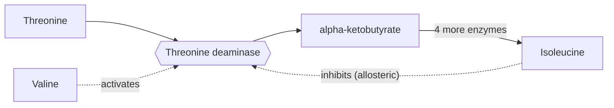

## From a curve to an equation

Lesson 5 showed that, with a fixed amount of enzyme, the reaction rate rises with substrate concentration and then levels off when the enzyme is saturated, and that a competitive inhibitor can be outcompeted by extra substrate while a noncompetitive one cannot. *Enzyme kinetics* turns those pictures into numbers. Two numbers per enzyme let you predict its rate at any substrate concentration, compare enzymes fairly and tell from a few measurements how a drug works. The second half of the lesson turns to how cells switch enzymes on and off.

## The Michaelis–Menten model

In 1913 Leonor Michaelis and Maud Menten, studying the enzyme invertase, proposed that enzyme (E) and substrate (S) bind reversibly to form a complex (ES), which either falls apart or goes on to make product (P):

$$\text{E} + \text{S} \rightleftharpoons \text{ES} \rightarrow \text{E} + \text{P}$$

The rate is proportional to how much enzyme is in the ES form. For the *initial* rate, with far more substrate than enzyme molecules, this gives the **Michaelis–Menten equation**:

$$v = \frac{V_{\max}\,[\text{S}]}{K_m + [\text{S}]}$$

Here $v$ is the initial rate and $[\text{S}]$ the substrate concentration. The two constants describe the enzyme:

- **Vmax**, written $V_{\max}$, is the maximum rate, reached when every enzyme molecule is busy all the time. It depends on how much enzyme is present: double the enzyme and $V_{\max}$ doubles.
- The **Michaelis constant**, $K_m$, is the substrate concentration that gives half the maximum rate. Put $[\text{S}] = K_m$ into the equation and you get $v = V_{\max} K_m / 2K_m = V_{\max}/2$. $K_m$ has units of concentration (such as mM) and does not depend on how much enzyme is present; it is a property of that enzyme with that substrate under given conditions.

The equation explains the shape of the curve. When $[\text{S}]$ is much smaller than $K_m$, the denominator is about $K_m$, so $v \approx (V_{\max}/K_m)[\text{S}]$: the rate rises in proportion to substrate. When $[\text{S}]$ is much larger than $K_m$, the denominator is about $[\text{S}]$, so $v \approx V_{\max}$: adding substrate barely helps. The fraction of maximum rate is $[\text{S}]/(K_m + [\text{S}])$, so $[\text{S}] = K_m$ gives 50%, $3K_m$ gives 75%, and $9K_m$ gives 90%. Approaching $V_{\max}$ takes a lot of substrate.

```plot
{"x": [0, 20], "y": [0, 110], "xLabel": "substrate concentration [S] (mM)", "yLabel": "initial rate v (% of Vmax)", "functions": [{"f": "100*x/(2+x)", "label": "v = Vmax[S]/(Km + [S])"}, {"f": "100", "label": "Vmax", "dashed": true}], "segments": [{"from": [2, 0], "to": [2, 50], "dashed": true}, {"from": [0, 50], "to": [2, 50], "dashed": true}], "points": [{"at": [2, 50], "label": "Km = 2 mM gives Vmax/2"}], "caption": "A Michaelis–Menten curve: half the maximum rate at [S] = Km, approaching Vmax slowly"}
```

A lower $K_m$ is often described as a higher *affinity* for the substrate. That is a useful rule of thumb but a simplification: $K_m$ reflects both how tightly the substrate binds and how fast the complex turns into product. In cells, substrate concentrations are often near or below $K_m$, where the rate responds most to supply.

### Example 1: Using the equation

An enzyme has $V_{\max} = 120$ µmol/min and $K_m = 4$ mM. Find the rate at $[\text{S}] = 1$, 4, 12 and 36 mM.

| [S] (mM) | Fraction $[\text{S}]/(K_m + [\text{S}])$ | $v$ (µmol/min) |
|---|---|---|
| 1 | $1/5 = 0.20$ | $0.20 \times 120 = 24$ |
| 4 | $4/8 = 0.50$ | 60 |
| 12 | $12/16 = 0.75$ | 90 |
| 36 | $36/40 = 0.90$ | 108 |

Four times the substrate (1 to 4 mM) raised the rate 2.5 times; three times the substrate (12 to 36 mM) raised it only 20%, because the enzyme is nearly saturated.

## How fast and how efficient: turnover numbers

Because $V_{\max}$ depends on enzyme amount, comparing enzymes needs a rate per enzyme molecule. The **turnover number**, $k_{\text{cat}}$, is the number of substrate molecules one enzyme molecule converts per second when saturated:

$$k_{\text{cat}} = \frac{V_{\max}}{[\text{E}]_{\text{total}}}$$

Turnover numbers range from below 1 per second to about a million per second for carbonic anhydrase, which converts CO₂ to bicarbonate in red blood cells. At the low substrate levels found in cells, a better measure is the **catalytic efficiency**, $k_{\text{cat}}/K_m$. It cannot exceed the rate at which enzyme and substrate meet by diffusion, about $10^8$ to $10^9$ per molar per second; carbonic anhydrase, at about $10^8$, is close to that limit.

### Example 2: Turnover number

A solution contains 2.0 nM of an enzyme. At saturating substrate, product forms at 1.0 µM per second. The enzyme's $K_m$ is 50 µM. Find $k_{\text{cat}}$ and $k_{\text{cat}}/K_m$.

Convert to the same units: $V_{\max} = 1.0 \times 10^{-6}$ M/s and $[\text{E}] = 2.0 \times 10^{-9}$ M.

$$k_{\text{cat}} = \frac{1.0 \times 10^{-6}}{2.0 \times 10^{-9}} = 500 \text{ s}^{-1}$$

Each enzyme molecule turns over 500 substrate molecules per second. Efficiency: $K_m = 5.0 \times 10^{-5}$ M, so $k_{\text{cat}}/K_m = 500 / (5.0 \times 10^{-5}) = 1.0 \times 10^{7}$ per molar per second: a good enzyme, about ten times short of the diffusion limit.

## Getting the constants from data: the Lineweaver–Burk plot

The curve only approaches $V_{\max}$, so you can't read it off a graph. In 1934 Hans Lineweaver and Dean Burk took the reciprocal of both sides:

$$\frac{1}{v} = \frac{K_m}{V_{\max}} \cdot \frac{1}{[\text{S}]} + \frac{1}{V_{\max}}$$

This has the form $y = mx + b$. Plotting $1/v$ against $1/[\text{S}]$ gives a straight line, the **Lineweaver–Burk plot**, with

- slope $= K_m / V_{\max}$,
- $y$-intercept $= 1/V_{\max}$,
- $x$-intercept $= -1/K_m$ (extend the line to the left of the $y$-axis).

The plot has a weakness: the least precise measurements (at low $[\text{S}]$) become the largest $1/[\text{S}]$ values and pull hardest on the line, so researchers now fit the curve directly with software. But it is still the clearest way to *see* how an inhibitor works.

### Example 3: Finding $K_m$ and $V_{\max}$

Initial rates for an enzyme (no inhibitor):

| [S] (mM) | 0.5 | 1 | 2 | 4 | 8 |
|---|---|---|---|---|---|
| $v$ (µmol/min) | 10.0 | 16.7 | 25.0 | 33.3 | 40.0 |
| $1/[\text{S}]$ (per mM) | 2 | 1 | 0.5 | 0.25 | 0.125 |
| $1/v$ (min/µmol) | 0.100 | 0.060 | 0.040 | 0.030 | 0.025 |

*Slope*, from the first and last points: $\dfrac{0.100 - 0.025}{2 - 0.125} = \dfrac{0.075}{1.875} = 0.040$ min·mM/µmol.

*Intercept*: $0.100 - 0.040 \times 2 = 0.020$ min/µmol. So $V_{\max} = 1/0.020 = 50$ µmol/min.

*$K_m$*: slope $= K_m/V_{\max}$, so $K_m = 0.040 \times 50 = 2.0$ mM. Check with the table: at $[\text{S}] = 2$ mM the rate is 25.0, exactly half of 50.

## Inhibition by the numbers

Reversible inhibitors bind by weak interactions and can come off again. Each type leaves a fingerprint on $K_m$ and $V_{\max}$:

| Type | Binds | Effect on $V_{\max}$ | Effect on $K_m$ | Lineweaver–Burk lines |
|---|---|---|---|---|
| Competitive | free enzyme, at the active site | unchanged | increases | same $y$-intercept, steeper |
| Noncompetitive (pure) | enzyme or ES, at another site | decreases | unchanged | same $x$-intercept, steeper |
| Uncompetitive | only the ES complex | decreases | decreases | parallel lines |

A competitive inhibitor makes the enzyme behave as if it had a higher $K_m$: you need more substrate to reach half speed, but with enough substrate the inhibitor is crowded out and $V_{\max}$ is reached. The apparent $K_m$ is

$$K_m^{\text{app}} = K_m\left(1 + \frac{[\text{I}]}{K_i}\right)$$

where $[\text{I}]$ is the inhibitor concentration and $K_i$ measures how tightly the inhibitor binds (a smaller $K_i$ means a more potent inhibitor). A pure noncompetitive inhibitor instead takes a fraction of the enzyme out of action whatever the substrate level, dividing $V_{\max}$ by the same factor, $1 + [\text{I}]/K_i$. An **uncompetitive inhibitor** binds only to the enzyme–substrate complex and locks it, lowering both $V_{\max}$ and $K_m$. Real inhibitors often show a blend, called *mixed inhibition*; the textbook "noncompetitive" type, which leaves $K_m$ exactly unchanged, is the special case.

```plot
{"x": [-0.75, 2.2], "y": [0, 0.2], "xLabel": "1/[S] (per mM)", "yLabel": "1/v (min per µmol)", "functions": [{"f": "0.04*x+0.02", "label": "no inhibitor", "from": -0.5}, {"f": "0.08*x+0.02", "label": "competitive", "dashed": true, "from": -0.25}, {"f": "0.08*x+0.04", "label": "noncompetitive", "dashed": true, "from": -0.5}], "caption": "Lineweaver–Burk lines: a competitive inhibitor keeps the y-intercept (same Vmax); a pure noncompetitive one keeps the x-intercept (same Km)"}
```

Many drugs are competitive inhibitors: statins block HMG-CoA reductase, an early enzyme in cholesterol synthesis, and methotrexate (a cancer drug) blocks dihydrofolate reductase. Methanol poisoning is treated by competition too: alcohol dehydrogenase turns methanol into toxic formaldehyde and formic acid, and giving ethanol (or the drug fomepizole) keeps the enzyme busy so the methanol is excreted unchanged.

An **irreversible inhibitor** bonds covalently to the enzyme, usually in the active site, inactivating it for good. Aspirin attaches an acetyl group to cyclooxygenase, which starts the synthesis of inflammation signals; penicillin bonds to the bacterial enzymes that cross-link cell walls; nerve agents bond to acetylcholinesterase. Extra substrate doesn't help, so it can look noncompetitive, but removing the free inhibitor does not restore activity.

### Example 4: Diagnosing an inhibitor

The enzyme from Example 3 is measured again with 3 µM of a drug present. The $1/v$ values at $1/[\text{S}] = 2$, 1, 0.5, 0.25 and 0.125 are 0.180, 0.100, 0.060, 0.040 and 0.030 min/µmol. Classify the drug and find $K_i$.

*Line with drug*: slope $= \dfrac{0.180 - 0.030}{2 - 0.125} = 0.080$; intercept $= 0.180 - 0.080 \times 2 = 0.020$.

*Compare*: the intercept is unchanged (0.020), so $V_{\max}$ is still 50 µmol/min. The slope doubled. Same $V_{\max}$, steeper line: competitive.

*Apparent $K_m$*: $0.080 \times 50 = 4.0$ mM, double the 2.0 mM without drug. So $1 + [\text{I}]/K_i = 2$, giving $[\text{I}]/K_i = 1$ and $K_i = 3$ µM.

A pure noncompetitive drug would have raised the intercept (lower $V_{\max}$) and kept the $x$-intercept at $-1/K_m = -0.5$.

## Allosteric regulation

Many of the enzymes that control pathways do not follow the Michaelis–Menten curve at all. In **allosteric regulation**, a molecule binds the enzyme at a regulatory (allosteric) site, separate from the active site, and changes the enzyme's shape and activity. An allosteric activator stabilizes the active shape; an allosteric inhibitor stabilizes the inactive one, as the picture shows.


Allosteric enzymes usually have several subunits that flip between a less active form (T, "tense") and a more active form (R, "relaxed"). Substrate binding at one active site favors the R form in the others, so each bound substrate makes the next bind more easily. This **cooperativity**, also seen in hemoglobin, gives an S-shaped (sigmoid) curve whose steep middle acts like a switch. Activators shift the curve left; inhibitors shift it right.

```plot
{"x": [0, 20], "y": [0, 105], "xLabel": "substrate concentration [S]", "yLabel": "rate (% of Vmax)", "functions": [{"f": "100*x/(5+x)", "label": "Michaelis–Menten enzyme"}, {"f": "100*x^3/(125+x^3)", "label": "allosteric enzyme"}, {"f": "100*x^3/(27+x^3)", "label": "+ activator", "dashed": true}, {"f": "100*x^3/(512+x^3)", "label": "+ inhibitor", "dashed": true}], "caption": "A cooperative allosteric enzyme gives an S-shaped curve; an activator shifts it left and an inhibitor right"}
```

A classic case is aspartate transcarbamoylase (ATCase), the first committed step in making pyrimidine nucleotides in *E. coli*. In 1962 John Gerhart and Arthur Pardee showed that CTP, a pyrimidine made at the end of the pathway, inhibits it allosterically, while ATP, a purine, activates it, so the enzyme balances the two kinds of nucleotide.

## Feedback inhibition

**Feedback inhibition** is regulation in which the end product of a pathway inhibits an enzyme near its start, usually the first committed step. In 1956 Edwin Umbarger found that in *E. coli* the amino acid isoleucine inhibits threonine deaminase, the first of five enzymes that turn threonine into isoleucine.



Isoleucine looks nothing like threonine, so it acts at an allosteric site, not the active site. Blocking the first committed step stops the whole pathway at once, so no intermediates pile up and no energy is wasted. (Valine, made by a related pathway that shares enzymes, activates threonine deaminase, helping balance the two.) This is negative feedback at the molecular scale, the same logic as temperature control in Lesson 1.

## Switching enzymes by cutting and tagging

Cells also regulate enzymes by changing them covalently.

- *Phosphorylation.* Kinases attach a phosphate group (from ATP) to serine, threonine or tyrosine R groups, and phosphatases remove it; the added charges change the enzyme's shape. Glycogen phosphorylase, which releases glucose from glycogen, is switched on this way in response to hormones such as adrenaline (Krebs and Fischer, Nobel Prize 1992).
- *Activation by cutting.* A **zymogen** is an inactive precursor activated when part of its chain is cut off. The pancreas makes trypsinogen, which enteropeptidase on the intestinal lining cuts into active trypsin only in the small intestine, so the enzyme doesn't digest the pancreas; trypsin then activates other zymogens. Early activation inside the pancreas causes pancreatitis.

## Common mistakes

- *Treating $K_m$ as half of $V_{\max}$.* $K_m$ is a substrate concentration; $V_{\max}/2$ is a rate. $K_m$ is the concentration at which the rate is $V_{\max}/2$.
- *Thinking more enzyme changes $K_m$.* More enzyme raises $V_{\max}$; $K_m$ stays the same.
- *Mixing up the intercepts.* On a Lineweaver–Burk plot, the $y$-intercept is $1/V_{\max}$ and the $x$-intercept is $-1/K_m$.
- *Saying a competitive inhibitor lowers $V_{\max}$.* With enough substrate it is outcompeted; it raises the apparent $K_m$.
- *Applying the Michaelis–Menten equation to allosteric enzymes.* Cooperative enzymes give sigmoid curves.

## Key points

- **Michaelis–Menten equation**: $v = V_{\max}[\text{S}]/(K_m + [\text{S}])$. **Vmax** is the rate with all enzyme saturated; the **Michaelis constant** $K_m$ is the $[\text{S}]$ giving half of $V_{\max}$.
- **Turnover number** $k_{\text{cat}} = V_{\max}/[\text{E}]_{\text{total}}$; **catalytic efficiency** $k_{\text{cat}}/K_m$ is capped by diffusion near $10^8$–$10^9$ per molar per second.
- **Lineweaver–Burk plot**: $1/v$ against $1/[\text{S}]$; slope $K_m/V_{\max}$, $y$-intercept $1/V_{\max}$, $x$-intercept $-1/K_m$.
- Competitive: $K_m$ up, $V_{\max}$ same. Pure noncompetitive: $V_{\max}$ down, $K_m$ same. **Uncompetitive inhibitor**: both down. An **irreversible inhibitor** bonds covalently.
- **Allosteric regulation** and **cooperativity** give sigmoid, switch-like kinetics; **feedback inhibition** lets an end product shut down the first committed step.
- Covalent switches: phosphorylation, and cutting a **zymogen** into its active form.
