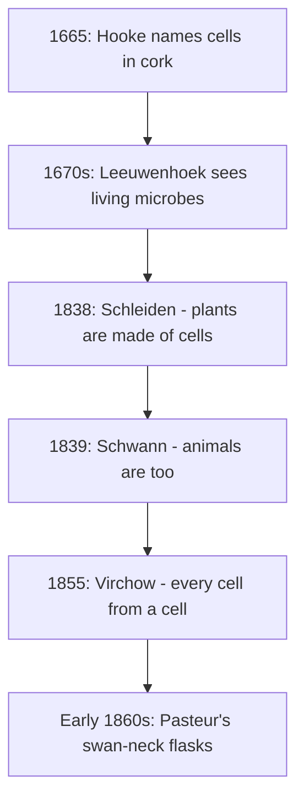

## Into the world of cells

Module 1 ended with the molecules of life: carbohydrates, lipids, proteins, nucleic acids and the enzymes that drive their chemistry. Those molecules do not float around loose. They are packaged into cells, the smallest units that are alive. This module is about cells: how we discovered them, how they differ, what is inside them, how they control what enters and leaves, and why they are so small. It starts with the tool that made cells visible, the microscope, and with one of the great unifying ideas of biology, cell theory.

## Discovering cells

Most cells are between about 1 and 100 micrometers across. One micrometer (µm) is a thousandth of a millimeter, so even a large cell is about the width of a fine hair, near the limit of what the naked eye can see. Cells had to wait for the microscope.

- *Robert Hooke, 1665.* Looking at a thin slice of cork through a compound microscope, Hooke saw rows of tiny empty boxes and called them "cells," after the small rooms monks lived in. He was seeing only the walls of dead plant cells, but the name stuck.
- *Antonie van Leeuwenhoek, 1670s.* A Dutch cloth merchant who ground superb single lenses, Leeuwenhoek magnified objects up to about 270 times. In pond water, rainwater and scrapings from his own teeth he saw tiny moving creatures he called "animalcules": single-celled organisms, including the first bacteria anyone had seen.
- *Matthias Schleiden, 1838,* concluded that all plants are made of cells.
- *Theodor Schwann, 1839,* extended this to animals: animals, too, are made of cells and cell products.
- *Rudolf Virchow, 1855,* popularized the principle *omnis cellula e cellula*, "every cell from a cell," building on the observations of Robert Remak and others, who had watched cells divide. New cells do not form from nonliving material; they come from the division of existing cells.

The timeline puts these steps in order. Notice the gap of almost two centuries between seeing cells and understanding them: better lenses, staining methods and many observers were needed before anyone could generalize.

## The cell theory

Together these findings became the **cell theory**, which has three parts:

1. All living things are made of one or more cells.
2. The cell is the basic unit of structure and function in living things.
3. All cells come from preexisting cells.

Modern biology adds that cells contain hereditary information (DNA) that is passed to new cells when they divide, and that the chemical reactions of life take place within cells. Like any scientific theory, cell theory is a broad explanation supported by an enormous body of evidence: no one has ever found an organism that is not made of cells, or a cell that arose other than from another cell.

## Pasteur and the end of spontaneous generation

The third part of the theory clashed with an old idea. Redi (Lesson 2) had shown that maggots come from flies, but many scientists still believed microbes arose spontaneously in broth. In the early 1860s Louis Pasteur settled the matter with an elegant experiment.

He boiled nutrient broth in flasks whose necks he had heated and drawn into a long S-shaped "swan neck." Air could flow freely in and out, but dust and microbes settled in the bend of the neck and never reached the broth. The broth stayed clear and sterile for months. When he snapped off the neck, or tipped the flask so broth touched the dust in the bend, the broth soon clouded with microbes.

### Example 1: Interpreting Pasteur's results

| Flask | Treatment | Result after several weeks |
|---|---|---|
| A | Boiled, swan neck intact | Clear (no microbes) |
| B | Boiled, then neck broken off | Cloudy (microbes growing) |
| C | Boiled, then tilted so broth touched the neck's bend, then set upright | Cloudy |

What do the three flasks show together?

1. Flask A shows that boiled broth exposed to air does not produce life on its own. Critics had claimed that air contained a "vital force" needed for spontaneous generation; air reached flask A freely, so that objection fails.
2. Flask B shows the broth can still support microbes, so A's clarity is not because boiling ruined the broth.
3. Flask C pins down the source: the only change was contact with the dust trapped in the neck. Microbes came from microbes already in that dust.

The conclusion: microbes come from other microbes, as cell theory predicts. Notice how each flask rules out one alternative explanation. That is the logic of controls from Lesson 2 at work.

## Microscopes and magnification

A compound light microscope uses two lenses in series: an ocular (eyepiece) lens, usually 10×, and one of several objective lenses, commonly 4×, 10×, 40× and 100×. Follow the light in the drawing: it leaves the light source in the base, passes through the diaphragm (which controls how much light gets through), through the thin specimen on a glass slide resting on the stage, and into the objective lens. The objectives sit on a revolving nosepiece, so you can click a different one into place. The image travels up the body tube to the eyepiece. The coarse focus knob moves the stage (or the tube, on some models) a long way for rough focusing at low power; the fine focus knob makes the small adjustments needed at high power.

The **magnification** is how many times larger the image appears than the real object. For a compound microscope,

$$\text{total magnification} = \text{ocular magnification} \times \text{objective magnification}.$$

A 10× ocular with a 40× objective gives 400×. Magnification also links an image (or photograph) to the real object:

$$\text{actual size} = \frac{\text{image size}}{\text{magnification}}.$$

Keep units straight: $1 \text{ mm} = 1000\ \mu\text{m}$ and $1\ \mu\text{m} = 1000 \text{ nm}$.

### Example 2: Actual size from a micrograph

In a photograph taken at 400× total magnification, a cheek cell measures 24 mm across. How wide is the real cell, in micrometers?

1. Convert the image size to micrometers: $24 \text{ mm} \times 1000 = 24\,000\ \mu\text{m}$.
2. Divide by the magnification: $24\,000 / 400 = 60\ \mu\text{m}$.

The cell is 60 µm across, a typical size for a human cheek cell. Dividing before converting gives the same answer (0.06 mm); just do not forget the conversion.

## Field of view

The **field of view** is the circle you see through the eyepiece. As magnification rises, you see a smaller part of the slide: the field's diameter shrinks in proportion. If magnification goes up by a factor of 10, the field diameter shrinks to a tenth.

$$\text{high-power field diameter} = \text{low-power field diameter} \times \frac{\text{low magnification}}{\text{high magnification}}$$

You can measure the low-power field with a clear ruler (at 40×, it is often about 4.5 mm), calculate the high-power field, and then estimate the size of a cell by counting how many fit across:

$$\text{cell size} \approx \frac{\text{field diameter}}{\text{number of cells across}}.$$

### Example 3: Estimating cell size

At 40×, the field of view is 4.5 mm across. A student switches to 400× and counts about 9 cheek cells lying side by side across the middle of the field. Estimate the length of one cell.

1. Magnification rose by a factor of $400 / 40 = 10$, so the field shrinks to $4.5 / 10 = 0.45$ mm.
2. Convert: $0.45 \text{ mm} = 450\ \mu\text{m}$.
3. Divide by the number of cells: $450 / 9 = 50\ \mu\text{m}$.

Each cell is about 50 µm across. A frequent error is to make the field *larger* at higher power; remember that zooming in shows less of the slide.

## Resolution and the electron microscope

Magnification alone is not enough. Enlarge a blurry image and you just get a bigger blur. **Resolution** is the smallest distance between two points at which they can still be seen as separate. Because of the wave nature of light, a light microscope cannot resolve details closer together than about 0.2 µm (200 nm), however much it magnifies. That is enough to see most cells and their nuclei, but not ribosomes or the fine structure of membranes.

An **electron microscope** uses a beam of electrons, which have a much shorter wavelength than light, focused by magnets. It can resolve details around a nanometer or smaller, hundreds of times finer than a light microscope. There are two main types:

- A *transmission electron microscope (TEM)* sends electrons through an ultra-thin slice of a specimen, revealing internal structures such as membranes and ribosomes.
- A *scanning electron microscope (SEM)* bounces electrons off a specimen's coated surface, producing detailed 3-D-looking images of surfaces.

The trade-off: electron microscopes need a vacuum and specially prepared (dead, fixed and coated or sliced) specimens, and they are expensive. Light microscopes can show living cells moving and dividing, and in true color. Stains and fluorescent dyes make particular structures stand out.

| | Light microscope | Electron microscope |
|---|---|---|
| Uses | Light and glass lenses | Electron beam and magnetic lenses |
| Best resolution | ≈ 0.2 µm | ≈ 1 nm or better |
| Useful magnification | up to ≈ 1000–1500× | up to hundreds of thousands × or more |
| Living specimens? | Yes | No (vacuum) |
| Color | True color with stains | Black and white (color is added later) |

## Common mistakes

- *Adding magnifications.* A 10× ocular and 40× objective give 400×, not 50×.
- *Field of view going the wrong way.* Higher magnification means a smaller field.
- *Skipping unit conversions.* 1 mm = 1000 µm; 1 µm = 1000 nm.
- *Confusing magnification with resolution.* Magnifying beyond a microscope's resolution adds size but no detail.
- *Thinking Hooke saw living cells.* He saw the empty walls of dead cork cells.

## Key points

- The **cell theory**: all living things are made of cells; the cell is the basic unit of life; all cells come from preexisting cells.
- Hooke named cells; Leeuwenhoek saw microbes; Schleiden and Schwann generalized cells to plants and animals; Virchow established "every cell from a cell"; Pasteur's swan-neck flasks refuted spontaneous generation of microbes.
- Total **magnification** = ocular × objective; actual size = image size ÷ magnification.
- The **field of view** shrinks in proportion as magnification rises; cell size ≈ field diameter ÷ number of cells across.
- **Resolution** limits detail: about 0.2 µm for light microscopes, about 1 nm or better for an **electron microscope**.
