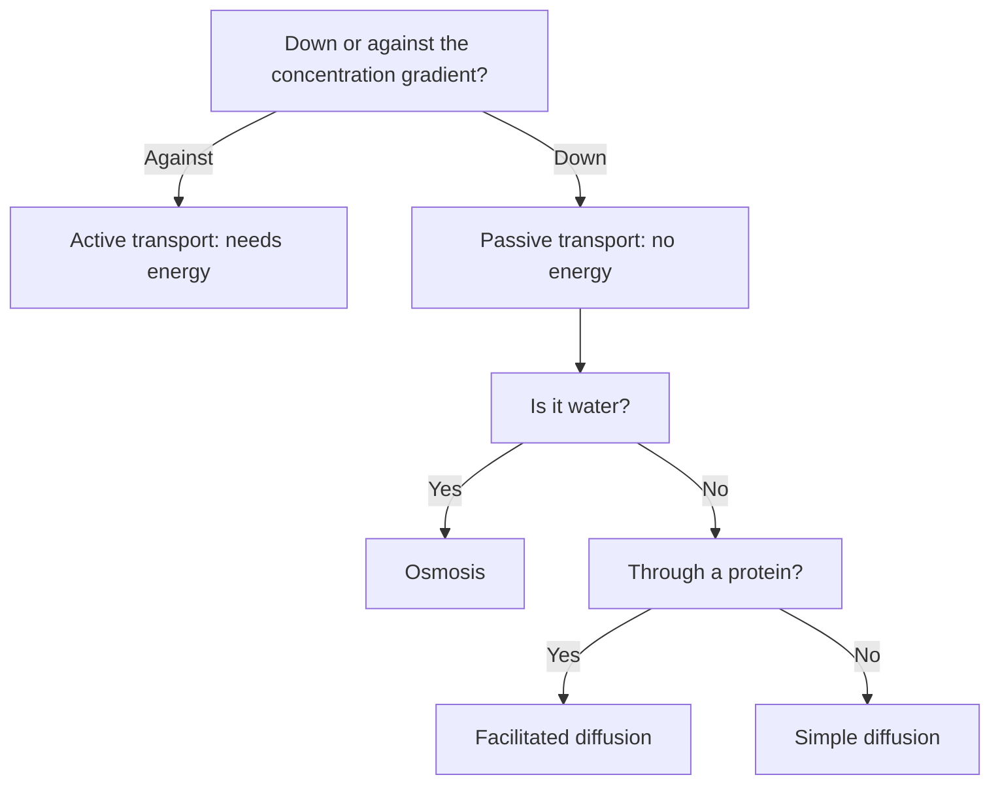

## The cell's border

The last lesson toured the organelles, most of which are wrapped in membranes, and ended with vesicles fusing with the plasma membrane to release proteins. This lesson looks closely at membranes themselves. A cell must take in food, oxygen and ions, get rid of wastes, and keep its internal conditions steady, all through a boundary only about 8 nanometers thick. How a membrane is built explains what can cross it, and how.

## The phospholipid bilayer

Membranes are built mainly from **phospholipids**, lipids with a polar, water-loving (hydrophilic) head containing phosphate and two nonpolar, water-avoiding (hydrophobic) fatty acid tails. In water, phospholipids arrange themselves spontaneously into a double layer, the bilayer: heads face the watery fluid on each side, and tails point inward, hidden from water. No energy is needed to form it.

The first evidence for a bilayer came in 1925. Evert Gorter and François Grendel extracted the lipids from a known number of red blood cells, spread them on water as a layer one molecule thick, and measured its area. It was about twice the total surface area of the cells. The lipids must therefore form two layers around each cell. (Their individual measurements had errors that happened to cancel, but later methods confirmed the bilayer.)

## The fluid mosaic model

The modern picture is the **fluid mosaic model**, proposed by S. J. Singer and Garth Nicolson in 1972. *Mosaic*: the membrane is a patchwork of many kinds of proteins embedded in or attached to the lipid bilayer. *Fluid*: the lipids and many of the proteins drift sideways within the layer, like icebergs in a sea, rather than being fixed in place.

The fluid part was shown directly in 1970 by Larry Frye and Michael Edidin. They fused a mouse cell with a human cell, making one hybrid cell, and tagged the mouse membrane proteins with a green fluorescent dye and the human proteins with a red one. Right after fusion, the colors occupied separate halves of the surface. After about 40 minutes at 37 °C, the colors were completely intermixed. When the experiment was done at low temperature (around 15 °C or below), the colors stayed separate. The proteins were not being made fresh in new places (blocking protein synthesis did not prevent mixing); they were *moving* in a fluid membrane, and more slowly when cold, just as a fluid thickens when chilled.

Other parts of the mosaic:

- *Cholesterol*, tucked among the phospholipids of animal cells, keeps the membrane from becoming too fluid when warm or too stiff when cold.
- *Transport proteins* (channels and carriers) let specific substances cross.
- *Receptor proteins* bind signal molecules such as hormones.
- *Glycoproteins and glycolipids*, with sugar chains on the outside surface, act as identification tags that let cells recognize each other (and let the immune system recognize foreign cells).

The drawing puts the mosaic together. The sugar chains all point outward, away from the cytoplasm, and every protein that spans the membrane has to cross the oily core, so the part of it buried in the tails is itself hydrophobic.


## Selective permeability

A membrane is **selectively permeable**: some substances cross it easily and others cannot cross without help. What decides it is how well a molecule can pass through the oily, hydrophobic core.

- Small nonpolar molecules (oxygen, carbon dioxide) slip straight through.
- Water is small and crosses slowly through the bilayer, but much faster through channel proteins called aquaporins, discovered by Peter Agre in 1992.
- Ions (Na⁺, K⁺, Cl⁻) and large polar molecules (glucose) are blocked by the hydrophobic core and cross only through transport proteins.

## Passive transport: no energy needed

**Diffusion** is the net movement of particles from a region of higher concentration to a region of lower concentration, caused by their random motion. The difference in concentration between two regions is a concentration gradient, and diffusion moves substances "down" it until the concentration is even (equilibrium). At equilibrium, molecules still move, but equally in both directions. Diffusion needs no energy from the cell; it is powered by the molecules' own motion. Oxygen diffuses into your cells and carbon dioxide out this way.

**Facilitated diffusion** is diffusion through a transport protein. It is still passive, always down the gradient, but it lets ions and polar molecules across. Channel proteins form pores for specific ions; carrier proteins bind a molecule such as glucose and change shape to release it on the other side.

**Osmosis** is the diffusion of water across a selectively permeable membrane. Water moves from the side where solute concentration is *lower* (more free water) to the side where solute concentration is *higher* (less free water), because the membrane blocks the solute from moving instead. A simple rule: water follows solute.

## Tonicity: predicting osmosis

The direction of osmosis depends on the solution outside the cell compared with the inside:

- A **hypertonic** solution has a higher solute concentration than the cell. Water leaves the cell, which shrinks. Animal cells shrivel; in plant cells the membrane pulls away from the wall (plasmolysis) and the plant wilts.
- A **hypotonic** solution has a lower solute concentration than the cell. Water enters. Animal cells swell and may burst (lyse); plant cells swell against their walls and become firm (turgid), which is the healthy state for a plant.
- An **isotonic** solution has the same solute concentration as the cell. Water moves in and out equally, with no net change.

That is why the standard hospital IV fluid is isotonic saline (about 0.9% NaCl).

The picture shows all six cases. Read each column as "the cell sits in this solution" and follow the blue arrows for the net movement of water. The animal cell has nothing to stop it bursting; the plant cell's wall turns the same inflow into firmness.

![A grid of six cells. Columns are hypertonic, isotonic and hypotonic solutions. Top row, red blood cells: in hypertonic solution water leaves and the cell shrinks into a spiky shape; in isotonic solution water moves both ways equally and the cell is a normal disc; in hypotonic solution water enters and the cell swells and may burst. Bottom row, plant cells: hypertonic, the membrane and shrunken vacuole pull away from the wall (plasmolyzed); isotonic, the membrane just touches the wall (flaccid); hypotonic, the large vacuole presses the cell against its wall (turgid).](images/m2-tonicity.svg)

### Example 1: Red blood cells in salt solutions

Red blood cells, whose contents are isotonic to about 0.9% NaCl (their dissolved particles are mostly potassium ions and proteins, adding up to the same concentration), are placed in 0.9%, 3% and 0.1% NaCl. Predict what happens in each.

1. 0.9%: isotonic. No net water movement; the cells keep their normal disc shape.
2. 3%: hypertonic outside (more solute). Water leaves the cells by osmosis; they shrink and become spiky.
3. 0.1%: hypotonic outside. Water rushes in; with no cell wall to resist, many cells swell and burst.

Reason about water, not salt: the membrane holds the ions back, so water is what moves.

### Example 2: The potato core experiment

A student cuts equal cylinders of potato, weighs them, soaks them in sucrose solutions for 24 hours, then blots and reweighs them.

| Sucrose (M) | 0.0 | 0.2 | 0.4 | 0.6 | 0.8 |
|---|---|---|---|---|---|
| Mass change (%) | +20 | +9 | −1 | −10 | −19 |

For example, a core that went from 2.50 g to 3.00 g in pure water changed by $\dfrac{3.00 - 2.50}{2.50} \times 100\% = +20\%$. Percent change, not grams, is used so that cores of slightly different starting mass can be compared.

```plot
{"x": [0, 0.9], "y": [-25, 25], "xLabel": "sucrose concentration (M)", "yLabel": "mass change (%)", "points": [[0, 20], [0.2, 9], [0.4, -1], [0.6, -10], [0.8, -19]], "segments": [{"from": [0, 20], "to": [0.2, 9]}, {"from": [0.2, 9], "to": [0.4, -1]}, {"from": [0.4, -1], "to": [0.6, -10]}, {"from": [0.6, -10], "to": [0.8, -19]}, {"from": [0, 0], "to": [0.9, 0], "dashed": true}], "labels": [{"at": [0.38, 4], "text": "≈ 0.38 M"}], "caption": "Potato cores gain mass in dilute sucrose and lose mass in concentrated sucrose"}
```

Interpretation:

1. In 0.0 and 0.2 M, the cores gained mass: the solutions were hypotonic to the potato cells, so water entered.
2. In 0.6 and 0.8 M, they lost mass: hypertonic solutions drew water out.
3. Where the line crosses zero, there is no net change: that solution is isotonic to the potato cells. Between 0.2 M (+9%) and 0.4 M (−1%) the mass change falls by 10 percentage points, so zero is reached $9/10$ of the way along: $0.2 + 0.9 \times 0.2 = 0.38$ M. The potato cells' contents are equivalent to roughly 0.38 M sucrose.

## Water potential (extension)

Biologists make osmosis quantitative with water potential, written $\Psi$ (psi), measured in bars or megapascals. Water always moves from higher to lower water potential. Pure water at atmospheric pressure has $\Psi = 0$; dissolving solute lowers it, and pressure raises it:

$$\Psi = \Psi_s + \Psi_p, \qquad \Psi_s = -iCRT$$

Here $\Psi_s$ is the solute potential, $i$ the number of particles each solute unit makes in water (1 for sucrose, about 2 for NaCl), $C$ the molar concentration, $R = 0.0831$ L·bar/(mol·K) and $T$ the temperature in kelvins (°C + 273). For example, 0.2 M sucrose at 22 °C has $\Psi_s = -(1)(0.2)(0.0831)(295) \approx -4.9$ bar. In an open beaker, $\Psi_p = 0$, so $\Psi = -4.9$ bar, and water from a cell with a higher (less negative) potential will move into it. In a swollen plant cell, the wall pushes back, creating a positive pressure potential that stops more water entering.

## Active transport: moving uphill

Sometimes a cell must move a substance *against* its concentration gradient, from low to high concentration. This is **active transport**, and it requires energy, usually from ATP, and a carrier protein that acts as a pump.

The best-known example is the sodium–potassium pump, found in nearly all animal cells. Each cycle uses one ATP to pump 3 sodium ions out of the cell and 2 potassium ions in. The result is high Na⁺ outside and high K⁺ inside, gradients that nerve cells use to send signals and that many cells use to drive other transport. Root cells of plants likewise use active transport to absorb mineral ions from soil where those ions are scarcer than inside the root.

Large particles and bulk amounts of material cross by vesicles, which also uses energy. In *endocytosis*, the membrane folds inward around material and pinches off a vesicle inside the cell; a white blood cell engulfing a bacterium is an example (phagocytosis, "cell eating"). In *exocytosis*, a vesicle fuses with the plasma membrane and releases its contents outside, the last step of the secretion pathway from Lesson 8.

### Example 3: Passive or active?

Classify each movement.

1. *Oxygen enters a lung cell from air where its concentration is higher.* Down the gradient, through the bilayer: simple diffusion (passive).
2. *Glucose enters a red blood cell, where its concentration is lower, through a carrier protein.* Down the gradient via a protein: facilitated diffusion (passive).
3. *A gut cell takes in glucose even though its own glucose concentration is already higher than in the gut.* Against the gradient: active transport (it needs energy). Here the energy comes indirectly: the carrier lets Na⁺ flow back in down the gradient built by the sodium–potassium pump and uses that flow to drag glucose along.
4. *Water enters a root cell from wet soil through aquaporins.* Osmosis (passive).

The test is the direction relative to the gradient, not whether a protein is involved. The flowchart turns that test into a set of questions you can ask about any small molecule or ion. (Bulk transport by vesicles, endocytosis and exocytosis, is a separate case that always uses energy.)



## Common mistakes

- *Saying water moves toward lower solute concentration.* Water moves toward *higher* solute concentration (lower water concentration).
- *Describing the solution and the cell backward.* "Hypertonic" describes the solution with more solute; a cell in a hypertonic solution loses water.
- *Thinking diffusion stops at equilibrium.* Molecules keep moving; there is just no *net* movement.
- *Calling facilitated diffusion active.* It uses proteins but no energy, and only goes down the gradient.
- *Expecting plant cells to burst in fresh water.* The cell wall stops them; they become turgid.

## Key points

- Membranes are **phospholipid** bilayers with embedded proteins: the **fluid mosaic model** (supported by Gorter–Grendel and Frye–Edidin).
- Membranes are **selectively permeable**: small nonpolar molecules cross freely; ions and large polar molecules need proteins.
- Passive transport (no energy, down the gradient): **diffusion**, **facilitated diffusion**, **osmosis**.
- **Hypertonic** solution: cell loses water. **Hypotonic**: cell gains water. **Isotonic**: no net change.
- Water potential $\Psi = \Psi_s + \Psi_p$; water moves from higher to lower $\Psi$.
- **Active transport** moves substances against the gradient using energy (sodium–potassium pump: 3 Na⁺ out, 2 K⁺ in per ATP). Endocytosis and exocytosis move bulk material in vesicles.
