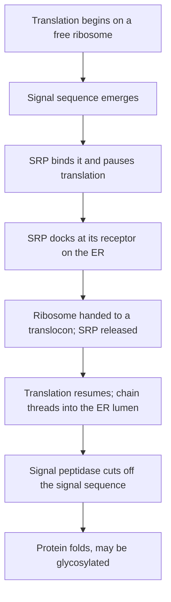

## Addresses, envelopes and roads

Lesson 8 followed a secreted protein from the rough ER to the Golgi and out of the cell, and Palade's pulse–chase data showed the route. That raises harder questions. A cell makes thousands of different proteins at once: how does each one reach the right place? How does a vesicle find the one membrane it should fuse with? And what carries vesicles across a cell that may be a meter long? The answers come from two connected systems: the **endomembrane system**, the set of membranes linked by vesicle traffic (nuclear envelope, ER, Golgi, lysosomes, endosomes, vesicles and the plasma membrane), and the **cytoskeleton**, the network of protein fibers that gives the cell its shape and serves as its roads.

## Getting into the ER: the signal hypothesis

Every ribosome is the same; an ER-bound ribosome is just one making the right kind of protein. In the 1970s Günter Blobel showed that the protein itself carries the instructions. Proteins headed for the ER begin with a **signal sequence**, a stretch of roughly 15 to 30 amino acids with a hydrophobic core at the start of the chain. Blobel received the 1999 Nobel Prize for this "signal hypothesis," the idea that proteins carry built-in address labels.

As soon as the signal sequence emerges from a ribosome in the cytosol, a **signal recognition particle (SRP)**, a complex of RNA and protein, binds it and pauses translation. The SRP steers the whole ribosome to an SRP receptor on the ER membrane, hands it to a protein channel called a translocon, and lets go. Translation resumes and the growing chain is threaded straight through the channel into the ER interior (the lumen).

A membrane protein is made the same way, except that a hydrophobic stretch of about 20 amino acids later in the chain stops the transfer and stays in the membrane as a membrane-spanning segment. Proteins without a signal sequence are finished in the cytosol. Some stay there; others carry different signals that bring them, fully made, into the nucleus, mitochondria, chloroplasts or peroxisomes. That is why mitochondria and chloroplasts, though wrapped in membranes, are not part of the endomembrane system: they never exchange vesicles with it.

## Inside the ER: folding and quality control

In the lumen, chaperone proteins (see the honors lesson on protein folding) help the chain fold, and enzymes link cysteines into disulfide bonds. Many proteins also undergo **glycosylation**: an enzyme transfers a ready-made branch of 14 sugars onto certain asparagines in the chain. The Golgi later trims and rebuilds these sugar trees, which is why the sugars on a finished glycoprotein record its journey.

The ER also inspects its products. A protein that will not fold is held back and eventually pushed out to the cytosol, where it is destroyed. Quality control can cause disease. In the most common cystic fibrosis mutation (ΔF508), the CFTR chloride channel folds poorly and most of it is destroyed in the ER, though it would partly work at the cell surface. Newer "corrector" drugs help it fold well enough to pass inspection.

## Vesicle traffic: coats, address tags and fusion

Vesicles bud from one membrane and fuse with another, carrying cargo inside and proteins in their own membrane. Three kinds of protein coat shape the buds: *COPII* coats form vesicles leaving the ER for the Golgi; *COPI* coats form vesicles moving backward from the Golgi to the ER and between Golgi stacks; *clathrin* coats form vesicles at the trans side of the Golgi and at the plasma membrane.

A vesicle finds its target with two sets of proteins. Small GTP-binding proteins called Rabs act like address tags that help the right vesicle dock. Then **SNARE** proteins on the vesicle and on the target membrane wind tightly around each other, like the two sides of a zipper, pulling the membranes together until they fuse. James Rothman, Randy Schekman and Thomas Südhof shared the 2013 Nobel Prize for working out this machinery. Botulinum and tetanus toxins are enzymes that cut particular SNAREs in nerve cells. Synaptic vesicles can no longer fuse, so the neurotransmitter is not released, and paralysis follows.

The Golgi has a direction. Its *cis* face, nearest the ER, receives vesicles; its *trans* face ships them out, through a sorting region called the trans-Golgi network. How cargo crosses the stack is still debated; the favored model says each sac itself matures from cis to trans.

![A map of the endomembrane system inside a cell. The nucleus is surrounded by curved sheets of rough ER. COPII vesicles carry cargo to the cis face of a Golgi stack, and dashed arrows show COPI vesicles returning escaped proteins to the ER. From the trans face, one route carries a secretory vesicle to the plasma membrane for exocytosis, and another carries mannose-6-phosphate-tagged enzymes to a lysosome. On the right, endocytosis brings material in at the plasma membrane to an endosome, which delivers it to the lysosome.](images/m2-endomembrane.svg)

## Sorting signals: how each protein gets its address

A protein that has entered the ER is sorted by further signals, read like the extra lines of a mailing address.

- *No further signal: secreted.* A soluble protein with only a signal sequence flows through the Golgi and out of the cell. Cells that release a product on demand, such as insulin from pancreas cells, store it in secretory vesicles until a signal (a rise in calcium ions) triggers exocytosis.
- *KDEL: stay in the ER.* ER-resident proteins end with the four amino acids Lys-Asp-Glu-Leu (KDEL in one-letter code). Some always escape to the Golgi, where KDEL receptors catch them and COPI vesicles return them.
- *Mannose-6-phosphate: go to a lysosome.* In the Golgi, an enzyme adds a phosphate to a mannose sugar on lysosomal enzymes. Receptors in the trans-Golgi network bind this **mannose-6-phosphate** tag and package the enzymes into vesicles bound for lysosomes. In I-cell disease, a rare inherited disorder, the tagging enzyme is missing: the lysosomal enzymes are secreted into the blood instead, and the patients' lysosomes fill with undigested material.
- *Membrane-spanning segments: stay in a membrane.* Where the protein ends up (ER, Golgi or plasma membrane) depends on further signals in its sequence.

### Example 1: Where does the engineered protein go?

A researcher attaches signals to a green fluorescent protein (GFP) that normally stays in the cytosol, and expresses each version in cultured cells. Predict where the green glow appears.

| Version | Added to GFP | Prediction |
|---|---|---|
| A | Nothing | ? |
| B | ER signal sequence at the start | ? |
| C | ER signal sequence + KDEL at the end | ? |
| D | KDEL at the end only | ? |
| E | ER signal sequence + a tag that gets mannose-6-phosphate | ? |

1. *A:* no signal sequence, so it is made and stays in the cytosol, where GFP normally sits.
2. *B:* the signal sequence takes it into the ER. With no other signal it follows the default route and is secreted; the glow appears in the culture medium (and briefly in ER, Golgi and vesicles on the way).
3. *C:* it enters the ER, and any copies that leak to the Golgi are returned. The glow stays in the ER.
4. *D:* KDEL only works inside the endomembrane system. Without a signal sequence the protein never enters the ER, so it stays in the cytosol, exactly like A.
5. *E:* it enters the ER, is tagged in the Golgi and is sent to lysosomes.

Experiments like these proved the signals. The lesson of D: signals act in order, and a later one is useless without the first.

## Coming in: endocytosis

Traffic also runs inward. Besides phagocytosis (Lesson 9), cells take up specific molecules by **receptor-mediated endocytosis**. Receptors gather in pits of the plasma membrane coated with clathrin; when they bind their cargo, the pit pinches off as a coated vesicle. The coat falls away and the vesicle fuses with an **endosome**, a sorting compartment whose interior is made acidic by proton pumps. The acid makes many cargo molecules let go of their receptors; the receptors are recycled to the surface, and the cargo goes on to a lysosome to be digested.

Cholesterol enters cells this way, carried in blood particles called LDL. Michael Brown and Joseph Goldstein discovered the LDL receptor by studying familial hypercholesterolemia, an inherited condition in roughly 1 in 250 people: with too few working receptors, cells cannot take LDL out of the blood, cholesterol builds up and heart attacks come early. They shared the 1985 Nobel Prize.

Lysosomes also digest the cell's own worn-out parts by **autophagy** ("self-eating"): a membrane wraps a damaged organelle and delivers it to a lysosome for recycling.

### Example 2: Putting the steps in order with mutants

In the late 1970s and 1980s, Schekman's lab collected yeast mutants whose secretion stops at high temperature. Electron micrographs show where each mutant piles up membranes at 37 °C. Mutant *X* swells with ER; mutant *Y* fills with secretory vesicles. The double mutant *XY* swells with ER and has no extra vesicles. What does this show?

1. Each mutant blocks one step; membrane and cargo pile up just before the block. So *X* blocks a step leaving the ER, and *Y* blocks the fusion of secretory vesicles with the plasma membrane.
2. In the double mutant, cargo stops at the first block it meets. It piles up in the ER, so the *X* step must come before the *Y* step.
3. This logic (a double mutant looks like the mutant whose step comes earlier) let the lab place its secretion genes in order: ER → Golgi → secretory vesicle → plasma membrane, the route Palade's pulse–chase found in pancreas cells.

## The cytoskeleton: tracks and motors

The cytoskeleton is built from three kinds of fiber, each a polymer of protein subunits.

| Fiber | Width | Subunit | Main jobs |
|---|---|---|---|
| **Microtubule** | about 25 nm, hollow | tubulin (α–β pairs) | tracks for vesicles and organelles; mitotic spindle; cilia and flagella |
| **Intermediate filament** | about 8–12 nm, ropelike | several families (keratins, lamins, vimentin) | resist pulling; anchor the nucleus; line the nuclear envelope |
| **Microfilament** | about 7 nm | actin | cell shape and crawling; muscle contraction with myosin; pinching cells apart in cytokinesis |

Microtubules and microfilaments have a direction: their two ends differ, and the "plus" end grows faster. In animal cells the minus ends of most microtubules sit at the centrosome near the nucleus, so the plus ends point toward the cell's edge. Microtubules also show **dynamic instability**: each one grows steadily, then suddenly shrinks rapidly, then may grow again, so the network can rebuild itself quickly, for example into a spindle.

**Motor proteins** use ATP to walk along these tracks, carrying cargo. Kinesins mostly walk toward plus ends (outward) and dyneins toward minus ends (inward) along microtubules; myosins walk along actin. A kinesin takes 8 nm steps, using one ATP per step. In cilia and flagella, a ring of nine pairs of microtubules surrounds a central pair (the "9 + 2" pattern), and dynein arms make the pairs slide against each other so the whole structure bends. People with primary ciliary dyskinesia, often from defective dynein arms, have cilia that beat weakly or not at all: mucus is not swept out of their airways, and sperm swim poorly.

Drugs that jam the cytoskeleton are useful medicines. Colchicine stops microtubules from growing; paclitaxel (Taxol) freezes them so they cannot shrink. Either way the spindle fails, so dividing cells stall in mitosis, which is why paclitaxel is used against cancer.

### Example 3: How long is the trip down an axon?

A motor neuron in your leg has an axon 1 m long. Proteins and vesicles made near the nucleus are carried down it by kinesin. (a) At 1 µm/s, how long does the trip take? (b) Fast axonal transport can reach about 4 µm/s; how long then? (c) How many steps does one kinesin take over the whole trip?

1. Convert: $1 \text{ m} = 10^6\ \mu\text{m}$.
2. (a) Time $= \dfrac{10^6\ \mu\text{m}}{1\ \mu\text{m/s}} = 10^6$ s. Divide by 3600 for hours (about 278 h) and by 24 for days: about **11.6 days**.
3. (b) $\dfrac{10^6}{4} = 2.5 \times 10^5$ s $\approx$ 69 h, about **2.9 days**.
4. (c) Each step is 8 nm $= 8 \times 10^{-9}$ m, so the number of steps is $\dfrac{1}{8 \times 10^{-9}} = 1.25 \times 10^8$, and the same number of ATP molecules for that motor.

Diffusion could never do this: its time grows with the square of distance (Lesson 10). Long cells depend on motors.

## Common mistakes

- *Thinking ribosomes come in two kinds.* Free and ER-bound ribosomes are identical; the signal sequence of the protein being made decides where the ribosome works.
- *Putting mitochondria in the endomembrane system.* They import finished proteins from the cytosol and exchange no vesicles with the ER or Golgi.
- *Assuming secretion needs a special signal.* Secretion is the default for a soluble protein in the ER; staying in the ER or going to a lysosome needs an extra signal.
- *Mixing up the motors.* Kinesin (mostly) moves toward plus ends, out to the cell edge; dynein toward minus ends, in toward the center. Myosin uses actin, not microtubules.
- *Thinking the cytoskeleton is fixed scaffolding.* Microtubules and microfilaments assemble and disassemble constantly.

## Key points

- The **endomembrane system** (nuclear envelope, ER, Golgi, endosomes, lysosomes, vesicles, plasma membrane) is linked by vesicle traffic.
- A **signal sequence** at the start of a protein is bound by the **signal recognition particle (SRP)**, which brings the ribosome to the ER; the chain is threaded inside, folded, often given sugars (**glycosylation**) and checked.
- Coats (COPII, COPI, clathrin) shape vesicles; Rabs and **SNARE** proteins make sure each vesicle fuses with the right membrane.
- Sorting signals: none extra → secreted; KDEL → returned to the ER; **mannose-6-phosphate** → lysosome.
- **Receptor-mediated endocytosis** brings specific cargo (such as LDL) in via clathrin-coated vesicles and **endosomes**; **autophagy** recycles the cell's own parts.
- The **cytoskeleton**: **microtubules** (tubulin, 25 nm, **dynamic instability**), **intermediate filaments** (strength) and **microfilaments** (actin). **Motor proteins** (kinesin, dynein, myosin) carry cargo using ATP; a kinesin step is 8 nm per ATP.
