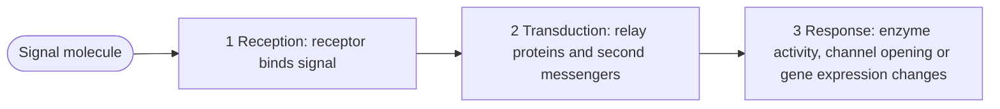
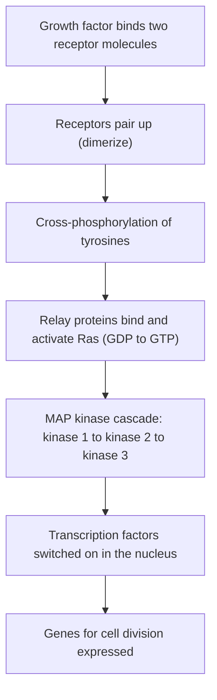
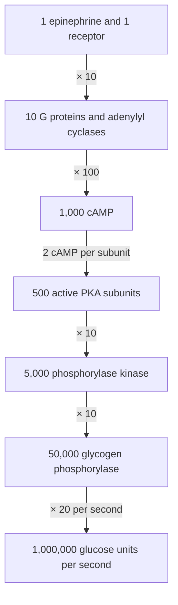

## Messages across the membrane

Lesson 9 listed receptor proteins as one tile in the membrane mosaic: proteins that bind signal molecules such as hormones. This lesson asks what happens next. A hormone like epinephrine (adrenaline) never enters a liver cell, yet within seconds the cell is breaking down glycogen and releasing glucose into the blood. How does a message stuck outside the cell change what happens inside? The answer, worked out over the last 70 years, is one of the great unifying stories of biology: a small number of receptor types and relay systems, reused in endless combinations, run everything from your heartbeat to the growth of your cells.

## Near and far signals

Cells signal at several distances. Neighboring cells can talk through direct connections (gap junctions in animals, plasmodesmata in plants) or by touching surface molecules. A cell can release a local signal that acts on nearby cells, such as a growth factor in a healing wound; nerve cells release neurotransmitters across a synapse. For long distances, endocrine cells release hormones into the blood. Whatever the distance, the signal molecule that binds a receptor is called a **ligand**, and a cell responds only if it has the matching **receptor**, a protein whose shape fits that ligand. That is why epinephrine in the blood reaches every cell but affects only some.

## Three stages: reception, transduction, response

In the 1950s Earl Sutherland asked how epinephrine makes liver cells activate glycogen phosphorylase, the enzyme that releases glucose from glycogen. His answer divided signaling into three stages, a framework still used today.

**Signal transduction** is the middle stage: converting the binding of a ligand into a change inside the cell, usually through a chain of relay molecules.

### Example 1: Sutherland's broken cells

Sutherland's group broke liver cells open and spun the mixture to separate a membrane fraction from a soluble fraction (the cytosol, which contained the phosphorylase). Simplified results:

| Tube | Treatment | Phosphorylase activated? |
|---|---|---|
| 1 | Soluble fraction + epinephrine | No |
| 2 | Membrane fraction + epinephrine + ATP; then boiled; the liquid added to soluble fraction | Yes |
| 3 | Membrane fraction + ATP, no epinephrine; then boiled; the liquid added to soluble fraction | No |

1. Tube 1: the hormone cannot act on the enzyme directly. Something in the membranes is needed (we now know: the receptor).
2. Tube 2: the membranes, given epinephrine, made something that could travel to the enzyme on its own.
3. That something survived boiling, which destroys almost all proteins, so it was a small molecule, not an enzyme.
4. Tube 3: it was made only when epinephrine was present.

The small molecule turned out to be cyclic AMP (cAMP), made from ATP. Sutherland called it a "second messenger," relaying inside the cell the message the hormone (the first messenger) brought to the surface. He received the 1971 Nobel Prize.

## Reception: four kinds of receptor

**G protein-coupled receptors (GPCRs)** are single proteins that snake back and forth across the membrane seven times. When a ligand binds, the receptor changes shape and activates a **G protein** on the inner surface. A G protein has three subunits; the largest, α, holds GDP when inactive. The activated receptor makes it swap GDP for GTP, and the α subunit then moves along the membrane to switch on an enzyme, such as adenylyl cyclase. The α subunit slowly breaks down its own GTP to GDP, which switches itself off. Humans have about 800 GPCR genes, for hormones, neurotransmitters, light (in the eye) and odors, and roughly a third of all approved drugs act on GPCRs, including beta blockers and many antihistamines.

A **receptor tyrosine kinase (RTK)** is a receptor that is itself an enzyme. When a growth factor binds, two receptor molecules pair up, and each adds phosphate groups to tyrosine amino acids on its partner's tail. The phosphorylated tyrosines become docking sites for relay proteins, so one activated receptor can start several pathways at once. The insulin receptor is an RTK (its two halves are permanently linked, and insulin binding changes their shape).

A **ligand-gated ion channel** opens a pore when its ligand binds. The acetylcholine receptor on muscle cells is one: acetylcholine from a nerve opens it, sodium ions rush in, and the muscle cell is excited within a millisecond.

An **intracellular receptor** sits in the cytoplasm or nucleus. Its ligands reach the inside of the cell: steroid hormones (estrogen, testosterone, cortisol) cross the membrane because they are nonpolar, thyroid hormone is carried in by transporters, and the small gas nitric oxide slips straight through. A steroid-receptor complex acts as a transcription factor, binding DNA and switching particular genes on or off, so its effects take minutes to hours but can last a long time.

## How strongly does a ligand bind?

Binding is reversible: ligands attach and detach constantly. The strength of binding is measured by the **dissociation constant** ($K_d$), the ligand concentration at which half the receptors are occupied. A smaller $K_d$ means tighter binding. For simple binding, the fraction of receptors occupied is

$$f = \frac{[L]}{[L] + K_d}.$$

### Example 2: Receptor occupancy

A hormone binds its receptor with $K_d = 2$ nM. What fraction of receptors is occupied at 2, 6 and 18 nM hormone? What concentration occupies 90%?

1. At 2 nM: $f = \dfrac{2}{2 + 2} = 0.50$, half, as the definition of $K_d$ says.
2. At 6 nM: $f = \dfrac{6}{6 + 2} = 0.75$.
3. At 18 nM: $f = \dfrac{18}{18 + 2} = 0.90$.
4. For 90%, solve $\dfrac{L}{L + 2} = 0.9$: $L = 0.9L + 1.8$, so $0.1L = 1.8$ and $L = 18$ nM, that is $9K_d$.

Tripling the hormone from 2 to 6 nM raised occupancy only from 50% to 75%; going from 90% to 99% would take $99K_d$. Receptors saturate, so a response cannot grow without limit. Occupancy is most sensitive to changes in concentration around $K_d$: it rises from 10% at $K_d/9$ to 90% at $9K_d$, an 81-fold range of concentration.

## Transduction: second messengers and kinases

Most relays work by turning proteins on and off. A **protein kinase** transfers a phosphate group from ATP to a target protein, changing its shape and activity; a **protein phosphatase** removes it. A chain in which each kinase activates the next is a **phosphorylation cascade**.

A **second messenger** is a small, non-protein molecule or ion that spreads the signal quickly through the cytoplasm. **Cyclic AMP (cAMP)** is made from ATP by adenylyl cyclase and activates protein kinase A (PKA); an enzyme called phosphodiesterase breaks cAMP down, ending the signal. Other GPCRs activate an enzyme that splits a membrane lipid into two messengers: one (IP₃) opens calcium channels in the ER, and calcium ions released into the cytosol activate many proteins.

## Amplification

Because each enzyme in a cascade activates many molecules of the next, a few ligand molecules can produce a huge response. This **amplification** is why hormones work at nanomolar concentrations.

### Example 3: Counting the cascade

Use the illustrative numbers in the chart, chosen to show orders of magnitude, for epinephrine acting on a liver cell. How many glucose units are released per second?

1. Multiply along the chain: $1 \times 10 \times 100 = 1000$ cAMP.
2. PKA is activated when cAMP binds its regulatory subunits, which release the active catalytic subunits; it takes 2 cAMP per active subunit, so $1000 / 2 = 500$. (A step that *divides* is not amplifying.)
3. $500 \times 10 \times 10 = 50\,000$ active phosphorylase molecules.
4. $50\,000 \times 20 = 1\,000\,000$ glucose units per second.

One hormone molecule, about a million glucose units per second. Real factors vary by cell and conditions, but amplification of this size is typical.

## Response, specificity and switching off

The response can be in the cytoplasm (an enzyme switched on, a channel opened, the cytoskeleton rearranged) or in the nucleus (genes switched on or off). The same signal can do different things in different cells, because the cells have different receptors or different relay proteins. Epinephrine makes liver cells release glucose, makes heart muscle beat faster and harder, widens blood vessels in skeletal muscle and narrows those in the skin and gut, all useful in an emergency.

A signal must also stop. Ligands drop off their receptors and are broken down; G proteins hydrolyze their GTP; phosphodiesterases destroy cAMP; phosphatases remove phosphates. Cells exposed to a signal for a long time also pull receptors inside by endocytosis (see the endomembrane honors lesson), becoming less sensitive.

### Example 4: Cholera

Cholera toxin enters intestinal cells and chemically modifies the α subunit of the G protein that activates adenylyl cyclase, so the α subunit can no longer break down its GTP. Predict the effect.

1. The α subunit stays in its GTP-bound, active form.
2. Adenylyl cyclase keeps making cAMP, with no ligand needed.
3. High cAMP keeps open the CFTR chloride channels of the intestinal lining, so chloride ions pour into the gut, and water follows by osmosis (Lesson 9).
4. The result is massive watery diarrhea; untreated, cholera can kill by dehydration within hours. Treatment replaces water and salts.

The same logic explains why mutations that lock **Ras**, the small G protein in RTK pathways, in its GTP-bound form are found in roughly a fifth of human cancers: the "divide" signal never switches off.

## Common mistakes

- *Thinking the ligand enters the cell.* Most ligands (epinephrine, insulin, growth factors) stay outside; only small or nonpolar ones such as steroids reach intracellular receptors.
- *Calling the G protein the receptor.* The GPCR is the receptor; the G protein is a separate relay protein inside the membrane.
- *Thinking a kinase adds phosphate from nowhere.* It transfers a phosphate from ATP; phosphatases remove it.
- *Expecting more ligand to keep raising the response.* Receptors saturate: at $9K_d$ they are 90% occupied.
- *Forgetting the off switch.* Signaling depends as much on GTP hydrolysis, phosphodiesterases and phosphatases as on activation.

## Key points

- A **ligand** binds a specific **receptor**; signaling has three stages: reception, **signal transduction**, response (Sutherland, cAMP).
- Receptor types: **G protein-coupled receptors** (seven passes; activate a **G protein**), **receptor tyrosine kinases** (pair up and cross-phosphorylate; often via **Ras**), **ligand-gated ion channels**, and **intracellular receptors** for steroids (act on genes).
- Occupancy $f = [L]/([L] + K_d)$; the **dissociation constant** $K_d$ gives 50% occupancy.
- A **protein kinase** adds phosphate from ATP and a **protein phosphatase** removes it; chains of kinases form a **phosphorylation cascade**.
- A **second messenger** such as **cyclic AMP (cAMP)** or calcium ions spreads the signal; **amplification** at each step turns a few ligand molecules into a huge response.
- Signals are switched off by GTP hydrolysis, phosphodiesterase, phosphatases and receptor removal; failures of the off switch (cholera, Ras in cancer) cause disease.
