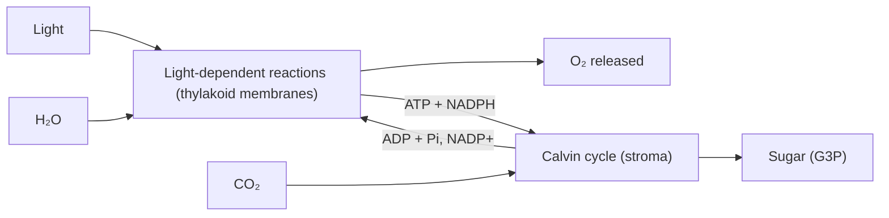

## Where the energy comes in

The last lesson showed that every cell needs a constant supply of energy, paid out as ATP. For almost every ecosystem on Earth, that energy enters the living world in one place: the chloroplasts of plants, algae, and some bacteria. **Photosynthesis** is the process that converts light energy into chemical energy stored in sugar, using carbon dioxide and water as raw materials and releasing oxygen.

Organisms that make their own food from inorganic materials are **autotrophs** ("self-feeders"); plants and algae are photosynthetic autotrophs. Organisms that must eat other organisms or their products are **heterotrophs**, which includes you, fungi, and many bacteria. Every bite you eat traces back to sugar made by photosynthesis, and nearly every oxygen molecule you breathe was released by it.

## How we figured it out

Photosynthesis looks like magic: a seed becomes a tree, apparently out of nothing. The overall equation took about 300 years of experiments to piece together.

- *Jan van Helmont (early 1600s; published in 1648, after his death)* planted a 5-pound willow in a pot holding 200 pounds of dried soil and gave it only rainwater for five years. The tree grew to about 169 pounds, yet the soil lost only about 2 ounces. He concluded the mass came from the water. He was partly right: most of a plant's mass actually comes from carbon dioxide in the air, which he never measured.
- *Joseph Priestley (1771)* found that a candle burning in a sealed jar went out, and a mouse in a sealed jar soon collapsed. Adding a sprig of mint and waiting several days "restored" the air so that a candle could burn again. Plants release something (we now know it is oxygen) that animals and flames use up.
- *Jan Ingenhousz (1779)* showed that plants restore air only in the light, and only through their green parts.
- *Samuel Ruben and Martin Kamen (1941)* gave algae water containing a heavy isotope of oxygen, ¹⁸O. The oxygen gas released carried the label. When they labeled the carbon dioxide instead, the oxygen gas did not. So the O₂ comes from splitting water, not from CO₂.

Put together, the overall equation is

$$6\,\text{CO}_2 + 6\,\text{H}_2\text{O} \xrightarrow{\text{light}} \text{C}_6\text{H}_{12}\text{O}_6 + 6\,\text{O}_2$$

Glucose stands in for the sugars actually made; most of the product is quickly turned into sucrose for transport or starch for storage. Notice that this is the reverse of the overall equation for cellular respiration in the next lesson. Photosynthesis is endergonic (it stores energy); respiration is exergonic.

## Capturing light: pigments

Light travels as packets of energy called photons. Shorter wavelengths (violet and blue) carry more energy per photon than longer ones (red). A pigment is a molecule that absorbs certain wavelengths of visible light and reflects or transmits the rest; the color we see is the light it does not absorb.

The main photosynthetic pigment is **chlorophyll**. Chlorophyll a absorbs strongly in the blue-violet (around 430 nm) and red (around 660 nm) and absorbs little green, which is why leaves look green. Helper pigments such as chlorophyll b and the carotenoids (yellow and orange) absorb other wavelengths and pass the energy on, broadening the range of usable light. In autumn, chlorophyll breaks down first and the carotenoids show through.

A graph of how much light a pigment absorbs at each wavelength is its **absorption spectrum**. A graph of how fast photosynthesis runs at each wavelength is the action spectrum. In 1882 Theodor Engelmann compared them in a clever way: he shone a tiny spectrum of light (made with a prism) along a filament of green alga in water containing bacteria that swim toward oxygen. The bacteria crowded around the parts of the alga lit by blue and red light. Without any instruments to measure oxygen, he had drawn the action spectrum with living bacteria, and it matched the absorption by chlorophyll.

```plot
{"x": [400, 700], "y": [0, 1.1], "xLabel": "wavelength (nm)", "yLabel": "relative absorption", "functions": [{"f": "exp(-((x-430)/22)^2) + 0.8*exp(-((x-662)/14)^2)", "label": "chlorophyll a"}, {"f": "0.9*exp(-((x-455)/20)^2) + 0.45*exp(-((x-642)/14)^2)", "label": "chlorophyll b", "dashed": true}], "labels": [{"at": [540, 0.3], "text": "green: little absorbed"}], "caption": "Absorption spectra of chlorophyll a and b (simplified): strong peaks in blue and red, a trough in green"}
```

## Where it happens: inside the chloroplast

You met the chloroplast as a structure in the last module. Inside its double membrane is a third membrane system, the **thylakoids**, flattened sacs stacked into piles (grana). Chlorophyll sits in the thylakoid membranes. The fluid surrounding the thylakoids is the **stroma**, as the drawing shows.


Photosynthesis runs as two linked stages in these two places:

| Stage | Location | Inputs | Outputs |
|---|---|---|---|
| Light-dependent reactions | Thylakoid membranes | Light, H₂O, ADP + Pᵢ, NADP⁺ | O₂, ATP, NADPH |
| Calvin cycle | Stroma | CO₂, ATP, NADPH | Sugar (G3P), ADP + Pᵢ, NADP⁺ |

The two stages feed each other: the first makes ATP and NADPH, the second spends them and returns ADP and NADP⁺ to be recharged. The flowchart shows the loop.



## Stage 1: the light-dependent reactions

The **light-dependent reactions** convert light energy into chemical energy in ATP and NADPH. In the thylakoid membrane, pigments are organized into clusters called **photosystems**, each with a reaction center that passes energized electrons on. There are two, named in the order they were discovered: photosystem II acts first and photosystem I second.

1. Light strikes photosystem II and boosts electrons in its reaction-center chlorophyll to a high energy level. They are passed to an **electron transport chain** in the membrane.
2. To replace those electrons, photosystem II splits water: $2\,\text{H}_2\text{O} \rightarrow 4\,\text{H}^+ + 4\,e^- + \text{O}_2$. This is the source of the oxygen gas (as Ruben and Kamen showed).
3. As electrons pass along the chain, they release energy that pumps hydrogen ions (H⁺) into the space inside the thylakoid. H⁺ builds up there, along with the H⁺ from split water.
4. Light re-energizes the electrons at photosystem I, and they are handed to NADP⁺, which becomes NADPH.
5. H⁺ ions flow back out, down their concentration gradient, through an enzyme called **ATP synthase**, which uses that flow to make ATP from ADP and Pᵢ. Making ATP with energy from an H⁺ gradient is called **chemiosmosis**. You will see the same machine in mitochondria next lesson.

## Stage 2: the Calvin cycle

The **Calvin cycle** uses ATP and NADPH to build sugar from CO₂. Melvin Calvin, Andrew Benson, and James Bassham worked it out in the late 1940s and 1950s by feeding algae CO₂ made with radioactive carbon-14, stopping the reaction after a few seconds, and identifying which molecules held the label first.

1. *Carbon fixation.* The enzyme **rubisco** attaches CO₂ to a five-carbon sugar, **RuBP** (ribulose bisphosphate). Rubisco is probably the most abundant protein on Earth. **Carbon fixation** means turning carbon from a gas into part of an organic molecule.
2. *Reduction.* ATP and NADPH convert the products into a three-carbon sugar, **G3P** (glyceraldehyde-3-phosphate).
3. *Regeneration.* Most G3P is rearranged, using more ATP, to rebuild RuBP so the cycle can continue.

Three turns of the cycle fix 3 CO₂ and yield one net G3P, using 9 ATP and 6 NADPH. Two G3P make one glucose, so one glucose takes 6 turns, 18 ATP, and 12 NADPH. The Calvin cycle does not need light directly, but it stops in the dark within seconds because it runs out of ATP and NADPH. That is why "light-independent reactions" is a better name than the old "dark reactions."

### Example 1

How many molecules of CO₂, ATP, and NADPH does a plant cell use to make 3 glucose molecules?

Step 1: Each glucose has 6 carbons, so 3 glucose need $3 \times 6 = 18$ CO₂.

Step 2: Each CO₂ fixed costs 3 ATP and 2 NADPH (from 9 ATP and 6 NADPH per 3 CO₂). So 18 CO₂ cost $18 \times 3 = 54$ ATP and $18 \times 2 = 36$ NADPH.

Step 3: Check with the per-glucose figures: $3 \times 18 = 54$ ATP and $3 \times 12 = 36$ NADPH. They agree.

## What limits the rate

The rate of photosynthesis can be measured by how fast O₂ is released (bubbles from a water plant such as Elodea, or a rise in dissolved oxygen) or how fast CO₂ is taken up. Three main factors control it: light intensity, CO₂ concentration, and temperature. Whichever is in shortest supply is the **limiting factor**: improving the others will not help until it is raised.

As light intensity increases, the rate climbs and then levels off. On the plateau, light is no longer limiting; something else, such as CO₂ or the speed of the Calvin cycle's enzymes, is. Temperature acts through those enzymes: the rate rises with temperature up to an optimum and then falls as enzymes denature.

```plot
{"x": [0, 10], "y": [0, 30], "xLabel": "light intensity (relative)", "yLabel": "O2 released (bubbles/min)", "functions": [{"f": "26*(1-exp(-0.55*x))", "label": "high CO2"}, {"f": "14*(1-exp(-0.55*x))", "label": "low CO2", "dashed": true}], "labels": [{"at": [1.5, 22], "text": "light limiting"}, {"at": [7.5, 28.5], "text": "CO2 limiting"}], "caption": "Rate of photosynthesis against light intensity at two CO2 levels"}
```

### Example 2

A student counts O₂ bubbles from an Elodea sprig at different lamp distances. At 10 cm she counts 48 bubbles in 2 minutes; at 40 cm, 18 bubbles in 2 minutes. Find each rate, and explain the difference. What should she keep the same between trials?

Step 1: Rate = bubbles ÷ time. At 10 cm, $48 \div 2 = 24$ bubbles/min. At 40 cm, $18 \div 2 = 9$ bubbles/min.

Step 2: Moving the lamp farther away lowers the light intensity reaching the plant, so light is the limiting factor here and the rate drops.

Step 3: Controlled variables: the same sprig (or same size), water temperature (a lamp close up also heats the water, so a heat shield or water bath matters), and the same CO₂ supply (for example, the same amount of baking soda in the water).

## Common mistakes

- Saying plants get their mass from the soil. Most of the dry mass comes from CO₂ in the air; water supplies hydrogen, and soil supplies only small amounts of minerals.
- Saying the O₂ comes from CO₂. It comes from splitting water.
- Saying plants photosynthesize instead of respiring. Plant cells respire all the time, day and night, in their mitochondria; photosynthesis happens only in light.
- Calling the Calvin cycle "the dark reactions" as if it ran at night. It depends on products of the light reactions.
- Thinking leaves are green because they absorb green light. They reflect it.

## Key points

- $6\,\text{CO}_2 + 6\,\text{H}_2\text{O} + \text{light} \rightarrow \text{C}_6\text{H}_{12}\text{O}_6 + 6\,\text{O}_2$; the O₂ comes from water.
- Chlorophyll absorbs mostly blue and red light; carotenoids broaden the usable range.
- Light-dependent reactions (thylakoid membranes): split water, release O₂, make ATP (by chemiosmosis through ATP synthase) and NADPH.
- Calvin cycle (stroma): rubisco fixes CO₂; ATP and NADPH reduce it to G3P. One glucose costs 6 CO₂, 18 ATP, 12 NADPH.
- The rate depends on light, CO₂, and temperature; the scarcest one is the limiting factor.
