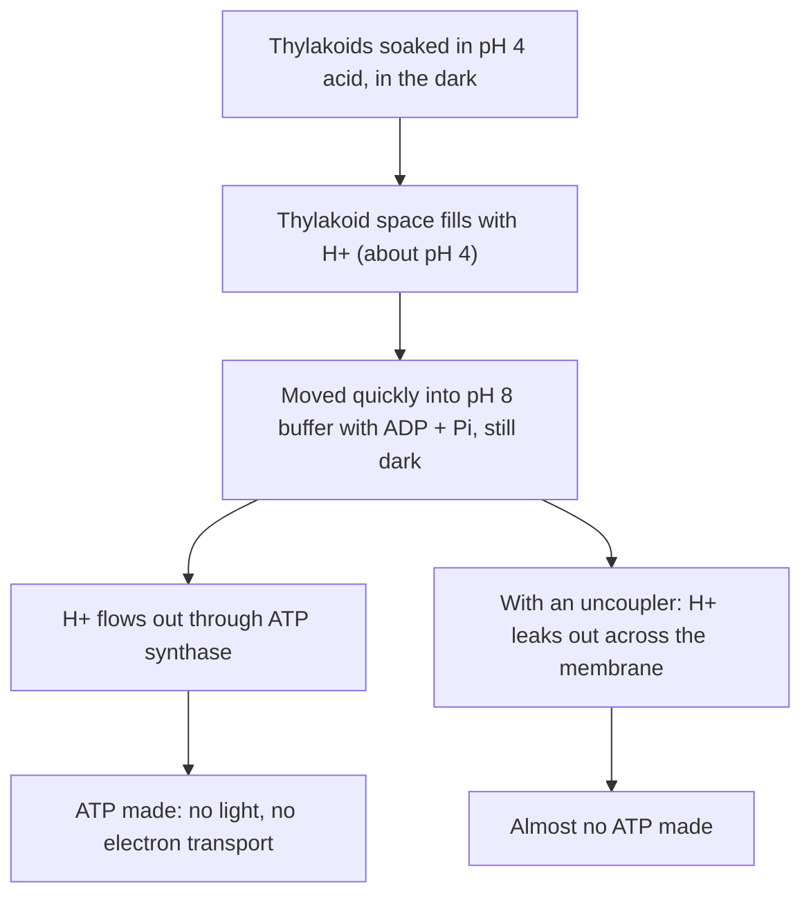

## One mechanism, two organelles

The core lessons told the same story twice: in thylakoids and in mitochondria, electron transport pumps H⁺ ions across a membrane, and the ions flow back through ATP synthase. The previous honors lesson showed how much energy the electrons carry (about 220 kJ/mol for NADH to oxygen). This lesson looks inside the machinery: which proteins carry the electrons, how a proton gradient stores energy, how ATP synthase turns it into ATP, and the experiments that convinced a skeptical field.

## The mitochondrial chain, protein by protein

The inner mitochondrial membrane holds four large complexes and two small mobile carriers, in order of rising reduction potential (last lesson): each passes electrons to one that holds them more tightly.

- *Complex I (NADH dehydrogenase)* takes two electrons from NADH and passes them to ubiquinone. It pumps 4 H⁺ out of the matrix per pair of electrons.
- *Complex II (succinate dehydrogenase)* is also an enzyme of the Krebs cycle. It oxidizes succinate, passing the electrons through its bound FAD (the "FADH₂" of the core lesson) to ubiquinone. It pumps no protons.
- **Ubiquinone** (coenzyme Q, or simply Q) is a small, fat-soluble molecule that diffuses within the membrane. It picks up two electrons and two H⁺ to become ubiquinol (QH₂) and carries them to complex III.
- *Complex III (cytochrome bc₁)* passes the electrons from QH₂ to cytochrome c. Through a two-step mechanism called the Q cycle, it moves 4 H⁺ into the intermembrane space per pair of electrons.
- **Cytochrome c** is a small protein with an iron-containing heme group, loosely attached to the outer face of the inner membrane. It carries one electron at a time from complex III to complex IV.
- *Complex IV (cytochrome c oxidase)* hands the electrons to oxygen, making water, and pumps 2 H⁺ per pair of electrons. Cyanide and carbon monoxide poison you by binding here.

![The inner mitochondrial membrane drawn across the middle, with the intermembrane space above and the matrix below. Complexes I, III and IV span the membrane and pump 4, 4 and 2 hydrogen ions upward. Electrons from NADH enter complex I, and electrons from FADH2 enter complex II; both pass to Q in the membrane, then to complex III, to cytochrome c on the outer face, to complex IV and finally to oxygen, forming water. Hydrogen ions flow back down through ATP synthase, whose head in the matrix makes ATP from ADP and phosphate.](images/m3-mito-etc.svg)

Adding up: electrons from NADH pass through complexes I, III and IV and move $4 + 4 + 2 = 10$ H⁺. Electrons from succinate skip complex I and move $4 + 2 = 6$. That difference, rather than anything about FADH₂ itself, is why the two carriers are worth different amounts of ATP.

## Storing energy in a gradient

Pumping protons stores energy in two forms at once: a chemical part, because the matrix becomes less acidic than the intermembrane space (a pH difference, $\Delta\text{pH}$), and an electrical part, because each H⁺ is charged, so the matrix side becomes negative (a membrane potential, $\Delta\psi$). Together they make up the **proton-motive force**, $\Delta p$, usually given in millivolts:

$$\Delta p = \Delta\psi + (61.5 \text{ mV}) \times \Delta\text{pH} \quad \text{(sizes only, at 37 °C)}$$

In a working mitochondrion both parts push protons back into the matrix: roughly 150–180 mV of membrane potential plus 0.5–0.8 pH units, for a $\Delta p$ of about 180–220 mV, mostly electrical. In chloroplasts other ions (Cl⁻, Mg²⁺) cross the thylakoid membrane and cancel much of the charge, so more of the force is a pH difference. Isolated thylakoids reach about 3 pH units; in living leaves the difference is smaller, and the exact split is still studied.

The free energy released when one mole of H⁺ flows back is $F\,\Delta p$.

### Example 1

A mitochondrion has $\Delta\psi = 160$ mV and $\Delta\text{pH} = 0.65$. Find $\Delta p$, the free energy per mole of H⁺, and the smallest number of H⁺ that could pay for one ATP if making ATP in the matrix costs about 50 kJ/mol.

Step 1: $\Delta p = 160 + 61.5 \times 0.65 = 160 + 40 = 200$ mV, or 0.200 V.

Step 2: Energy per mole of H⁺: $96.5 \times 0.200 = 19.3$ kJ/mol.

Step 3: $50 \div 19.3 = 2.6$. At least 2.6 protons must flow back for each ATP. Real synthases use a little more than this minimum, as the next section shows.

## ATP synthase: a rotary motor

ATP synthase has two parts. F₀, in the membrane, contains a ring of identical c subunits. F₁ is the knob: three α and three β subunits around a lopsided central stalk, on the matrix side in mitochondria and the stroma side in chloroplasts. Protons ride on the c subunits as the ring turns, and the ring spins the stalk. As the stalk turns, it forces each β subunit through three shapes in turn: one that loosely binds ADP and Pᵢ, one that clamps them so tightly that ATP forms, and one that opens and releases ATP. This is Paul Boyer's **binding-change mechanism**. Its surprise is that the energy is spent mainly on releasing ATP from the enzyme, not on forming the bond.

Three ATP are made per full turn (one per β subunit), so protons per ATP = (number of c subunits) ÷ 3. Ring sizes differ: 8 in animal mitochondria, 10 in yeast mitochondria and E. coli, 14 in spinach chloroplasts. Mammalian synthase needs about $8/3 \approx 2.7$ H⁺ per ATP, just above the minimum from Example 1. In mitochondria about one more H⁺ per ATP is spent bringing phosphate in and swapping the new ATP out for ADP.

## How many ATP per NADH?

The **P/O ratio** is the number of ATP made per oxygen atom reduced, that is, per pair of electrons sent down the chain. The common textbook accounting uses 4 H⁺ per ATP (about 3 through the synthase plus 1 for transport):

- NADH: $10 \div 4 = 2.5$ ATP
- Succinate (FADH₂): $6 \div 4 = 1.5$ ATP

These are the core lesson's 2.5 and 1.5, close to measured values. They are not whole numbers because the gradient sits between electrons and ATP, and some protons leak back without making ATP. Using ring sizes instead: mammals need $8/3 + 1 = 3.67$ H⁺ per ATP, so NADH is worth $10 \div 3.67 = 2.7$ ATP. A synthase with a 10-subunit ring (as in yeast mitochondria) needs $10/3 + 1 = 4.33$, so 10 H⁺ buy only 2.3 ATP. (Baker's yeast actually lacks complex I, so its NADH pumps fewer protons and yields even less.) That is one reason the total per glucose is a range (about 30–32), and why the older figures of 3 and 2 per carrier (36–38 per glucose) were revised.

## The chloroplast version

The thylakoid runs a similar chain powered by light. Photosystem II (reaction center P680) pulls electrons from water, releasing O₂ and H⁺ into the thylakoid space. Plastoquinone (PQ), a cousin of ubiquinone, carries them to the cytochrome b₆f complex (a cousin of complex III), which pumps more H⁺ inward. The copper protein plastocyanin (PC) carries them to photosystem I (P700), where a second photon boosts them to ferredoxin (Fd), and the enzyme FNR makes NADPH. Protons flow back out through ATP synthase, whose knob faces the stroma, where the Calvin cycle uses the ATP.

![The thylakoid membrane drawn across the middle, with the stroma above and the thylakoid space below. Light strikes photosystem II, which splits water into oxygen and hydrogen ions on the thylakoid-space side. Electrons pass through plastoquinone, the cytochrome b6f complex, plastocyanin, photosystem I (which receives more light), ferredoxin and the enzyme FNR, which makes NADPH in the stroma. Hydrogen ions are pumped into the thylakoid space at the b6f complex and flow back out to the stroma through ATP synthase, making ATP.](images/m3-thylakoid-etc.svg)

The orientation looks reversed: chloroplasts pile protons up inside the thylakoid and make ATP in the stroma outside it; mitochondria pile them up outside the matrix and make ATP inside it. But in both, the knob faces the compartment that matches the cytoplasm of their bacterial ancestors, just as bacteria pump protons out and make ATP in their cytoplasm.

### Example 2

In linear electron flow, the passage of 4 electrons from 2 H₂O to 2 NADP⁺ moves about 12 H⁺ into the thylakoid space (4 from splitting water, 8 at the b₆f complex). The chloroplast ATP synthase has 14 c subunits. Does linear flow make enough ATP for the Calvin cycle, which uses 3 ATP for every 2 NADPH?

Step 1: Protons per ATP $= 14/3 = 4.67$ (no transport cost: the ATP is made and used in the stroma).

Step 2: ATP per 2 NADPH $= 12 \div 4.67 = 2.57$, a ratio of $2.57 \div 2 = 1.29$ ATP per NADPH.

Step 3: The Calvin cycle needs $3 \div 2 = 1.5$ ATP per NADPH. Linear flow falls short by about 0.2 ATP per NADPH. Chloroplasts make up the gap with **cyclic electron flow**: electrons from photosystem I return from ferredoxin to the plastoquinone pool and the b₆f complex instead of going to NADP⁺. This pumps protons and makes ATP without making NADPH or splitting water.

## The experiments behind chemiosmosis

When Peter Mitchell proposed chemiosmosis in 1961, most biochemists were hunting for a high-energy chemical intermediate linking electron transport to ATP synthesis, as in substrate-level phosphorylation. None was ever found. Mitchell's idea made testable predictions: the membrane must be sealed, electron transport must move protons, and an artificial proton gradient alone should make ATP.

In 1966 André Jagendorf and Ernest Uribe did this acid-bath experiment with spinach thylakoids. In the dark, the membranes made a burst of ATP, up to about one ATP per four chlorophyll molecules, far more than any hidden intermediate could have stored; the yield grew with the size of the pH jump, and substances that make membranes leaky to protons abolished it. In 1974 Efraim Racker and Walther Stoeckenius made ATP in light using artificial vesicles holding only two proteins: a light-driven proton pump from an archaeon (bacteriorhodopsin) and a mitochondrial ATP synthase. No electron transport chain was present at all. Mitchell received the 1978 Nobel Prize in Chemistry. In 1997 a Japanese team filmed the stalk of ATP synthase rotating, and that year Boyer and John Walker, whose group had solved the structure of the F₁ knob, shared half of the Nobel Prize in Chemistry (the other half went to Jens Skou for the sodium-potassium pump).

## Uncouplers, inhibitors, and brown fat

Because the gradient links the chain to the synthase, the two normally run together: electrons flow only as fast as protons can get back in. This coupling is called **respiratory control**.

An **uncoupler** lets protons back across the inner membrane without passing through ATP synthase. The classic one, 2,4-dinitrophenol (DNP), is a weak acid that picks up H⁺ outside the matrix, crosses the membrane and releases it inside. Electron transport and oxygen use speed up, ATP synthesis collapses, and the energy appears as heat. DNP was sold as a diet drug in the early 1930s, caused deaths from overheating, and was soon taken off the US market; it still kills people who buy it illegally.

Mammals also uncouple on purpose. Mitochondria in **brown adipose tissue** (brown fat), found in newborns, hibernating animals and, in smaller amounts, many adults, are packed with uncoupling protein 1 (thermogenin), a channel that lets protons leak back and makes heat without shivering.

Inhibitors act at specific points: rotenone on complex I, antimycin A on complex III, cyanide and carbon monoxide on complex IV. Oligomycin plugs the proton channel of ATP synthase; through respiratory control it slows electron transport too, because the gradient can no longer be spent.

### Example 3

Isolated mitochondria are given succinate in a sealed chamber, and their oxygen use is measured (illustrative data). Explain each rate.

| Condition | O₂ use (nmol O₂/min) |
|---|---|
| Succinate only | 10 |
| + ADP | 48 |
| + ADP, then oligomycin | 11 |
| + oligomycin, then DNP | 70 |

Step 1: Succinate only: with no ADP the synthase cannot run, so the gradient builds up and pushes back on the pumps. The slow rate reflects protons leaking back.

Step 2: Adding ADP lets protons flow through the synthase, lowering the gradient, so electron transport speeds up about fivefold. This is respiratory control.

Step 3: Oligomycin plugs the synthase, so the gradient builds again and oxygen use falls back to the leak rate, even with ADP present.

Step 4: DNP gives protons a route around the plugged synthase. The gradient collapses and oxygen use is the highest of all, yet no ATP is made: respiration has been uncoupled.

## Common mistakes

- Saying the electron transport chain makes ATP. It makes the proton gradient; ATP synthase makes ATP.
- Forgetting why FADH₂ is worth less: its electrons enter at Q and skip complex I, so they move 6 protons, not 10.
- Placing the gradient backwards. H⁺ is high in the intermembrane space (ATP made in the matrix) and in the thylakoid space (ATP made in the stroma).
- Thinking oligomycin and DNP have the same effect on oxygen use. Both stop ATP synthesis, but oligomycin slows oxygen use and DNP speeds it up.

## Key points

- Mitochondrial chain: NADH → complex I → Q → complex III → cytochrome c → complex IV → O₂. Protons pumped per pair of electrons: 4 (I), 4 (III), 2 (IV); 10 from NADH, 6 from succinate.
- Proton-motive force = electrical part + pH part; about 200 mV in mitochondria. Each mole of H⁺ flowing back releases $F\Delta p$, about 19 kJ.
- ATP synthase is a rotary motor: 3 ATP per turn, so H⁺ per ATP = (number of c subunits) ÷ 3, plus about 1 for transport in mitochondria.
- P/O ratios of about 2.5 (NADH) and 1.5 (FADH₂) follow from proton counting; they depend on ring size and leaks.
- Thylakoids run a similar chain (PSII → PQ → b₆f → PC → PSI → Fd → FNR); cyclic electron flow adds ATP without NADPH to reach the 3 ATP : 2 NADPH the Calvin cycle needs.
- Evidence: Jagendorf's acid bath (1966) and Racker–Stoeckenius vesicles (1974) showed that a proton gradient alone makes ATP.
- Uncouplers (DNP, thermogenin) give fast oxygen use, little ATP, much heat; oligomycin blocks ATP synthase and slows oxygen use.
