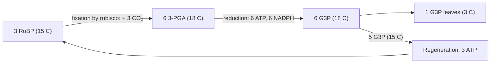
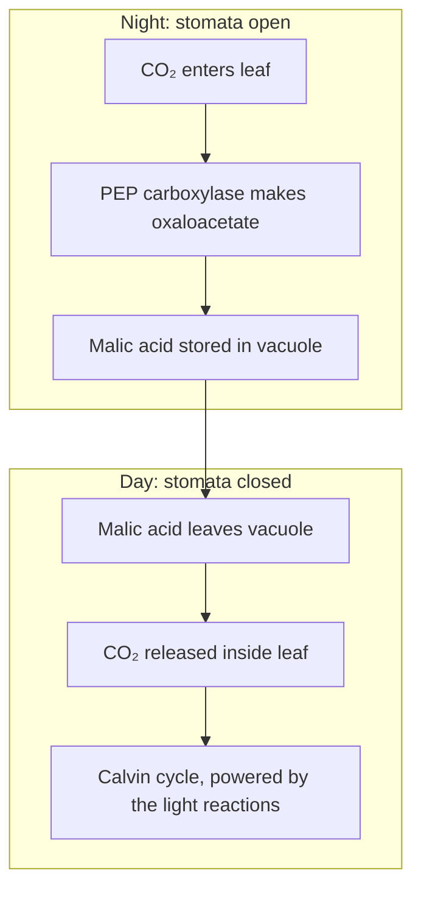

## The enzyme at the center of life

The core photosynthesis lesson gave the Calvin cycle in three steps and one fact about its key enzyme: rubisco attaches CO₂ to RuBP. This lesson follows every carbon atom around the cycle, then looks at rubisco's great weakness, its tendency to grab O₂ instead of CO₂. The corn in a field, the cactus in a desert and the pineapple on a farm photosynthesize differently because of that one problem.

## The cycle, carbon by carbon

It is easiest to follow three turns of the cycle, which fix three CO₂ and produce one spare three-carbon sugar.

1. *Fixation.* Rubisco joins each CO₂ to a molecule of RuBP (ribulose 1,5-bisphosphate, five carbons). The six-carbon product is unstable and splits at once into two molecules of **3-phosphoglycerate** (3-PGA, three carbons). For three turns: 3 RuBP + 3 CO₂ → 6 3-PGA. Carbon count: $15 + 3 = 18 = 6 \times 3$.
2. *Reduction.* Each 3-PGA is phosphorylated by ATP and then reduced by NADPH to G3P. This is the step where light energy, carried by ATP and NADPH, becomes chemical energy in sugar. Six 3-PGA use 6 ATP and 6 NADPH to make 6 G3P (18 carbons).
3. *Leaving.* One G3P (3 carbons) leaves the cycle. It is the actual product: exported to the cytosol to make sucrose, or kept in the stroma to make starch.
4. *Regeneration.* The other five G3P (15 carbons) are reshuffled through a series of three-, four-, five-, six- and seven-carbon sugars into three five-carbon molecules, and 3 more ATP phosphorylate them back into 3 RuBP (15 carbons). The cycle is ready to turn again.

Totals per G3P: 9 ATP and 6 NADPH. Per CO₂: 3 ATP and 2 NADPH. The 3 : 2 ratio of ATP to NADPH matters: as the last honors lesson showed, linear electron flow alone makes slightly too little ATP, and cyclic electron flow tops it up.

Several Calvin cycle enzymes, rubisco included, switch on in the light and off in the dark. Light makes the stroma more alkaline (about pH 8, as protons are pumped into the thylakoids) and raises its Mg²⁺ level, and electrons from ferredoxin activate other enzymes through a small protein, thioredoxin. So the cycle does not waste ATP at night.

### Example 1

In the 1950s, Calvin's group followed the radioactive label in algae and then changed the conditions suddenly. Predict what happens to the amounts of 3-PGA and RuBP (a) when the light is switched off, with CO₂ still present, and (b) when the CO₂ supply is cut, with the light still on.

Step 1: (a) In the dark, ATP and NADPH run out within seconds, so 3-PGA can no longer be reduced and starts to pile up. Rubisco keeps fixing CO₂ for a short while, consuming the remaining RuBP, and no new RuBP is made (regeneration also needs ATP). So 3-PGA rises and RuBP falls.

Step 2: (b) Without CO₂, rubisco has nothing to attach to RuBP, so RuBP accumulates. The 3-PGA already present is still reduced by ATP and NADPH from the light reactions and drained away. So RuBP rises and 3-PGA falls.

Step 3: This is what the experiments found, and the opposite responses were key evidence that RuBP is the CO₂ acceptor and 3-PGA its product.

## Rubisco's weakness and photorespiration

Rubisco is slow, catalyzing only a few reactions per second per active site, compared with thousands for many enzymes. Plants make up for this with sheer quantity; rubisco is often a third to half of the soluble protein in a leaf and is probably the most abundant protein on Earth. Its bigger problem is that it is not choosy. Its active site also accepts O₂, which competes with CO₂ for the same position on RuBP.

When rubisco adds O₂ to RuBP instead of CO₂, the products are one 3-PGA and one two-carbon molecule, 2-phosphoglycolate, which the Calvin cycle cannot use and which inhibits some of its enzymes. The plant salvages it through a long pathway that runs through the chloroplast, the peroxisome and the mitochondrion. For every two 2-phosphoglycolate (4 carbons), the salvage pathway returns one 3-PGA (3 carbons) to the Calvin cycle and releases one CO₂, plus ammonia that must be refixed using ATP. This whole process is called **photorespiration**: it uses O₂ and releases CO₂ like respiration, but it makes no ATP; it costs ATP and NADPH.

How often does rubisco make this mistake? In a typical leaf at 25 °C in today's air, roughly one oxygenation for every three or four carboxylations. The ratio climbs with temperature, because CO₂ becomes less soluble relative to O₂ as water warms and rubisco's preference for CO₂ weakens. It also climbs when stomata close to save water on a hot, dry day: CO₂ inside the leaf falls while O₂ from the light reactions builds up. In hot conditions, photorespiration can cut a plant's net carbon gain by a quarter or more.

Why would evolution leave such a flaw? Rubisco arose billions of years ago, when the air held far more CO₂ and almost no O₂, so the side reaction hardly mattered. Its CO₂ and O₂ reactions seem chemically linked, so a faster, more selective rubisco may not be possible without trade-offs; this is still debated, and engineering a better one is an active research goal. Photorespiration may have some uses (supplying amino acids, protecting the light reactions under stress), but on balance it lowers yield.

### Example 2

A leaf's rubisco carries out 400 carboxylations per second, and the ratio of oxygenations to carboxylations is 0.3. Find the net CO₂ fixed per second, and the percentage of fixed carbon lost to photorespiration.

Step 1: Oxygenations: $400 \times 0.3 = 120$ per second.

Step 2: Each 2 oxygenations release 1 CO₂ in the salvage pathway, so $120 \div 2 = 60$ CO₂ are released per second.

Step 3: Net fixation: $400 - 60 = 340$ CO₂ per second. Loss: $60 \div 400 = 0.15$, or 15% of the carbon fixed. And that ignores the extra ATP and NADPH spent on the salvage pathway.

## C4 plants: concentrating CO₂ in space

Plants that fix CO₂ directly with rubisco, making the three-carbon 3-PGA as their first product, are called **C3 plants**; they include most plants, among them wheat, rice, soybeans and trees. In the mid-1960s, Hugo Kortschak's group in Hawaii and then Marshall Hatch and Roger Slack in Australia found that sugarcane fed radioactive CO₂ put the label first into four-carbon acids (malate and aspartate), not into 3-PGA. These are **C4 plants**, and they work by pumping CO₂ to rubisco.

The trick uses two kinds of cell arranged in rings around each vein, an arrangement called **Kranz anatomy** (German for "wreath"). In the outer mesophyll cells, the enzyme **PEP carboxylase** attaches CO₂ (as bicarbonate, HCO₃⁻) to the three-carbon PEP, making four-carbon oxaloacetate, which is turned into malate. PEP carboxylase has no reaction with O₂ and grabs bicarbonate even at low concentrations. Malate moves into the inner **bundle-sheath cells**, tightly packed around the vein, where it is broken down to release CO₂ and pyruvate. Rubisco and the Calvin cycle are found there, bathed in CO₂ at several times (by some estimates up to ten times) the level in the outside air, so oxygenation becomes rare. The pyruvate returns to the mesophyll and is turned back into PEP.

The C4 pump is not free. Regenerating PEP uses one ATP but breaks it down to AMP, which costs the equivalent of 2 ATP. So a C4 plant spends 5 ATP and 2 NADPH per CO₂ fixed instead of 3 ATP and 2 NADPH. In cool, moist or shady conditions, where photorespiration is low, that extra cost can make C4 the losing strategy. In hot, bright and dry conditions it pays off. Because C4 plants keep CO₂ high around rubisco, they can also keep their stomata less open, losing less water per sugar made, and they need less rubisco, so less nitrogen.

C4 photosynthesis has evolved independently more than 60 times, in grasses (corn, sugarcane, sorghum, millets, crabgrass) and in many other families. C4 species are only about 3% of flowering plants, but they carry out roughly a quarter of all photosynthesis on land.

### Example 3

Compare the ATP and NADPH a C3 plant and a C4 plant spend to make one glucose (6 CO₂), ignoring photorespiration.

Step 1: C3: $6 \times 3 = 18$ ATP and $6 \times 2 = 12$ NADPH (as in the core lesson).

Step 2: C4: $6 \times 5 = 30$ ATP and $6 \times 2 = 12$ NADPH.

Step 3: The C4 plant pays 12 extra ATP per glucose, two-thirds more ATP. It comes out ahead only when the C3 plant would otherwise lose enough carbon and energy to photorespiration, which happens at high temperature and when stomata are closing. In experiments, C4 grasses usually beat C3 grasses in full sun above roughly the mid-20s °C, and C3 plants usually win in cool climates.

## CAM plants: concentrating CO₂ in time

Desert plants face a sharper trade-off: open stomata and lose water, or close them and starve. **CAM** (crassulacean acid metabolism, named for the stonecrop family, Crassulaceae, which includes the jade plant) solves it by opening the stomata at night, when air is cool and humid, and closing them during the hot day.

At night, PEP carboxylase fixes CO₂ into four-carbon acids, stored as malic acid in the large central vacuole; the cell sap becomes steadily more acidic through the night. As early as 1815 a botanist noted that leaves of one such plant tasted sour in the morning and much less so by afternoon. During the day, with the stomata shut, the malic acid is broken down to release CO₂ behind closed doors, and the Calvin cycle fixes it using ATP and NADPH from the light reactions. C4 plants separate the two carboxylations in space (two cell types); CAM plants separate them in time (night and day, in the same cell).

CAM plants include most cacti, agaves, pineapple, jade plants and many orchids and bromeliads, together roughly 6% of plant species. Their growth is usually slow, because the vacuole can store only so much acid each night, but their water economy is unmatched. Many CAM plants can also switch to ordinary C3 fixation when water is plentiful.

| | C3 | C4 | CAM |
|---|---|---|---|
| First product of CO₂ fixation | 3-PGA (3C) | Oxaloacetate (4C) | Oxaloacetate (4C) |
| How the steps are separated | Not separated | In space: mesophyll and bundle sheath | In time: night and day |
| Stomata open | Day | Day (less widely) | Night |
| Photorespiration | Significant, worse when hot | Very low | Very low |
| ATP per CO₂ fixed | 3 | About 5 | About 5 or more |
| Examples | Wheat, rice, oaks | Corn, sugarcane | Cacti, pineapple |

### Example 4

A rough, often-quoted comparison: a C3 plant loses about 500 molecules of water through its stomata for every CO₂ molecule it fixes, a C4 plant about 250, and a CAM plant about 50 (real values vary a lot with weather and species). How many moles of water does each lose while fixing enough CO₂ for 1 mole of glucose?

Step 1: One glucose needs 6 CO₂, so 1 mol glucose needs 6 mol CO₂.

Step 2: C3: $6 \times 500 = 3{,}000$ mol water. C4: $6 \times 250 = 1{,}500$ mol. CAM: $6 \times 50 = 300$ mol.

Step 3: In mass (18 g/mol), that is about 54 kg, 27 kg and 5.4 kg of water for 180 g of glucose. The CAM plant uses a tenth of the water of the C3 plant, which is why CAM dominates in deserts despite growing slowly.

## Common mistakes

- Thinking C4 and CAM plants do not use the Calvin cycle. They all do; C4 and CAM add a CO₂-concentrating step in front of it.
- Thinking CAM plants run the Calvin cycle at night. It needs ATP and NADPH from the light reactions, so it runs in the day; only CO₂ uptake happens at night.
- Calling photorespiration a kind of respiration that makes ATP. It consumes ATP and NADPH and releases CO₂ that had already been fixed.
- Thinking C4 is always better. It costs extra ATP; C3 plants do as well or better in cool, moist, shady places.
- Mixing up the enzymes: PEP carboxylase does the first fixation in C4 and CAM plants; rubisco still does the fixation that feeds the Calvin cycle.

## Key points

- Three turns of the Calvin cycle: 3 RuBP + 3 CO₂ → 6 3-PGA → 6 G3P; 1 G3P leaves, 5 regenerate 3 RuBP. Cost per CO₂: 3 ATP + 2 NADPH.
- Rubisco is slow and also reacts with O₂; the salvage pathway (photorespiration) releases 1 CO₂ per 2 oxygenations and costs ATP.
- Photorespiration rises with temperature and when stomata close.
- C4 plants (Kranz anatomy): PEP carboxylase fixes CO₂ in mesophyll cells into a four-carbon acid that delivers CO₂ to rubisco in bundle-sheath cells. About 5 ATP per CO₂.
- CAM plants: take in CO₂ at night and store it as malic acid; release it to the Calvin cycle by day with stomata closed. Highest water-use efficiency.
- Which strategy wins depends on temperature, light and water.
