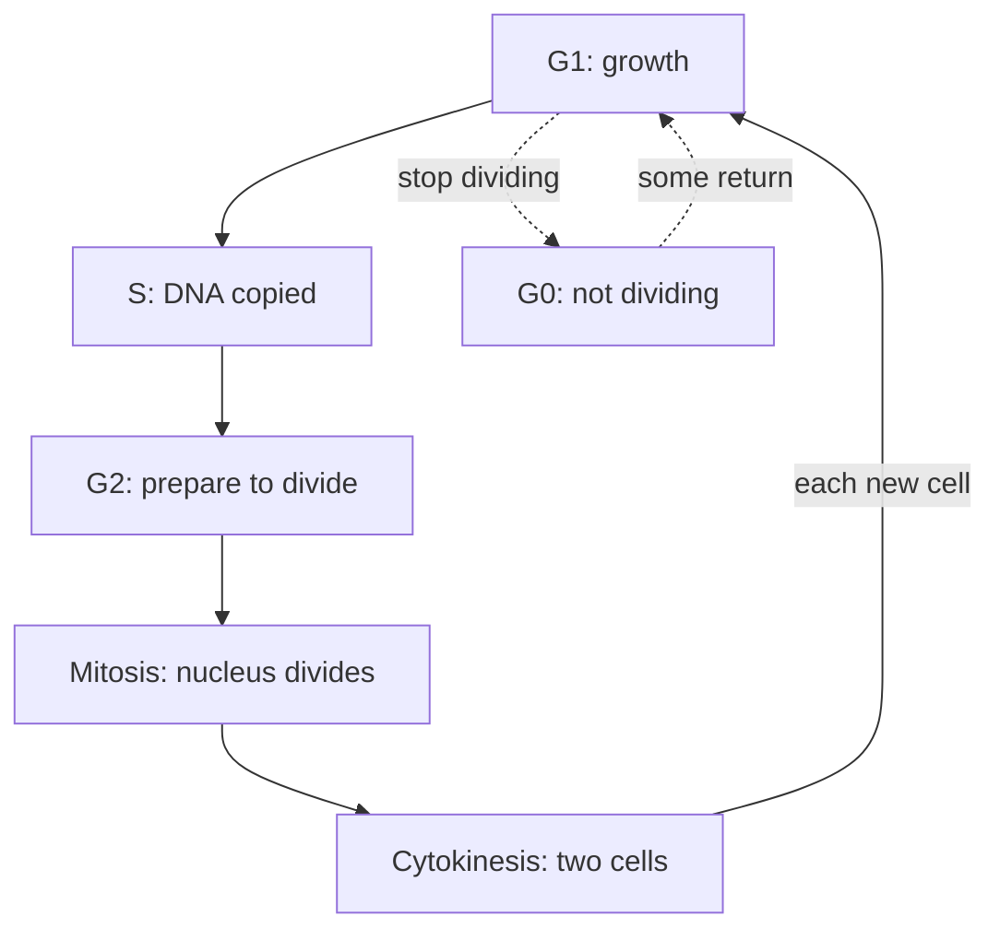

## Why cells divide

The last module followed energy through the cell: light captured in photosynthesis, sugar broken down for ATP. One of the biggest jobs that ATP pays for is making new cells. You began as a single fertilized egg and are now made of roughly 30 trillion cells. Your body replaces roughly 330 billion cells every day, most of them blood cells: skin flakes away, the lining of your gut is renewed every few days, and red blood cells last about four months. A cut heals because cells near the wound divide. Single-celled organisms such as amoebas and yeast divide to reproduce.

There is also a size reason, from module 2: as a cell grows, its volume rises faster than its surface area, so a large cell cannot move nutrients and wastes across its membrane fast enough. Dividing restores a workable surface-area-to-volume ratio.

Every division must solve one problem perfectly: each new cell needs a complete, accurate copy of the DNA. This lesson shows how eukaryotic cells do that.

## Chromosomes and chromatids

A eukaryotic cell's DNA is divided among several long molecules, each wrapped around proteins to form a **chromosome**. Human body cells have 46 chromosomes. Most of the time chromosomes are long, thin, and tangled in the nucleus, which is ideal for reading genes but terrible for sorting them. Before division they coil up tightly, becoming short and thick enough to see under a light microscope.

Before a cell divides, it copies each chromosome. The two identical copies, still joined together, are called **sister chromatids**. They are held together most tightly at a constricted region called the **centromere**, which gives a duplicated chromosome its familiar X shape. The counting rule that trips people up: a duplicated chromosome is still one chromosome, even though it contains two chromatids (two DNA molecules). When the sister chromatids separate, each becomes a chromosome in its own right. The drawing shows one chromosome before and after it is copied.


## The cell cycle

The **cell cycle** is the life of a cell from the moment it forms by division to the moment it divides again. It has two main parts.

**Interphase** is the long stretch between divisions, typically 90% or more of the cycle. It is not a resting stage; the cell is working hard. Interphase has three phases:

- G1 (first gap): the cell grows, makes proteins and organelles, and does its normal job.
- S (synthesis): the cell replicates its DNA, so each chromosome becomes two sister chromatids.
- G2 (second gap): the cell keeps growing and makes the proteins needed for division, such as the components of the spindle.

The M phase (mitotic phase) is division itself. It includes **mitosis**, the division of the nucleus, and **cytokinesis**, the division of the cytoplasm into two cells. The diagram traces one turn of the cycle; cells that stop dividing leave it for a resting branch called G0 (lesson 15).



For a typical human cell growing in culture, a full cycle takes about 24 hours: roughly 11 hours in G1, 8 in S, 4 in G2, and only about 1 in M. Cycle length varies enormously. Early frog embryo cells divide every 30 minutes or so; some liver cells divide only once a year or two.

```plot
{"x": [0, 26], "y": [0, 2.6], "xLabel": "time (hours)", "yLabel": "DNA per cell (relative)", "segments": [{"from": [0, 1], "to": [11, 1]}, {"from": [11, 1], "to": [19, 2]}, {"from": [19, 2], "to": [24, 2]}, {"from": [24, 2], "to": [24, 1], "dashed": true}, {"from": [24, 1], "to": [26, 1]}], "labels": [{"at": [5.5, 1.25], "text": "G1"}, {"at": [14, 1.8], "text": "S"}, {"at": [21, 2.25], "text": "G2"}, {"at": [24.6, 2.3], "text": "M"}], "caption": "DNA content of one cell through a 24-hour cycle: it doubles during S and halves when the cell divides"}
```

## The stages of mitosis

Mitosis was first described in detail by Walther Flemming in 1882. He stained cells from salamander larvae with dyes, saw thread-like structures in the nucleus (he named the stainable material chromatin), and drew the threads splitting and moving apart. Biologists divide the continuous process into four stages.

1. **Prophase**. The chromosomes condense and become visible, each as two sister chromatids. Outside the nucleus, the **spindle** begins to form: a framework of protein fibers (microtubules) that grows from two organizing centers moving to opposite ends of the cell. Near the end of prophase, the nuclear envelope breaks apart, and spindle fibers attach to each chromosome at its centromere, one fiber from each pole.
2. **Metaphase**. The spindle lines the chromosomes up along the middle of the cell (the metaphase plate). Each chromosome's two sister chromatids face opposite poles. This is the easiest stage to recognize in a micrograph and the best moment to count chromosomes.
3. **Anaphase**. The proteins holding sister chromatids together are cut, and the chromatids are pulled to opposite poles as the spindle fibers shorten. Each separated chromatid is now a chromosome, so the chromosome count in the cell briefly doubles. Anaphase is short, often only a few minutes.
4. **Telophase**. A complete set of chromosomes arrives at each pole. Nuclear envelopes re-form around them, the chromosomes uncoil, and the spindle breaks down. There are now two nuclei in one cell.

Cytokinesis usually overlaps telophase. In animal cells, a ring of protein filaments pinches the cell in two, forming a cleavage furrow, like pulling a drawstring. Plant cells have rigid walls and cannot pinch; instead, vesicles gather at the middle and fuse into a cell plate that grows outward into a new wall.

The result: two daughter cells, each with the same number of chromosomes as the parent and genetically identical to it (apart from rare copying errors). The drawing follows an animal cell with four chromosomes through the whole process. The red and blue colors mark chromosomes inherited from the mother and from the father; in mitosis they do not pair up, they simply line up one by one.


Prokaryotes have no nucleus and usually a single circular chromosome. They divide by a simpler process, binary fission: the chromosome is copied, the copies move apart as the cell lengthens, and the cell splits.

### Example 1

A cell from a fruit fly has 8 chromosomes in G1. How many chromosomes and how many chromatids (DNA molecules) does it have in G2, metaphase, anaphase, and each daughter cell?

Step 1: G1. 8 chromosomes, each one DNA molecule: 8 chromosomes, 8 DNA molecules.

Step 2: G2. The DNA was copied in S, so each chromosome now has 2 sister chromatids: still 8 chromosomes, but 16 chromatids.

Step 3: Metaphase. Nothing has separated yet: 8 chromosomes, 16 chromatids.

Step 4: Anaphase. Sister chromatids separate, and each counts as a chromosome: 16 chromosomes in the cell (8 heading to each pole), 16 DNA molecules.

Step 5: Each daughter cell: 8 chromosomes, each a single DNA molecule. The count matches the parent's G1, as it must.

## Measuring the cycle from a snapshot

You cannot easily watch one cell for a whole day, but you can take a snapshot of many cells at once. In a growing onion root tip, cells divide constantly and are not synchronized, so at any instant each cell is at a random point in its cycle. The fraction of cells caught in a stage is proportional to the time that stage takes. A stage that lasts 10% of the cycle should contain about 10% of the cells.

The **mitotic index** is the percentage of cells in a sample that are in mitosis:

$$\text{mitotic index} = \frac{\text{cells in mitosis}}{\text{total cells counted}} \times 100\%$$

A high mitotic index means cells are dividing rapidly, which is why pathologists use it in grading tumors.

### Example 2

A student counts 200 cells in an onion root tip micrograph:

| Stage | Interphase | Prophase | Metaphase | Anaphase | Telophase |
|---|---|---|---|---|---|
| Cells | 180 | 10 | 4 | 3 | 3 |

Find the mitotic index. If the whole cycle takes 24 hours, about how long does prophase last?

Step 1: Cells in mitosis: $10 + 4 + 3 + 3 = 20$.

Step 2: Mitotic index: $\dfrac{20}{200} \times 100\% = 10\%$.

Step 3: Time in prophase is the same fraction of the cycle as the fraction of cells in prophase: $\dfrac{10}{200} \times 24 = 1.2$ hours, or 72 minutes.

Step 4: Check it makes sense: interphase holds $\dfrac{180}{200} = 90\%$ of cells, so it lasts about 21.6 of the 24 hours, the longest stage, as expected.

## Common mistakes

- Calling interphase a "resting phase." The cell grows, works, and replicates its DNA during interphase.
- Thinking DNA is copied during mitosis. It is copied in S phase, before mitosis starts.
- Counting chromatids as chromosomes. Count centromeres: each centromere marks one chromosome, whether it holds one chromatid or two.
- Treating mitosis and cytokinesis as the same thing. Mitosis divides the nucleus; cytokinesis divides the cell.
- Thinking daughter cells get half the chromosomes. Mitosis keeps the number the same; halving is the job of meiosis (lesson 16).

## Key points

- The cell cycle = interphase (G1 growth, S DNA replication, G2 preparation) + M phase (mitosis and cytokinesis).
- After S, each chromosome has two identical sister chromatids joined at the centromere.
- Mitosis: prophase (condense, spindle forms), metaphase (line up in the middle), anaphase (chromatids separate), telophase (nuclei re-form).
- Cytokinesis: cleavage furrow in animal cells, cell plate in plant cells.
- Mitosis gives two genetically identical cells with the parent's chromosome number.
- Mitotic index = cells in mitosis ÷ total × 100%; a stage's share of cells estimates its share of the cycle time.
