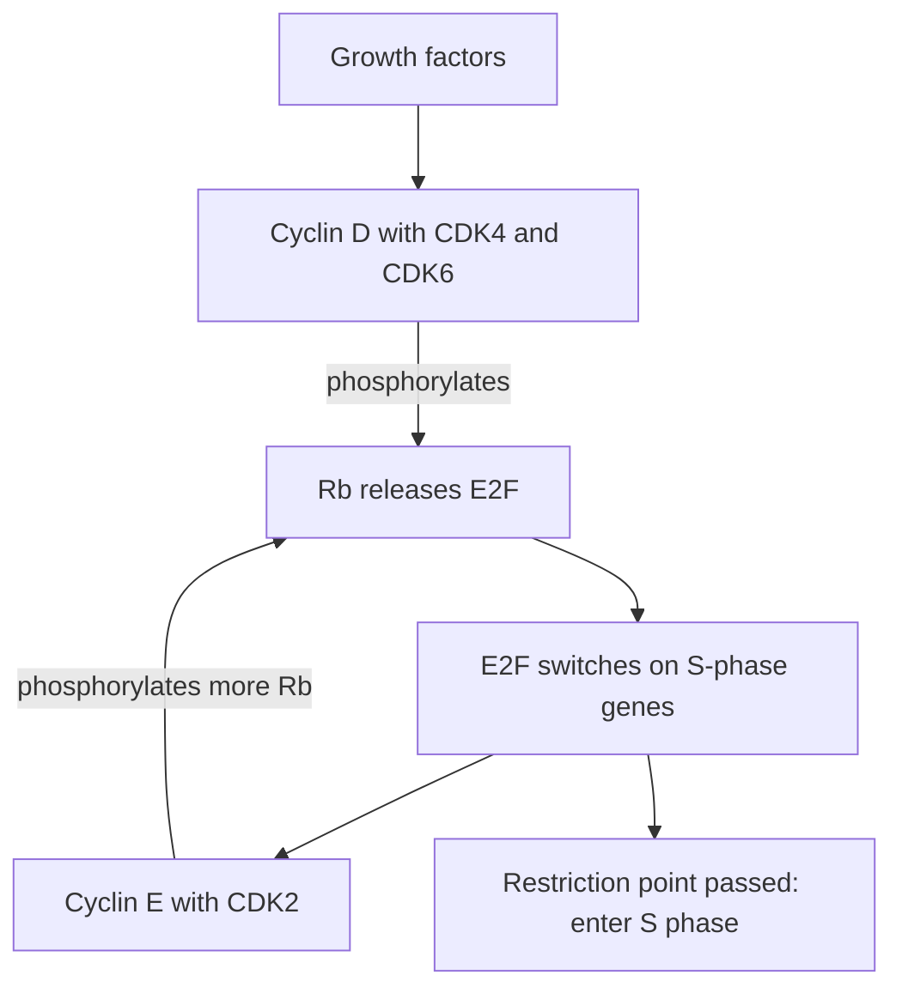
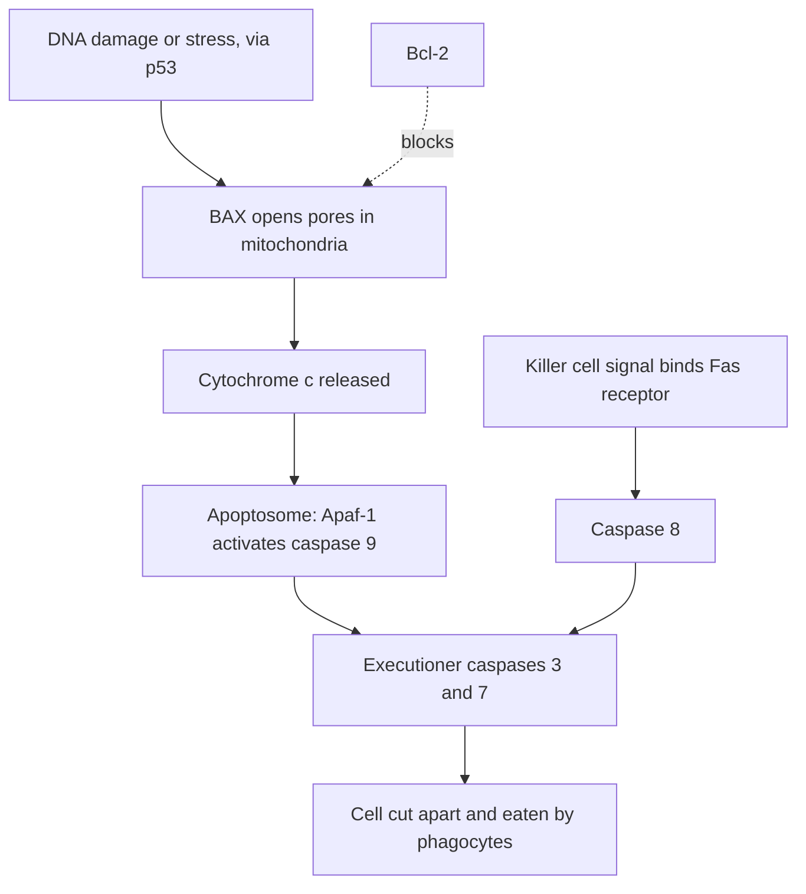

## Opening the control box

Lesson 15 described the cell cycle's controls from the outside: checkpoints, cyclins that rise and fall, CDKs that switch on when a cyclin binds, p53 as a brake, and Knudson's two hits. This lesson opens the box: how the mitotic trigger was found, why a cell flips into mitosis all at once, how Rb and p53 turn the clock into decisions to divide, pause or die, and how a cell carries out its own death.

## Frog eggs and maturation-promoting factor

A frog oocyte (an immature egg) is a giant cell, over a millimeter across, paused for months in prophase of meiosis I, a G2-like state with a large intact nucleus. A hormone signal makes it mature: the nucleus breaks down, the chromosomes condense, and meiosis runs on until it pauses again at metaphase II to wait for a sperm.

In 1971 Yoshio Masui and Clement Markert (and, independently, Dennis Smith and Robert Ecker) injected a little cytoplasm from a mature egg into an immature oocyte that had received no hormone.


The injected oocyte matured on its own; cytoplasm from an immature oocyte did nothing. Masui named the active substance **maturation-promoting factor** (MPF). Cytoplasm from the newly matured recipient could trigger another oocyte, then another, through many serial transfers without diluting away, even with protein synthesis blocked: MPF activates more MPF already stored in an inactive form. Extracts of dividing yeast, clam and mammal cells worked too, so MPF was a universal trigger, soon read as "M-phase promoting factor."

Three lines of work then met. Paul Nurse had found *cdc2*, a fission yeast gene needed to enter mitosis, and in 1987 showed that the human version could replace it in yeast, a control gene conserved across about a billion years. Tim Hunt had found cyclin in sea urchin eggs. MPF was purified from frog eggs in 1988, and within two years it was shown to be a CDK (CDK1, the product of *cdc2*) bound to cyclin B.

## Switching a CDK on and off

Cyclin binding is necessary but not sufficient. A CDK is fully active only when:

1. a cyclin is bound;
2. an activating phosphate group has been added at one site;
3. inhibitory phosphates at a second site are absent. A kinase called Wee1 adds these, and a phosphatase (an enzyme that removes phosphate groups) called Cdc25 takes them off.

During G2, cyclin B accumulates and binds CDK1, but Wee1 keeps the complexes switched off, like a loaded spring. Once a little cyclin B–CDK1 becomes active, it phosphorylates Cdc25 (activating it) and Wee1 (inactivating it), which frees more CDK1, which activates more Cdc25. This positive feedback makes entry into mitosis an all-or-none switch, and it explains the serial transfers: a little injected MPF converts the recipient's stored MPF into active MPF.

Leaving mitosis needs the opposite. The **anaphase-promoting complex** (APC/C) tags cyclin B with chains of the small protein ubiquitin, the label that sends a protein to the proteasome, the cell's protein shredder. Without its cyclin, CDK1 goes quiet and the cell can rebuild nuclei and divide. The APC/C also destroys securin, which guards an enzyme called separase; freed separase cuts **cohesin**, the protein rings holding sister chromatids together, and anaphase begins. The spindle checkpoint holds the APC/C back: every **kinetochore** (the protein structure on a centromere where spindle fibers attach) that is still unattached sends a "wait" signal. When Conly Rieder's group destroyed the last unattached kinetochore in a waiting cell with a laser, the cell went straight into anaphase.

Animal cells use several cyclin–CDK pairs:

| Pair | When active | Main job |
|---|---|---|
| Cyclin D – CDK4/6 | G1, made in response to growth factors | Starts phosphorylating Rb |
| Cyclin E – CDK2 | Late G1 into S | Commits the cell to S phase |
| Cyclin A – CDK2 | S | Drives DNA replication and helps block a second round |
| Cyclin B – CDK1 (MPF) | G2 to M | Condenses chromosomes, breaks down the nuclear envelope, builds the spindle |

Cells can also block CDKs with **CDK inhibitor** proteins such as p21, which binds and blocks cyclin–CDK complexes, and p16, which binds CDK4 and CDK6 and keeps cyclin D from activating them.

### Example 1

In 1989 Andrew Murray and Marc Kirschner made frog egg extracts that cycle in a test tube, repeatedly building and breaking down nuclear envelopes around added sperm DNA.

```plot
{"x": [0, 90], "y": [0, 1.1], "xLabel": "time (minutes)", "yLabel": "relative level", "functions": [{"f": "min(0.1 + 0.8*mod(x,30)/28, 0.9 - 0.4*(mod(x,30)-28))", "label": "cyclin B"}, {"f": "0.05 + 0.85*exp(-(mod(x,30)-27.5)^2/2)", "label": "MPF activity", "dashed": true}], "caption": "Schematic of a cycling egg extract: cyclin builds up gradually, MPF activity switches on sharply near the top, and cyclin is then destroyed"}
```

Predict the result of each change: (a) all mRNA is destroyed, then only cyclin B mRNA is added back; (b) a cyclin B that cannot be tagged with ubiquitin is added; (c) Wee1 is removed.

Step 1, (a): CDK1, Wee1, Cdc25 and the APC/C are already present as proteins, and cyclin B can still be made. Cyclin builds, MPF switches on, cyclin is destroyed, and the cycle repeats. This is what Murray and Kirschner saw: cyclin is the only protein that must be newly made each cycle.

Step 2, (b): MPF switches on, but the APC/C cannot destroy this cyclin, so CDK1 stays active and the extract is stuck in M phase. Destroying cyclin is required to leave mitosis.

Step 3, (c): Nothing holds cyclin B–CDK1 inactive, so MPF switches on before the usual amount of cyclin has built up, and mitosis comes early. (Yeast lacking *wee1* divide at about half the normal size, hence the name.)

## Rb and the restriction point

Late in G1 is the **restriction point**: after it, a cell goes on through S, G2 and M even if growth factors are removed; before it, removing them sends the cell into G0. The Rb protein (from the retinoblastoma gene in lesson 15) runs this switch.

Unphosphorylated Rb binds and blocks a transcription factor called **E2F**, which switches on S-phase genes, including cyclin E. Growth factors lead to cyclin D, and cyclin D–CDK4/6 phosphorylates Rb, loosening its grip. Freed E2F makes cyclin E, and cyclin E–CDK2 phosphorylates Rb further, freeing more E2F: another positive feedback loop that makes commitment abrupt.



High-risk HPV jams this switch: its E7 protein binds Rb and releases E2F (and its E6 protein sends p53 to the proteasome). Many cancers have instead lost p16, the CDK4/6 inhibitor, with the same result.

## p53: responding to damage

p53 is made all the time but destroyed within minutes, because the protein MDM2 tags it with ubiquitin. DNA damage activates sensor kinases (ATM and ATR) that phosphorylate p53 so MDM2 can no longer bind it. p53 accumulates and, as a transcription factor, switches on:

- the CDK inhibitor p21, which blocks cyclin–CDK complexes, keeps Rb unphosphorylated, and holds the cell in G1;
- DNA repair genes;
- genes that start apoptosis (such as BAX) if the damage is too great.

p53 also switches on the MDM2 gene, a negative feedback loop that lowers p53 again after repair. People who inherit one faulty copy of *TP53* (the gene for p53) have Li-Fraumeni syndrome and a very high lifetime risk of several cancers.

## Apoptosis: how a cell dismantles itself

The word apoptosis ("falling off," as leaves fall) was coined in 1972. Its genetics came from the roundworm *C. elegans*: as a hermaphrodite develops, exactly 1,090 somatic cells are made and the same 131 always die. Robert Horvitz found that the genes *ced-3* and *ced-4* are needed to kill and *ced-9* protects cells that should live. Humans have related genes for all three (Nobel Prize 2002, with Sydney Brenner and John Sulston).

The killers are **caspases**, protein-cutting enzymes (proteases) that use a cysteine to cut just after an aspartate. Each is made as an inactive procaspase. An initiator caspase cuts and activates executioner caspases, so a small signal becomes a large, irreversible cascade. Executioners cut hundreds of proteins, including the lamins that support the nuclear envelope and an inhibitor that holds a DNA-cutting enzyme in check. The DNA is cut between nucleosomes, so on a gel it forms a "ladder" of fragments in multiples of about 180 base pairs, a classic test for apoptosis.



- Intrinsic (mitochondrial) pathway: proteins such as BAX open pores in the outer mitochondrial membrane, and cytochrome c, the electron carrier from the electron transport chain (lesson 13), leaks out. It binds Apaf-1, forming a wheel-shaped apoptosome that activates caspase 9. **Bcl-2** and its relatives block the pores. (In the worm, CED-9 is the Bcl-2 relative, CED-4 the Apaf-1 relative, and CED-3 a caspase.)
- Extrinsic pathway: a killer T cell's Fas ligand binds a "death receptor," Fas, on the target cell, activating caspase 8.

The dying cell shrinks, its chromatin condenses, and it buds off small sealed packets. Phosphatidylserine, a phospholipid normally kept on the membrane's inner face, flips outward as an "eat me" signal for phagocytes. Nothing spills out, so there is no inflammation. **Necrosis**, death from injury such as a burn or lost blood supply, is the opposite: cells swell and burst, and their contents trigger inflammation.

Escaping apoptosis is a hallmark of cancer. Bcl-2 was discovered in follicular lymphoma, where a translocation makes B cells overproduce it so they fail to die; a Bcl-2-blocking drug (venetoclax) now treats some leukemias.

## Cancer genes and the arithmetic of two hits

In 1976 Harold Varmus and J. Michael Bishop's group found that *src*, the cancer gene of a chicken sarcoma virus, has a close match in the DNA of normal chickens. The virus had picked up a normal cell gene: proto-oncogenes are ordinary growth-control genes. One becomes an oncogene by a gain of function: a point mutation that leaves the protein stuck on (RAS), extra copies (amplified *HER2* in some breast cancers), or a gene fusion (BCR-ABL in chronic myeloid leukemia, blocked by the drug imatinib). One altered copy is enough, so oncogenes act dominantly in a cell.

Tumor suppressors (Rb, p53, p16) fail by loss of function and act recessively in a cell. Yet inherited predisposition, as in familial retinoblastoma, shows up in pedigrees as dominant. The two-hit model resolves this: a carrier has millions of cells each needing only one more hit, so some cell almost surely loses its good copy. That second hit is often **loss of heterozygosity**: the good copy is deleted, or the whole chromosome is lost by nondisjunction in mitosis, or replaced by mitotic recombination. Tumors in carriers often have two bad copies and no good one.

### Example 2

Knudson treated the number of tumors in a child who inherits one bad RB copy as a Poisson count with a mean of about 3 per carrier. For a Poisson count with mean $m$, $P(k) = \dfrac{m^k e^{-m}}{k!}$. What fraction of carriers get no tumor, and what fraction get two or more?

Step 1: No tumor: $P(0) = e^{-3} = 0.0498$, about 5%. About 95% of carriers get at least one tumor: a dominant-looking trait with high but incomplete penetrance.

Step 2: Exactly one: $P(1) = 3e^{-3} = 0.149$.

Step 3: Two or more: $1 - P(0) - P(1) = 1 - 4e^{-3} = 0.801$. Most carriers get several tumors, which is why inherited cases usually affect both eyes.

Step 4: Compare a noncarrier. If a carrier's expected number of second hits is $m = N\mu = 3$ ($N$ cells at risk, chance $\mu$ per cell of losing a copy), a noncarrier cell needs two independent hits, chance about $\mu^2$, so the expected number of tumors is about $N\mu^2 = 3\mu$. With $\mu$ near one in a million, that is a few in a million: sporadic cases are rare and almost always in one eye. (This simplest model underestimates sporadic cases, because a cell with one hit can divide into a clone of many one-hit cells before the second hit.)

## Reading the cycle with a flow cytometer

A flow cytometer measures the DNA content of thousands of dye-stained cells. G1 cells have the diploid content, written 2C; G2 and M cells have 4C; S-phase cells are in between. As with the mitotic index (lesson 14), the fraction of cells in each group estimates the fraction of the cycle spent there. (Growing cultures have slightly more young cells than old, which careful work corrects for.)

### Example 3

A culture with a 20-hour cycle is analyzed before and after 16 hours with a drug that inhibits CDK1.

```plot
{"x": [0.2, 7.8], "y": [0, 100], "xLabel": "DNA content per cell", "yLabel": "percent of cells", "bars": [{"x": 1, "height": 50, "width": 0.8, "label": "2C"}, {"x": 2, "height": 30, "width": 0.8, "label": "2C-4C"}, {"x": 3, "height": 20, "width": 0.8, "label": "4C"}, {"x": 5, "height": 5, "width": 0.8, "label": "2C"}, {"x": 6, "height": 7, "width": 0.8, "label": "2C-4C"}, {"x": 7, "height": 88, "width": 0.8, "label": "4C"}], "labels": [{"at": [2, 70], "text": "untreated"}, {"at": [6, 96], "text": "after CDK1 inhibitor"}], "caption": "Left: an untreated culture (50% 2C, 30% between, 20% 4C). Right: the same culture after the drug (5% 2C, 7% between, 88% 4C)."}
```

How long are G1, S and G2 + M, and what did the drug do?

Step 1: Untreated: G1 $= 0.50 \times 20 = 10$ h, S $= 0.30 \times 20 = 6$ h, G2 + M $= 0.20 \times 20 = 4$ h.

Step 2: After the drug, 88% of cells have 4C DNA. Cells kept moving through G1 and S but could not enter mitosis without active CDK1, so they piled up in G2.

## Common mistakes

- Thinking cyclin binding alone activates a CDK. Phosphates added and removed by other enzymes (Wee1, Cdc25) also set the timing.
- Thinking the spindle checkpoint counts chromosomes. It senses unattached kinetochores; one is enough to wait.
- Treating apoptosis and necrosis as the same. Apoptosis is orderly and caspase-driven with no inflammation; necrosis is swelling and bursting.
- Saying tumor suppressor mutations are inherited recessively. They act recessively in a cell, but the predisposition is inherited as dominant because a second hit somewhere is nearly certain.

## Key points

- MPF, found by injecting mature frog egg cytoplasm into immature oocytes, is cyclin B bound to CDK1.
- A CDK needs a cyclin, an activating phosphate, and removal of Wee1's inhibitory phosphates by Cdc25; positive feedback makes mitotic entry switch-like.
- The APC/C tags cyclin B and securin for destruction, ending mitosis and starting anaphase; unattached kinetochores hold it back.
- Rb holds E2F until cyclin D–CDK4/6 and cyclin E–CDK2 phosphorylate it at the restriction point.
- DNA damage stabilizes p53, which turns on p21 (arrest), repair genes and apoptosis genes.
- Apoptosis runs on caspase cascades started by cytochrome c release (intrinsic, opposed by Bcl-2) or death receptors (extrinsic).
- Oncogenes: gain of function, dominant in the cell. Tumor suppressors: loss of function, two hits, often by loss of heterozygosity.
