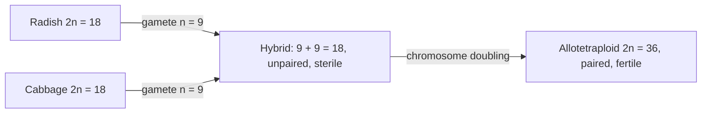

## Beyond the basic picture

Lesson 16 gave the outline of meiosis: homologs pair and cross over, meiosis I separates them, meiosis II separates sister chromatids, and nondisjunction makes gametes with an extra or missing chromosome. This lesson asks the next questions. What physically holds homologs together so they can be pulled apart correctly? How can a geneticist tell, years later, in which parent and which division an error happened? How many different gametes can one person really make? And what happens when a cell ends up with whole extra sets of chromosomes, as in bread wheat and seedless bananas?

## Crossovers hold homologs together

Early in prophase I, each chromosome finds its homolog and the two zip together along their length, a pairing called **synapsis**. The zipper is a ladder-like protein structure, the **synaptonemal complex**. Crossing over begins in a surprising way: an enzyme deliberately cuts both strands of the DNA at hundreds of places, and the cell repairs each break using the matching chromatid of the homolog as a template. Some of these repairs swap the chromatid arms beyond the break, producing a crossover. When the synaptonemal complex comes apart later in prophase I, the homologs stay joined at each crossover point, which is visible as an X-shaped **chiasma** (plural chiasmata).

Chiasmata are not just a side effect; they are how meiosis I works. Cohesin rings hold sister chromatids together along their whole length. Because the arms have swapped at a chiasma, that cohesion also ties the two homologs together, like a rope tied between two posts. At metaphase I the spindle pulls the homologs toward opposite poles, and the tension across the chiasma tells the cell they are attached correctly. At anaphase I separase cuts the cohesin along the arms, releasing the homologs, but a protein called shugoshin (Japanese for "guardian spirit") protects the cohesin at the centromeres, so sister chromatids stay together until anaphase II.

So nearly every homologous pair gets at least one crossover. A pair with none has nothing holding it together, its two homologs can go to the same pole, and the result is nondisjunction. In studies of trisomy 21, chromosomes 21 that missegregated in maternal meiosis I more often show no crossover, or one placed very near the tip, where it holds poorly.


One crossover involves only two of the four chromatids. If it falls between two genes, as in the picture, two of the four products are recombinant (Ab and aB) and two keep the parental combinations (AB and ab). That is why, even for genes far apart on a chromosome, at most about half of the gametes are recombinant, a fact the module 5 honors lesson on linkage uses to map genes.

Human eggs add a special risk. An oocyte forms its chiasmata before birth and then waits, in prophase I, for up to five decades. The leading explanation for the maternal age effect is that the cohesin loaded before birth is never replaced and slowly wears away, so chiasmata and sister chromatid cohesion weaken with age.

## Nondisjunction: which parent, which division?


The picture shows the key difference. An n + 1 gamete from a meiosis I error carries both homologs, one inherited from each grandparent, which usually differ. An n + 1 gamete from a meiosis II error carries two copies of the same homolog, sister chromatids that are identical (near the centromere, at least; crossing over can reshuffle regions far from it). Geneticists use DNA markers, short stretches of DNA that vary between people, close to the centromere to tell the cases apart.

### Example 1

At a marker near the centromere of chromosome 21, a mother has the two versions M1 and M2, and a father has P1 and P2. Four children with trisomy 21 are tested. Where did each error happen?

| Child | Markers |
|---|---|
| 1 | M1, M2, P2 |
| 2 | M2, M2, P1 |
| 3 | M1, P1, P2 |
| 4 | M1, P1, P1 |

Step 1: Find the parent who gave two copies: the parent whose markers appear twice. Children 1 and 2 got two copies from the mother; children 3 and 4 from the father.

Step 2: Two different markers from that parent (both homologs) point to meiosis I. Child 1 (M1 and M2): maternal meiosis I. Child 3 (P1 and P2): paternal meiosis I.

Step 3: Two identical markers (sister chromatids) point to meiosis II. Child 2 (M2, M2): maternal meiosis II. Child 4 (P1, P1): paternal meiosis II.

Large studies of this kind find that about 90% of trisomy 21 cases come from the mother, most of them from meiosis I (roughly 70% of all cases, versus about 20% from maternal meiosis II); only about 5% come from the father, and a few percent arise from a mitotic error after fertilization.

That last group shows that nondisjunction also happens in mitosis. An error in an early embryo produces **mosaicism**: a person whose body contains two cell lines, for example some cells with 47 chromosomes and some with 46. About 2% of people with Down syndrome are mosaic, often with milder effects. Mitotic errors are also common in cancer cells, whose checkpoints have failed.

The sex chromosomes give some neat tests of the logic. A 47,XYY person usually received a YY sperm: the father is the only source of a Y, and two Y chromosomes in one sperm can only be sister chromatids, so the error was in paternal meiosis II. (A minority of cases arise instead from a mitotic error in the early embryo.) A 47,XXY person could have received an XY sperm (paternal meiosis I) or an XX egg (maternal meiosis I or II); studies find these about equally often.

The risk of a trisomy 21 birth rises steeply with maternal age (approximate figures):

```plot
{"x": [20, 50], "y": [0, 36], "xLabel": "mother's age at delivery (years)", "yLabel": "trisomy 21 births per 1,000", "bars": [{"x": 25, "height": 0.8, "width": 3, "label": "0.8"}, {"x": 30, "height": 1.1, "width": 3, "label": "1.1"}, {"x": 35, "height": 2.9, "width": 3, "label": "2.9"}, {"x": 40, "height": 10, "width": 3, "label": "10"}, {"x": 45, "height": 33, "width": 3, "label": "33"}], "caption": "Approximate risk of a birth with trisomy 21: about 1 in 1,250 at age 25, 1 in 950 at 30, 1 in 350 at 35, 1 in 100 at 40, and 1 in 30 at 45"}
```

## Counting the possible gametes

Lesson 16 counted $2^n$ chromosome combinations for $n$ pairs. Two refinements make the count more realistic.

First, think about which grandparent each chromosome came from. In a gamete, each of the 23 chromosomes came from either the grandmother or the grandfather on that side, each with probability $\tfrac12$ (ignoring crossing over). The number from the grandmother follows a binomial distribution: $P(k) = \dbinom{23}{k}\left(\tfrac12\right)^{23}$. The average is 11.5, but the count varies from gamete to gamete, which is why siblings can differ in how much they resemble each grandparent.

Second, crossing over multiplies the possibilities. Suppose each pair carries two genes for which the parent is heterozygous. Without a crossover between the genes, a pair can contribute 2 kinds of chromatid; with one, all four kinds in the crossover picture are possible. If $c$ of the $n$ pairs have a crossover between their genes, the number of kinds of gamete is $4^c \times 2^{n-c}$.

### Example 2

(a) A plant has 2n = 6. Each chromosome pair carries two genes, and the plant is heterozygous for all six genes. How many kinds of gamete can it make if no crossovers occur between the genes? If one pair has a crossover between its genes? If all three do?

(b) For a human gamete, what is the probability that exactly 10 of its 23 chromosomes came from the grandmother? That all 23 did?

Step 1, (a): No crossovers: $2^3 = 8$. One pair: $4 \times 2 \times 2 = 16$. All three: $4^3 = 64$, the same as $2^6$ for six genes assorting independently. Crossing over lets genes on the same chromosome assort almost as if they were on different chromosomes.

Step 2, (b): $P(10) = \dbinom{23}{10} \div 2^{23} = 1{,}144{,}066 \div 8{,}388{,}608 = 0.136$.

Step 3: $P(23) = 1 \div 2^{23} = 1.2 \times 10^{-7}$, about 1 in 8.4 million.

Step 4: Check the scale: two siblings receive the same set of 23 grandparental chromosomes from both parents with probability $\left(\tfrac{1}{2^{23}}\right)^2 = 1.4 \times 10^{-14}$, and crossing over (dozens of crossovers per meiosis in humans) makes an exact repeat effectively impossible.

## Polyploidy: whole extra sets

Nondisjunction of one chromosome changes the count by one. Sometimes a whole set fails to separate, for example when a spindle fails and a cell keeps both sets, or when meiosis produces an unreduced (2n) gamete. Having three or more complete sets of chromosomes is **polyploidy**. Geneticists write $x$ for the number of chromosomes in one basic set: a triploid has $3x$, a tetraploid $4x$.

- An **autopolyploid** has extra sets from its own species, for example when two unreduced gametes fuse, or when growers treat a plant with colchicine, a drug that blocks spindle formation so the chromosomes double without the cell dividing.
- An **allopolyploid** combines sets from two species. A hybrid between species is usually sterile, because its chromosomes have no true partners to pair with at meiosis I. If the hybrid's chromosome number then doubles, every chromosome has a partner again.



Georgii Karpechenko did exactly this in 1928, crossing radish and cabbage. His fertile doubled hybrid could not breed successfully with either parent, so it was in effect a new species formed in a single step. Bread wheat is a natural example: it is hexaploid, 2n = 6x = 42, combining three ancestral genomes from three different wild grasses through two rounds of hybridization and doubling, the last of them in farmers' fields within roughly the last ten thousand years. Polyploidy is common in plant evolution: by one estimate, about 15% of speciation events in flowering plants involve a change in ploidy. It is much rarer in animals, though some frogs, fish and salamanders are polyploid; human triploid conceptions almost always miscarry.

### Example 3

Seedless watermelons are triploid ($x = 11$, so $3x = 33$). They are made by crossing a tetraploid plant (doubled with colchicine) with a normal diploid. Why are triploids nearly sterile? Model it: at meiosis I, each of the 11 sets of three homologs sends one chromosome to one pole and two to the other, with either pole equally likely to get the two, independently for each set. What fraction of gametes is balanced (euploid, with exactly one or exactly two of every chromosome)?

Step 1: The cross: the tetraploid makes 2x gametes (22 chromosomes), the diploid makes x gametes (11), and the seed gets $22 + 11 = 33 = 3x$.

Step 2: A gamete is balanced only if it gets one copy of every chromosome (probability $\left(\tfrac12\right)^{11}$) or two copies of every chromosome (also $\left(\tfrac12\right)^{11}$).

Step 3: Total: $2 \times \left(\tfrac12\right)^{11} = \tfrac{1}{1024} \approx 0.001$. About 99.9% of gametes are aneuploid, and the seeds that would form from them abort, leaving the small, soft white seed coats you see in a "seedless" fruit. Cultivated bananas (triploid, $x = 11$) are sterile for the same reason and are propagated from cuttings.

## Common mistakes

- Thinking crossing over is optional decoration. Chiasmata are what hold homologs together for meiosis I; pairs without one are prone to nondisjunction.
- Thinking a single crossover makes all four chromatids recombinant. Only the two chromatids involved are.
- Reading two identical copies from one parent as a meiosis I error. Identical copies near the centromere mean sister chromatids, so meiosis II; two different homologs mean meiosis I.
- Confusing aneuploidy with polyploidy. Aneuploidy is one chromosome extra or missing; polyploidy is whole extra sets.
- Thinking odd-numbered polyploids are sterile because of a missing gene. The problem is mechanical: sets of three cannot split evenly at meiosis I.

## Key points

- Synapsis is held by the synaptonemal complex; crossovers form chiasmata that tie homologs together until anaphase I. Shugoshin protects centromere cohesin until anaphase II.
- One crossover between two genes gives two recombinant and two parental chromatids.
- An n + 1 gamete from meiosis I carries both homologs; from meiosis II, two identical sister chromatids. Markers near the centromere reveal which.
- About 90% of trisomy 21 is maternal, mostly meiosis I; risk rises steeply with maternal age. Mitotic errors cause mosaicism.
- Gamete kinds: $2^n$ for chromosomes; $4^c \times 2^{n-c}$ with $c$ crossovers between two heterozygous genes; grandparental share is binomial.
- Polyploids have extra whole sets: autopolyploids from one species, allopolyploids from hybrids plus doubling. Triploids make balanced gametes with probability $2 \times \left(\tfrac12\right)^x$.
