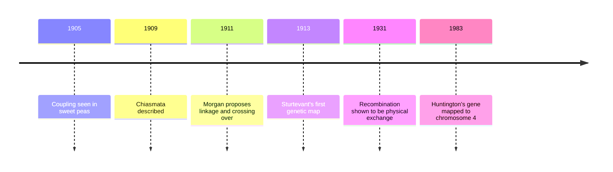

Lesson 18 set aside an awkward exception: genes that sit close together on the same chromosome don't assort independently. This honors lesson turns that exception into a tool. The way linked genes occasionally come apart, through crossing over, can be counted, and the counts reveal the order of genes along a chromosome and the distances between them. That idea gave biology its first chromosome maps decades before anyone could read DNA, and the same logic still underlies how disease genes are located in human families.

You will need lesson 16 (crossing over in prophase I), lesson 18 (test crosses and the 1 : 1 : 1 : 1 ratio) and lesson 21 (the chi-square test).

## When Mendel's second law fails

In 1905 William Bateson, Edith Saunders and Reginald Punnett crossed sweet peas that differed in flower color and pollen shape. The F2 didn't come out 9 : 3 : 3 : 1: the two parental combinations were far too common and the new combinations far too rare. They called this "coupling" but couldn't explain it.

Thomas Hunt Morgan's fly room supplied the explanation. By 1911 Morgan had several mutations on the fruit fly X chromosome, such as white eyes and miniature wings. In crosses involving two of them, the allele combinations that came into an F1 female mostly went out together into her offspring, but a sizable minority of offspring carried new combinations. Morgan proposed that genes on one chromosome are physically connected, which explains why they travel together, and that homologous chromosomes can exchange segments, which explains the exceptions. He drew on F. A. Janssens' 1909 observation of chiasmata, the X-shaped contacts between paired homologs in meiosis.

Genes on the same chromosome that tend to be inherited together are **linked genes**. Linkage is a matter of degree: the closer two genes are, the less often a crossover falls between them, and the more tightly they stay together.

## Parental and recombinant offspring

Test crosses make linkage easy to see, because the tester parent contributes only recessive alleles, so each offspring's phenotype reads off the alleles in the gamete from the heterozygous parent.

Take two autosomal fruit fly genes: body color (b+ gray, dominant; b black) and wing shape (vg+ normal, dominant; vg vestigial, crumpled stubs). A geneticist crosses a true-breeding gray, normal-winged fly with a black, vestigial one. The F1 females are heterozygous for both genes, with b+ and vg+ on one chromosome and b and vg on its homolog. In linkage notation, chromosomes are written either side of a slash: b+ vg+ / b vg.

Each F1 female is then test-crossed with a black, vestigial male (b vg / b vg). The female is used as the heterozygote on purpose: in *Drosophila*, meiosis in males has no crossing over at all, so a heterozygous male would give no recombinants.

Offspring that show the same allele combinations as the original parents (gray-normal and black-vestigial) are **parental types**. Offspring with new combinations (gray-vestigial and black-normal) are **recombinants**, and they arise from gametes in which a crossover fell between the two genes.

The figure shows the key fact. Crossing over happens after DNA replication, when each homolog has two chromatids. A single crossover involves only two of the four, so one crossover makes two recombinant chromatids and leaves two parental ones.

## Recombination frequency

The **recombination frequency** is the fraction of offspring (really, of gametes) that are recombinant:

$$\text{recombination frequency} = \frac{\text{number of recombinant offspring}}{\text{total offspring}} \times 100\%$$

### Example 1

The test cross above gives these offspring:

| Phenotype | Count |
|---|---|
| Gray body, normal wings | 1031 |
| Black body, vestigial wings | 1019 |
| Gray body, vestigial wings | 228 |
| Black body, normal wings | 222 |

Are the genes linked, and what is the recombination frequency?

If the genes assorted independently, the four classes would be about equal (1 : 1 : 1 : 1, lesson 18), so 625 each out of 2500. Instead, two classes are about four times bigger than the other two. A chi-square test against 1 : 1 : 1 : 1 gives $\chi^2 \approx 1024$ with df = 3, enormously above the critical value 7.81, so independent assortment is rejected.

The two large classes match the original parents, so they are the parental types. The small classes are the recombinants:

$$\text{recombination frequency} = \frac{228 + 222}{2500} \times 100\% = \frac{450}{2500} \times 100\% = 18.0\%$$

A useful habit: in a two-gene test cross, the two most common classes are parental and the two least common are recombinant, whatever the phenotypes are (Example 4 shows why).

## From frequencies to maps

In 1911 Alfred Sturtevant, an undergraduate in Morgan's lab, realized that recombination frequencies could be used as distances. If crossovers are scattered along a chromosome, the farther apart two genes are, the more likely a crossover falls between them. He used the data for several X-linked genes to put them in a line, publishing the first **genetic map** (a linkage map) in 1913.

The unit is the **map unit**: 1 map unit = 1% recombination frequency. It is also called a centimorgan (cM) in Morgan's honor. Example 1 puts b and vg 18 map units apart.

Map distances are close to additive for short distances, which is what lets you order genes.

### Example 2

Separate two-gene test crosses give these recombination frequencies among three fruit fly genes: b (black body) and cn (cinnabar, bright red eyes), 9.0%; cn and vg, 9.5%; b and vg, 18.0%. Put the genes in order and draw the map.

The largest distance must span the two outer genes, so b and vg are at the ends and cn sits between them. Place b at 0. Then cn is at 9.0 and vg at $9.0 + 9.5 = 18.5$.

Notice the mismatch: adding the two short intervals gives 18.5, but measuring b to vg directly gave 18.0. The direct measurement is a little too small, and the reason is double crossovers, which the next section explains.

## Why recombination frequencies stop near 50%

Suppose two genes are so far apart that at least one crossover happens between them in every meiosis. Even then, each single crossover affects only two of the four chromatids, so only half of the gametes are recombinant. With more crossovers in the interval, some cancel out: two crossovers between the same two genes swap the segment and then swap it back, leaving the outer alleles in their parental arrangement. Averaged over many meioses, the crossovers randomize the outer alleles, and the recombination frequency approaches 50%, exactly what independent assortment gives.

Three consequences follow:

- Recombination frequencies never meaningfully exceed 50%. A frequency near 50% means "unlinked or far apart"; it can't tell genes far apart on one chromosome from genes on different chromosomes.
- Long distances are underestimated. Double crossovers make some recombinant chromosomes look parental, so the direct frequency between distant genes is smaller than the sum of the short intervals between them (18.0 versus 18.5 in Example 2).
- Maps are therefore built by adding up short intervals. A whole chromosome's map can be well over 50 units long; each of the two large fruit fly autosomes is over 100 map units long, measured interval by interval.

## The three-point test cross

Mapping three genes in one cross handles the double-crossover problem directly. The heterozygote for all three genes is test-crossed, giving eight phenotype classes. The two most common are the parental types, the two rarest are double crossovers, and the rest are single crossovers in one interval or the other.

### Example 3

Female flies heterozygous b+ cn+ vg+ / b cn vg (gene order not yet known) are test-crossed with black, cinnabar, vestigial males. The 2000 offspring:

| Offspring show | Count |
|---|---|
| Wild type (gray, red eyes, normal wings) | 822 |
| Black, cinnabar, vestigial | 818 |
| Black only | 85 |
| Cinnabar and vestigial | 87 |
| Vestigial only | 90 |
| Black and cinnabar | 88 |
| Cinnabar only | 6 |
| Black and vestigial | 4 |

Find the gene order, the two map distances and the interference.

Step 1, parental and double-crossover classes. Parental: wild type and black-cinnabar-vestigial (822 and 818). Rarest, so double crossovers: cinnabar only and black-vestigial (6 and 4).

Step 2, the middle gene. A double crossover swaps only the middle gene relative to the outer two. Compare the parental "+ + +" with the double crossover "cinnabar only": only cn has changed. So cn is in the middle, and the order is b, cn, vg.

Step 3, distances. Count every recombinant between each pair of adjacent genes, including the double crossovers, which are recombinant in both intervals.

- b to cn: the single crossovers that separate b from cn (black only, 85; cinnabar-vestigial, 87) plus the double crossovers (10): $\dfrac{85 + 87 + 10}{2000} = 9.1\%$, so 9.1 map units.
- cn to vg: the single crossovers that separate cn from vg (vestigial only, 90; black-cinnabar, 88) plus the double crossovers: $\dfrac{90 + 88 + 10}{2000} = 9.4\%$, so 9.4 map units.

So b to vg is $9.1 + 9.4 = 18.5$ map units. If you scored only b and vg in these flies, the double crossovers would look parental (they still have b with vg and b+ with vg+), and you would get $\dfrac{350}{2000} = 17.5\%$, too small.

Step 4, interference. If crossovers in the two intervals were independent, the product rule would predict a double-crossover frequency of $0.091 \times 0.094 = 0.00855$, or $0.00855 \times 2000 \approx 17.1$ flies. Only 10 were seen. The **coefficient of coincidence** is observed ÷ expected double crossovers, $10 / 17.1 \approx 0.58$, and **interference** is $1 - 0.58 = 0.42$. Positive interference means one crossover makes another nearby less likely, which is common in many organisms.

## Using a map to predict offspring

A map distance works backward as a prediction. Genes 18 map units apart produce 18% recombinant gametes, split equally between the two recombinant types, and 82% parental gametes, split equally between the two parental types.

### Example 4

Genes A and B are 20 map units apart. A plant that is Ab / aB (A on the same chromosome as b) is test-crossed with ab / ab. How many of 500 offspring are expected in each class?

The parental gametes here are Ab and aB, each $\tfrac{80\%}{2} = 40\%$: 200 Ab/ab and 200 aB/ab offspring. The recombinant gametes are AB and ab, each $\tfrac{20\%}{2} = 10\%$: 50 of each. In this plant the "all dominant" and "all recessive" phenotypes are the rare ones. The arrangement with both dominant alleles on one chromosome (AB / ab) is called coupling, and the arrangement in this example (Ab / aB) is called repulsion.

## What maps do and don't tell you

A genetic map shows order and recombination distance, not physical distance in DNA. Crossovers are more common in some regions ("hotspots") than others, and rates differ between the sexes; female human meiosis produces more crossovers overall than male meiosis. Across the human genome, one map unit corresponds very roughly to a million base pairs, but the local ratio varies a lot.

Mapping still matters. In 1983 the Huntington's disease gene was placed on chromosome 4 because, in large families, the disease allele was inherited along with a nearby DNA marker; the gene itself was identified ten years later.

## Common mistakes

- Calling the "all dominant" and "all recessive" classes parental by default. Parental classes are the most common ones; which phenotypes they are depends on coupling or repulsion.
- Dividing recombinants by the number of parental offspring instead of the total.
- Leaving out the double crossovers when calculating each interval in a three-point cross. They are recombinant in both intervals.
- Expecting recombination frequencies above 50%, or reading 50% as proof that genes are on different chromosomes.
- Using a heterozygous male fruit fly in a mapping test cross. Male *Drosophila* don't cross over, so you would see no recombinants.
- Treating map units as physical distance. They measure crossover frequency, which varies along a chromosome.

## Key points

- Linked genes are close together on one chromosome and are inherited together more often than chance; crossing over in prophase I makes recombinants.
- In a test cross, the two most common classes are parental and the two least common are recombinant. Recombination frequency = recombinants ÷ total × 100%.
- 1% recombination = 1 map unit = 1 centimorgan. Distances are roughly additive over short intervals, so the largest distance spans the outer genes.
- Recombination frequency approaches but doesn't meaningfully exceed 50%, because one crossover affects only two of four chromatids and multiple crossovers cancel out.
- In a three-point cross, the rarest classes are double crossovers; the gene that switches between parental and double-crossover classes is in the middle.
- Coefficient of coincidence = observed ÷ expected double crossovers; interference = 1 − coefficient of coincidence.
