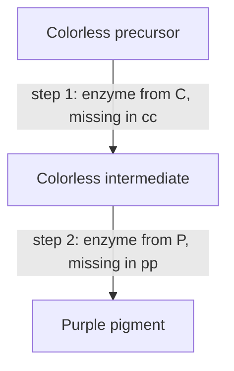

Lesson 19 met three complications in passing: epistasis (yellow Labradors and the 9 : 3 : 4 ratio), pleiotropy (the sickle-cell allele) and polygenic traits (the bell curve of height). This honors lesson takes each further: where modified ratios such as 9 : 7 and 12 : 3 : 1 come from and how to spot them in data, how one allele can affect both coat color and survival, and how geneticists measure how much of the variation in a trait comes from genes. That last number, heritability, is one of the most useful and most misunderstood in biology.

## Reading a modified ratio

Every two-gene ratio in this lesson starts from the same 16 equally likely F2 outcomes of AaBb × AaBb with complete dominance at each gene: 9 A_B_ : 3 A_bb : 3 aaB_ : 1 aabb (the blank means "either allele"). Mendel's genes acted on separate traits, so all four classes looked different. When two genes act on the *same* trait, some classes look alike and merge. The alleles still segregate and assort normally; only the mapping from genotype to phenotype changes.

So if an F2 falls into classes close to sixteenths, such as 9 : 7 or 12 : 3 : 1, suspect two genes and a doubly heterozygous F1.


The figure shows which classes merge in each of the four ratios below.

## Recessive epistasis: 9 : 3 : 4

In **recessive epistasis**, two recessive alleles at one gene hide the effect of another gene. In mice, the agouti gene controls the pattern of pigment in each hair: A gives banded "agouti" hairs (the wild grayish-brown color), and aa gives solid black hairs. A second gene controls whether any pigment is made: it encodes tyrosinase, the enzyme that starts melanin synthesis. Mice that are cc make no melanin and are albino, whatever their agouti genotype.

AaCc × AaCc gives 9 A_C_ agouti : 3 aaC_ black : 3 A_cc albino : 1 aacc albino, or 9 agouti : 3 black : 4 albino. The gene that does the hiding (C) is called epistatic; the hidden gene (A) is hypostatic.

## Duplicate recessive epistasis: 9 : 7

Around 1905, Bateson and Punnett crossed two true-breeding white-flowered strains of sweet pea. Surprisingly, every F1 plant had purple flowers, and the F2 came out about 9 purple : 7 white.

The explanation is a two-step pathway in which each step needs a different enzyme:



A plant needs at least one working allele at both genes (C_P_) to be purple. One white strain was CCpp and the other ccPP; the F1 is CcPp and purple. In the F2, the 9 C_P_ are purple and the other 7 sixteenths (3 C_pp, 3 ccP_ and 1 ccpp) are white. Genes that must both work to produce one phenotype like this are called **complementary genes**.

The white × white → purple F1 is the logic of a **complementation test**: cross two individuals with the same recessive mutant phenotype. Normal offspring mean the mutations are in different genes (each parent supplies the working allele the other lacks); mutant offspring mean both mutations are in the same gene.

### Example 1

A cross of two different true-breeding white-flowered lines gives purple F1 plants. The F2 has 176 purple and 144 white plants. Which hypothesis fits better: one gene (3 : 1) or two complementary genes (9 : 7)?

Total 320. For 3 : 1, expected 240 purple and 80 white:

$$\chi^2 = \frac{(176 - 240)^2}{240} + \frac{(144 - 80)^2}{80} = 17.07 + 51.20 = 68.27$$

For 9 : 7, expected $\tfrac{9}{16} \times 320 = 180$ and $\tfrac{7}{16} \times 320 = 140$:

$$\chi^2 = \frac{(176 - 180)^2}{180} + \frac{(144 - 140)^2}{140} = 0.089 + 0.114 = 0.20$$

Both tests have df = 1 (critical value 3.84). The one-gene hypothesis is firmly rejected; the 9 : 7 data fit well. Two genes, each needed for color, explain the result.

## Dominant epistasis: 12 : 3 : 1

In **dominant epistasis**, a dominant allele at one gene hides the other gene. In summer squash, fruit color depends on two genes. A dominant W allele blocks pigment production early, so W_ fruit are white whatever the second gene. In ww plants, the second gene decides: Y_ gives yellow fruit and yy gives green.

WwYy × WwYy: 9 W_Y_ and 3 W_yy are white (12), 3 wwY_ are yellow and 1 wwyy is green: 12 : 3 : 1.

## Duplicate dominant genes: 15 : 1

Sometimes two genes do the same job, and one dominant allele at either gene is enough. In shepherd's purse, a small weed in the mustard family, seed capsules are heart-shaped (triangular) if the plant has a dominant allele at either of two genes, and narrow and oval only when it is homozygous recessive for both. AaBb × AaBb gives 15 triangular : 1 oval. Such genes are called **duplicate genes**; they often arise when a gene is copied during evolution and both copies keep working.

## Pleiotropy and lethal alleles

Lesson 19 described pleiotropy: one gene affecting several traits. Pleiotropy can even reach survival. In 1905 Lucien Cuénot found that yellow mice never bred true. Crossing two yellow mice always gave yellow and non-yellow offspring, in a ratio near 2 : 1 instead of 3 : 1.

The yellow allele, $A^Y$, is dominant for coat color: $A^YA$ mice are yellow. But $A^YA^Y$ embryos die early in development, so that genotype never appears among the pups. For survival, $A^Y$ acts as a recessive **lethal allele**. The molecular story is now known: the $A^Y$ mutation is a deletion that switches on the agouti gene in every tissue (which also makes yellow mice prone to obesity, a third effect of the same allele) and removes the working part of a neighboring gene that embryos need.

### Example 2

Two yellow mice ($A^YA$) are mated many times and produce 120 pups. How many are expected to be yellow, and why are their litters smaller than usual?

The Punnett square gives $\tfrac14\ A^YA^Y : \tfrac12\ A^YA : \tfrac14\ AA$. The $A^YA^Y$ quarter dies before birth, so among the surviving pups, yellow is $\dfrac{1/2}{3/4} = \tfrac23$ and agouti is $\tfrac13$. Expected yellow: $\tfrac23 \times 120 = 80$, agouti 40. The litters are about a quarter smaller than litters of non-yellow parents because a quarter of the embryos are lost.

A 2 : 1 ratio among the offspring of two parents with the same dominant phenotype is a classic sign of a recessive lethal. A human example of pleiotropy is Marfan syndrome: one dominant allele of the fibrillin-1 gene (a connective-tissue protein) affects the skeleton, the eyes and the aorta.

## Quantitative traits

A **quantitative trait** is measured on a continuous scale (height, milk yield, kernel color, blood pressure) rather than sorted into a few classes. Lesson 19's additive model explains the shape of the distribution. The model also works backward: you can estimate how many genes are involved from the extremes.

In 1909 Herman Nilsson-Ehle crossed wheat with dark red kernels and wheat with white kernels. The F1 was intermediate, and in some crosses about 1 in 64 F2 kernels was as white as the white parent. With $n$ additive genes, each F2 extreme requires homozygous recessive at all $n$ genes, probability $\left(\tfrac14\right)^n$, and the number of phenotype classes is $2n + 1$ (0 to $2n$ "adding" alleles). Since $\left(\tfrac14\right)^3 = \tfrac{1}{64}$, those crosses involved three segregating genes.

### Example 3

Two true-breeding plant lines differ in height: 40 cm and 72 cm. The F1 is 56 cm. Of 1024 F2 plants, about 4 are 40 cm tall. Assuming additive genes with equal effects and no environmental effect, how many genes differ between the lines, and how much does each "adding" allele contribute?

The fraction as short as the short parent is $\tfrac{4}{1024} = \tfrac{1}{256} = \left(\tfrac14\right)^4$, so $n = 4$ genes. The tall line carries $2n = 8$ adding alleles and the short line none, so each allele adds $\dfrac{72 - 40}{8} = 4$ cm. The F2 should fall into $2 \times 4 + 1 = 9$ height classes, from 40 to 72 cm in steps of 4 cm, and the F1 with 4 adding alleles is $40 + 4 \times 4 = 56$ cm, as observed.

Real estimates are rougher, because gene effects are unequal and the environment blurs the classes.

## Genes and environment: norms of reaction

The same genotype can give different phenotypes in different environments. The range of phenotypes one genotype produces across environments is its **norm of reaction**. In a classic study in the 1940s, Jens Clausen, David Keck and William Hiesey split single yarrow plants into clones and grew them in gardens at different elevations in California. Different genotypes responded differently to the same gardens, so no single "genetic height" describes a plant without saying where it grows.

```plot
{"x": [0, 3], "y": [0, 60], "xLabel": "garden (1 low, 2 middle, 3 high elevation)", "yLabel": "plant height (cm)", "functions": [{"f": "50 - 15*(x - 1)", "from": 1, "to": 3, "label": "genotype 1"}, {"f": "30 - 2*(x - 1)", "from": 1, "to": 3, "label": "genotype 2"}], "caption": "Invented norms of reaction for two clones: genotype 1 is taller low down but shorter high up"}
```

## Heritability

Variation in a quantitative trait has genetic and environmental sources. Geneticists split the total (phenotypic) variance $V_P$, a measure of spread, into a genetic part $V_G$ and an environmental part $V_E$ (ignoring interactions between them):

$$V_P = V_G + V_E$$

**Heritability** in the broad sense is the fraction of phenotypic variance that is genetic:

$$H^2 = \frac{V_G}{V_P}$$

Only part of $V_G$ passes predictably from parent to offspring: the additive part $V_A$, from alleles whose effects simply add up. Dominance and epistasis effects depend on combinations of alleles that are broken up each generation. **Narrow-sense heritability** is $h^2 = V_A / V_P$, and it predicts the response to selection with the **breeder's equation**:

$$R = h^2 S$$

where $S$, the selection differential, is how far the chosen parents' mean is from the population mean, and $R$, the response, is how far the offspring mean moves.

### Example 4

(a) Two inbred lines of corn and their F1 are each genetically uniform, and their ear lengths have a variance of 4.0 cm². The F2, which is genetically varied, has a variance of 10.0 cm². Estimate $H^2$ for ear length.

In the genetically uniform groups, all variation is environmental, so $V_E \approx 4.0$. In the F2, $V_G = V_P - V_E = 10.0 - 4.0 = 6.0$, so $H^2 = \tfrac{6.0}{10.0} = 0.6$. (This assumes the environment varies as much for the F2 as for the other groups.)

(b) In another population with a mean plant height of 120 cm and $h^2 = 0.4$, a breeder plants seed only from plants averaging 130 cm. Predict the offspring mean.

$S = 130 - 120 = 10$ cm, so $R = 0.4 \times 10 = 4$ cm, and the offspring mean is about $120 + 4 = 124$ cm. Selection works, but only the heritable part of the parents' advantage is passed on.

In humans, heritability is estimated from relatives, especially twins: identical twins share all their genes, fraternal twins about half. If identical twins are much more alike than fraternal twins, genes account for much of the variation. Height in well-nourished populations has a heritability of about 0.8 by such estimates.

## What heritability does not mean

Heritability is easy to misread:

- It describes variation in a population, not an individual. $H^2 = 0.8$ for height does not mean 80% of your height comes from genes.
- It belongs to one population in one environment. Make the environment more uniform and $V_E$ shrinks, so heritability rises; the same trait can have different heritabilities in different places.
- High heritability doesn't mean a trait can't change. Average heights rose a lot in many countries during the 1900s as nutrition improved, though heritability stayed high, and PKU (lesson 19) is strongly genetic yet fully treatable by diet.
- Heritability within groups says nothing about the causes of average differences between groups, which may be entirely environmental.

## Common mistakes

- Treating a 9 : 7 or 12 : 3 : 1 ratio as a sign that Mendel's laws failed. The alleles segregate and assort normally; only the genotype-to-phenotype mapping changes.
- Mixing up which gene is epistatic. The epistatic gene is the one whose genotype hides the other (cc albino mice hide the agouti gene).
- Using 3 : 1 for two parents with the same dominant phenotype when one allele is a recessive lethal; the surviving offspring come out 2 : 1.
- Reading heritability as "how genetic a trait is in each person," or as fixed and unchangeable.
- Using broad-sense $H^2$ in the breeder's equation. Response to selection depends on narrow-sense $h^2$.

## Key points

- Two genes acting on one trait merge the 16 F2 outcomes into modified ratios: 9 : 3 : 4 (recessive epistasis), 9 : 7 (complementary genes), 12 : 3 : 1 (dominant epistasis), 15 : 1 (duplicate genes). Ratios in sixteenths point to two genes.
- Two true-breeding mutants with the same phenotype whose F1 is normal carry mutations in different genes (complementation).
- Pleiotropic alleles can be dominant for one trait and recessive lethal for survival, giving 2 : 1 among survivors (yellow mice).
- With $n$ additive genes, each F2 extreme has probability $(1/4)^n$, and there are $2n + 1$ phenotype classes.
- $V_P = V_G + V_E$; $H^2 = V_G/V_P$; $h^2 = V_A/V_P$; breeder's equation $R = h^2 S$.
- Heritability describes variation in a particular population and environment, not individuals, not fixedness and not differences between groups.
