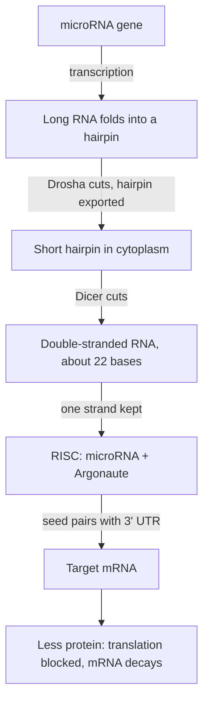

Lesson 24 showed the lac operon as a single switch: a repressor sits on the operator until lactose pulls it off. That is only half of the lac story, and some bacterial switches work the other way around. Eukaryotes add more layers: proteins acting from thousands of bases away, DNA packing that hides or exposes genes, chemical marks copied when cells divide, and control after transcription. This lesson takes each layer, with the experiments behind it, at AP or first-year college depth.

## Inducible and repressible operons

The lac operon is an **inducible operon**: it is normally off and is switched on by a small molecule, the inducer. (Strictly, the inducer is allolactose, a rearranged form of lactose made inside the cell; it binds the repressor and changes its shape so it can no longer grip the operator.)

The trp operon of *E. coli* works in the opposite direction. Its five genes encode the enzymes that build the amino acid tryptophan. It is a **repressible operon**: normally on, switched off by a small molecule. The trp repressor protein is made in an inactive form that cannot bind the operator. When tryptophan is plentiful, tryptophan itself binds the repressor and changes its shape so that it *can* bind the operator. A small molecule that activates a repressor like this is a **corepressor**. When tryptophan runs low, the repressor loses its tryptophan, falls off, and the genes are transcribed again.

The logic follows from what each pathway is for. A pathway that breaks down a food (lactose) should run only when the food is present, so it is inducible. A pathway that builds a product (tryptophan) should run only when the product is scarce, so it is repressible and shut off by its own end product. Both are negative control: in each, a repressor protein blocks transcription.

## Positive control: CAP and glucose

*E. coli* prefers glucose. Even with lactose around, it makes few lac enzymes while glucose is available. The reason is an activator. The **CAP** protein (catabolite activator protein) binds a site just upstream of the lac promoter, bends the DNA and helps RNA polymerase bind, raising transcription many-fold. CAP can bind only when it is holding a small signal molecule, cyclic AMP (cAMP), and cAMP levels rise when glucose is scarce. So CAP is a "glucose is low" signal and the repressor is a "lactose is absent" signal, and the operon reads both:

| Glucose | Lactose | Repressor | CAP–cAMP | lac transcription |
|---|---|---|---|---|
| present | absent | on operator | not bound | essentially none |
| present | present | released | not bound | low |
| absent | absent | on operator | bound | essentially none |
| absent | present | released | bound | high |

Only the last row, lactose but no glucose, gives full expression. (Glucose also slows the entry of lactose into the cell, which adds to the effect; current models include both mechanisms.)

## Telling DNA sites from proteins: cis and trans

A "stuck on" lac mutant could have a broken repressor *protein* or a broken operator *site*. To tell them apart, Jacob and Monod made partial diploids: bacteria carrying a second copy of the lac region on a plasmid. Each cell then has two operons, and the question is whether a mutation in one copy affects the other.

- A repressor is a protein. It diffuses through the cell and can bind any operator, on either DNA molecule. A part that acts on other DNA molecules like this is **trans-acting**.
- An operator is a DNA site. It controls only the genes next to it on the same molecule. A part that acts only on its own DNA molecule is **cis-acting**.

Geneticists write the alleles as $I^+$ (normal repressor), $I^-$ (no working repressor), $I^S$ (a "super-repressor" that cannot bind the inducer), $O^+$ (normal operator), $O^C$ (a mutant operator the repressor cannot bind) and $Z^+$ or $Z^-$ (working or broken gene for β-galactosidase, the enzyme measured).

### Example 1

Predict β-galactosidase production, with and without lactose, for each partial diploid. Assume no glucose. The two copies are separated by a slash.

| Genotype | No lactose | Lactose |
|---|---|---|
| (a) $I^+ O^+ Z^+$ / $I^- O^+ Z^+$ | ? | ? |
| (b) $I^+ O^C Z^-$ / $I^+ O^+ Z^+$ | ? | ? |
| (c) $I^+ O^C Z^+$ / $I^+ O^+ Z^-$ | ? | ? |
| (d) $I^S O^+ Z^+$ / $I^+ O^+ Z^+$ | ? | ? |

Work through what each protein can reach and which operon has the working $Z$:

- (a) The $I^+$ copy makes normal repressor, which diffuses to both operators. Without lactose both operons are off; with lactose both turn on. Result: **off / on** (normal). The $I^-$ mutation is recessive because the good repressor acts in trans.
- (b) The $O^C$ operon can never be repressed, but its $Z$ gene is broken, so it makes no enzyme. The only working $Z$ sits next to a normal operator. Result: **off / on**. The constant transcription of the $O^C$ copy is invisible here.
- (c) Now the working $Z$ is next to $O^C$. The repressor cannot bind there, with or without lactose. Result: **on / on**. Comparing (b) and (c) shows that $O^C$ affects only the genes on its own molecule: it is cis-acting.
- (d) The $I^S$ repressor cannot bind inducer, so it stays on whichever operator it reaches, and it reaches both. Result: **off / off**. $I^S$ is dominant, because a protein that never lets go blocks the normal copy too.

## Eukaryotic transcription: many proteins, combined

Eukaryotic RNA polymerase II cannot recognize a promoter by itself. A set of **general transcription factors** binds the core promoter first (many promoters contain a TATA box about 25–30 bases upstream of the start site) and positions the polymerase. On their own they give only a low, basal rate.

Most of the control comes from specific transcription factors. Activators bind **enhancers**: short DNA control regions that can lie thousands, even hundreds of thousands, of bases from the gene, upstream, downstream or inside an intron, and they work in either orientation. The DNA between them bends into a loop that brings the enhancer-bound activator next to the promoter. A large protein complex called Mediator bridges the activator and the polymerase. Repressor proteins bound to silencer sites work similarly but lower transcription.

Each enhancer has sites for several factors, so control is combinatorial: a gene that needs activators A and B stays off in a cell that makes only A. A few hundred factors in different combinations can specify hundreds of cell types.

### Example 2

How do biologists find an enhancer? A common method is a reporter assay. The DNA upstream of a liver gene is joined to a reporter gene, luciferase, whose product glows and is easy to measure. Pieces of the upstream DNA are removed or moved, and each construct is tested in liver cells and kidney cells. Light output (relative units):

| Construct | Liver | Kidney |
|---|---|---|
| A: bases −3,000 to 0 (full region) | 100 | 4 |
| B: −2,000 to 0 | 98 | 4 |
| C: −1,000 to 0 | 5 | 4 |
| D: core promoter only (−200 to 0) | 4 | 4 |
| E: the −2,000 to −1,000 piece, flipped, in front of the core promoter | 96 | 4 |
| F: the −2,000 to −1,000 piece placed after the reporter gene | 90 | 4 |

Reasoning step by step:

1. D gives 4 in both cells: the core promoter alone gives basal transcription.
2. Removing −3,000 to −2,000 (A → B) changes little, so that piece isn't needed. Removing −2,000 to −1,000 (B → C) drops liver activity from 98 to 5, about $98 / 5 \approx 20$-fold. The key element lies between −2,000 and −1,000.
3. E and F show that the piece works backwards and downstream of the gene: the defining properties of an enhancer.
4. Kidney cells stay at 4 with every construct. The enhancer is liver-specific, most likely because liver cells make an activator that binds it and kidney cells don't.

## Chromatin: packing as a gate

In the nucleus, DNA is wrapped around **histone** proteins. About 147 base pairs coil around a core of eight histones (two each of four kinds) to form a **nucleosome**, and nucleosomes linked by short stretches of DNA look like beads on a string. The beads fold further into denser fibers. The whole DNA–protein material is **chromatin**.

Tightly packed chromatin keeps transcription factors and polymerase away from the DNA; loosely packed chromatin lets them in. Cells change packing with chemical marks:

- *Histone acetylation.* The histones' flexible tails carry positively charged lysines that grip the negatively charged DNA. Enzymes that add acetyl groups neutralize those charges, loosening the grip, and the acetyl groups are also docking sites for activator proteins. Acetylated chromatin is usually active; removing the acetyl groups (deacetylation) silences it. Histones can also be methylated, which can mark a gene as active or silent depending on which amino acid carries the mark.
- *DNA methylation.* In mammals, **DNA methylation** adds methyl groups to cytosines, mostly where a C is followed by a G (CpG). Methylated promoters are usually silent: proteins that bind methylated CpG recruit enzymes that deacetylate histones and compact the chromatin.

Why does a methylation pattern survive cell division? CpG reads CpG on the partner strand too (5′-CG-3′ pairs with 3′-GC-5′), so both strands are methylated at the same site. After replication, each new helix has one methylated old strand and one unmethylated new strand. A maintenance enzyme recognizes these half-methylated sites and methylates the new strand to match. The pattern is copied along with the sequence.

Changes in gene expression that are passed on through cell divisions without a change in the DNA sequence are the subject of **epigenetics**. Two well-established examples:

- *X inactivation.* In female mammals, one X chromosome in each cell is coated by a noncoding RNA and packed into silent chromatin early in development, and each cell's daughters keep the same X silent. In a calico cat, orange and black patches are groups of cells that silenced different X chromosomes.
- *Imprinting.* For a small number of genes, the copy inherited from one parent is methylated and silent. The growth gene *IGF2*, for example, is normally expressed only from the father's copy.

Be careful with bigger claims. Marks are reliably copied through cell divisions within one body, but in mammals most are erased and reset in eggs, sperm and the early embryo. Inheritance of acquired marks across generations is well documented in plants and roundworms; in humans it is debated, and popular claims often outrun the evidence.

## After transcription: splicing and microRNAs

**Alternative splicing** joins a gene's exons in different combinations, as in the figure, where skipping exon 3 gives a shorter protein. About 95% of human genes with several exons are alternatively spliced, and splicing choices differ between tissues.

### Example 3

The fruit fly gene *Dscam* has four clusters of mutually exclusive exons: every mRNA includes exactly one exon from each cluster. The clusters have 12, 48, 33 and 2 alternatives. How many different mRNAs are possible?

Each choice is independent, so multiply: $12 \times 48 \times 33 \times 2 = 38{,}016$. That is more than twice the number of genes in the whole fly genome (about 14,000). Compare an optional "cassette" exon, which is either included or skipped: $n$ independent cassette exons give $2^n$ versions.

A **microRNA** is a small RNA, about 22 nucleotides long, that turns down the expression of other genes. It is cut from a hairpin-shaped precursor and loaded into a protein (Argonaute) that uses it as a guide. Bases 2–8 of the microRNA, its "seed", pair with matching sites, usually in the 3′ untranslated region of target mRNAs. In animals the pairing is usually partial, and the result is less translation and faster mRNA breakdown rather than a clean cut. One microRNA can tune hundreds of targets. The first microRNA was found in roundworms in 1993, work recognized by the 2024 Nobel Prize in Physiology or Medicine.

A mutation that destroys a target's seed match frees that mRNA from control, so its protein level rises. Synthetic small RNAs that use the same machinery (RNA interference) silence chosen genes in research, and several are approved drugs.

## Common mistakes

- Treating tryptophan like lactose. Lactose (as allolactose) inactivates its repressor; tryptophan *activates* its repressor as a corepressor.
- Thinking lactose alone gives full lac expression. CAP–cAMP is also needed, so glucose must be low.
- Calling an operator mutation trans-acting. A DNA site affects only genes on its own molecule; only diffusible products (proteins, RNAs) act in trans.
- Assuming enhancers must sit just upstream of the gene. They can be far away, downstream or in introns, in either orientation.
- Thinking DNA methylation changes the base sequence. A methylated C still pairs with G; the sequence is the same.
- Mixing up the effects of acetylation and DNA methylation. Histone acetylation usually opens chromatin; DNA methylation at promoters usually silences.
- Thinking microRNAs are translated. They are noncoding RNAs that pair with mRNAs.

## Key points

- Inducible operons (lac) are turned on by an inducer that inactivates the repressor; repressible operons (trp) are turned off when a corepressor activates the repressor.
- CAP–cAMP is a positive control: the lac operon is fully on only with lactose present and glucose absent.
- Proteins act in trans and can affect both copies in a partial diploid; DNA sites such as operators act in cis.
- Eukaryotic genes are switched by combinations of activators at enhancers, which reach the promoter by DNA looping and Mediator.
- Histone acetylation opens chromatin; DNA methylation at CpG silences promoters and is copied after replication. Heritable expression states without sequence change are epigenetic.
- Alternative splicing multiplies the proteins one gene can make; microRNAs pair with mRNA 3′ ends to reduce translation.
