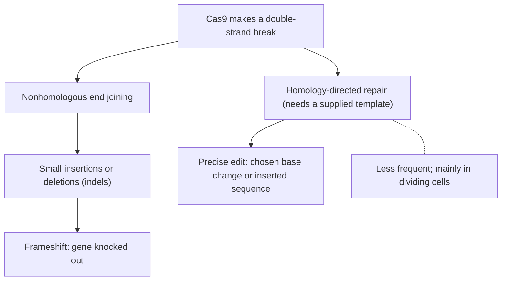

Lesson 25 gave DNA sequencing and CRISPR a paragraph each. This lesson opens both up. You will see how a sequencing machine actually reads bases, why a genome has to be read many times over, what the human genome turned out to contain, how sequences are compared, and how Cas9 finds and cuts one chosen site among billions. It ends with gene therapy and the ethical questions it raises, presented as the range of views people hold.

## Sanger sequencing: reading DNA by stopping it

The first practical method, published by Frederick Sanger in 1977, uses DNA polymerase's own rules against it. Polymerase adds each nucleotide to the 3′-OH group of the growing strand (lesson 22). A **dideoxynucleotide** (ddNTP) lacks that 3′-OH. Once one is added, nothing can be attached after it, and the strand stops.

A Sanger reaction holds the template, a primer, DNA polymerase, plenty of the normal nucleotides, and a small amount of all four ddNTPs, each tagged with a different colored fluorescent dye. Most of the time the polymerase adds a normal nucleotide and keeps going; now and then it adds a ddNTP and stops. Across millions of template copies, strands stop at every position, and each strand's last base is marked by its color. Capillary electrophoresis then sorts the strands by length, one base apart, and a detector reads the color of each length in turn. That is **Sanger sequencing**. It reads about 800–1,000 bases per reaction, very accurately, and is still used to check short stretches.

![Top: a template strand reading 3′-TGCAATC-5′ after a primer-binding region, with a primer bound and an arrow showing the polymerase adding bases 5′ to 3′. Middle: seven new strands, each starting at the primer and ending one base later than the last, each stopped by a colored terminator: A, then AC, ACG, ACGT, ACGTT, ACGTTA and ACGTTAG. Right: the terminators read in order of length, shortest first, spell A, C, G, T, T, A, G. Bottom: the new strand reads 5′-ACGTTAG-3′, the complement of the template.](images/m6-sanger.svg)

### Example 1

A Sanger run with a 16-base primer gives fragments of these total lengths, with these terminal bases: 21 G, 18 T, 22 A, 19 C, 20 C, 23 T, 17 A, 24 G. What is the new strand's sequence, and what is the template?

- Sort by length: 17 A, 18 T, 19 C, 20 C, 21 G, 22 A, 23 T, 24 G. The 17-base fragment is the primer plus one base, so A is the first base added.
- The new strand, after the primer, reads 5′-ATCCGATG-3′.
- The template is its complement, antiparallel: 3′-TAGGCTAC-5′, which written 5′ to 3′ is 5′-CATCGGAT-3′.

## Next-generation sequencing and coverage

The Human Genome Project (1990–2003) relied on Sanger reads and cost about $3 billion. Today's **next-generation sequencing** gets its speed from parallel reading. The genome is broken into fragments a few hundred bases long; each fragment is copied into a tiny cluster on a glass slide, and hundreds of millions of clusters are read at once. In the most common method, each cycle adds one fluorescent nucleotide to every cluster, a camera records each cluster's color, and the dye and a temporary block are removed so the next base can be added. The result is billions of short reads (often 150 bases). Newer long-read methods read single molecules tens of thousands of bases long, for example by pulling DNA through a protein pore and measuring how each stretch changes an electric current. Long reads are slower per base but can span long repeated sequences that short reads can't place.

Reads come from random places, so some bases are covered many times and some not at all. The average number of reads covering a base is the **coverage** (or depth):

$$C = \frac{N \times L}{G}$$

where $N$ is the number of reads, $L$ the read length and $G$ the genome size. If reads land at random, the fraction of bases missed entirely is about $e^{-C}$. At $C = 1$ that is $e^{-1} \approx 37\%$ of the genome unread, so genomes are sequenced to around 30×, which also lets each base be checked many times and shows both alleles at heterozygous sites.

### Example 2

How many 150-base reads give 30× coverage of a 3.1-billion-base human genome? What fraction would be missed by chance?

- Rearrange: $N = \dfrac{C \times G}{L} = \dfrac{30 \times 3.1 \times 10^9}{150} = 6.2 \times 10^8$, about 620 million reads.
- Missed fraction $\approx e^{-30} \approx 9 \times 10^{-14}$: in practice, nothing is missed at random. Real gaps come from regions that are hard to sequence, such as long repeats.

## What genome projects found

A **genome** is an organism's complete set of DNA. The human genome holds about 3.1 billion base pairs per set of chromosomes; the last gaps were closed in 2022 by the Telomere-to-Telomere project (the Y chromosome followed in 2023), adding about 8% that earlier versions could not read. Some findings surprised biologists:

- Only about 1.5% of the genome codes for protein, in roughly 20,000 protein-coding genes, about as many as a roundworm has. Much of the rest is regulatory DNA (enhancers, promoters), genes for noncoding RNAs such as microRNAs, and repeated sequences; about half is derived from transposable elements.
- Two unrelated people differ at about 1 base in 1,000. Most differences are **SNPs** (single-nucleotide polymorphisms): single positions where people carry different bases. Larger insertions, deletions and duplications add more variation.
- Sequencing is now used in medicine: to diagnose rare genetic diseases in sick newborns, to choose cancer treatments from a tumor's mutations, and to track virus variants during outbreaks.

## Comparing sequences

To compare two sequences, line them up in an alignment, placing a gap where one has an insertion the other lacks. The simplest score is percent identity: identical positions divided by aligned positions. Databases can be searched for sequences similar to a new one, and close similarity points to shared ancestry (homology) and often shared function.

### Example 3

A 20-base stretch of a gene in two species:

| Species | Sequence (codons separated) |
|---|---|
| 1 | ATG GCT AAG CTT GCA GTC GA |
| 2 | ATG GCA AAG CTT GCG GTC GA |

Positions 6 and 15 differ, so 18 of 20 bases match: 90% identity. Both differences are in the third base of a codon: GCT and GCA both code for Ala, as do GCA and GCG. The protein is unchanged. This pattern is common in real comparisons: silent third-position changes accumulate faster than changes that alter amino acids, because natural selection removes many of the harmful protein changes.

## CRISPR-Cas9: how the cut is aimed

In bacteria, CRISPR is an immune memory: stored snippets of viral DNA are transcribed into short RNAs that guide Cas proteins to cut matching viruses. For editing, scientists use Cas9 with a single **guide RNA** whose first 20 bases (the spacer) are chosen to match the target.

1. Cas9 slides along DNA checking for a **PAM** (protospacer adjacent motif). For the commonly used Cas9, the PAM is 5′-NGG-3′, where N is any base. Without a PAM, Cas9 moves on, which is also why the bacterium's own CRISPR array, which lacks PAMs, is never cut.
2. At a PAM, Cas9 unwinds the neighboring DNA. If the guide's spacer pairs with one strand, starting with the bases nearest the PAM, it forms an RNA–DNA hybrid.
3. With a full match, Cas9's two cutting domains each cut one strand, about 3 bases from the PAM, leaving a double-strand break.

The cell then repairs the break, and that repair is what creates the edit:

### Example 4

Design a guide for this stretch, using only the strand shown:

5′-TTCAGACTCATGCTAGCTTACAGATGGATCCAGTTCA-3′

- Find a PAM. Scanning for any base followed by GG, the only one is TGG (bases 25–27).
- The target is the 20 bases just 5′ of the PAM: GACTCATGCTAGCTTACAGA.
- The guide's spacer has the same sequence, in RNA: 5′-GACUCAUGCUAGCUUACAGA-3′. It pairs with the opposite strand, as in the figure.
- Cas9 cuts 3 bases from the PAM, between …CTTAC and AGA.

Is a 20-base target unique? There are $4^{20} \approx 1.1 \times 10^{12}$ possible 20-base sequences, and a 3.1-billion-base genome offers about $6.2 \times 10^9$ positions on its two strands. A random genome would contain a given 20-mer about $6.2 \times 10^9 / 1.1 \times 10^{12} \approx 0.006$ times by chance, so a chosen target is usually unique. Real genomes are not random, though, and Cas9 tolerates some mismatches, especially far from the PAM, so guides are screened by computer for near-matches that could cause off-target cuts.

Newer tools avoid the double-strand break: base editors chemically convert one base to another, and prime editors write a short new sequence. A Cas9 with its cutting domains disabled can carry activators or repressors to a chosen promoter, switching genes on or off without changing the sequence.

## Gene therapy

**Gene therapy** treats disease by adding, repairing or silencing genes in a patient's cells. Genes are delivered by disabled viruses or by lipid nanoparticles, either into cells taken out of the body and returned (ex vivo) or directly into the body (in vivo). Early trials taught hard lessons: a volunteer died from an immune reaction to a viral vector in 1999, and in the early 2000s a vector that inserted itself near a cancer-related gene caused leukemia in some children. Safer vectors followed. Approved treatments now include a virus-delivered gene for an inherited form of blindness (2017) and one for spinal muscular atrophy (2019). In 2023 Casgevy became the first approved CRISPR therapy: patients' blood stem cells are edited to break an enhancer of *BCL11A*, a gene that switches off fetal hemoglobin after birth, so their red cells make enough fetal hemoglobin to make up for the faulty adult form. (Compare the enhancers in the previous honors lesson.)

## Ethics: several perspectives

These questions don't have one scientific answer; people weigh the same facts differently.

- *Somatic treatment* changes only the patient. Most people support it for serious disease, but list prices above $2 million raise questions of fairness and access, and long-term effects are still being followed.
- *Germline editing* would pass changes to future generations. In 2018 a researcher announced twins born from edited embryos; the work was condemned worldwide and he was imprisoned. Some argue germline editing could one day prevent serious inherited disease when no other option exists; others point to off-target edits, the impossibility of consent from future people, and a slide toward enhancement. An international summit in 2023 called heritable editing unacceptable at this time.
- *Disability perspectives* differ. Many families welcome cures; some disabled people, including some in the Deaf community, see certain conditions as differences rather than diseases and worry about who decides which traits to remove.
- *Genetic privacy.* Genome data can reveal information about relatives who never consented. In the US a 2008 law bans genetic discrimination in health insurance and employment, but not, for example, in life insurance.

## Common mistakes

- Saying a ddNTP stops synthesis because it lacks a base. It has a base; it lacks the 3′-OH needed for the next bond.
- Reading a Sanger result as the template. The colors spell the new strand; the template is its complement.
- Using the coverage formula backwards. Coverage rises with more or longer reads and falls with genome size.
- Forgetting the PAM. A perfect 20-base match is not cut without an adjacent NGG.
- Writing the guide as the complement of the target strand you chose. The guide matches the protospacer next to the PAM (with U for T) and pairs with the opposite strand.
- Thinking CRISPR itself makes the precise change. Cas9 only cuts; the cell's repair makes the edit.

## Key points

- Sanger sequencing: ddNTPs stop strands at every position; sorting by length and reading terminal colors gives the sequence.
- Next-generation sequencing reads billions of short fragments in parallel; coverage $C = NL/G$, and about 30× is used so that almost nothing is missed.
- The human genome: about 3.1 billion bp, about 20,000 protein-coding genes, about 1.5% coding; unrelated people differ at about 0.1% of bases, mostly SNPs.
- Alignments and percent identity compare sequences; silent third-position differences are the most common.
- Cas9 needs a PAM and a 20-base guide match, cuts both strands near the PAM, and relies on end joining (knockouts) or template repair (precise edits).
- Gene therapy can be ex vivo or in vivo; somatic and germline editing raise different ethical questions.
