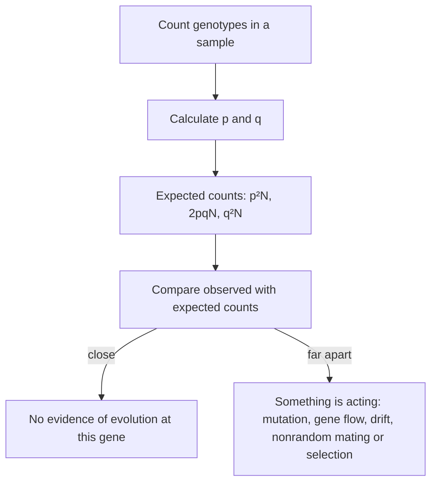

In the last lesson, selection changed the share of dark moths and deep-beaked finches. Underneath every such change is a change in the alleles carried by the population. Population genetics puts numbers on this: it measures how common each allele is, predicts what should happen if nothing is changing, and uses the gap between prediction and data to detect evolution and work out its cause. It joins Mendel's genetics (module 5) to Darwin's natural selection.

## The gene pool and allele frequencies

A population's **gene pool** is all the alleles of all its genes, across every individual. For one gene with two alleles, $A$ and $a$, each diploid individual carries two copies, so a population of $N$ individuals has $2N$ copies of the gene.

The **allele frequency** of an allele is the fraction of all gene copies that are that allele. By convention, $p$ is the frequency of $A$ and $q$ the frequency of $a$. Since every copy is one or the other,

$$p + q = 1.$$

In these terms, evolution in the narrow sense (sometimes called microevolution) is a change in allele frequencies from one generation to the next.

### Example 1

A population of 1,000 plants has 500 $AA$, 200 $Aa$ and 300 $aa$ individuals. Find $p$ and $q$.

- Total gene copies: $2 \times 1{,}000 = 2{,}000$.
- Copies of $A$: each $AA$ plant has two, each $Aa$ has one: $2(500) + 200 = 1{,}200$.
- $p = \dfrac{1{,}200}{2{,}000} = 0.6$, so $q = 1 - 0.6 = 0.4$.

Check by counting $a$ directly: $200 + 2(300) = 800$, and $800 / 2{,}000 = 0.4$.

## The Hardy-Weinberg principle

In 1908 the mathematician G. H. Hardy and the physician Wilhelm Weinberg independently answered a question people were asking about Mendel's laws: won't dominant alleles automatically take over a population? They showed the answer is no.

Picture gametes as drawn at random from the gene pool. An egg carries $A$ with probability $p$ and $a$ with probability $q$; so does a sperm. By the product rule:

| | Sperm $A$ ($p$) | Sperm $a$ ($q$) |
|---|---|---|
| Egg $A$ ($p$) | $AA$: $p^2$ | $Aa$: $pq$ |
| Egg $a$ ($q$) | $Aa$: $pq$ | $aa$: $q^2$ |

So the next generation's genotype frequencies are

$$p^2 + 2pq + q^2 = 1,$$

with $p^2$ for $AA$, $2pq$ for $Aa$ (two ways to get it) and $q^2$ for $aa$. Count the alleles in that generation and you get back $p$ and $q$ exactly. Allele frequencies stay put, generation after generation. A population in this steady state is in **Hardy-Weinberg equilibrium**.

```plot
{"x": [0, 1], "y": [0, 1], "xLabel": "q (frequency of allele a)", "yLabel": "genotype frequency", "functions": [{"f": "(1-x)^2", "label": "AA (p²)"}, {"f": "2*x*(1-x)", "label": "Aa (2pq)", "dashed": true}, {"f": "x^2", "label": "aa (q²)"}], "caption": "Hardy-Weinberg genotype frequencies. When an allele is rare, most copies of it are in heterozygotes."}
```

Equilibrium holds only under five conditions:

1. no mutation;
2. no migration in or out (no gene flow);
3. a very large population (no genetic drift);
4. random mating;
5. no natural selection (all genotypes survive and reproduce equally).

Real populations never meet all five perfectly, and that is the point. Hardy-Weinberg is a null model, like a control group: it says what happens if nothing is causing evolution. When real data differ from it, something on the list is happening. The diagram shows the reasoning, and Example 3 below works through it.



### Example 2

Cystic fibrosis is a recessive disorder. Among people of Northern European ancestry, about 1 in 2,500 babies is born with it. Assuming Hardy-Weinberg equilibrium, what fraction of people are carriers?

- Affected people are $aa$, so $q^2 = \dfrac{1}{2{,}500} = 0.0004$.
- $q = \sqrt{0.0004} = 0.02$, and $p = 1 - 0.02 = 0.98$.
- Carriers are $Aa$: $2pq = 2(0.98)(0.02) = 0.0392$, about 4%, or roughly 1 person in 25.

Notice how much more common carriers (about 1 in 25) are than affected people (1 in 2,500). For a rare recessive allele, almost all copies hide in heterozygotes, which is why selection removes harmful recessive alleles so slowly.

Always start from $q^2$, the frequency of the recessive phenotype, because homozygous recessive individuals are the only genotype you can identify by appearance. Dominant-phenotype individuals could be $AA$ or $Aa$.

### Example 3

Is the plant population in Example 1 in Hardy-Weinberg equilibrium?

With $p = 0.6$ and $q = 0.4$, the expected genotype counts out of 1,000 are:

| Genotype | Expected | Observed |
|---|---|---|
| $AA$ | $0.36 \times 1{,}000 = 360$ | 500 |
| $Aa$ | $0.48 \times 1{,}000 = 480$ | 200 |
| $aa$ | $0.16 \times 1{,}000 = 160$ | 300 |

There are far too few heterozygotes and too many of both homozygotes. The population is not in equilibrium. A shortage of heterozygotes is the signature of nonrandom mating, such as self-pollination or mating with relatives, or of a population split into separate groups. (A chi-square test, from lesson 21, can check whether a difference this size could be chance; here $\chi^2$ is over 300, far above the critical value.)

## Mechanisms of evolution

Each broken condition is a way allele frequencies change.

*Mutation* creates new alleles. It is the ultimate source of variation, but any one gene mutates so rarely that mutation alone changes frequencies very slowly.

**Gene flow** is the movement of alleles between populations when individuals or gametes (such as pollen) migrate. It makes populations more alike and can bring in new alleles.

**Genetic drift** is random change in allele frequencies from chance events in which individuals happen to reproduce. Flip a coin 10 times and you may easily get 7 heads; flip it 10,000 times and you will be very close to half. In the same way, drift is weak in large populations and strong in small ones, and it can make an allele disappear or become the only one, regardless of whether it is helpful. Two situations make drift especially strong:

- The **bottleneck effect**: a disaster or overhunting shrinks a population to a few survivors, whose alleles are a random, reduced sample. Northern elephant seals were hunted down to perhaps a few dozen animals by the 1890s. They now number more than 200,000, but have very little genetic variation.
- The **founder effect**: a few individuals start a new, isolated population, carrying only some of the original alleles. Among the Old Order Amish of Lancaster County, Pennsylvania, descended from a small group of founders, a rare recessive form of dwarfism with extra fingers (Ellis–van Creveld syndrome) is far more common than in the general population.


In both cases the survivors or founders are a small random sample, so some alleles are lost and others become much more common, by chance alone.

*Nonrandom mating* changes genotype frequencies. Mating with relatives raises homozygotes; mate choice (sexual selection) can also change allele frequencies.

*Natural selection* changes frequencies because genotypes differ in survival and reproduction. Of all five, only selection consistently makes populations better adapted. Drift, gene flow and mutation change populations without regard to fitness.

## Common mistakes

- Taking the frequency of the recessive phenotype as $q$. That frequency is $q^2$; take the square root.
- Thinking dominant alleles are always common. Dominance describes how alleles show up in a heterozygote, not how common they are. The allele for extra fingers in polydactyly is dominant but rare.
- Forgetting the 2 in $2pq$. Heterozygotes arise two ways (egg $A$ with sperm $a$, or egg $a$ with sperm $A$).
- Mixing up $p + q = 1$ (alleles) and $p^2 + 2pq + q^2 = 1$ (genotypes).
- Thinking drift is a kind of selection. Drift is random; selection is not.
- Counting individuals instead of gene copies. Each diploid individual carries two copies.

## Key points

- Allele frequencies: $p + q = 1$; count gene copies, two per diploid individual.
- Hardy-Weinberg equilibrium: genotype frequencies $p^2 + 2pq + q^2 = 1$, steady from generation to generation if there is no mutation, no gene flow, no drift, random mating and no selection.
- To use it, start from the recessive phenotype: $q = \sqrt{\text{frequency of } aa}$; carriers are $2pq$.
- Departures from Hardy-Weinberg show evolution or nonrandom mating at work.
- Mechanisms of evolution: mutation, gene flow, genetic drift (bottleneck and founder effects), nonrandom mating and natural selection; only selection reliably produces adaptation.
