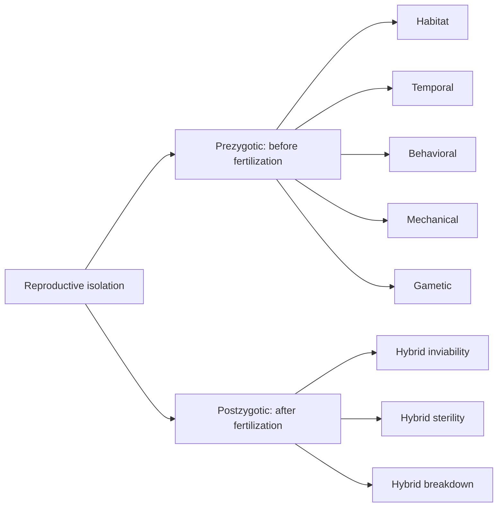

The last two lessons explained how allele frequencies change within a population. But evolution has also produced millions of separate species. This lesson asks how one species becomes two, and how biologists draw the resulting family tree of life from evidence.

## What is a species?

The most widely used definition is the biological species concept, proposed by Ernst Mayr in 1942: a species is a group of populations whose members can interbreed in nature and produce fertile offspring, and that cannot do so with other groups. Horses and donkeys can mate, but their offspring, mules, are almost always sterile, so horses and donkeys are separate species.

The definition has limits. It can't be applied to organisms that reproduce asexually, like bacteria, or to fossils, whose breeding can't be observed. For those, biologists group organisms by shared physical features or DNA sequences. All definitions agree on the central idea: a species is a separate branch of the tree of life, evolving independently of other branches.

**Speciation** is the process by which one species splits into two or more. The key event is the evolution of reproductive isolation.

## Reproductive isolation

**Reproductive isolation** is anything that prevents members of two groups from interbreeding or from producing fertile offspring. Once gene flow between two groups stops, mutation, selection and drift act on each separately, and they drift further apart. The barriers fall into two families, sorted by whether they act before or after an egg is fertilized:



Barriers that act before fertilization (prezygotic barriers):

- *Habitat isolation:* the groups live in different places within the same area, for example one in water, one on land.
- *Temporal isolation:* they breed at different times of day or year. Where the ranges of the eastern and western spotted skunks meet, in the central United States, the eastern species mates in late winter and the western one in late summer.
- *Behavioral isolation:* courtship signals don't match. Many firefly species differ in their flash patterns, and females answer only their own species' pattern; many birds respond only to their own species' song.
- *Mechanical isolation:* reproductive structures don't fit, as in many insects and in flowers adapted to different pollinators.
- *Gametic isolation:* sperm and egg don't fuse. Sea urchins release gametes into open water, but proteins on the egg surface bind only sperm of the same species.

Barriers that act after fertilization (postzygotic barriers):

- *Hybrid inviability:* hybrid embryos fail to develop or die young.
- *Hybrid sterility:* hybrids survive but can't reproduce. A horse has 64 chromosomes and a donkey 62; a mule gets 63, and its chromosomes can't pair properly in meiosis (module 4), so it makes almost no working gametes.
- *Hybrid breakdown:* first-generation hybrids are fertile, but their offspring are weak or sterile.

### Example 1

Two populations of frogs live in the same pond. Population X calls and mates in March; population Y in May. In the lab, if eggs and sperm are combined, hybrid tadpoles develop normally and grow into fertile adults. Are they separate species, and what isolates them?

In nature, they never interbreed because they breed at different times: temporal isolation, a prezygotic barrier. Under the biological species concept they count as separate species, because they don't interbreed *in nature*. The lab result shows that no postzygotic barrier has evolved yet, a sign that the split is recent.

## How new species form

**Allopatric speciation** ("other homeland") begins when a population is split by a geographic barrier: a new mountain range, a river changing course, a rising sea, or a few individuals reaching an island. Gene flow stops. Each part then evolves on its own, through different mutations, different selection pressures and drift. If the parts later meet again, they may no longer be able to interbreed.

A clear natural test comes from the Isthmus of Panama. When the land bridge between North and South America closed about 3 million years ago, it split marine populations into a Caribbean group and a Pacific group. Snapping shrimp now come in matched pairs of species, one on each side, each pair more similar to each other than to any other species. In the lab, males and females from opposite sides of the isthmus rarely mate successfully.

Speciation can also happen without a geographic barrier, called sympatric speciation ("same homeland"):

- *Polyploidy.* An error in cell division can double a plant's chromosome number. A plant with four sets of chromosomes cannot produce fertile offspring with its two-set parents, so a new species can arise in one generation. Many crops, including wheat, cotton and potatoes, are polyploid.
- *Shifts in habitat or food.* In North America, some apple maggot flies began laying eggs on apples (introduced by European settlers) instead of native hawthorns. Flies mate on their host fruit, and apples ripen earlier than hawthorns, so the two groups are becoming isolated within the same area.

When one ancestral species gives rise to many species, each adapted to a different way of life, the result is called an adaptive radiation. The Galápagos finches, about 15 to 18 species descended from one ancestor that arrived roughly 2 million years ago, are a classic example, with beaks suited to seeds, insects, cactus or even blood.

## Phylogenetic trees

A **phylogenetic tree** is a diagram of the evolutionary relationships among organisms: a hypothesis about who descended from whom, built from evidence such as anatomy and DNA. To read one:

- The tips are present-day (or fossil) groups.
- Each branch point (node) stands for a common ancestor, and the branches above it are its descendants.
- The root, at the base, is the common ancestor of everything on the tree.
- Relatedness is measured by how recently two groups share a common ancestor, not by how close they sit on the page. Branches can be rotated around a node like a mobile without changing the tree.


In the figure, species D and E are each other's closest relatives; C is equally related to D and E; and A and B form their own clade.

A **clade** is an ancestor and all of its descendants: one complete branch. Biologists build trees from shared derived characters, traits that arose in a common ancestor and were passed on to its descendants (fur in mammals, for example). A descendant can later lose such a trait, as snakes lost their legs, which is one reason trees are built from many characters, and today mostly from DNA. Traits shared with distant groups, like a backbone among vertebrates, don't help sort the vertebrates.

### Example 2

Use the character table to build a tree for six vertebrates. (1 = present, 0 = absent.) The lamprey, which has none of the traits, is the outgroup.

| | Jaws | Bony skeleton | Four limbs | Amniotic egg | Hair |
|---|---|---|---|---|---|
| Lamprey | 0 | 0 | 0 | 0 | 0 |
| Shark | 1 | 0 | 0 | 0 | 0 |
| Trout | 1 | 1 | 0 | 0 | 0 |
| Frog | 1 | 1 | 1 | 0 | 0 |
| Lizard | 1 | 1 | 1 | 1 | 0 |
| Human | 1 | 1 | 1 | 1 | 1 |

Group by shared traits. Every animal but the lamprey has jaws, so the lamprey branches off first. Among the jawed animals, all but the shark have a bony skeleton, so the shark branches next. Then the trout (no limbs), then the frog (no amniotic egg), leaving lizard and human together. Each trait marks the branch where it first appeared:

```shape
{"width": 520, "segments": [{"from": [5, 0], "to": [5, 1]}, {"from": [5, 0], "to": [6, 0]}, {"from": [5, 1], "to": [6, 1]}, {"from": [4, 0.5], "to": [4, 2]}, {"from": [4, 2], "to": [6, 2]}, {"from": [4, 0.5], "to": [5, 0.5]}, {"from": [3, 1.25], "to": [3, 3]}, {"from": [3, 3], "to": [6, 3]}, {"from": [3, 1.25], "to": [4, 1.25]}, {"from": [2, 2.12], "to": [2, 4]}, {"from": [2, 4], "to": [6, 4]}, {"from": [2, 2.12], "to": [3, 2.12]}, {"from": [1, 3.06], "to": [1, 5]}, {"from": [1, 5], "to": [6, 5]}, {"from": [1, 3.06], "to": [2, 3.06]}, {"from": [0, 4.03], "to": [1, 4.03]}], "labels": [{"at": [6.9, 5], "text": "Lamprey"}, {"at": [6.9, 4], "text": "Shark"}, {"at": [6.9, 3], "text": "Trout"}, {"at": [6.9, 2], "text": "Frog"}, {"at": [6.9, 1], "text": "Lizard"}, {"at": [6.9, 0], "text": "Human"}, {"at": [3.5, 1.55], "text": "limbs"}, {"at": [2.5, 2.42], "text": "bone"}, {"at": [1.5, 3.36], "text": "jaws"}, {"at": [4.5, 0.8], "text": "amniotic egg"}, {"at": [5.5, 0.3], "text": "hair"}], "caption": "Tree built from the character table. Each label marks the branch where that trait arose."}
```

Each nested group is a clade: lizard + human (amniotes), frog + lizard + human (four-limbed animals), and so on.

### Example 3

On that tree, is the lizard more closely related to the frog or to the human?

Find the most recent common ancestor of each pair. Lizard and human share the node at the far right; lizard and frog share only the node before it, further back in time. So the lizard is more closely related to the human, even though lizards and frogs both depend on outside heat and look more alike to us. Looks can mislead; shared ancestry is what counts. This is also why biologists say birds belong in the reptile clade: DNA and fossils show that crocodiles are more closely related to birds than to lizards.

## The tree of all life

The same method scales up to every living thing. In the 1970s Carl Woese compared ribosomal RNA, a molecule every cell carries, and found that cells without a nucleus fall into two deeply separate groups. That work gave the three domains this course uses: Bacteria, Archaea and Eukarya (the eukaryotes: protists, fungi, plants and animals). All three trace back to one common ancestor of all living cells, at the root of the tree.

Exactly where eukaryotes attach to that tree is still being worked out, and the evidence has shifted. Since 2015, genomes of the Asgard archaea, first found in deep-sea sediment, have turned out to carry many genes once thought to exist only in eukaryotes. Most recent analyses place eukaryotes on a branch that grows out of the archaea, closest to the Asgard group: the first eukaryote seems to have formed when an archaeal cell took in a bacterium that became the mitochondrion (lesson 30). On that view the tree has two primary branches, Bacteria and Archaea, with eukaryotes nested inside the archaeal one. Biologists still use the three domains to sort living things because eukaryotes are so distinctive, and lesson 31 does the same. Either way, a tree is a hypothesis that is revised as evidence comes in.

## Common mistakes

- Reading relatedness from left-to-right order of the tips. Look for the most recent shared node.
- Thinking a tip is the ancestor of the tip next to it. Tips are the groups being compared (usually living ones); ancestors sit at the nodes.
- Thinking a group that branched off early is "less evolved." The lamprey's line has been evolving for exactly as long as ours.
- Calling any two populations that can make a hybrid one species. The test is fertile offspring in nature.
- Thinking speciation always needs a physical barrier. Polyploidy and habitat shifts can split populations that live together.

## Key points

- Biological species concept: populations that interbreed in nature and produce fertile offspring.
- Speciation requires reproductive isolation: prezygotic barriers (habitat, temporal, behavioral, mechanical, gametic) and postzygotic barriers (hybrid inviability, sterility, breakdown).
- Allopatric speciation follows geographic separation; sympatric speciation happens without it, often by polyploidy in plants.
- Phylogenetic trees show common ancestry; relatedness is judged by the most recent common ancestor.
- A clade is an ancestor and all its descendants, identified by shared derived characters.
- All life falls into three domains (Bacteria, Archaea, Eukarya); current evidence suggests eukaryotes arose from within the archaea.
